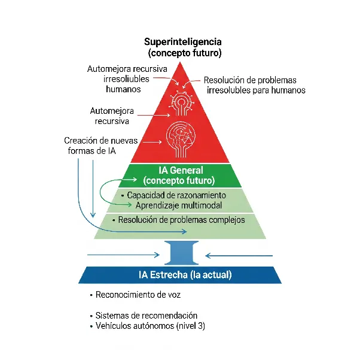
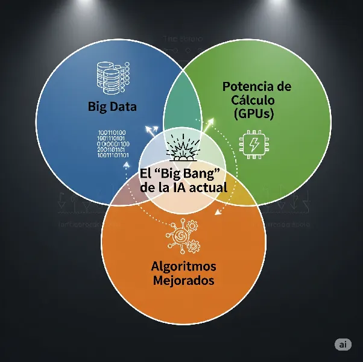

# 1. ¡Hola, IA! Desmitificando el futuro

!!! abstract "En este módulo"
    - Qué es (y qué no es) la Inteligencia Artificial.
    - En qué se parece y en qué se diferencia de la inteligencia humana.
    - Dónde la usas ya sin darte cuenta.
    - Por qué ha explotado precisamente ahora.

## 1. ¿Qué es (y qué no es) la Inteligencia Artificial?

Cuando escuchamos «Inteligencia Artificial», la mente suele volar hacia la ciencia ficción: robots con conciencia propia como en *Yo, robot*, o sistemas inquietantes como HAL 9000 en *2001: Una odisea del espacio*. Son historias fascinantes, pero la IA real es a la vez más sutil y más práctica.

En esencia, **la Inteligencia Artificial es el campo de la informática que crea sistemas capaces de realizar tareas que, tradicionalmente, han requerido inteligencia humana**: aprender, razonar, resolver problemas, percibir el entorno (ver, oír) y entender o producir lenguaje.

La definición oficial europea va en la misma línea. El Reglamento Europeo de IA describe un sistema de IA como un sistema basado en máquinas que, a partir de la información que recibe, **infiere** cómo generar resultados (predicciones, contenidos, recomendaciones o decisiones) que pueden influir en entornos físicos o virtuales. La palabra clave es *infiere*: no sigue solo reglas escritas a mano, sino que extrae conclusiones de los datos.

La IA que usamos hoy **no tiene conciencia, sentimientos ni deseos propios**. Tradicionalmente se la llama **IA débil o estrecha** (*ANI, Artificial Narrow Intelligence*), porque cada sistema está diseñado y entrenado para un tipo de tarea concreto. Una IA que juega al ajedrez no sabe redactar un correo ni reconocer una cara; simplemente calcula jugadas con una eficacia sobrehumana.

!!! note "Un matiz importante (2026)"
    Los grandes modelos de lenguaje como ChatGPT, Gemini o Claude han difuminado esa frontera: un mismo modelo traduce, programa, resume, analiza imágenes y razona sobre problemas variados. Por eso muchos expertos los llaman **modelos de propósito general**. Aun así, no son la «IA general» de la ciencia ficción: cometen errores de sentido común, no tienen experiencias propias y no aprenden por sí solos de su día a día. Lo veremos en el [módulo 3](03-tipos-de-ia.md).

La clave para desmitificar la IA es verla como una **herramienta avanzada**. Igual que un martillo amplía la fuerza del brazo, la IA amplía nuestra capacidad de analizar datos, encontrar patrones y tomar decisiones basadas en ellos. **No es magia: es estadística, matemáticas y computación a una escala gigantesca.**

<figure markdown="span">
  { width="520" loading=lazy }
  <figcaption>Los tres niveles que se suelen distinguir. Hoy solo existe el escalón inferior (IA estrecha); la IA general y la superinteligencia son hipótesis de futuro.</figcaption>
</figure>

## 2. Inteligencia humana vs. artificial

Para entender la IA es útil compararla con nuestra propia inteligencia, reconociendo sus profundas diferencias.

La **inteligencia humana** es versátil y adaptable. Se basa en años de experiencia, en un contexto cultural y social, y en emociones que influyen en nuestro juicio. Aprendemos con pocos ejemplos (a un niño le basta ver un par de jirafas para reconocerlas siempre), entendemos el sarcasmo y el lenguaje no verbal, y **transferimos** lo aprendido entre ámbitos muy distintos.

La **inteligencia artificial** actual funciona de otra manera: procesa cantidades masivas de datos para encontrar **patrones estadísticos**.

| | Inteligencia humana | IA actual |
|---|---|---|
| **Aprendizaje** | Con pocos ejemplos | Necesita miles o millones de ejemplos |
| **Velocidad y escala** | Limitada | Analiza millones de datos en segundos |
| **Transferencia** | Aplica lo aprendido a otros ámbitos | Limitada; mejor dentro de lo que ha visto en el entrenamiento |
| **Sentido común** | Implícito y muy rico | Frágil; puede fallar en lo «obvio» |
| **Consumo energético** | ~20 W (el cerebro) | Desde vatios (un móvil) hasta megavatios (entrenar un gran modelo) |
| **Experiencia subjetiva** | Sí (emociones, conciencia) | No |

Algunas consecuencias prácticas:

- **Literalidad y ambigüedad.** Si a un generador de imágenes le pides «un ratón junto a un teclado», puede dibujar un roedor o un ratón de ordenador. Los modelos actuales resuelven bien muchas ambigüedades gracias al contexto, pero siguen fallando en casos que para nosotros son evidentes.
- **«Alucinaciones».** Un modelo de lenguaje puede inventarse con total seguridad una cita, una fecha o un enlace que no existe, porque genera el texto *más probable*, no el *verificado*. (De hecho, muchos de los enlaces de la versión original de este curso estaban inventados por una IA y han tenido que sustituirse).
- **Sin experiencia subjetiva.** La IA no siente alegría al acertar ni frustración al fallar; ajusta números en función de los resultados.

Una buena analogía: la IA es como **un erudito rapidísimo con una memoria enorme, pero sin experiencia del mundo**. El futuro no pasa porque una inteligencia sustituya a la otra, sino por su **colaboración**.

## 3. Ejemplos cotidianos: la IA que ya usas

La IA no es una tecnología del futuro: está integrada en nuestro día a día, casi siempre de forma invisible.

- **Entretenimiento.** Netflix, YouTube o Spotify analizan tu historial, lo que valoras, la hora a la que te conectas y lo que ven personas con gustos parecidos para recomendarte contenido (los llamados **sistemas de recomendación**). Incluso la imagen de portada que ves de una serie puede estar elegida para ti.
- **Asistentes de voz y chatbots.** Siri, Alexa, el Asistente de Google o ChatGPT en modo voz convierten tu voz en texto, entienden la intención y responden. Tus interacciones pueden usarse (según la configuración de privacidad) para mejorar los sistemas, aunque normalmente no aprenden «en directo» de cada conversación.
- **Navegación.** Google Maps o Waze combinan datos de tráfico en tiempo real enviados de forma anónima por millones de móviles con patrones históricos para predecir atascos y proponerte la ruta más rápida.
- **Redes sociales y correo.** El orden de tu *feed* de Instagram o TikTok lo decide un algoritmo. Gmail filtra el spam y la mayoría de los intentos de *phishing* con IA entrenada sobre miles de millones de correos.
- **Compras online.** «Los clientes que compraron esto también compraron…» es un sistema de recomendación basado en patrones de compra.
- **El móvil.** El modo retrato de la cámara, el desbloqueo facial, el texto predictivo del teclado, la transcripción de notas de voz o la búsqueda de fotos por contenido («perro en la playa») funcionan con IA, muchas veces dentro del propio teléfono.
- **Banca y salud.** Detección de fraudes con tarjeta en tiempo real, ayuda al diagnóstico por imagen, traducción automática…

!!! example "Actividad: entrena tu propia IA en 5 minutos"
    Entra en [Teachable Machine](https://teachablemachine.withgoogle.com/) (Google), elige «Proyecto de imagen» y enséñale a distinguir dos gestos con la cámara (por ejemplo, mano abierta y puño cerrado) con unas 30 fotos de cada uno. Después prueba a engañarla: cambia la luz, el fondo o usa la otra mano. **¿Qué aprendió realmente la IA?** Es la mejor forma de ver de primera mano qué es aprender de ejemplos.

## 4. ¿Por qué ahora? La tormenta perfecta

La idea de la IA tiene más de 70 años, pero en los últimos 10-15 años sus capacidades se han disparado. La explicación es la confluencia de **tres factores**:

<figure markdown="span">
  { width="480" loading=lazy }
  <figcaption>La «tormenta perfecta»: datos masivos, hardware potente y mejores algoritmos.</figcaption>
</figure>

1. **Big Data (datos masivos).** El aprendizaje automático necesita «combustible», y ese combustible son los datos. Con internet, los móviles y la digitalización generamos cantidades astronómicas de texto, fotos, vídeos, compras, búsquedas… Proyectos como **ImageNet** (2009), con más de 14 millones de imágenes etiquetadas a mano, o los rastreos masivos de la web, hicieron posible entrenar modelos que antes no tenían de qué aprender.
2. **Potencia de cálculo (GPUs).** Entrenar un modelo exige billones de operaciones matemáticas sencillas (sobre todo multiplicaciones de matrices). Las CPU son excelentes para tareas variadas una tras otra; las **GPU** (tarjetas gráficas), diseñadas para los videojuegos, hacen **miles de operaciones en paralelo**. En 2007 NVIDIA lanzó **CUDA**, que permitió programarlas para cualquier cálculo, y en 2012 una red entrenada con dos GPU de consumo (AlexNet) revolucionó el campo. Hoy existen chips diseñados específicamente para IA (GPUs de centro de datos, TPUs de Google). Lo verás en el [módulo 9](09-hardware.md).
3. **Algoritmos mejorados.** Las redes neuronales existen desde los años 50, pero se perfeccionaron técnicas clave: la **retropropagación** para entrenarlas (popularizada en 1986), funciones de activación como ReLU, técnicas contra el sobreajuste y, sobre todo, la arquitectura **Transformer** (2017), base de todos los chatbots actuales.

En resumen: **datos para aprender + hardware para procesar + algoritmos para darles sentido.** A esto se suma un cuarto factor más reciente: la **inversión masiva** de empresas y gobiernos, que ha convertido la IA en una prioridad económica y geopolítica.

!!! question "Para reflexionar"
    Piensa en las aplicaciones que has usado hoy. ¿En cuántas crees que había IA? ¿En alguna te ha tomado una decisión (qué ver, qué ruta seguir, qué correo leer) sin que lo notaras?

## Para ampliar

**Artículos**

- [¿Qué es la inteligencia artificial?](https://www.oracle.com/es/artificial-intelligence/what-is-ai/) (Oracle): explicación clara de los conceptos fundamentales.
- [¿Qué es la Inteligencia Artificial (IA)?](https://www.ibm.com/es-es/think/topics/artificial-intelligence) (IBM): visión completa, desde la definición hasta los tipos de IA.
- [Inteligencia artificial](https://es.wikipedia.org/wiki/Inteligencia_artificial) (Wikipedia): artículo enciclopédico con historia, técnicas y debates.
- [Unidad de procesamiento gráfico (GPU)](https://es.wikipedia.org/wiki/Unidad_de_procesamiento_gr%C3%A1fico) (Wikipedia): qué es una GPU y por qué calcula en paralelo.

**Vídeos**

- :material-youtube: [¿Qué es y cómo funciona la Inteligencia Artificial?](https://www.youtube.com/watch?v=_tA5cinv0U8) (Derivando, 8 min): una introducción excelente y amena.
- :material-youtube: [¿Qué es la IA y cómo funciona? Explicado con dibujos](https://www.youtube.com/watch?v=-NXUk2P2qKc) (CIENCiTECH, 2 min).
- :material-youtube: [¿Por qué las GPUs son buenas para la IA?](https://www.youtube.com/watch?v=C_wSHKG8_fg) (Dot CSV, 35 min): la parte de hardware de la «tormenta perfecta», en profundidad.

**Para experimentar**

- :material-gesture-tap: [Teachable Machine](https://teachablemachine.withgoogle.com/): entrena un modelo de imágenes, sonidos o posturas sin escribir código.
- :material-gesture-tap: [Quick, Draw!](https://quickdraw.withgoogle.com/): dibuja y una red neuronal intenta adivinar qué es.
- :material-school: [Elements of AI](https://course.elementsofai.com/es/): curso gratuito en español de la Universidad de Helsinki, pensado para quien no programa.

