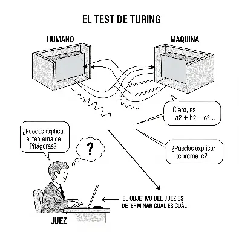
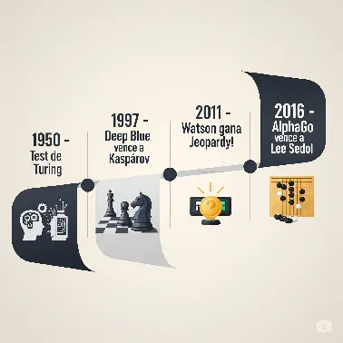
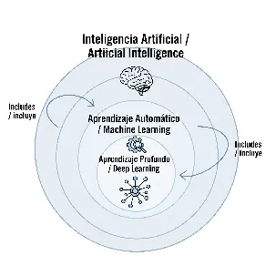

# 2. Un breve viaje en el tiempo

!!! abstract "En este módulo"
    - Alan Turing y la pregunta fundacional: ¿pueden pensar las máquinas?
    - Los grandes hitos: de Deep Blue a AlphaGo y ChatGPT.
    - Los «inviernos» de la IA: cuando las promesas no se cumplieron.
    - El renacimiento gracias al Machine Learning y el Deep Learning.

## Línea del tiempo

| Año | Hito |
|---|---|
| **1950** | Turing publica «Computing Machinery and Intelligence» |
| **1956** | Conferencia de Dartmouth, nace el término «Inteligencia Artificial» |
| | Logic Theorist demuestra teoremas |
| **1958** | Perceptrón de Rosenblatt |
| **1966** | ELIZA, el primer chatbot |
| **1974-1980** | Primer invierno de la IA |
| **1980s** | Auge de los sistemas expertos |
| **1987-1993** | Segundo invierno de la IA |
| **1997** | Deep Blue vence a Kaspárov |
| **2011** | Watson gana en Jeopardy! |
| **2012** | AlexNet gana ImageNet, despega el Deep Learning |
| **2016** | AlphaGo vence a Lee Sedol |
| **2017** | Arquitectura Transformer |
| **2020** | AlphaFold resuelve el plegamiento de proteínas |
| **2022** | ChatGPT y la IA generativa llegan al gran público |
| **2024** | Premios Nobel para Hinton, Hopfield y Hassabis |

## 1. Los inicios: Alan Turing y la pregunta «¿Pueden pensar las máquinas?»

El sueño de crear seres artificiales inteligentes es antiguo (de los autómatas griegos al Golem), pero el debate moderno tiene un punto de partida claro: el matemático británico **Alan Turing** (1912-1954). Considerado uno de los padres de la informática, Turing fue clave en el descifrado de la máquina Enigma durante la Segunda Guerra Mundial y sentó las bases teóricas de la computación con su «máquina de Turing» (1936).

En su artículo de 1950, *Computing Machinery and Intelligence*, Turing evitó la enredada pregunta «¿Qué es pensar?» y la sustituyó por otra práctica y medible. Para responderla propuso el **«Juego de la imitación»**, hoy conocido como **test de Turing**.

<figure markdown="span">
  { width="460" loading=lazy }
  <figcaption>El test de Turing: un juez conversa por escrito con dos interlocutores ocultos y debe adivinar cuál es la máquina.</figcaption>
</figure>

La idea es sencilla: un juez humano conversa por texto con dos interlocutores ocultos, una persona y una máquina. Si el juez no consigue distinguir con fiabilidad cuál es cuál, se dice que la máquina ha «pasado» el test.

Lo brillante de la propuesta es que no se pregunta si la máquina *siente* o *piensa* como nosotros, sino si su **comportamiento** es indistinguible del nuestro. Turing predijo que hacia el año 2000 un ordenador engañaría al 30 % de los jueces en conversaciones de cinco minutos.

!!! info "¿Se ha superado el test de Turing?"
    Durante décadas ninguna máquina lo logró de forma convincente. En 2025, un estudio de la Universidad de California en San Diego (Jones y Bergen) realizó un test de Turing clásico a tres bandas y **GPT-4.5**, al que se pidió adoptar la personalidad de una persona joven, fue elegido como «el humano» el **73 %** de las veces, más que las propias personas reales. Muchos investigadores señalan que esto dice tanto sobre los límites del test como sobre la inteligencia de la máquina: imitar una conversación no equivale a comprender el mundo.

En **1956** se celebró la **conferencia de Dartmouth** (EE. UU.), organizada por John McCarthy, Marvin Minsky, Claude Shannon y Nathaniel Rochester. Allí se acuñó el término **«Inteligencia Artificial»** y se considera el nacimiento oficial de la disciplina.

## 2. Hitos clave: las «victorias» de la IA

Desde entonces, la IA ha avanzado a través de logros icónicos que, además de proezas técnicas, fueron símbolos que atrajeron la atención del público y la inversión.

- **Los primeros programas (1950-1960).** El *Logic Theorist* (1956), de Newell, Shaw y Simon, demostró teoremas de los *Principia Mathematica*. **ELIZA** (1966), de Joseph Weizenbaum en el MIT, simulaba a una psicoterapeuta reformulando las frases del usuario («Me siento triste» → «¿Por qué te sientes triste?»). Era muy rudimentaria, pero muchas personas le atribuían comprensión: el llamado **efecto ELIZA**, que sigue vigente con los chatbots actuales.
- **Deep Blue vence a Kaspárov (mayo de 1997).** El superordenador de IBM se enfrentó en una revancha al campeón mundial de ajedrez Garri Kaspárov. En 1996 había ganado Kaspárov (4-2); en 1997 ganó la máquina (3,5-2,5). Deep Blue no «entendía» el ajedrez: evaluaba unos **200 millones de posiciones por segundo** con fuerza bruta y reglas diseñadas por expertos.
- **Watson gana en *Jeopardy!* (2011).** Otro sistema de IBM venció a los mejores concursantes del programa de preguntas estadounidense, demostrando que podía interpretar preguntas ambiguas formuladas en lenguaje natural.
- **AlphaGo vence a Lee Sedol (marzo de 2016).** El programa de **DeepMind** (empresa de Google) derrotó 4-1 a Lee Sedol, uno de los mejores jugadores de go del mundo. Fue más impresionante que Deep Blue: el go tiene unas 10^170^ posiciones legales, muchísimas más que átomos en el universo observable (~10^80^), así que la fuerza bruta es imposible. AlphaGo combinaba **redes neuronales profundas** con aprendizaje por refuerzo (jugando millones de partidas contra sí mismo). Su famoso «movimiento 37» de la segunda partida sorprendió a los expertos por su creatividad.
- **AlphaFold (2020).** DeepMind resolvió en gran medida un problema biológico de 50 años: predecir la forma 3D de las proteínas a partir de su secuencia. Le valió a Demis Hassabis y John Jumper el **Premio Nobel de Química 2024**.
- **ChatGPT (noviembre de 2022).** OpenAI puso un gran modelo de lenguaje al alcance de cualquiera con un chat. Llegó a 100 millones de usuarios en unos dos meses, el crecimiento más rápido de una aplicación hasta entonces. Abrió la era de la **IA generativa** ([módulo 8](08-ia-generativa.md)).

<figure markdown="span">
  { width="460" loading=lazy }
  <figcaption>De la pregunta de Turing a AlphaGo: del cálculo puro a la estrategia y el lenguaje.</figcaption>
</figure>

## 3. Los «inviernos» de la IA: periodos de estancamiento

La historia de la IA no es una línea recta de progreso. Ha alternado ciclos de euforia con profundas decepciones y recortes de financiación, que los investigadores bautizaron como **«inviernos de la IA»**.

**Primer invierno (aprox. 1974-1980).** Los pioneros habían hecho promesas muy optimistas. Herbert Simon (que más tarde recibiría el Nobel de Economía) afirmó en 1965 que «en veinte años las máquinas serán capaces de hacer cualquier trabajo que pueda hacer un hombre». La realidad se impuso: los ordenadores no tenían potencia suficiente, y tareas que parecían sencillas, como entender una conversación o reconocer objetos, resultaron enormemente complejas. Además, en 1969 Minsky y Papert demostraron las limitaciones del perceptrón simple, lo que frenó la investigación en redes neuronales. En el Reino Unido, el **informe Lighthill** (1973) criticó duramente los resultados del campo, y en EE. UU. la agencia **DARPA** recortó drásticamente los fondos.

**Segundo invierno (aprox. 1987-1993).** En los 80 resurgió el interés gracias a los **sistemas expertos**, programas que capturaban el conocimiento de un especialista en forma de reglas «si… entonces…» (como XCON, que configuraba ordenadores en la empresa DEC). Tuvieron éxito comercial, pero eran caros de mantener y frágiles: ante un caso fuera de sus reglas fallaban por completo. En 1987 se hundió el mercado de las máquinas LISP (ordenadores especializados en IA) y la financiación volvió a desplomarse.

!!! tip "La lección de los inviernos"
    Gestionar las expectativas, desconfiar de las promesas exageradas y entender que los grandes saltos requieren avances simultáneos en **algoritmos, datos y hardware**. Hoy se debate si la inversión actual en IA es una burbuja: conocer la historia ayuda a valorar ese debate con perspectiva.

## 4. El renacimiento: el auge del Machine Learning y el Deep Learning

Tras el último invierno, a finales de los 90 y en los 2000 se impuso un enfoque distinto al de la IA simbólica basada en reglas: el **Machine Learning (aprendizaje automático)** y, más tarde, el **Deep Learning (aprendizaje profundo)**.

El cambio de paradigma fue fundamental: en lugar de programar a mano las reglas del conocimiento, se le da a la máquina **muchos ejemplos** y un algoritmo para que **descubra ella misma los patrones**. Este enfoque resultó mucho más robusto y escalable.

<figure markdown="span">
  { width="400" loading=lazy }
  <figcaption>El Deep Learning es una parte del Machine Learning, que a su vez es una parte de la IA.</figcaption>
</figure>

Figuras como **Geoffrey Hinton, Yann LeCun y Yoshua Bengio**, conocidos como los «padrinos del Deep Learning», siguieron investigando en redes neuronales cuando casi nadie creía en ellas. LeCun, por ejemplo, creó en los 90 redes convolucionales que leían cheques bancarios.

El momento decisivo llegó en **2012**: **AlexNet**, una red neuronal profunda creada por Alex Krizhevsky, Ilya Sutskever y Geoffrey Hinton, ganó el concurso de reconocimiento de imágenes **ImageNet** con un error (*top-5*) del **15,3 %**, frente al 26,2 % del segundo clasificado, casi 11 puntos menos. Fue el «momento Sputnik» del Deep Learning: demostró su poder y provocó una avalancha de inversión y talento.

Los reconocimientos llegaron después:

- **2018:** Hinton, LeCun y Bengio reciben el **Premio Turing**, el «Nobel de la informática».
- **2022:** **Premio Princesa de Asturias** de Investigación Científica para los tres y Demis Hassabis.
- **2024:** **Nobel de Física** para Geoffrey Hinton y John Hopfield por sus trabajos fundacionales en redes neuronales, y **Nobel de Química** para Hassabis y Jumper por AlphaFold.

Desde entonces, el Deep Learning ha impulsado los avances más espectaculares: asistentes de voz, traducción automática, coches autónomos y la IA generativa (ChatGPT, Gemini, Claude, Midjourney…).

## Para ampliar

**Artículos**

- [Prueba de Turing](https://es.wikipedia.org/wiki/Prueba_de_Turing) (Wikipedia): origen, variantes y críticas del test.
- [El juego de imitación de Turing y el pensamiento humano](http://www.scielo.org.co/scielo.php?script=sci_arttext&pid=S1794-47242008000200006) (SciELO): análisis más profundo de las implicaciones filosóficas.
- [Large Language Models Pass the Turing Test](https://arxiv.org/abs/2503.23674) (Jones y Bergen, 2025, en inglés): el estudio sobre GPT-4.5.
- [Deep Blue (computadora)](https://es.wikipedia.org/wiki/Deep_Blue_%28computadora%29) y [AlphaGo](https://es.wikipedia.org/wiki/AlphaGo) (Wikipedia).
- [Invierno IA](https://es.wikipedia.org/wiki/Invierno_IA) (Wikipedia): causas y consecuencias de los inviernos de la IA.
- [Hinton, LeCun, Bengio y Hassabis, Premio Princesa de Asturias 2022](https://www.fpa.es/es/premios-princesa-de-asturias/premiados/2022-geoffrey-hinton-yann-lecun-yoshua-bengio-y-demis-hassabis.html?texto=trayectoria) (Fundación Princesa de Asturias).
- [AlexNet](https://es.wikipedia.org/wiki/AlexNet) (Wikipedia).

**Vídeos**

- :material-youtube: [La prueba de Turing: ¿puede una computadora pasar por un ser humano?](https://www.youtube.com/watch?v=uN-HTAWV5ws) (TED-Ed en español, 5 min).
- :material-youtube: [El hombre vs. la máquina: Kaspárov contra Deep Blue](https://www.youtube.com/watch?v=z2Q8NNio_hk) (documental en español).
- :material-youtube: [AlphaGo, la película](https://www.youtube.com/watch?v=WXuK6gekU1Y) (Google DeepMind, documental completo con subtítulos).
- :material-youtube: [Inviernos en la inteligencia artificial](https://www.youtube.com/shorts/H4zuVlKm85U) (vídeo corto).
- :material-youtube: [La historia de la Inteligencia Artificial](https://www.youtube.com/watch?v=2ROswiaQeLo) (ConmiMente).
- :material-youtube: [Historia de la Inteligencia Artificial](https://www.youtube.com/watch?v=rTScSyzeDr4) (Biblioteca de Castilla-La Mancha).

