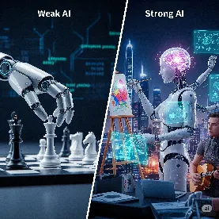
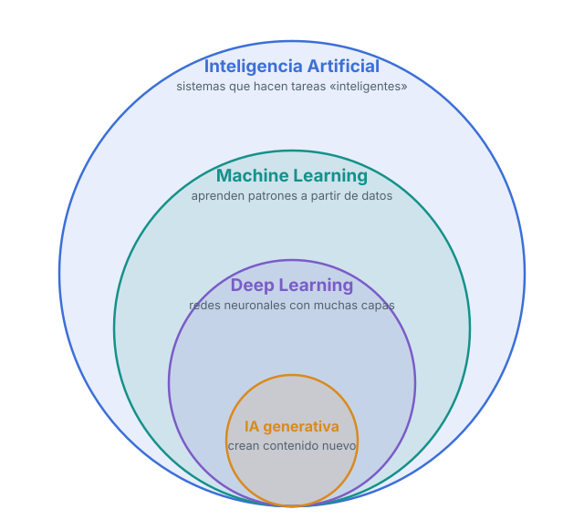
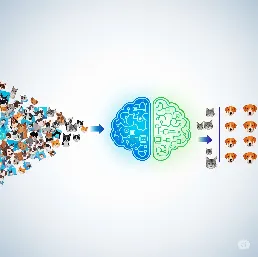

# 3. Los grandes tipos de IA

!!! abstract "En este módulo"
    - La IA que tenemos (débil o estrecha) y la que se busca (general).
    - Los tres grandes enfoques: IA simbólica, Machine Learning y Deep Learning.

## 1. IA débil (ANI) vs. IA fuerte o general (AGI)

Una de las distinciones más importantes en IA no es técnica, sino de **alcance**: la diferencia entre la IA que existe hoy y la que todavía pertenece a la investigación y la ciencia ficción.

<figure markdown="span">
  { width="460" loading=lazy }
</figure>

### IA débil o estrecha (ANI, *Artificial Narrow Intelligence*)

«Débil» o «estrecha» no significa poco potente, sino **especializada**: un experto increíble en su dominio e inútil fuera de él. AlphaGo vence al mejor jugador de go del mundo, pero no puede recomendarte una película. El algoritmo de Netflix sabe qué serie te gustará, pero no tiene ni idea de conducir. Son ejemplos de IA estrecha los filtros de spam, los sistemas de detección de fraude, el reconocimiento facial del móvil o el piloto automático de un coche.

### El caso especial de los grandes modelos actuales

¿Y ChatGPT, Gemini o Claude? Aquí el esquema clásico se queda corto. Un mismo modelo escribe, traduce, programa, resume, interpreta imágenes, resuelve problemas de matemáticas y conversa sobre casi cualquier tema. No es una IA «estrecha» en el sentido tradicional, por eso se habla de **modelos de propósito general** (la ley europea los llama *modelos de IA de uso general*).

Pero tampoco son una IA general en sentido pleno:

- Su conocimiento se fija durante el entrenamiento y no aprenden de forma continua de su experiencia.
- Pueden fallar en razonamientos sencillos para una persona o inventarse datos («alucinaciones»).
- No tienen cuerpo, objetivos propios ni experiencia del mundo físico.

Si estamos más o menos cerca de la AGI es uno de los grandes debates actuales: algunos líderes de empresas de IA la anuncian para pocos años, mientras que otros investigadores (como Yann LeCun) creen que faltan avances fundamentales.

### IA fuerte o general (AGI, *Artificial General Intelligence*)

Es la meta a largo plazo, el «santo grial» de la investigación. Una AGI tendría una inteligencia comparable a la humana en **flexibilidad**: podría aprender cualquier tarea intelectual, razonar en situaciones nuevas y **transferir** conocimiento de un dominio a otro, como hacemos nosotros. Aprendería ajedrez y usaría esas habilidades para planificar un negocio, o aprendería a cocinar leyendo un recetario.

**Hoy no existe ninguna AGI** y no hay consenso ni siquiera sobre cómo medirla. Construirla es un reto enorme, entre otras cosas porque no entendemos del todo cómo funciona nuestra propia inteligencia general.

### Superinteligencia (ASI, *Artificial Superintelligence*)

Es un intelecto hipotético que **superaría ampliamente** a la inteligencia humana en todos los campos. Este concepto alimenta los mayores debates éticos y de seguridad a largo plazo (¿cómo garantizar que sus objetivos estén alineados con los nuestros?), pero sigue siendo puramente teórico.

| | ANI (estrecha) | Modelos de propósito general | AGI (general) | ASI (superinteligencia) |
|---|---|---|---|---|
| **¿Existe?** | Sí | Sí (desde ~2022) | No | No |
| **Alcance** | Una tarea | Muchas tareas de texto, imagen y código | Cualquier tarea intelectual humana | Supera a los humanos en todo |
| **Ejemplos** | Filtro de spam, AlphaGo | ChatGPT, Gemini, Claude | — | — |

## 2. Las tres ramas principales de la IA

Dentro de la IA existen distintos enfoques sobre cómo construir sistemas inteligentes. Hoy domina el Machine Learning, pero conviene conocer el enfoque histórico que lo precedió.

<figure markdown="span">
  { .diagrama width="420" }
  <figcaption>Las ramas no son independientes: el Deep Learning es un tipo de Machine Learning, y la IA generativa actual se basa en Deep Learning.</figcaption>
</figure>

### a) IA simbólica (GOFAI)

Fue el enfoque dominante desde los años 50 hasta los 80. El filósofo John Haugeland la bautizó en 1985 como **GOFAI** (*Good Old-Fashioned AI*, «la buena IA de toda la vida»).

La idea central es que la inteligencia se logra **manipulando símbolos mediante reglas lógicas**. Es un enfoque **de arriba abajo**: un experto humano define el conocimiento como un conjunto de reglas explícitas («SI el semáforo está en rojo, ENTONCES detener el coche») y la máquina las aplica para razonar.

Su mayor éxito fueron los **sistemas expertos** de los 80. MYCIN, por ejemplo, recomendaba antibióticos a partir de unas 600 reglas escritas con médicos. Funcionaban bien en dominios cerrados, pero tenían grandes limitaciones:

- **Fragilidad:** no sabían manejar situaciones no previstas en sus reglas.
- **Coste:** extraer y codificar el conocimiento de un experto era lento y caro.
- **No aprendían:** ante una enfermedad nueva había que reprogramarlos a mano.

La IA simbólica **sigue siendo útil** donde la explicabilidad y la certeza son cruciales: verificación de software y de chips, planificación logística, normativa fiscal o sistemas de control. Además, hoy se investiga la **IA neurosimbólica**, que combina redes neuronales con razonamiento lógico.

### b) Machine Learning (aprendizaje automático)

Representa un cambio de paradigma radical: un enfoque **de abajo arriba**. En lugar de darle a la máquina las reglas, **le damos los datos (y a menudo las respuestas), y ella misma infiere las reglas**.

Imagina un sistema que distinga fotos de gatos y perros. Con el enfoque simbólico habría que escribir reglas («SI tiene orejas puntiagudas Y bigotes largos, ENTONCES es un gato»), algo casi imposible por la enorme variedad de razas, posturas y fondos.

Con Machine Learning le mostramos al algoritmo miles de fotos etiquetadas como «gato» y como «perro». El algoritmo encuentra por sí mismo los patrones estadísticos (formas, texturas, proporciones) que los distinguen, y crea sus propias «reglas» internas, a menudo demasiado complejas para que una persona las entienda.

<figure markdown="span">
  { width="460" loading=lazy }
</figure>

Esta capacidad de aprender de los datos ha convertido al Machine Learning en el **corazón de la IA moderna**: sistemas de recomendación, diagnóstico médico, detección de fraude, previsión de demanda… Lo veremos a fondo en el [módulo 4](04-machine-learning.md).

### c) Deep Learning (aprendizaje profundo)

No es una rama separada, sino una **subcategoría muy potente del Machine Learning** que usa **redes neuronales artificiales profundas**, es decir, con muchas capas.

La inspiración viene, de forma muy libre, del cerebro: una red está formada por «neuronas» (pequeñas unidades de cálculo) organizadas en capas. Cada capa aprende patrones progresivamente más abstractos. En el ejemplo de gatos y perros:

1. Las **primeras capas** detectan cosas simples: bordes, esquinas, manchas de color.
2. Las **capas intermedias** combinan lo anterior en texturas y formas: ojos, orejas, hocicos.
3. Las **capas finales** reconocen partes del cuerpo y el animal completo.
4. La **capa de salida** decide: «Con un 98 % de probabilidad, esto es un gato».

La gran diferencia con el Machine Learning clásico es que **la red aprende sola qué características mirar**, mientras que antes era una persona quien debía decidir qué medir (por ejemplo, «longitud de las orejas»).

Esta estructura jerárquica permite abordar problemas enormemente complejos: reconocimiento de voz, traducción, conducción autónoma y la IA generativa. A cambio, necesita **muchos más datos y potencia de cálculo**. Lo verás en el [módulo 5](05-deep-learning.md).

| | IA simbólica | Machine Learning clásico | Deep Learning |
|---|---|---|---|
| **Quién define las reglas** | Una persona experta | El algoritmo, a partir de características elegidas por personas | El algoritmo, de principio a fin |
| **Datos necesarios** | Pocos | Cientos o miles | Miles a billones |
| **Explicabilidad** | Alta | Media | Baja («caja negra») |
| **Ejemplo** | Sistema experto médico | Predicción del precio de una vivienda | Reconocimiento facial, ChatGPT |

## Para ampliar

**Artículos**

- [¿Qué es la inteligencia artificial general (AGI)?](https://www.ibm.com/es-es/think/topics/artificial-general-intelligence) (IBM).
- [Inteligencia artificial general](https://es.wikipedia.org/wiki/Inteligencia_artificial_general) (Wikipedia).
- [Sistema experto](https://es.wikipedia.org/wiki/Sistema_experto) (Wikipedia): historia y funcionamiento de la IA simbólica aplicada.
- [¿Qué es el machine learning (aprendizaje automático)?](https://aws.amazon.com/es/what-is/machine-learning/) (Amazon Web Services).
- [¿Qué es el deep learning?](https://www.ibm.com/es-es/think/topics/deep-learning) (IBM).

**Vídeos**

- :material-youtube: [¿Qué es el Machine Learning? ¿Y Deep Learning? Un mapa conceptual](https://www.youtube.com/watch?v=KytW151dpqU) (Dot CSV, 8 min): imprescindible para ordenar los conceptos.
- :material-youtube: [Diferencia entre inteligencia artificial, machine learning y deep learning](https://www.youtube.com/watch?v=6iVUKYgOihQ) (AprendeIA con Ligdi Gonzalez, 13 min).
- :material-youtube: [ANI, AGI y ASI: los 3 tipos de inteligencia artificial](https://www.youtube.com/watch?v=2ks6JjrNHHM) (Creando Código Libre, 10 min).
- :material-youtube: [Is AI Really Superintelligence? ANI, AGI & ASI Explained](https://www.youtube.com/watch?v=0MvcuIrects) (IBM Technology, en inglés con subtítulos).

