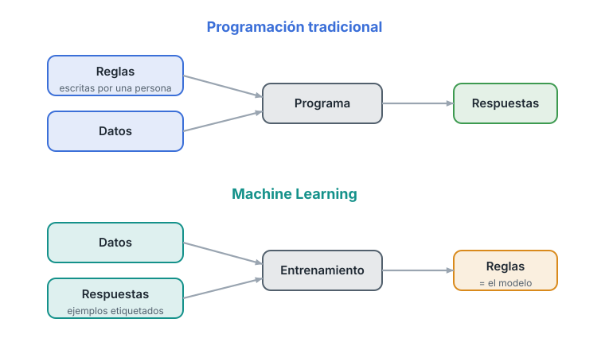
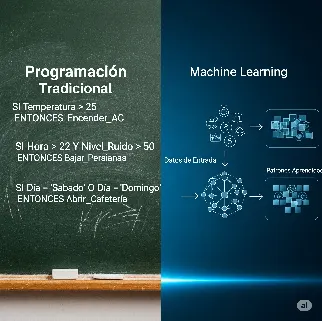
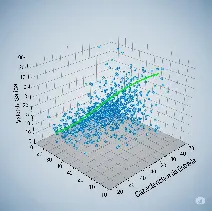
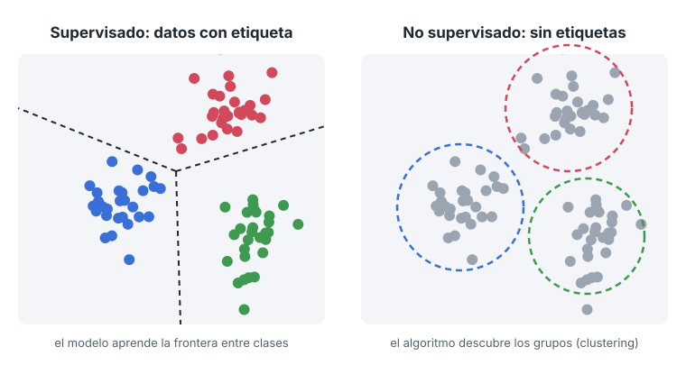
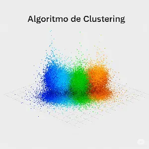

# 4. Machine Learning: el motor del cambio

!!! abstract "En este módulo"
    - De programar reglas a aprender de los datos.
    - Aprendizaje supervisado: clasificación y regresión.
    - Aprendizaje no supervisado: encontrar patrones ocultos.
    - Aprendizaje por refuerzo y autosupervisado.
    - Cómo se sabe si un modelo funciona: entrenamiento, prueba y sobreajuste.

## 1. El concepto clave: de programar reglas a aprender de los datos

Para entender la revolución del Machine Learning (ML), primero hay que contrastarla con la forma en que se ha construido software durante décadas: la **programación tradicional**.

En la programación tradicional, una persona analiza el problema y escribe instrucciones exactas. Para convertir euros a dólares basta con una regla: `dólares = euros × tipo_de_cambio`. Pero si la tarea está llena de excepciones, como detectar spam, escribir todas las reglas posibles («SI el correo contiene "lotería" O "premio"…») se vuelve titánico, ineficiente y fácil de burlar: basta con escribir «l0tería».

**El Machine Learning invierte el paradigma**: en vez de que el programador escriba las reglas, la máquina las descubre a partir de ejemplos.

<figure markdown="span">
  { .diagrama width="640" }
  <figcaption>En la programación tradicional las reglas son la entrada; en Machine Learning son el resultado.</figcaption>
</figure>

El proceso tiene cuatro pasos:

1. **Recopilar datos.** Para un filtro de spam, miles de correos etiquetados por personas como «spam» o «no spam».
2. **Entrenar.** Un algoritmo de aprendizaje analiza los ejemplos y busca patrones estadísticos. No «entiende» el texto, pero aprende que ciertas palabras, remitentes, enlaces u horas de envío se asocian con el spam.
3. **Obtener un modelo.** El resultado del entrenamiento no es código escrito por una persona, sino un **modelo**: un conjunto de parámetros (números) que codifican los patrones aprendidos.
4. **Predecir.** El modelo recibe un correo nuevo, que nunca ha visto, y estima si es spam.

En lugar de crear un programa que *sigue* instrucciones, creamos uno que *aprende* de la experiencia. Y cuando los spammers cambian de táctica, basta con reentrenar el modelo con ejemplos nuevos.

<figure markdown="span">
  { width="460" loading=lazy }
</figure>

## 2. Aprendizaje supervisado: aprender con «etiquetas»

Es el tipo de ML más común. Se llama **supervisado** porque se parece a un estudiante con un profesor: cada ejemplo de entrenamiento viene **etiquetado con la respuesta correcta**. El modelo compara sus predicciones con esas respuestas y se ajusta para equivocarse cada vez menos.

1. **Datos etiquetados:** por ejemplo, un historial de clientes donde sabemos quién compró (1) y quién no (0).
2. **Entrenamiento:** el algoritmo busca la relación entre las características (edad, visitas a la web, ubicación…) y la etiqueta.
3. **Modelo entrenado:** ha aprendido esa relación.
4. **Predicción:** ante un cliente nuevo, estima la probabilidad de que compre.

Dentro del aprendizaje supervisado hay dos grandes tipos de problemas.

### a) Clasificación: predecir una categoría

El objetivo es decir **a qué clase pertenece** un dato. La respuesta es una etiqueta, como en una pregunta tipo test.

- ¿Este correo es *spam* o *no spam*? (2 categorías)
- ¿Esta transacción es *fraudulenta* o *legítima*? (2 categorías)
- ¿El animal de la foto es un *perro*, un *gato*, un *pájaro* o un *pez*? (4 categorías)
- ¿La reseña es *positiva*, *negativa* o *neutra*? (3 categorías)

### b) Regresión: predecir un número

El objetivo es predecir un **valor numérico continuo**, como rellenar un hueco con una cifra.

- ¿Cuál será el **precio** de esta vivienda según sus metros, zona y habitaciones? (p. ej., 250 000 €)
- ¿Cuántas **unidades** venderemos el mes que viene? (p. ej., 1500)
- ¿Qué **temperatura** hará mañana en Madrid? (p. ej., 28,5 °C)
- ¿Cuántos **minutos** tardará el repartidor? (p. ej., 42)

<figure markdown="span">
  { width="420" loading=lazy }
  <figcaption>En regresión, el modelo aprende una línea (o superficie) que se ajusta lo mejor posible a los datos para predecir valores nuevos.</figcaption>
</figure>

!!! info "Un poco de matemáticas (opcional)"
    El modelo de regresión más sencillo es la **regresión lineal**: \( \text{precio} = a \cdot \text{metros} + b \). «Entrenar» consiste en encontrar los valores de \(a\) y \(b\) que hacen que los errores entre las predicciones y los precios reales sean lo más pequeños posible. Los modelos modernos hacen exactamente esto, pero con millones o billones de parámetros en lugar de dos.

Algoritmos clásicos de aprendizaje supervisado: regresión lineal y logística, árboles de decisión, *random forest*, *gradient boosting* (XGBoost) y máquinas de vectores de soporte (SVM). Para datos en tablas (ventas, clientes, sensores) **siguen siendo a menudo la mejor opción**, por delante del Deep Learning.

## 3. Aprendizaje no supervisado: encontrar patrones ocultos

En el aprendizaje no supervisado **no hay etiquetas**. No hay profesor que diga cuál es la respuesta correcta: le damos al modelo datos «en bruto» y le pedimos que **encuentre por sí mismo la estructura**, los patrones o los grupos que existan.

Es como darle a alguien una caja de frutas sin decirle sus nombres y pedirle que las organice: las agrupará por color, tamaño o forma. El aprendizaje no supervisado hace lo mismo, a gran escala y con datos mucho más complejos.

<figure markdown="span">
  { .diagrama width="680" }
  <figcaption>Los mismos puntos vistos de dos maneras. Con etiquetas (colores), el modelo aprende a separarlos; sin etiquetas, el algoritmo descubre los grupos por proximidad.</figcaption>
</figure>

### Clustering: agrupar por similitud

El tipo más común es el **clustering** (agrupamiento): formar grupos en los que los datos de un mismo grupo se parecen mucho entre sí y poco a los de otros grupos. El algoritmo más conocido es **K-means** (k-medias), que coloca *k* «centros» y los va moviendo hasta que cada uno queda en medio de un grupo de datos.

Aplicaciones prácticas:

- **Segmentación de clientes:** descubrir grupos como «clientes fieles de alto gasto», «cazadores de ofertas» o «nuevos y esporádicos» para diseñar campañas específicas.
- **Organización de documentos:** agrupar miles de noticias por tema sin que nadie defina los temas antes.
- **Detección de anomalías:** en ciberseguridad, el tráfico normal forma grupos densos; un ataque aparece como un punto aislado, fácil de detectar. Lo mismo vale para fraudes o averías en máquinas.
- **Genómica:** agrupar genes con patrones de expresión similares para identificar los relacionados con una enfermedad.

<figure markdown="span">
  { width="420" loading=lazy }
</figure>

Otra técnica no supervisada importante es la **reducción de dimensionalidad** (por ejemplo, PCA), que resume datos con cientos de variables en dos o tres para poder visualizarlos.

## 4. Otros dos tipos de aprendizaje imprescindibles

### Aprendizaje por refuerzo: aprender por ensayo y error

Un **agente** actúa en un entorno y recibe **recompensas o castigos** según el resultado de sus acciones. Nadie le dice qué hacer en cada paso: descubre la estrategia que maximiza la recompensa a largo plazo, como quien aprende a montar en bici a base de caerse.

- **AlphaGo** jugó millones de partidas contra sí mismo para mejorar.
- Robots que aprenden a andar o a coger objetos.
- Optimización del consumo energético de centros de datos.
- Los chatbots actuales se afinan con **RLHF** (aprendizaje por refuerzo con retroalimentación humana): personas puntúan respuestas y el modelo aprende a dar las preferidas. También se entrenan así los modelos de **razonamiento**, premiando las cadenas de pasos que llegan a la solución correcta.

### Aprendizaje autosupervisado: los datos se etiquetan solos

Etiquetar a mano millones de ejemplos es carísimo. El aprendizaje **autosupervisado** crea las etiquetas a partir de los propios datos: se tapa una parte y se pide al modelo que la adivine. Un gran modelo de lenguaje se entrena así, prediciendo la siguiente palabra de miles de millones de textos (la «respuesta correcta» es la palabra que realmente venía después). Es la clave de la IA generativa ([módulo 8](08-ia-generativa.md)).

| Tipo | ¿Hay etiquetas? | Pregunta típica | Ejemplo |
|---|---|---|---|
| Supervisado | Sí, puestas por personas | ¿Qué es esto? ¿Cuánto valdrá? | Filtro de spam, precio de una vivienda |
| No supervisado | No | ¿Qué grupos hay? ¿Qué es raro? | Segmentación de clientes |
| Por refuerzo | No; hay recompensas | ¿Qué acción me conviene? | AlphaGo, robots |
| Autosupervisado | Las generan los propios datos | ¿Qué falta aquí? | Entrenamiento de ChatGPT |

## 5. ¿Cómo sabemos si un modelo funciona?

Un modelo que acierta el 100 % de los ejemplos con los que se entrenó no tiene mérito: podría habérselos **memorizado**. Lo importante es que acierte con datos **nuevos**. Por eso los datos se dividen:

- **Conjunto de entrenamiento** (≈ 80 %): para aprender.
- **Conjunto de prueba** (≈ 20 %): se guarda aparte y solo se usa al final, como un examen con preguntas que el alumno no ha visto.

!!! warning "Sobreajuste (*overfitting*)"
    Es el error más típico: el modelo se aprende de memoria los datos de entrenamiento, incluido su «ruido», y luego falla con datos nuevos. Es como el estudiante que memoriza las respuestas del examen del año pasado en lugar de entender la materia. Lo contrario, un modelo demasiado simple que no capta el patrón, se llama **subajuste**.

Además, la «precisión» puede engañar. Si solo el 1 % de las transacciones son fraudulentas, un modelo que diga siempre «legítima» acierta el 99 %… y no sirve para nada. Por eso se usan otras métricas, como la **sensibilidad** (¿cuántos fraudes reales detecta?) y la **precisión** (de los que marca como fraude, ¿cuántos lo son?).

## Para ampliar

**Artículos**

- [¿Qué es el aprendizaje supervisado?](https://www.ibm.com/es-es/think/topics/supervised-learning) (IBM).
- [¿Qué es el aprendizaje no supervisado?](https://www.ibm.com/es-es/think/topics/unsupervised-learning) (IBM).
- [¿Qué es la agrupación de k-medias?](https://www.ibm.com/es-es/think/topics/k-means-clustering) (IBM).
- [Aprendizaje automático](https://es.wikipedia.org/wiki/Aprendizaje_autom%C3%A1tico), [Aprendizaje supervisado](https://es.wikipedia.org/wiki/Aprendizaje_supervisado) y [Aprendizaje no supervisado](https://es.wikipedia.org/wiki/Aprendizaje_no_supervisado) (Wikipedia).
- [Curso intensivo de Machine Learning](https://developers.google.com/machine-learning/crash-course?hl=es-419) (Google, gratuito, con visualizaciones interactivas).

**Vídeos**

- :material-youtube: [¿Qué es el Machine Learning? ¿Y Deep Learning? Un mapa conceptual](https://www.youtube.com/watch?v=KytW151dpqU) (Dot CSV).
- :material-youtube: [Machine Learning: aprendizaje supervisado, no supervisado y por refuerzo](https://www.youtube.com/watch?v=FMkxSsfvMI4) (BitBoss, 8 min).
- :material-youtube: [Aprendizaje supervisado: clasificación y regresión](https://www.youtube.com/watch?v=rLVuedvxOls) (OMES, 5 min).
- :material-youtube: [K-means clustering en español, en solo 5 pasos](https://www.youtube.com/watch?v=2kfY0R34Dy0) (AprendeInnovando, 5 min).
- :material-youtube: [Aprendizaje no supervisado: K-means clustering](https://www.youtube.com/watch?v=EZOab1vkFmI) (AprendeIA con Ligdi Gonzalez, 9 min).

**Para experimentar**

- :material-gesture-tap: [Teachable Machine](https://teachablemachine.withgoogle.com/): un ejemplo directo de aprendizaje supervisado (tú pones las etiquetas).

