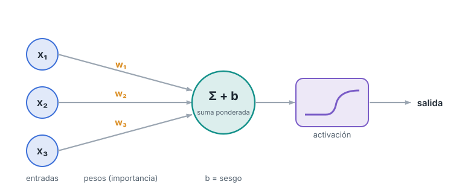
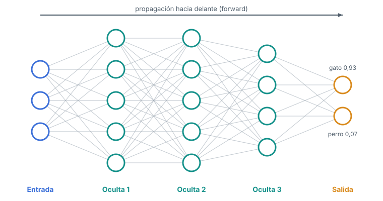
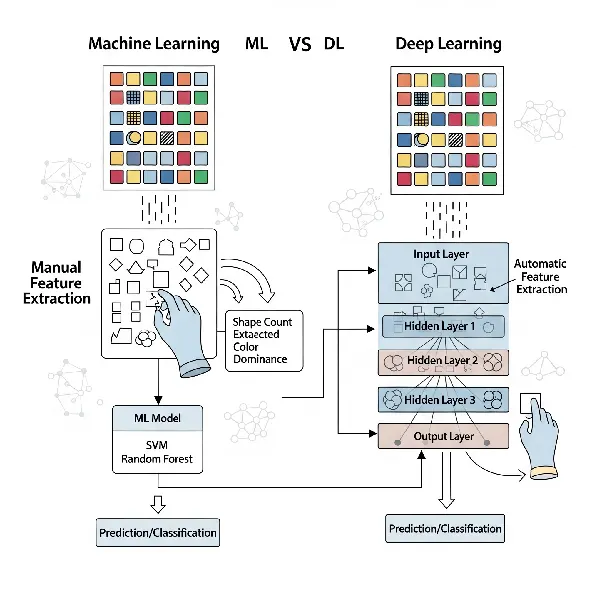
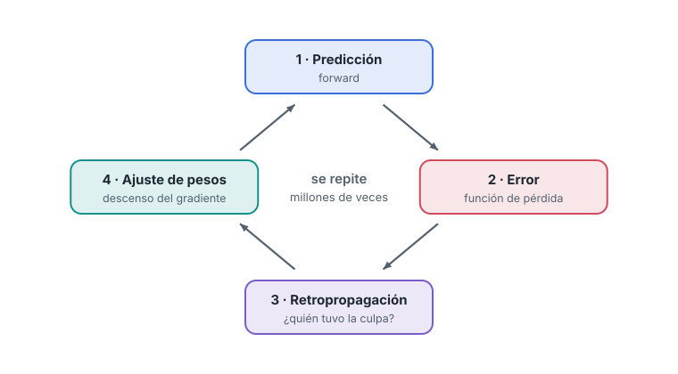
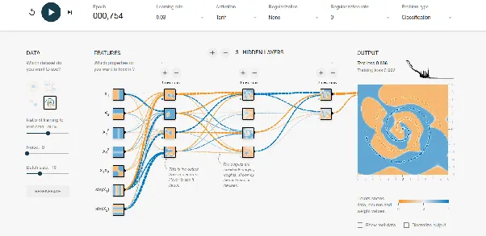
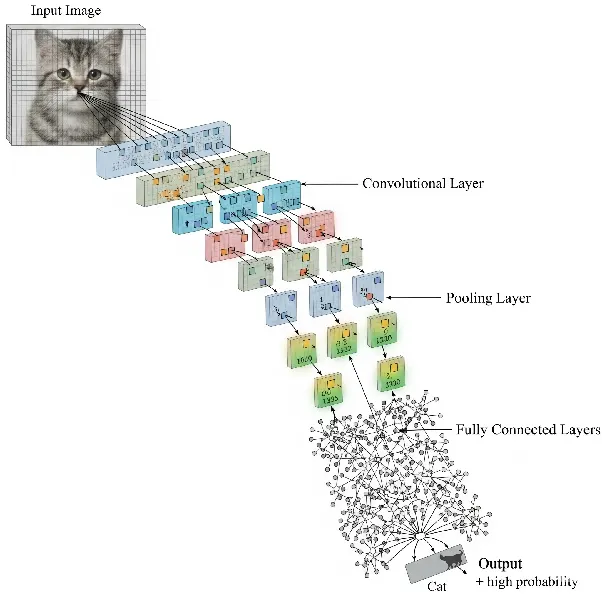

# 5. Deep Learning y las redes neuronales

!!! abstract "En este módulo"
    - Qué es una neurona artificial.
    - Cómo se organizan las neuronas en capas.
    - Cómo «aprende» una red: el ciclo de entrenamiento.
    - Aplicaciones estrella: imágenes y lenguaje.

## 1. Inspiración biológica: ¿qué es una neurona artificial?

El Deep Learning se inspira, de forma muy libre, en el cerebro. Su unidad básica es la **neurona artificial** (también llamada **nodo** o **unidad**). Es una **simplificación matemática** de una neurona biológica: no replica su complejidad, pero imita su función básica de recibir señales, combinarlas y transmitir una respuesta.

<figure markdown="span">
  { .diagrama width="660" }
  <figcaption>Una neurona artificial: multiplica cada entrada por su peso, lo suma todo con el sesgo y pasa el resultado por una función de activación.</figcaption>
</figure>

Funciona en cuatro pasos:

1. **Recibe entradas.** Igual que una neurona biológica recibe señales por sus dendritas, la artificial recibe varios números. Cada entrada tiene un **peso** (*weight*) que indica su importancia: un peso alto (positivo o negativo) significa que esa entrada influye mucho.
2. **Suma ponderada.** Multiplica cada entrada por su peso, lo suma todo y añade un valor llamado **sesgo** (*bias*), que desplaza el umbral a partir del cual la neurona «se activa»:

    \[ z = x_1 \cdot w_1 + x_2 \cdot w_2 + x_3 \cdot w_3 + b \]

3. **Función de activación.** El resultado pasa por una función que decide qué señal enviar. Las más usadas son **ReLU** (deja pasar los valores positivos y convierte los negativos en cero) y la **sigmoide** (convierte cualquier número en un valor entre 0 y 1). Sin esta función, apilar capas sería inútil: toda la red equivaldría a una única operación lineal y no podría aprender patrones complejos.
4. **Salida.** El valor resultante se envía a las neuronas de la capa siguiente.

!!! info "Neurona artificial y perceptrón: ¿son lo mismo?"
    No exactamente. El **perceptrón** (Frank Rosenblatt, 1958) fue la primera neurona artificial que podía aprender. Usaba una activación de «todo o nada» (salida 0 o 1). Las neuronas actuales usan activaciones suaves como ReLU, que permiten entrenar redes de muchas capas. El perceptrón es el antepasado; la neurona moderna, su descendiente.

Una neurona sola solo toma decisiones muy simples. La «magia» aparece al conectar **miles, millones o billones** de ellas.

## 2. Arquitectura básica: capas de neuronas

Al conectar neuronas organizadas en **capas** obtenemos una **red neuronal artificial**:

<figure markdown="span">
  { .diagrama width="660" }
  <figcaption>La información fluye de izquierda a derecha. Cada línea es una conexión con su propio peso.</figcaption>
</figure>

1. **Capa de entrada.** Recibe los datos en bruto; no calcula nada. Tiene una neurona por cada característica: para predecir el precio de una vivienda a partir de sus metros, habitaciones y distancia al centro, 3 neuronas; para una imagen de 28×28 píxeles en escala de grises, 784 (una por píxel).
2. **Capas ocultas.** Son el corazón de la red. Se llaman «ocultas» porque no vemos directamente lo que hacen. Cada neurona recibe las salidas de la capa anterior, calcula y pasa el resultado. Aquí ocurre el **aprendizaje jerárquico** que vimos en el módulo 3: las primeras capas detectan rasgos simples y las siguientes los combinan en conceptos cada vez más complejos. Cuando hay varias capas ocultas hablamos de **red neuronal profunda**, y de ahí el nombre *Deep Learning*.
3. **Capa de salida.** Produce el resultado y su forma depende del problema:
    - **Regresión** (predecir un número): una neurona con el valor.
    - **Clasificación binaria** (gato o perro): una neurona con una probabilidad (0,9 = 90 % gato).
    - **Clasificación multiclase** (perro, gato, pájaro): una neurona por clase; sus probabilidades suman 100 % (función *softmax*).

La información fluye hacia delante, de la entrada a la salida, en lo que se llama **propagación hacia delante** (*forward propagation*).

!!! example "¿Cuántos parámetros tiene una red?"
    Cada conexión tiene un peso y cada neurona un sesgo. Una red modesta para reconocer dígitos (784 → 128 → 10 neuronas) ya tiene unos **100 000 parámetros**. GPT-3 tenía **175 000 millones**, y los modelos más grandes actuales superan el **billón**. Entrenar consiste, precisamente, en encontrar buenos valores para todos ellos.

<figure markdown="span">
  { width="500" loading=lazy }
  <figcaption>En el Machine Learning clásico una persona decide qué características medir; en el Deep Learning, la propia red las descubre.</figcaption>
</figure>

## 3. ¿Cómo «aprenden»? El proceso de entrenamiento

¿Cómo sabe la red si acierta? ¿Y cómo mejora? Mediante un ciclo de **predicción, evaluación y corrección**:

<figure markdown="span">
  { .diagrama width="600" }
</figure>

0. **Inicialización.** Los pesos y sesgos empiezan con valores **aleatorios** (pequeños). Al principio la red adivina al azar.
1. **Predicción (*forward*).** Se pasa un ejemplo (una foto de un gato) por la red y se obtiene una predicción. Al principio, quizá «perro, 80 %».
2. **Cálculo del error (función de pérdida).** Se compara la predicción con la etiqueta real («gato»). La **función de pérdida** (*loss*) mide cuánto se ha equivocado: error alto, predicción mala; error bajo, predicción buena.
3. **Retropropagación (*backpropagation*).** Es el paso clave, popularizado en 1986 por Rumelhart, Hinton y Williams. Recorriendo la red **de la salida hacia la entrada**, calcula cuánto ha contribuido cada peso al error (técnicamente, el **gradiente**). Es decir, reparte «la culpa».
4. **Ajuste de pesos (optimización).** Un algoritmo de optimización, el **descenso del gradiente** o una variante como **Adam**, mueve cada peso un poquito en la dirección que reduce el error. Es como girar millones de diales a la vez, muy poco a poco.

!!! tip "La metáfora de la montaña en la niebla"
    Imagina que estás en una montaña con niebla y quieres bajar al valle (el error mínimo). No ves el camino, pero notas la pendiente bajo tus pies. El descenso del gradiente consiste en dar un pequeño paso cuesta abajo, volver a tantear y repetir. El tamaño del paso es la **tasa de aprendizaje** (*learning rate*): si es demasiado grande, te pasas de largo; si es demasiado pequeño, tardas una eternidad.

Este ciclo se repite millones de veces, normalmente con **lotes** (*batches*) de ejemplos a la vez. Cada pasada completa por todos los datos se llama **época**. Poco a poco los pesos dejan de ser aleatorios y empiezan a representar los patrones reales de los datos.

!!! example "Actividad: entrena una red en el navegador"
    Entra en [TensorFlow Playground](https://playground.tensorflow.org/). Elige el conjunto de datos de la **espiral** (el más difícil) y pulsa ▶. Prueba primero con los conjuntos sencillos y luego:

    - Añade capas ocultas y neuronas con los botones **+**.
    - Cambia la activación (*Activation*) de *Tanh* a *ReLU*.
    - Añade características de entrada (por ejemplo, *sin(X₁)* y *sin(X₂)*).
    - Observa la gráfica de pérdida (*Test loss*): ¿baja o se estanca?

    **Pista para la espiral:** con 2 entradas (X₁, X₂) hacen falta varias capas ocultas con bastantes neuronas (por ejemplo, 3 capas de 6-8 neuronas) y paciencia; añadir *sin(X₁)* y *sin(X₂)* lo facilita mucho.

<figure markdown="span">
  { width="560" loading=lazy }
  <figcaption>TensorFlow Playground resolviendo el problema de la espiral.</figcaption>
</figure>

## 4. Aplicaciones estrella: imágenes y lenguaje

El Deep Learning ha transformado muchos campos, pero en dos su impacto ha sido revolucionario.

### a) Reconocimiento de imágenes (visión por computador)

Gracias a las **redes neuronales convolucionales** (CNN), las máquinas pasaron de distinguir formas simples a superar a las personas en algunas pruebas de reconocimiento de imágenes. Las CNN se inspiran en el **córtex visual** (los experimentos de Hubel y Wiesel con gatos en los años 60): en vez de mirar toda la imagen de golpe, pasan pequeños **filtros** que detectan rasgos locales (bordes, texturas) y los combinan capa a capa en formas y objetos.

<figure markdown="span">
  { width="440" loading=lazy }
  <figcaption>Una CNN: la imagen atraviesa capas de convolución (detectan rasgos) y de agrupación o <em>pooling</em> (resumen la información) hasta las capas finales, que clasifican.</figcaption>
</figure>

- **Clasificación de imágenes:** decir qué aparece en la foto (Google Fotos agrupa tus imágenes por contenido).
- **Detección de objetos:** localizar y etiquetar varios objetos en la misma imagen (los recuadros alrededor de coches, peatones y señales en un coche autónomo).
- **Segmentación:** decidir a qué objeto pertenece cada píxel; fundamental en imagen médica para delimitar tumores.
- **Reconocimiento facial:** desbloqueo del móvil, control de accesos.

Desde 2020 también se usan para visión los **Vision Transformers** (ViT), la misma arquitectura que en lenguaje.

### b) Procesamiento del lenguaje natural (PLN)

El Deep Learning también revolucionó cómo las máquinas entienden y generan lenguaje. Primero llegaron las **redes recurrentes** (RNN y LSTM), que leían el texto palabra a palabra con una especie de «memoria». Desde 2017, la arquitectura **Transformer** las ha sustituido casi por completo: procesa todas las palabras a la vez y usa un mecanismo de **atención** para relacionarlas entre sí, aunque estén lejos ([módulo 8](08-ia-generativa.md)).

- **Traducción automática:** Google Translate y DeepL mejoraron drásticamente con redes neuronales.
- **Análisis de sentimiento:** saber si una reseña o un comentario es positivo, negativo o neutro.
- **Asistentes y chatbots:** ChatGPT, Gemini, Claude o Copilot se basan en Transformers.
- **Resumen y generación de textos.**

<figure markdown="span">
  { width="460" loading=lazy }
</figure>

Imagen y lenguaje se han ido acercando hasta fusionarse en los **modelos multimodales**, que ven, leen, escuchan y hablan a la vez. Es el tema del siguiente módulo.

## Para ampliar

**Artículos**

- [¿Qué es una red neuronal?](https://www.ibm.com/es-es/think/topics/neural-networks) (IBM).
- [¿Qué es una red neuronal?](https://aws.amazon.com/es/what-is/neural-network/) (AWS).
- [¿Qué es el descenso de gradiente?](https://www.ibm.com/es-es/think/topics/gradient-descent) y [¿Qué es la retropropagación?](https://www.ibm.com/es-es/think/topics/backpropagation) (IBM).
- [¿Qué son las redes neuronales convolucionales?](https://www.ibm.com/es-es/think/topics/convolutional-neural-networks) (IBM).
- [Perceptrón](https://es.wikipedia.org/wiki/Perceptr%C3%B3n) y [Red neuronal convolucional](https://es.wikipedia.org/wiki/Red_neuronal_convolucional) (Wikipedia).

**Vídeos** (la serie de 3Blue1Brown es la mejor explicación visual que existe; está doblada al español)

- :material-youtube: [¿Qué es una red neuronal? Aprendizaje profundo, capítulo 1](https://www.youtube.com/watch?v=jKCQsndqEGQ) (3Blue1Brown Español, 21 min).
- :material-youtube: [Descenso de gradiente: cómo aprenden las redes neuronales, capítulo 2](https://www.youtube.com/watch?v=mwHiaTrQOiI) (3Blue1Brown Español, 21 min).
- :material-youtube: [¿Cómo funciona realmente la retropropagación? Capítulo 3](https://www.youtube.com/watch?v=ScVpPS_CFYc) (3Blue1Brown Español, 16 min).
- :material-youtube: [¿Qué es una red neuronal? Parte 1: la neurona](https://www.youtube.com/watch?v=MRIv2IwFTPg) (Dot CSV).
- :material-youtube: [Jugando con redes neuronales: TensorFlow Playground](https://www.youtube.com/watch?v=FVozZVUNOOA) (Dot CSV).
- :material-youtube: [¿Qué es el descenso del gradiente?](https://www.youtube.com/watch?v=A6FiCDoz8_4) (Dot CSV, 9 min).
- :material-youtube: [¡Redes neuronales convolucionales! ¿Cómo funcionan?](https://www.youtube.com/watch?v=V8j1oENVz00) (Dot CSV, 13 min).

**Para experimentar**

- :material-gesture-tap: [TensorFlow Playground](https://playground.tensorflow.org/): construye y entrena una red neuronal en el navegador.
- :material-gesture-tap: [CNN Explainer](https://poloclub.github.io/cnn-explainer/): mira por dentro, capa a capa, cómo una CNN clasifica una imagen (en inglés, muy visual).

