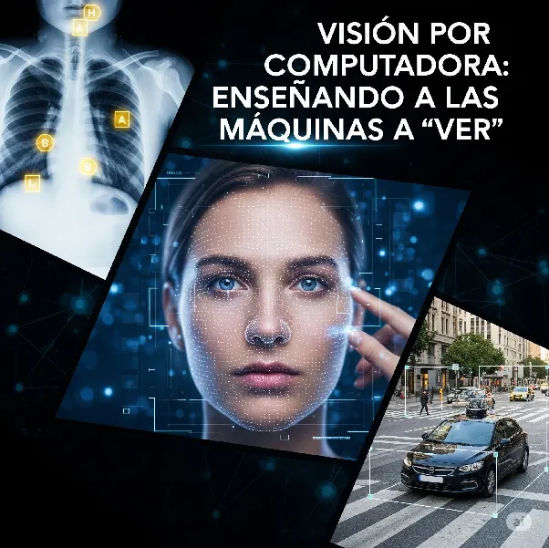
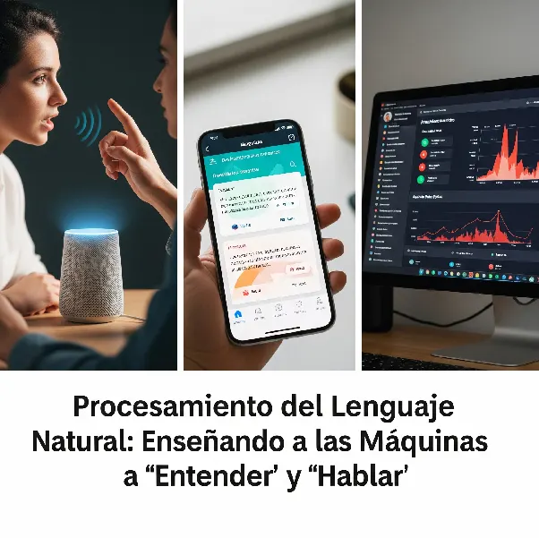
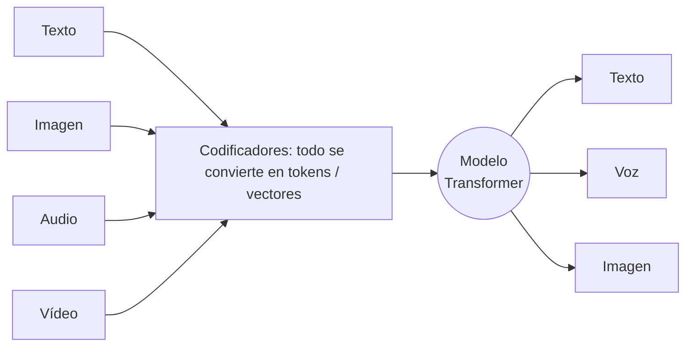

# 6. Multimodalidad: la IA que ve y habla

!!! abstract "En este módulo"
    - Visión por computador: enseñar a las máquinas a «ver».
    - Procesamiento del lenguaje natural: enseñarlas a «entender» y «hablar».
    - Voz: de la voz al texto y del texto a la voz.
    - Modelos multimodales: cuando todo se une en un solo sistema.

**Modalidad** es cada tipo de información: texto, imagen, audio, vídeo… Durante años, cada una tenía sus propios modelos especializados. Hoy los grandes modelos son **multimodales**: un mismo sistema lee, mira, escucha y responde. Para entenderlos, conviene ver primero cada sentido por separado.

## 1. Visión por computador: enseñar a las máquinas a «ver»

La **visión por computador** (o visión artificial) busca que las máquinas **interpreten imágenes y vídeos**: no solo registrar una foto como una cámara, sino extraer significado e identificar objetos, personas, lugares y acciones.

<figure markdown="span">
  { width="440" loading=lazy }
</figure>

Para un ordenador, una imagen es solo una **cuadrícula de números**: cada píxel tiene tres valores (rojo, verde y azul) entre 0 y 255. Una foto de 12 megapíxeles son 36 millones de números. La tarea de la visión artificial es encontrar sentido en esa enorme tabla, y las **redes convolucionales** (y ahora también los Transformers de visión) son las que lo han hecho posible.

- **Reconocimiento facial.** El móvil se desbloquea al reconocer tu cara. Los sistemas actuales no miden a mano distancias entre ojos y nariz (así funcionaban los primeros), sino que una red neuronal convierte cada cara en una **«huella numérica»** (un vector de cientos de números, llamado *embedding*); dos fotos de la misma persona producen vectores muy parecidos. El Face ID de Apple, además, usa un proyector infrarrojo para captar la forma 3D y no dejarse engañar con una foto.
- **Diagnóstico médico por imagen.** Redes entrenadas con miles de radiografías, mamografías, resonancias o imágenes de retina diagnosticadas por especialistas aprenden a detectar patrones sutiles. No sustituyen al médico: actúan como una **segunda opinión** que ayuda a detectar antes y a priorizar casos.
- **Coches autónomos.** La visión es uno de sus sentidos principales: varias cámaras detectan vehículos, peatones, ciclistas, señales y carriles en tiempo real. Muchos fabricantes (como Waymo, que ya opera taxis sin conductor en varias ciudades de EE. UU.) la combinan con **LiDAR** (láser que mide distancias) y **radar**; otros, como Tesla, apuestan solo por cámaras.
- **Otras aplicaciones:** control de calidad en fábricas, agricultura de precisión con drones, lectura automática de matrículas y documentos (OCR), inventario en tiendas, accesibilidad (apps que describen el entorno a personas ciegas).

## 2. Procesamiento del lenguaje natural (PLN)

El **PLN** (*NLP*, en inglés) se ocupa de la **interacción entre ordenadores y lenguaje humano**: que las máquinas lean, entiendan, interpreten y generen texto. El lenguaje es endiabladamente complejo: está lleno de ambigüedades («vi a Juan con el telescopio»: ¿quién tenía el telescopio?), ironía, dobles sentidos, errores y contexto cultural.

<figure markdown="span">
  { width="440" loading=lazy }
</figure>

### ¿Cómo «lee» una máquina? Tokens y *embeddings*

Los modelos no ven letras ni palabras como nosotros, sino **tokens**: trozos de palabra. Por ejemplo, «inteligentemente» podría partirse en «intelig» + «ente» + «mente». Cada token se convierte en un **vector de números** (*embedding*) de forma que las palabras con significado parecido quedan **cerca** en ese «espacio de significados». El ejemplo clásico: *rey − hombre + mujer ≈ reina*.

### Aplicaciones del PLN

- **Traducción automática.** Google Translate o DeepL no traducen palabra a palabra: leen la frase completa para captar su contexto y generan una traducción fluida en el idioma de destino.
- **Chatbots y asistentes.** Identifican tu **intención** (¿qué quieres hacer?) y las **entidades** (fechas, lugares, nombres), y responden en lenguaje natural o ejecutan una acción. Los modelos como ChatGPT mantienen conversaciones largas y coherentes.
- **Análisis de opiniones (*sentiment analysis*).** Las empresas clasifican automáticamente miles de reseñas, tuits o comentarios como positivos, negativos o neutros para detectar crisis o mejorar productos.
- **Otras:** correctores gramaticales, resumen de documentos, clasificación de correos, búsqueda semántica (encontrar documentos por su significado, no solo por palabras exactas).

## 3. La voz: oír y hablar

- **Reconocimiento automático del habla (ASR):** convierte voz en texto. Modelos como **Whisper** (OpenAI, de código abierto) transcriben decenas de idiomas con gran precisión; es lo que usan los subtítulos automáticos o el dictado del móvil.
- **Síntesis de voz (TTS):** convierte texto en voz. Las voces actuales son casi indistinguibles de las humanas e incluso pueden **clonar una voz** con unos segundos de grabación (con los riesgos que veremos en el [módulo 11](11-etica.md)).

## 4. Modelos multimodales: todo en uno

Desde 2023, los grandes modelos (GPT-4o y sucesores, Gemini, Claude…) son **multimodales**: aceptan texto, imágenes, documentos, audio e incluso vídeo en la misma conversación, y pueden responder con texto, voz o imágenes.

La idea clave es que **todo se convierte al mismo «idioma» interno de vectores**: la imagen se trocea en parches que se tratan como tokens, el audio en fragmentos… y el modelo los procesa juntos. Un precursor importante fue **CLIP** (OpenAI, 2021), que aprendió a situar imágenes y sus descripciones en el mismo espacio de significados.

Ejemplos de lo que permiten:

- Hacer una foto a un problema de matemáticas escrito a mano y pedir que lo explique paso a paso.
- Subir un gráfico o una factura y preguntar por los datos.
- Conversar por voz en tiempo real, con interrupciones y cambios de tono.
- Apuntar con la cámara del móvil a un objeto y preguntar qué es o cómo se repara.
- Analizar un vídeo largo y resumir lo que ocurre.

!!! example "Actividad"
    Con un asistente multimodal (ChatGPT, Gemini, Claude o Copilot), haz una foto a algo de tu entorno (una planta, un enchufe, una etiqueta de ropa) y pregúntale qué es y qué puede decirte de ello. Después **comprueba la respuesta** en otra fuente. ¿Acertó? ¿Inventó algo?

## Para ampliar

**Artículos**

- [¿Qué es la visión por computadora?](https://www.ibm.com/es-es/think/topics/computer-vision) (IBM).
- [¿Qué es la visión artificial?](https://aws.amazon.com/es/what-is/computer-vision/) (AWS).
- [¿Qué es el procesamiento del lenguaje natural?](https://aws.amazon.com/es/what-is/nlp/) (AWS).
- [¿Qué es el PLN?](https://www.ibm.com/es-es/think/topics/natural-language-processing) (IBM).
- [Visión artificial](https://es.wikipedia.org/wiki/Visi%C3%B3n_artificial) y [Procesamiento de lenguajes naturales](https://es.wikipedia.org/wiki/Procesamiento_de_lenguajes_naturales) (Wikipedia).

**Vídeos**

- :material-youtube: [¿Qué es visión por computadora? Explicación sencilla en 3 minutos](https://www.youtube.com/watch?v=45bTuCeF0b4) (Mente Artificial IA).
- :material-youtube: [Redes neuronales convolucionales: clasificación avanzada de imágenes](https://www.youtube.com/watch?v=4sWhhQwHqug) (Ringa Tech, 24 min).
- :material-youtube: [Intro al Natural Language Processing: de palabras a vectores](https://www.youtube.com/watch?v=Tg1MjMIVArc) (Dot CSV, 11 min).
- :material-youtube: [¿Qué es la NLP y cómo funciona?](https://www.youtube.com/watch?v=RACMePfrhfM) (Mente Artificial IA, 5 min).

