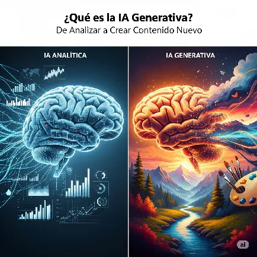
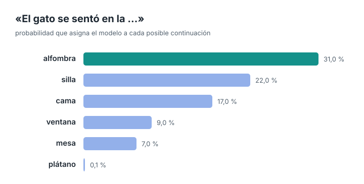
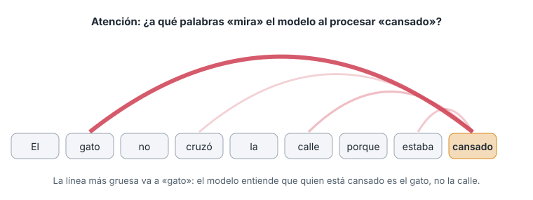
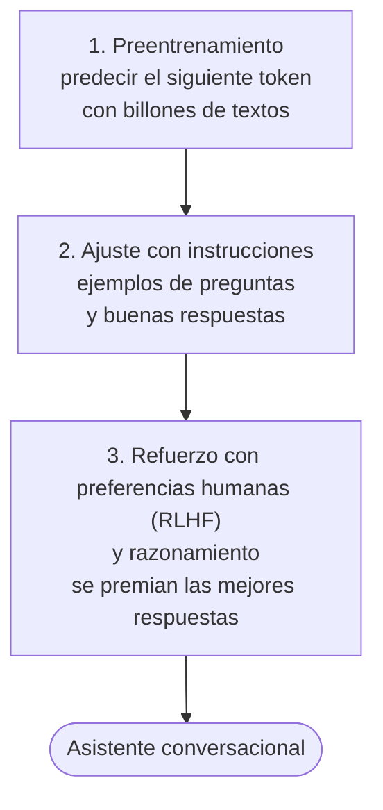
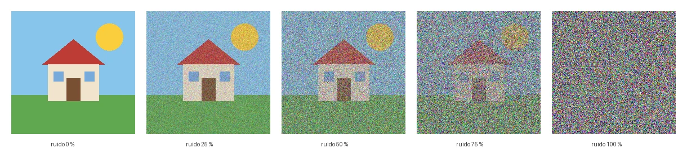
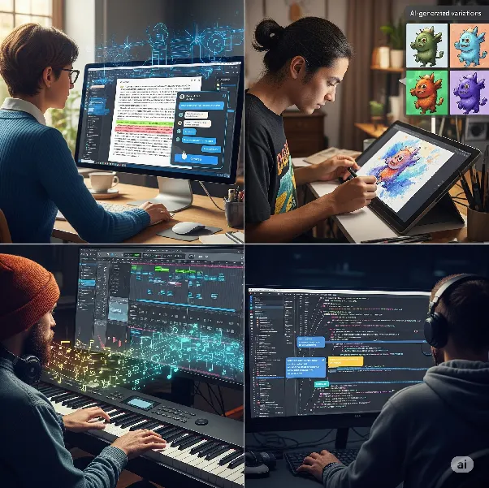

# 8. La revolución de la IA generativa

!!! abstract "En este módulo"
    - Qué es la IA generativa: de analizar a crear.
    - Los grandes modelos de lenguaje (LLM): el cerebro de ChatGPT, Gemini o Claude.
    - Cómo se generan imágenes: los modelos de difusión.
    - Aplicaciones prácticas, límites y buenas prácticas (*prompting*).

## 1. ¿Qué es la IA generativa? De analizar a crear contenido nuevo

Hasta hace poco, casi toda la IA que usábamos era **analítica** o **predictiva**: clasificaba datos («esto es spam») o predecía resultados («esta casa valdrá X»). La **IA generativa** supone un cambio de paradigma: **crea contenido nuevo**, ya sea texto, imágenes, música, voz, código, vídeo o modelos 3D.

El resultado no es una copia de algo que el modelo haya visto, sino una **combinación nueva** basada en los patrones, estilos y estructuras que aprendió de enormes cantidades de datos.

<figure markdown="span">
  { width="460" loading=lazy }
</figure>

Una analogía musical:

- Una **IA predictiva** escucha miles de canciones y predice si una nueva será un éxito.
- Una **IA generativa** escucha esas mismas canciones y **compone** una pieza nueva al estilo de Mozart o una canción pop que nunca ha existido.

Por debajo, los modelos generativos aprenden la **distribución de probabilidad** de los datos: qué elementos suelen aparecer juntos y en qué orden. Si aprende que «cielo» suele ir con «azul» y «nubes», puede describir un paisaje coherente; si ha visto millones de imágenes con sus descripciones, puede dibujar «un astronauta montando a caballo en Marte al estilo de Van Gogh».

## 2. Modelos de lenguaje grandes (LLM)

El motor de ChatGPT (OpenAI), Gemini (Google), Claude (Anthropic), Llama (Meta), Mistral, DeepSeek o Copilot es un **modelo de lenguaje grande** o **LLM** (*Large Language Model*): una red neuronal profunda basada en la arquitectura **Transformer**, presentada por investigadores de Google en el artículo *Attention Is All You Need* (2017). Se entrena con cantidades descomunales de texto: libros, webs, artículos científicos, código… Los modelos actuales ven **decenas de billones de tokens** durante su entrenamiento.

### La tarea: predecir el siguiente token

La tarea con la que se entrena un LLM es sorprendentemente simple: **predecir el siguiente fragmento de texto** (*token*). Ante «El gato se sentó en la…», calcula la probabilidad de cada continuación posible:

<figure markdown="span">
  { .diagrama width="600" }
  <figcaption>El modelo no «busca» la respuesta: asigna probabilidades a cada posible continuación y elige una. (Valores ilustrativos).</figcaption>
</figure>

Al repetir esto con billones de ejemplos, el modelo no solo aprende gramática y vocabulario: captura relaciones de significado, datos sobre el mundo, estilos, lógica de programación e incluso **capacidades de razonamiento**. Construye una representación matemática del lenguaje y, en cierta medida, del conocimiento contenido en esos textos.

### La atención: la clave del Transformer

El mecanismo de **atención** permite al modelo decidir, para cada palabra, **en qué otras palabras fijarse**, sin importar lo lejos que estén. Así resuelve ambigüedades que confundían a las arquitecturas anteriores:

<figure markdown="span">
  { .diagrama width="660" }
</figure>

### Cómo se convierte en un asistente

Un modelo que solo predice texto no es todavía un buen asistente. Se construye en fases:

Cuando le preguntas «Explica la fotosíntesis», el modelo no consulta una respuesta guardada: toma tu pregunta como inicio de un texto y **genera la respuesta token a token**, eligiendo cada vez una continuación probable. Es un «autocompletado» extraordinariamente sofisticado, con capacidades que surgen de la escala.

!!! info "Novedades recientes que conviene conocer"
    - **Modelos de razonamiento** (desde 2024): antes de responder, «piensan» generando una cadena de pasos intermedios, lo que mejora mucho los resultados en matemáticas, ciencia y programación.
    - **Búsqueda y herramientas:** los asistentes pueden buscar en internet, ejecutar código o leer tus documentos, lo que reduce (pero no elimina) los errores.
    - **Agentes:** sistemas que encadenan acciones de forma autónoma (navegar por webs, escribir y probar código, rellenar formularios) para completar una tarea.
    - **Ventana de contexto:** la cantidad de texto que el modelo «tiene delante» a la vez. Ha pasado de unas pocas páginas a cientos o miles de páginas.

!!! warning "Las alucinaciones"
    Como generan el texto **más probable** y no el **comprobado**, los LLM pueden inventar datos, citas, referencias o enlaces con total convicción. **Verifica siempre** la información importante. (Muchos enlaces de la primera versión de este curso eran inventados por una IA: parecían reales, pero no existían).

## 3. Generación de imágenes: los modelos de difusión

Crear imágenes detalladas a partir de una descripción («*un gato con sombrero de copa leyendo el periódico en un café de París*») es otra de las proezas de la IA generativa. La tecnología principal detrás de **Stable Diffusion, Midjourney, Flux** o el vídeo de **Sora** y **Veo** son los **modelos de difusión**.

El proceso se entiende en dos fases:

<figure markdown="span">
  { width="680" loading=lazy }
  <figcaption>Difusión hacia delante: se añade ruido poco a poco hasta que la imagen desaparece. El modelo aprende a hacer el camino inverso, de derecha a izquierda.</figcaption>
</figure>

1. **Destrucción (difusión hacia delante, durante el entrenamiento).** Se toman millones de imágenes con sus descripciones y se les añade **ruido** aleatorio poco a poco, hasta que solo queda estática. En cada paso se entrena a la red para que **prediga qué ruido se ha añadido**. Así aprende a «limpiar» una imagen un poquito.
2. **Creación (difusión inversa, al generar).** Se parte de **ruido puro** y del texto que escribimos (el *prompt*). Guiado por ese texto, el modelo elimina el ruido paso a paso (normalmente entre 20 y 50 pasos) hasta que emerge una imagen nítida y nueva que encaja con la descripción.

Es como un escultor que parte de un bloque de mármol informe y, golpe a golpe, va revelando la figura que tiene en mente. Para ir más rápido, la mayoría de los modelos trabajan en un **espacio latente** (una versión comprimida de la imagen) en vez de píxel a píxel: de ahí el nombre técnico *latent diffusion*.

!!! note "No todos los generadores son de difusión"
    Algunos generadores recientes integrados en los chatbots, como la generación de imágenes de ChatGPT o **Nano Banana** (Gemini) de Google, combinan o sustituyen la difusión por enfoques **autorregresivos** (generan la imagen por partes, como un LLM genera texto). Eso les permite seguir instrucciones complejas, mantener personajes y editar imágenes conversando. La idea de fondo, aprender patrones de enormes cantidades de datos, es la misma.

## 4. Aplicaciones prácticas

<figure markdown="span">
  { width="460" loading=lazy }
</figure>

- **Redacción y contenido:** borradores de correos e informes, resúmenes, publicaciones para redes, descripciones de productos, guiones, lluvia de ideas, traducciones y adaptación de textos a distintos niveles de lectura.
- **Arte y diseño:** bocetos y *moodboards*, ilustraciones, texturas para videojuegos, prototipos de logotipos y maquetas. Permite explorar decenas de estilos en minutos.
- **Música y voz:** herramientas como **Suno** o **Udio** generan canciones completas con letra y voz a partir de una descripción; también se usan para bandas sonoras, efectos y doblaje.
- **Vídeo:** **Sora** (OpenAI), **Veo** (Google), Runway o Kling generan clips de vídeo realistas a partir de texto o de una imagen.
- **Código:** asistentes como **GitHub Copilot**, Claude Code, Cursor o Gemini Code Assist autocompletan, explican, traducen y depuran código, y como agentes pueden programar tareas completas. Pueden funcionar con modelos de distintas empresas (OpenAI, Anthropic, Google…).
- **Ciencia y educación:** diseño de fármacos y proteínas, materiales de estudio personalizados, tutores que explican paso a paso.

!!! tip "Cómo pedirle las cosas a una IA (*prompting*)"
    1. **Da contexto:** quién eres, para qué lo necesitas y para quién es («Soy profesor de 4.º de ESO…»).
    2. **Sé específico** con el formato: extensión, tono, estructura («en una tabla», «en 5 puntos»).
    3. **Pon ejemplos** de lo que quieres.
    4. **Itera:** pide cambios sobre la primera respuesta en lugar de empezar de cero.
    5. **Verifica** datos, cifras y referencias.
    6. **No compartas datos personales o confidenciales** ([módulo 11](11-etica.md)).

## Para ampliar

**Artículos**

- [¿Qué es la IA generativa?](https://www.oracle.com/es/artificial-intelligence/generative-ai/what-is-generative-ai/) (Oracle).
- [¿Qué es la IA generativa?](https://www.ibm.com/es-es/think/topics/generative-ai) (IBM).
- [IA generativa vs. IA predictiva](https://www.blueprism.com/es/resources/blog/generative-ai-vs-predictive-ai/) (Blue Prism).
- [¿Qué son los grandes modelos de lenguaje (LLM)?](https://www.ibm.com/es-es/think/topics/large-language-models) (IBM).
- [¿Qué es un LLM?](https://aws.amazon.com/es/what-is/large-language-model/) (AWS).
- [¿Qué es un modelo de transformador?](https://www.ibm.com/es-es/think/topics/transformer-model) y [¿Qué son los modelos de difusión?](https://www.ibm.com/es-es/think/topics/diffusion-models) (IBM).
- [Generative AI makes images: how do DALL·E 2 and Midjourney work?](https://viden.ai/en/generative-ai-makes-images-how-do-dall-e-2-and-midjourney-work/) (en inglés).
- [Top 9 real-world generative AI use cases](https://www.pynetlabs.com/generative-ai-use-cases/) (en inglés) y [IA para empresas: tendencias y herramientas clave](https://www.apd.es/ia-para-empresas-tendencias-herramientas/) (APD).
- [Attention Is All You Need](https://arxiv.org/abs/1706.03762) (2017, en inglés): el artículo original del Transformer.

**Vídeos**

- :material-youtube: [¿Qué es un LLM? Enormes modelos del lenguaje](https://www.youtube.com/watch?v=Sz4qacFBHLk) (Dot CSV, 15 min).
- :material-youtube: [¿Qué es un Transformer? La red neuronal que lo cambió todo](https://www.youtube.com/watch?v=aL-EmKuB078) (Dot CSV, 19 min).
- :material-youtube: [Pero, ¿qué es un GPT? Introducción visual a los Transformers](https://www.youtube.com/watch?v=wjZofJX0v4M) y [Atención en los Transformers explicado visualmente](https://www.youtube.com/watch?v=eMlx5fFNoYc) (3Blue1Brown, con subtítulos en español).
- :material-youtube: [¡La IA generativa explicada!](https://www.youtube.com/watch?v=CoaSZLHxVL8) (Codificando Bits, 17 min).
- :material-youtube: [¿Cómo funciona la IA generadora de imágenes?](https://www.youtube.com/watch?v=2VDiAykI_Ck) (La Constante de Planck, 19 min).
- :material-youtube: [Cómo funciona la generación de imágenes con IA (modelos de difusión)](https://www.youtube.com/watch?v=mNxzQvdVSQI) (campusMVP, 11 min).

**Para experimentar**

- :material-gesture-tap: [Transformer Explainer](https://poloclub.github.io/transformer-explainer/): escribe una frase y mira cómo un GPT pequeño calcula el siguiente token, capa a capa.
- :material-gesture-tap: [Diffusion Explainer](https://poloclub.github.io/diffusion-explainer/): visualiza paso a paso cómo Stable Diffusion convierte ruido en una imagen.

