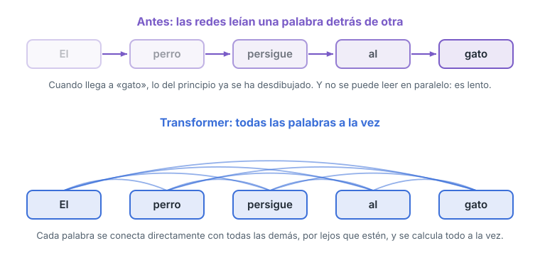
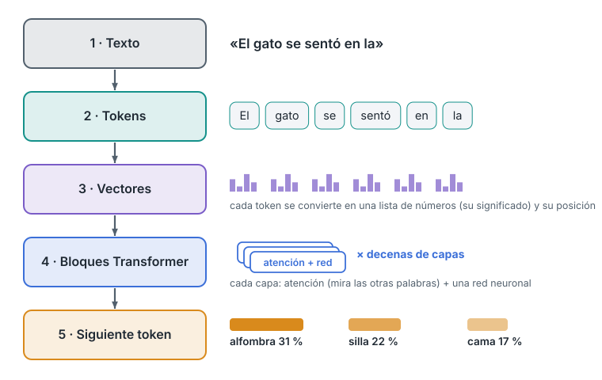
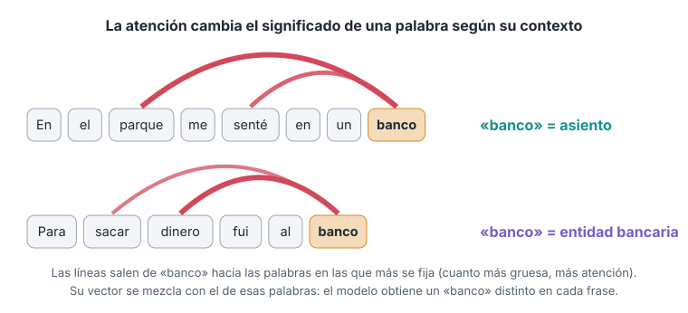
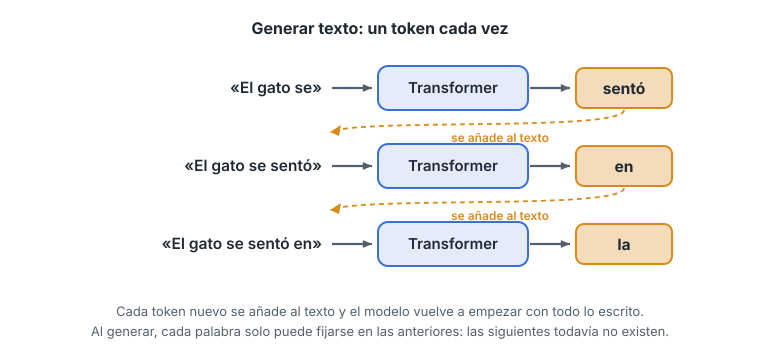

# Cómo funciona un Transformer

[← Volver al módulo 8](08-ia-generativa.md#la-atencion-la-clave-del-transformer)

!!! abstract "En esta página"
    - El problema que resolvió el Transformer.
    - El camino del texto a la siguiente palabra, en cinco pasos.
    - La atención, explicada con un ejemplo.
    - Cómo escribe un modelo «palabra a palabra».

El **Transformer** es la forma de organizar la red neuronal que hay dentro de ChatGPT, Gemini, Claude y casi todos los modelos de lenguaje actuales. También está en muchos modelos que traducen, entienden imágenes o transcriben voz. Su nombre no tiene nada que ver con los robots de las películas: viene de que **transforma** una secuencia (un texto, por ejemplo) en otra.

## 1. El problema que resolvió

<figure markdown="span">
  { .diagrama width="760" }
</figure>

Antes del Transformer, las redes que trabajaban con texto lo **leían palabra a palabra**, como quien lee en voz alta. Iban guardando un pequeño «resumen» de lo leído y lo actualizaban con cada palabra nueva. Eso tenía dos problemas:

- **Olvidaban el principio.** En una frase larga, cuando llegaban al final, lo del principio se había desdibujado.
- **Eran lentas.** Cada palabra tenía que esperar a la anterior, así que no se podía repartir el trabajo entre muchos procesadores.

El Transformer cambió el enfoque: **mira todas las palabras a la vez**, y cada una puede conectarse directamente con cualquier otra, por lejos que esté. Como todo se calcula a la vez, se puede repartir entre miles de GPU ([módulo 9](09-hardware.md)). Eso es lo que permitió entrenar modelos enormes con cantidades enormes de texto.

## 2. Del texto a la siguiente palabra, en cinco pasos

<figure markdown="span">
  { .diagrama width="760" }
</figure>

1. **Texto.** Lo que escribes: «El gato se sentó en la».
2. **Tokens.** El texto se trocea en piezas, los *tokens* ([módulo 6](06-multimodalidad.md)). Pueden ser palabras enteras o trozos de palabra.
3. **Vectores.** Cada token se convierte en una lista de números que representa su significado (su *embedding*): palabras de significado parecido tienen listas parecidas. Como todas las palabras se procesan a la vez, a cada una se le añade también su **posición**. Sin ella, «el perro muerde al hombre» y «el hombre muerde al perro» serían lo mismo para el modelo.
4. **Bloques Transformer.** Es el corazón del modelo. Cada bloque tiene dos partes:
    - la **atención**, en la que cada palabra mira a las demás y recoge información de las que le importan (el apartado siguiente);
    - una **red neuronal** normal ([módulo 5](05-deep-learning.md)), que procesa lo que cada palabra ha recogido.

    Los bloques se apilan en **decenas de capas**. Las primeras captan relaciones sencillas, como qué palabras van juntas; las últimas, ideas más abstractas, como de qué trata el texto o qué tono tiene.
5. **Siguiente token.** Al final, el modelo calcula una **probabilidad** para cada token posible y elige uno, como viste en el [módulo 8](08-ia-generativa.md#la-tarea-predecir-el-siguiente-token).

## 3. La atención, con un ejemplo

Muchas palabras cambian de significado según el contexto. La atención es lo que permite al modelo resolverlo:

<figure markdown="span">
  { .diagrama width="760" }
</figure>

Para cada palabra, la atención calcula **cuánto debe fijarse en cada una de las demás**. Después mezcla su significado con el de las palabras en las que más se fija. Así, el «banco» del parque y el «banco» del dinero acaban siendo dos «bancos» distintos dentro del modelo, aunque se escriban igual. Es lo mismo que pasaba con el gato cansado del [módulo 8](08-ia-generativa.md#la-atencion-la-clave-del-transformer).

### Muchas atenciones a la vez

Cada bloque no tiene una sola atención, sino **varias trabajando a la vez**: se llaman *cabezas* de atención. Cada cabeza puede aprender a fijarse en una cosa distinta: quién hace la acción, a qué se refiere un pronombre, qué palabras forman una expresión… Nadie las programa a mano: las aprende el modelo durante el entrenamiento.

## 4. Cómo escribe: un token cada vez

<figure markdown="span">
  { .diagrama width="760" }
</figure>

Un modelo de lenguaje no escribe la respuesta de golpe. Predice **un token**, lo añade al texto y vuelve a empezar con todo lo escrito hasta entonces. Así, token a token, hasta terminar.

Al escribir, cada palabra **solo puede fijarse en las anteriores**: las siguientes todavía no existen. Por eso las respuestas largas tardan más, y por eso la **ventana de contexto** ([módulo 12](12-inferencia.md)) importa tanto: es todo lo que el modelo puede tener delante a la vez.

## 5. Dónde se usa

- **Chatbots y asistentes:** todos los modelos de lenguaje grandes son Transformers.
- **Traducción:** fue la primera tarea para la que se diseñó.
- **Imágenes:** una imagen se trocea en pequeños cuadrados que se tratan como si fueran tokens ([módulo 6](06-multimodalidad.md)).
- **Voz:** los modelos que transcriben audio a texto.
- **Generación de imágenes:** el programa que «entiende» lo que escribes para un modelo de difusión suele ser un Transformer. Lo verás en la página de los [modelos de difusión](08b-difusion.md).

## Las tres ideas clave

1. **Lee todo a la vez**, en lugar de palabra a palabra. Por eso se puede entrenar con miles de GPU.
2. **La atención:** cada palabra decide en qué otras fijarse, y así entiende el contexto.
3. **Escribe un token cada vez**, mirando solo hacia atrás.

!!! question "Para comprobar que lo has entendido"
    1. ¿Por qué hay que añadir a cada palabra su posición?
    2. En «El trofeo no cabe en la maleta porque es demasiado grande», ¿en qué palabra debería fijarse «grande»? ¿Y si cambias «grande» por «pequeña»?
    3. ¿Por qué, al escribir, el modelo no puede fijarse en las palabras que vienen después?

[← Volver al módulo 8](08-ia-generativa.md#la-atencion-la-clave-del-transformer) · [Cómo funcionan los modelos de difusión →](08b-difusion.md)
