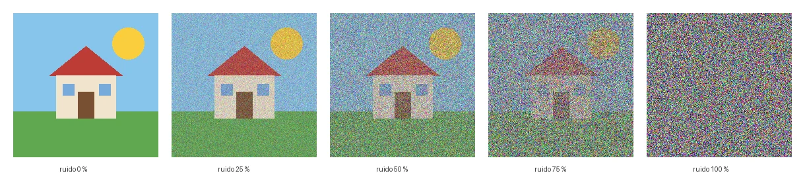
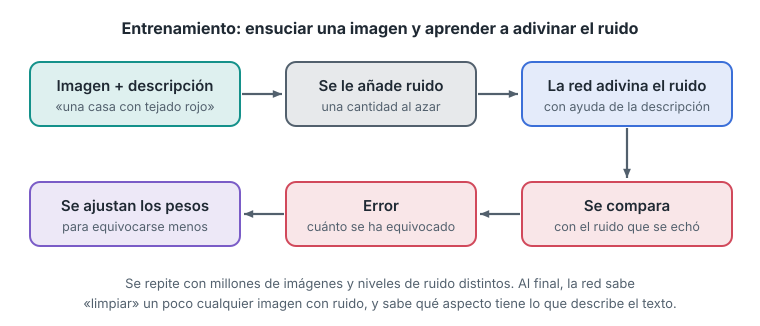
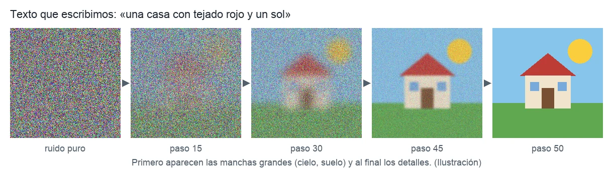
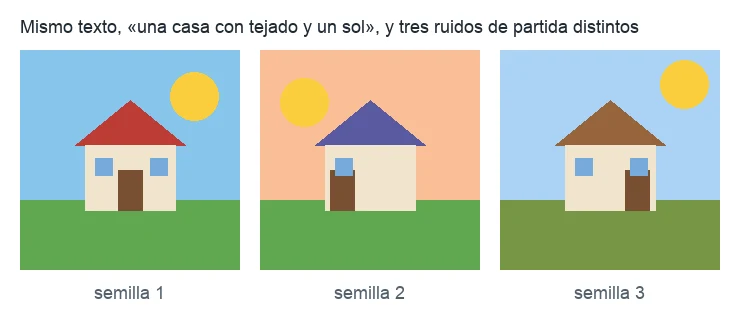
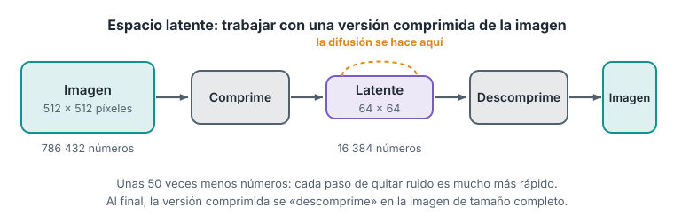

# Cómo funcionan los modelos de difusión

[← Volver al módulo 8](08-ia-generativa.md#3-generacion-de-imagenes-los-modelos-de-difusion)

!!! abstract "En esta página"
    - Qué es el «ruido» de una imagen.
    - Cómo aprende un modelo de difusión: ensuciar y aprender a limpiar.
    - Cómo nace una imagen del ruido, paso a paso, guiada por el texto.
    - Por qué el mismo texto da imágenes distintas, y el truco para ir rápido.

Los **modelos de difusión** están detrás de Stable Diffusion, Midjourney, Flux o el vídeo de Sora y Veo. Su idea cabe en una frase: **aprenden a quitar ruido de una imagen**. Para crear una imagen nueva, parten de ruido puro y lo van quitando paso a paso, guiados por el texto que escribes.

## 1. Una imagen son números, y el ruido también

Para un ordenador, una imagen es una **cuadrícula de números**: cada píxel tiene tres, uno para el rojo, otro para el verde y otro para el azul ([módulo 6](06-multimodalidad.md)).

Añadir **ruido** es sumar a cada uno de esos números una cantidad al azar. El resultado se parece a la «nieve» de una televisión mal sintonizada. Con poco ruido, la imagen se reconoce; con mucho, solo queda estática:

<figure markdown="span">
  { width="680" loading=lazy }
  <figcaption>La misma imagen con cada vez más ruido. (Ilustración)</figcaption>
</figure>

## 2. El entrenamiento: ensuciar y aprender a limpiar

<figure markdown="span">
  { .diagrama width="760" }
</figure>

Para aprender, el modelo hace una y otra vez este ejercicio:

1. Toma una imagen con su **descripción** («una casa con tejado rojo»).
2. Le añade **ruido** al azar: unas veces un poco, otras mucho.
3. La red tiene que **adivinar qué ruido se le ha añadido**: qué manchas sobran. La descripción le ayuda: si sabe que es una casa, sabe mejor qué no es casa.
4. Se **compara** lo que ha adivinado con el ruido que de verdad se añadió. La diferencia es el **error**, y los pesos se ajustan para equivocarse menos, como en cualquier red neuronal ([módulo 5](05-deep-learning.md)).

¿Por qué adivinar el ruido? Porque si sabes qué sobra, puedes **quitarlo**, y lo que queda se parece un poco más a una imagen de verdad. Después de millones de imágenes, la red sabe limpiar un poco cualquier imagen con ruido, y ha aprendido cómo son las cosas que describen los textos: una casa, un gato, una acuarela, una foto nocturna…

!!! tip "Una analogía: restaurar una foto antigua"
    Una persona que ha restaurado miles de fotos antiguas sabe distinguir a simple vista qué es una mancha o una raya y qué es parte de la foto. El modelo aprende lo mismo, pero con ruido, y con la ayuda de una descripción de lo que hay en la imagen.

## 3. Crear: del ruido a la imagen

Cuando le pides una imagen, el modelo hace el camino contrario:

<figure markdown="span">
  { width="760" loading=lazy }
  <figcaption>Primero aparecen las manchas grandes (el cielo, el suelo) y al final los detalles. (Ilustración: no es la salida de un modelo real)</figcaption>
</figure>

1. **El texto se convierte en números.** Un programa, el *codificador de texto*, traduce lo que escribes (el *prompt*) a vectores. Suele ser un Transformer, como el que se explica en [Cómo funciona un Transformer](08a-transformer.md).
2. **Se parte de ruido puro:** una imagen de estática generada al azar.
3. **En cada paso**, la red mira el ruido y el texto, adivina qué sobra y **quita una parte**.
4. **Tras unos 20 a 50 pasos**, lo que queda es una imagen nítida y nueva que encaja con la descripción.

!!! tip "Una analogía: buscar formas en las nubes"
    Si miras las nubes y alguien te dice «busca un barco», acabas viendo un barco. El modelo hace algo parecido con el ruido: el texto le dice qué buscar, y en cada paso «dibuja» un poco más lo que ha encontrado.

## 4. Por qué cada vez sale una imagen distinta

<figure markdown="span">
  { width="760" loading=lazy }
  <figcaption>El mismo texto con tres ruidos de partida distintos. (Ilustración)</figcaption>
</figure>

El ruido del que parte el modelo es **aleatorio**, y lo decide un número llamado **semilla** (*seed*):

- **El mismo texto, la misma semilla y los mismos ajustes** dan **la misma imagen**.
- **Otra semilla** da **otra imagen** distinta para el mismo texto.

Muchas aplicaciones permiten fijar la semilla para hacer pequeñas variaciones de una imagen que te gusta. Es la misma idea que la semilla de los modelos de texto ([módulo 12](12-inferencia.md)).

Hay otro ajuste muy común, la **escala de guía** (*guidance scale*): cuánto caso hace el modelo al texto. Si es alta, obedece más la descripción, pero la imagen puede quedar forzada; si es baja, la imagen es más libre y se parece menos a lo pedido.

## 5. El truco para ir rápido: el espacio latente

Quitar ruido a una imagen de 512 × 512 píxeles, paso a paso, supone trabajar con cientos de miles de números en cada paso. Para ir más rápido, la mayoría de los modelos **comprimen** antes la imagen:

<figure markdown="span">
  { .diagrama width="760" }
</figure>

La difusión se hace sobre esa versión comprimida, el **espacio latente**, con unas 50 veces menos números. Al terminar, se «descomprime» en la imagen de tamaño completo. Por eso a estos modelos se les llama técnicamente de **difusión latente** (*latent diffusion*).

## 6. Más allá de las imágenes

- **Vídeo:** la misma idea con muchas imágenes seguidas, que además tienen que ser coherentes entre sí. Es lo que hacen Sora o Veo.
- **Audio y música:** también se pueden generar quitando ruido a un sonido.
- **Ciencia:** se usan, por ejemplo, para diseñar moléculas nuevas.

No todos los generadores de imágenes son de difusión: algunos generan la imagen por partes, como un modelo de lenguaje genera texto, como se explica al final del apartado 3 del [módulo 8](08-ia-generativa.md#3-generacion-de-imagenes-los-modelos-de-difusion).

## Las tres ideas clave

1. **Aprende a quitar ruido**, adivinando el ruido que se le añadió a millones de imágenes.
2. **Crea partiendo de ruido**, y lo quita paso a paso, guiado por el texto.
3. **El ruido de partida, la semilla,** hace que cada imagen sea distinta.

!!! question "Para comprobar que lo has entendido"
    1. ¿Por qué el modelo aprende a adivinar el ruido, y no directamente a dibujar?
    2. Si usas el mismo texto y la misma semilla dos veces, ¿qué pasa? ¿Y si cambias la semilla?
    3. ¿Qué gana el modelo trabajando en el espacio latente?

[← Volver al módulo 8](08-ia-generativa.md#3-generacion-de-imagenes-los-modelos-de-difusion) · [← Cómo funciona un Transformer](08a-transformer.md)
