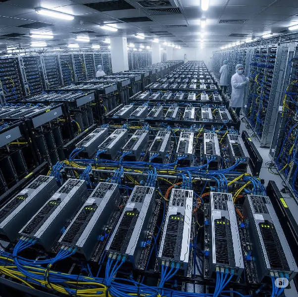
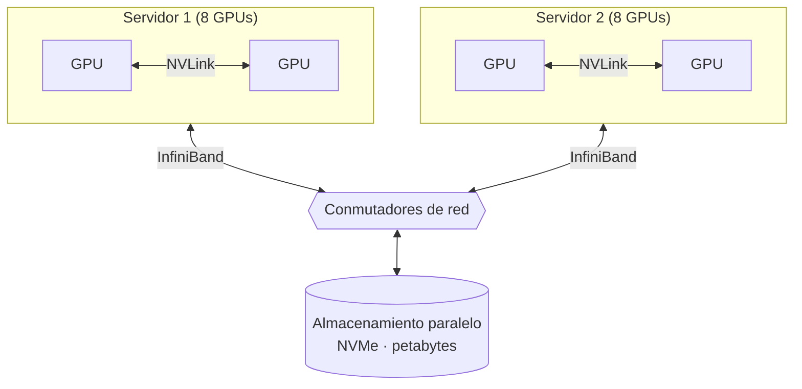
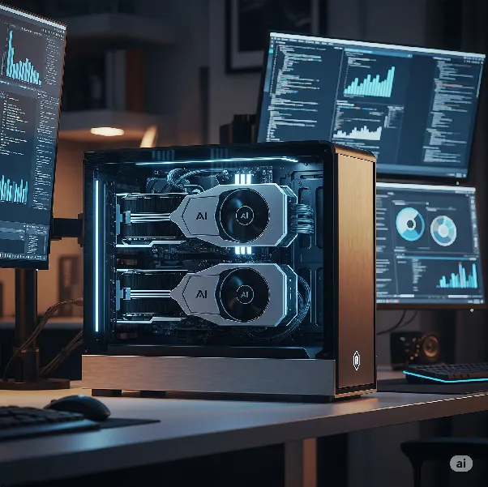

# 9. Hardware necesario

!!! abstract "En este módulo"
    - Qué hardware hace falta para **crear** un gran modelo desde cero.
    - Qué hace falta para **especializar** un modelo existente (*fine-tuning*).
    - Qué hace falta para **usar** modelos en tu propio ordenador.
    - Cuánta memoria de vídeo (VRAM) necesita un modelo.

No es lo mismo **entrenar** un modelo como GPT o Gemini desde cero, **ajustarlo** para una tarea concreta o simplemente **usarlo** (lo que técnicamente se llama *inferencia*). La diferencia de escala es de millones de euros a unos cientos:

| Tarea | Hardware típico | Coste orientativo |
|---|---|---|
| **Entrenar un LLM puntero desde cero** | Decenas de miles de GPUs de centro de datos durante meses | Cientos de millones de euros |
| **Fine-tuning de un modelo abierto** | 1 a 8 GPUs (de consumo o profesionales) | De cientos a decenas de miles de euros |
| **Usar un modelo en local** | Un PC con tarjeta gráfica, o un Mac con mucha memoria | Desde el ordenador que ya tienes |

## 1. Cómputo masivo y paralelo: las GPUs

Es el corazón de la operación. Para entrenar un gran modelo no se usa «una GPU», sino **miles de GPUs de centro de datos** trabajando en paralelo durante semanas o meses sin parar.

<figure markdown="span">
  { width="460" loading=lazy }
</figure>

- **Componentes:** GPUs de centro de datos de **NVIDIA**: generación *Hopper* (**H100**, 80 GB; **H200**, 141 GB), *Blackwell* (**B200** y **B300**, de 192 a 288 GB, desplegadas desde 2025) y la nueva *Rubin* (288 GB de memoria HBM4), que empezó a llegar a los grandes centros de datos en la segunda mitad de 2026. Alternativas: **AMD Instinct** (MI300X, MI350), las **TPU** de Google y chips propios de Amazon (Trainium) o Microsoft (Maia). Las tarjetas de consumo (como la RTX 5090) no se usan para entrenar modelos punteros.
- **¿Por qué son tan importantes?**
    - **Potencia bruta (*Tensor Cores*):** unidades diseñadas específicamente para multiplicar matrices, la operación básica del Deep Learning. Son órdenes de magnitud más rápidas que una CPU para esta tarea.
    - **Memoria HBM (*High Bandwidth Memory*):** memoria ultrarrápida apilada junto al chip. La **cantidad de VRAM** decide qué tamaño de modelo (y de lote de datos) cabe en cada GPU, y su **ancho de banda** (varios TB/s) decide lo rápido que se alimenta el cálculo.
    - **Formatos numéricos reducidos:** usan números de menos bits (FP16, FP8, incluso FP4) para hacer más operaciones con menos memoria y energía.
    - **Escalabilidad:** están pensadas para interconectarse y funcionar como un único superordenador.

!!! example "En perspectiva"
    Para entrenar **Llama 3**, Meta construyó dos clústeres con **24 000 GPUs H100** cada uno; su modelo más grande (405 000 millones de parámetros) usó más de **16 000** a la vez durante meses. Los centros de datos de IA que se construyen hoy agrupan **cientos de miles de GPUs** y consumen tanta electricidad como una ciudad mediana. La energía se ha convertido en uno de los grandes límites de la IA.

## 2. Interconexión de ultra alta velocidad: el sistema nervioso

Tener miles de GPUs es inútil si no pueden comunicarse casi al instante. Durante el entrenamiento deben **sincronizar sus cálculos** continuamente; si una espera a otra, todo se para. Esta «red» es tan crucial como las propias GPUs.

<figure markdown="span">
  { width="440" loading=lazy }
</figure>

- **NVIDIA NVLink y NVSwitch:** conectan las GPUs **dentro de un servidor o un armario**. En un servidor clásico de 8 GPUs permiten que funcionen casi como una sola con memoria compartida; en los sistemas recientes (GB200 NVL72) unen **72 GPUs** en un mismo dominio.
- **InfiniBand** (NVIDIA Quantum) o **Ethernet de alto rendimiento**: red de latencia mínima y enorme ancho de banda que conecta **miles de servidores** entre sí. Una autopista de datos sin semáforos.

## 3. Almacenamiento distribuido y de alto rendimiento: la despensa

El modelo necesita un flujo constante de datos. Los datos para entrenar un LLM pueden ocupar **petabytes** (miles de terabytes) antes de filtrarse.

<figure markdown="span">
  { width="440" loading=lazy }
</figure>

- **Componentes:** **sistemas de archivos paralelos** (como Lustre, BeeGFS, GPFS o WEKA) sobre enormes granjas de **SSD NVMe** de centro de datos.
- **¿Por qué?** Hay que leer datos a velocidad vertiginosa y repartirlos a miles de GPUs a la vez sin crear cuellos de botella. Además, el entrenamiento guarda periódicamente copias del modelo (*checkpoints*), que pueden ocupar terabytes, por si algo falla.

## 4. ¿Qué puede hacer una persona o una empresa pequeña?

Entrenar desde cero un modelo puntero es inviable. La alternativa realista es el **fine-tuning** (ajuste fino): partir de un **modelo abierto ya entrenado** (Llama, Mistral, Qwen, Gemma…) y seguir entrenándolo con un conjunto de datos pequeño y específico, por ejemplo, los documentos internos de tu empresa o el estilo de tus apuntes.

!!! info "LoRA y QLoRA: el fine-tuning al alcance de todos"
    En lugar de modificar todos los parámetros del modelo, las técnicas **LoRA** y **QLoRA** entrenan solo unas pequeñas «capas adaptadoras» (menos del 1 % de los parámetros) y, en el caso de QLoRA, cargan el modelo comprimido a 4 bits. Gracias a ellas, **un modelo de unos 8000 millones de parámetros se puede ajustar en una sola GPU de 16-24 GB**, y uno de 70 000 millones con unos 48 GB. Sin ellas harían falta varias GPUs de centro de datos.

Configuraciones orientativas para fine-tuning serio:

- **GPU:** toda la **VRAM** posible.
    - **Personal/aula:** una o dos **RTX 5060 Ti de 16 GB**, una **RTX 3090/4090 de 24 GB** o una **RTX 5090 de 32 GB**.
    - **Profesional:** **RTX PRO 6000 Blackwell (96 GB)**, o alquilar por horas en la nube una **A100/H100 de 80 GB**.
- **RAM del sistema:** 64 GB como mínimo; lo habitual son **128 GB o más** para manejar los datos con holgura.
- **CPU y almacenamiento:** un procesador con suficientes núcleos y líneas PCIe para varias GPUs, y almacenamiento **NVMe** rápido.
- **Fuente de alimentación y refrigeración:** cada GPU de gama alta puede consumir de 300 a 600 W.

!!! warning "Dos GPUs no son una GPU con el doble de memoria"
    Las tarjetas de consumo actuales (RTX 40 y 50) **no tienen NVLink**. Con dos de 16 GB no tienes 32 GB unificados: las librerías reparten las capas del modelo entre ambas tarjetas y se comunican por PCIe, lo que funciona pero es más lento. Aun así, es una forma muy económica de poder cargar modelos más grandes. Es justo lo que plantea la [práctica de montaje](practicas/montaje.md).

## 5. ¿Cuánta memoria necesita un modelo?

Para **usar** un modelo (inferencia), la cuenta básica es:

\[ \text{memoria} \approx \text{n.º de parámetros} \times \text{bytes por parámetro} \; (+\,10\text{-}20\,\% \text{ extra}) \]

Los modelos se pueden **cuantizar**, es decir, guardar sus números con menos precisión: 16 bits (2 bytes), 8 bits (1 byte) o 4 bits (0,5 bytes). A 4 bits pierden muy poca calidad y ocupan la cuarta parte.

| Tamaño del modelo | 16 bits | 8 bits | 4 bits | ¿Dónde cabe (a 4 bits)? |
|---|---|---|---|---|
| 3B (3000 millones) | ~6 GB | ~3 GB | ~2 GB | Un móvil o portátil |
| 8B | ~16 GB | ~8 GB | ~5 GB | GPU de 8 GB |
| 14B | ~28 GB | ~14 GB | ~8 GB | GPU de 12-16 GB |
| 32B | ~64 GB | ~32 GB | ~18 GB | GPU de 24 GB, o dos de 16 GB |
| 70B | ~140 GB | ~70 GB | ~40 GB | Dos GPUs de 24 GB, o un Mac de 64 GB |

A esto hay que sumar la memoria del **contexto** (la conversación), que crece con la longitud del texto.

!!! tip "La alternativa de la memoria unificada"
    Los Mac con chip Apple Silicon (M3, M4, M5…) y algunos PC con memoria unificada (como los AMD Ryzen AI Max) comparten la RAM entre CPU y GPU. Un equipo con 64 o 128 GB puede cargar modelos que no cabrían en ninguna tarjeta gráfica de consumo, aunque genere el texto más despacio que una GPU de gama alta.

<figure markdown="span">
  { width="440" loading=lazy }
</figure>

**En resumen:** para **crear** un LLM hace falta un **clúster de supercomputación**; para **especializar** uno existente, una **estación de trabajo potente** (o unas horas de GPU en la nube); y para **usarlo**, a menudo basta con un buen ordenador personal.

## Para ampliar

**Artículos y fichas técnicas**

- [Unidad de procesamiento gráfico](https://es.wikipedia.org/wiki/Unidad_de_procesamiento_gr%C3%A1fico) y [CUDA](https://es.wikipedia.org/wiki/CUDA) (Wikipedia).
- [GPU H100](https://www.nvidia.com/es-es/data-center/h100/), [GPU H200](https://www.nvidia.com/es-es/data-center/h200/) y [DGX B200](https://www.nvidia.com/es-es/data-center/dgx-b200/) (NVIDIA).
- [NVLink y NVLink Switch](https://www.nvidia.com/es-es/data-center/nvlink/) (NVIDIA).
- [¿Qué es el fine-tuning?](https://www.ibm.com/es-es/think/topics/fine-tuning) (IBM) y [Ajuste fino (aprendizaje profundo)](https://es.wikipedia.org/wiki/Ajuste_fino_%28aprendizaje_profundo%29) (Wikipedia).
- [Lustre](https://www.lustre.org/): sistema de archivos paralelo usado en supercomputación.

**Vídeos**

- :material-youtube: [¿Por qué las GPUs son buenas para la IA?](https://www.youtube.com/watch?v=C_wSHKG8_fg) (Dot CSV, 35 min).
- :material-youtube: [Nvidia CUDA explicado en 6 minutos](https://www.youtube.com/watch?v=yMNlAy6X4pg) (Bug Labs).
- :material-youtube: [Qué es fine-tuning](https://www.youtube.com/watch?v=49aHaXesJxw) (Computer Hoy, 4 min).

**Práctica**

- :material-tools: [Práctica: presupuesto de un equipo para IA](practicas/montaje.md).

