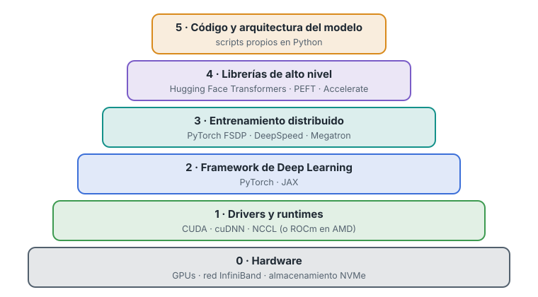

# 10. Software necesario: la pila para crear un LLM

!!! abstract "En este módulo"
    - Las capas de software que hacen falta para entrenar un gran modelo de lenguaje.
    - Las herramientas de datos, orquestación y seguimiento.
    - Qué software basta en la práctica para hacer *fine-tuning* o usar modelos en local.

Imagina una pirámide en la que cada capa se apoya en la anterior. Abajo está el hardware ([módulo 9](09-hardware.md)) y arriba, el código propio de cada modelo.

<figure markdown="span">
  { .diagrama width="620" }
</figure>

## Capa 5 (la cima): el código y la arquitectura del modelo

Es la «receta» de cada empresa o laboratorio.

- **¿Qué es?** Un conjunto de programas, casi siempre en **Python**, que define la arquitectura concreta del modelo y cómo se entrena. Casi todos los LLM actuales se basan en el **Transformer**, pero hay miles de decisiones que marcan la diferencia: el tipo exacto de atención, cómo se normalizan las capas, la función de activación, si es un modelo **de mezcla de expertos** (*Mixture of Experts*, donde cada token solo activa una parte de la red), la mezcla de datos de entrenamiento, etc.
- **Ejemplos:** no es un programa que se descargue, sino **código propio** que se apoya en las librerías de las capas inferiores. Algunos laboratorios publican el suyo (por ejemplo, el de los modelos abiertos OLMo, del Allen Institute).

## Capa 4: librerías de alto nivel y ecosistema

Hacen que construir, entrenar y compartir modelos sea mucho más fácil.

- **¿Qué es?** Librerías con bloques ya fabricados (capas de atención, arquitecturas Transformer completas) y herramientas que simplifican el entrenamiento.
- **Ejemplos:**
    - **Hugging Face Transformers:** la librería más importante del ecosistema abierto. Implementa cientos de arquitecturas (Llama, Mistral, Qwen, Gemma…) listas para usar, y el **Hub** de Hugging Face aloja más de un millón de modelos y conjuntos de datos. Es el estándar de facto para trabajar con modelos abiertos.
    - **Hugging Face Accelerate:** adapta el código de entrenamiento para que funcione en varias GPUs o TPUs sin reescribirlo.
    - **PEFT** y **TRL** (Hugging Face): implementan el ajuste eficiente (**LoRA, QLoRA**) y el aprendizaje por refuerzo con preferencias humanas.
    - **Unsloth** o **Axolotl:** herramientas que simplifican y aceleran mucho el *fine-tuning* en una sola GPU.

## Capa 3: frameworks de entrenamiento distribuido

Orquestan el trabajo de miles de GPUs para que actúen como una sola.

- **¿Qué es?** Se encargan de lo más difícil del entrenamiento a gran escala: **repartir el modelo y los datos** entre miles de procesadores y **sincronizar** su trabajo de forma eficiente.
- **Ejemplos:**
    - **PyTorch FSDP** (*Fully Sharded Data Parallel*): la solución integrada en PyTorch. *Sharding* significa que fragmenta no solo los datos, sino también los parámetros del modelo y el estado del optimizador entre todas las GPUs, lo que permite entrenar modelos que no caben en la memoria de una sola.
    - **DeepSpeed** (Microsoft): técnicas similares (su sistema ZeRO), fundamental para entrenar muchos de los primeros modelos gigantes.
    - **Megatron-LM / NeMo** (NVIDIA): reparte incluso cada capa entre varias GPUs (*paralelismo de tensores y de tuberías*); se usa en los entrenamientos más grandes.

## Capa 2: el framework de Deep Learning

Es el motor principal sobre el que se construye todo lo demás.

- **¿Qué es?** La librería fundamental para construir redes neuronales. Su función clave es la **diferenciación automática** (*autograd*): calcula automáticamente los gradientes necesarios para la retropropagación ([módulo 5](05-deep-learning.md)), algo que a mano sería imposible con miles de millones de parámetros.
- **Ejemplos:**
    - **PyTorch:** el líder en investigación y en el entrenamiento de la mayoría de los grandes modelos (Llama, DeepSeek, Mistral, los de OpenAI…). Conocido por su flexibilidad.
    - **JAX** (Google): alto rendimiento, especialmente en **TPU**. Google entrena con él sus modelos Gemini. Más que un framework completo, es una librería de cálculo numérico acelerado con diferenciación automática.

## Capa 1 (la base): drivers y *runtimes* de bajo nivel

Conectan el sistema operativo y el framework con el hardware.

- **¿Qué es?** El software que permite que el código de alto nivel (Python) dé órdenes a las GPUs.
- **Ejemplos:**
    - **NVIDIA CUDA Toolkit:** el componente más fundamental si usas GPUs de NVIDIA. Una plataforma de computación paralela que da acceso directo a la potencia de la GPU. Que casi todo el software de IA dependa de CUDA es una de las razones del dominio de NVIDIA.
    - **cuDNN:** librería sobre CUDA con rutinas muy optimizadas para las operaciones típicas del Deep Learning (convoluciones, atención, multiplicaciones de matrices). PyTorch la usa internamente.
    - **NCCL:** la librería de comunicaciones que usan las GPUs para sincronizarse entre sí.
    - **Alternativas:** **ROCm** para GPUs de AMD y **Metal/MLX** para los Mac con Apple Silicon.

## ¿Y para los datos y los experimentos?

Además de la pila principal, hacen falta otras herramientas:

- **Procesamiento de datos:** **Apache Spark** o **Dask** para procesar, filtrar y limpiar en paralelo petabytes de texto (eliminar duplicados, basura, datos personales…).
- **Orquestación de trabajos:** **Slurm**, el gestor estándar en supercomputación, pone en cola y asigna las tareas a los clústeres de GPUs. En entornos de nube también se usa **Kubernetes**.
- **Seguimiento de experimentos:** **Weights & Biases (W&B)**, **MLflow** o **TensorBoard** registran métricas, visualizan el progreso del entrenamiento y comparan experimentos.
- **Servir el modelo (inferencia):** una vez entrenado, programas como **vLLM**, **SGLang** o **TensorRT-LLM** lo ponen a responder a miles de usuarios a la vez de forma eficiente.

## Resumen para el mundo real

La pila para entrenar desde cero es inmensa. Pero para las tareas realistas, la lista se reduce drásticamente:

=== "Hacer fine-tuning"

    1. **Python**.
    2. Los **drivers de NVIDIA (CUDA)**.
    3. **PyTorch**.
    4. El ecosistema de **Hugging Face** (`transformers`, `datasets`, `peft`, `trl`, `accelerate`), o una herramienta que lo empaquete, como **Unsloth**.

    Con estos componentes tienes todo lo necesario para especializar un buen modelo abierto en tu propio hardware o en la nube.

=== "Usar modelos en local"

    - **[Ollama](https://ollama.com/)** o **[LM Studio](https://lmstudio.ai/)**: descargas un modelo con un clic y conversas con él, sin programar. Por debajo usan **llama.cpp**, que ejecuta modelos cuantizados (formato GGUF) en casi cualquier ordenador. Los verás a fondo en el [módulo 14](14-ia-local.md).
    - Para dar servicio a varios usuarios: **vLLM**.

## Para ampliar

**Documentación oficial**

- [PyTorch](https://pytorch.org/) · [FSDP](https://docs.pytorch.org/docs/stable/fsdp.html) · [JAX](https://docs.jax.dev/en/latest/)
- [Hugging Face Transformers](https://huggingface.co/docs/transformers/index) · [Accelerate](https://huggingface.co/docs/accelerate/index) · [Curso de LLM de Hugging Face (en español)](https://huggingface.co/learn/llm-course/es/chapter1/1)
- [DeepSpeed](https://www.deepspeed.ai/) · [Unsloth](https://github.com/unslothai/unsloth)
- [CUDA Toolkit](https://developer.nvidia.com/cuda-toolkit) · [cuDNN](https://developer.nvidia.com/cudnn)
- [Apache Spark](https://spark.apache.org/) · [Slurm](https://slurm.schedmd.com/) · [Weights & Biases](https://wandb.ai/site/)
- [Ollama](https://ollama.com/) · [LM Studio](https://lmstudio.ai/)

**Vídeos**

- :material-youtube: [Nvidia CUDA explicado en 6 minutos](https://www.youtube.com/watch?v=yMNlAy6X4pg) (Bug Labs).
- :material-youtube: [Fine-tuning: qué es y cómo usarlo en IA](https://www.youtube.com/watch?v=VL4MEj0rbqI) (Código Facilito, 24 min).
- :material-youtube: [Aprende a hacer fine-tuning de LLMs open source](https://www.youtube.com/watch?v=xMm66CnUVgw) (NullSafe Architect, 23 min; práctico, con código).

