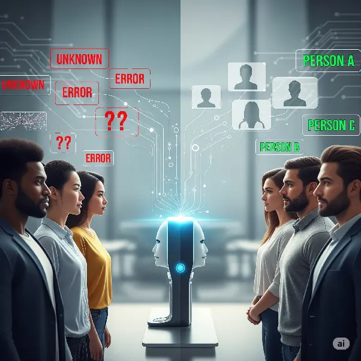
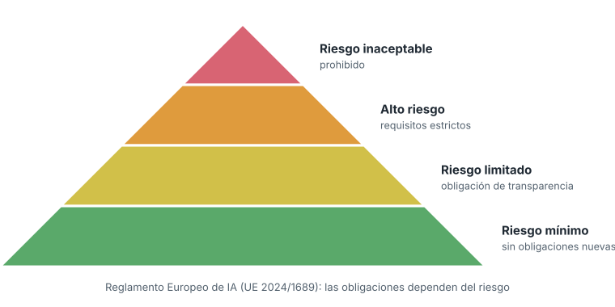

# 11. Ética y responsabilidad en la era de la IA

!!! abstract "En este módulo"
    - Sesgos algorítmicos: cuando la IA aprende nuestros prejuicios.
    - Privacidad: quién tiene nuestros datos y cómo los usa.
    - El futuro del trabajo.
    - Desinformación y *deepfakes*.
    - La regulación: el Reglamento Europeo de IA.
    - Otros retos: impacto ambiental, propiedad intelectual y uso responsable en educación.

## 1. Sesgos algorítmicos: cuando la IA aprende nuestros prejuicios

Uno de los grandes mitos sobre la IA es que es objetiva porque se basa en matemáticas y datos. En realidad, puede ser tan parcial como los datos con los que se entrena y las personas que la diseñan. El **sesgo algorítmico** se produce cuando un sistema de IA **refleja y amplifica** prejuicios presentes en sus datos, con resultados injustos o discriminatorios.

<figure markdown="span">
  { width="440" loading=lazy }
</figure>

La IA no tiene malas intenciones: es una experta en encontrar patrones. Si los datos reflejan una injusticia histórica, el modelo la aprende como si fuera una regla.

- **Contratación.** En 2018 se supo que **Amazon** había abandonado una herramienta experimental que puntuaba currículos: entrenada con diez años de contrataciones mayoritariamente masculinas, penalizaba los currículos que contenían la palabra «mujeres» (como en «capitana del club de ajedrez de mujeres»).
- **Reconocimiento facial.** El estudio *Gender Shades* (2018), de **Joy Buolamwini** y Timnit Gebru en el MIT, mostró que varios sistemas comerciales fallaban menos del 1 % con hombres de piel clara y hasta un **35 %** con mujeres de piel oscura, porque se habían entrenado sobre todo con caras de hombres blancos.
- **Préstamos y seguros.** Un sistema que aprende de datos históricos puede discriminar a personas de ciertos barrios o grupos que antes tuvieron menos acceso al crédito, perpetuando la desigualdad. Por eso la ley europea los considera de **alto riesgo**.
- **IA generativa.** Si le pides imágenes de «un médico» o «una persona que limpia», los generadores tienden a reproducir estereotipos de género y origen.

El problema es doble: no solo se reproduce el prejuicio, sino que **se oculta bajo una apariencia de objetividad tecnológica**, lo que lo hace más difícil de detectar y discutir. Combatirlo exige auditar los datos para que sean representativos, medir los resultados por grupos (*fairness*), hacer pruebas exhaustivas antes de poner un sistema en marcha y mantener **supervisión humana** en las decisiones importantes.

## 2. Privacidad de los datos: ¿quién tiene nuestros datos y cómo los usa?

La IA y los datos tienen una relación simbiótica: la IA necesita muchos datos para aprender, y los datos valen mucho gracias a lo que la IA puede hacer con ellos. Esa relación plantea serias preguntas sobre nuestra **privacidad**.

- **Recogida de datos.** Para entrenar modelos se recopilan historiales de navegación y compras, interacciones en redes sociales, geolocalización, grabaciones de voz… Aunque se anonimicen, el riesgo de **reidentificación** (volver a asociar datos anónimos con una persona) existe: a menudo bastan el código postal, la fecha de nacimiento y el sexo para identificar a alguien.
- **Conversaciones con chatbots.** Lo que escribes en un chatbot puede almacenarse y, según el servicio y tu configuración, usarse para entrenar futuros modelos. Muchas empresas prohíben introducir información confidencial en chatbots públicos. Revisa la configuración de privacidad y usa versiones empresariales o educativas que garanticen que no se entrena con tus datos.
- **Inferencia.** Los modelos son tan buenos encontrando patrones que pueden **deducir** información muy personal que nunca compartiste: tu orientación política, tu estado de salud o un embarazo, a partir de tus *likes* o tus compras.

<figure markdown="span">
  { width="440" loading=lazy }
</figure>

En Europa, el **Reglamento General de Protección de Datos (RGPD)** fija reglas estrictas sobre cómo se recogen, procesan y guardan los datos personales, y da derechos a la ciudadanía: acceso, rectificación, supresión u oposición a decisiones totalmente automatizadas. En España vela por ello la **Agencia Española de Protección de Datos (AEPD)**. Técnicas como la **privacidad diferencial** (añadir ruido estadístico para proteger a las personas) o el **aprendizaje federado** (entrenar en los dispositivos sin centralizar los datos) ayudan a construir IA más respetuosa.

!!! tip "Buenas prácticas para el aula"
    - No introduzcas en un chatbot datos personales propios ni de otras personas (nombres, notas, informes, fotos de alumnado).
    - Desactiva la opción de usar tus conversaciones para entrenar, si el servicio la ofrece.
    - Prefiere las herramientas que tu centro haya validado.

## 3. El futuro del trabajo: ¿qué cambiará y qué oportunidades surgirán?

El impacto de la IA en el empleo genera mucha inquietud. Más que una sustitución masiva de personas por máquinas, lo que se observa es una **transformación profunda de las tareas** dentro de casi todas las profesiones.

La IA generativa es una potente **herramienta de productividad**: redactar borradores, escribir código repetitivo, analizar hojas de cálculo o preparar presentaciones se hace en una fracción del tiempo. El papel del profesional cambia: de crear todo desde cero pasa a **dirigir, editar y validar** el trabajo de la IA, aportando juicio crítico, creatividad, responsabilidad y conocimiento del contexto.

<figure markdown="span">
  { width="440" loading=lazy }
</figure>

Algunas ocupaciones con muchas tareas rutinarias de información (atención al cliente básica, introducción de datos, traducción o redacción sencilla) se están transformando más deprisa. Al mismo tiempo surgen nuevos perfiles:

- **Ingeniería de *prompts* e integración de IA:** saber pedir y combinar las herramientas para obtener buenos resultados, y conectarlas con los procesos de la empresa.
- **Auditoría de algoritmos:** revisar sistemas de IA para detectar sesgos y comprobar que cumplen la ley.
- **Ética y cumplimiento normativo de IA:** ayudar a las organizaciones a usar la IA de forma responsable y legal.
- **Entrenamiento y evaluación de modelos:** expertos que etiquetan datos, escriben ejemplos y valoran respuestas para mejorar los modelos (RLHF).

El informe *Future of Jobs 2025* del Foro Económico Mundial prevé que hasta 2030 se creen más empleos de los que se destruyen a escala global, pero con un gran **cambio de habilidades**. El reto es doble: la **recualificación** (*reskilling*) de quienes ya trabajan y la **adaptación educativa**, enseñando, además de conocimientos, pensamiento crítico, resolución creativa de problemas, colaboración, inteligencia emocional y **alfabetización en IA**: saber cuándo usarla, cómo y cuándo no fiarse de ella.

## 4. Desinformación y *deepfakes*: distinguir lo real de lo artificial

Si la IA generativa crea contenido realista, también puede crear **engaños realistas**. Es una de las amenazas más serias para la confianza en la información.

<figure markdown="span">
  { width="440" loading=lazy }
</figure>

Los ***deepfakes*** (en español también «ultrafalsos») son vídeos, imágenes o audios manipulados con IA que parecen auténticos: se pone la cara de una persona en el cuerpo de otra o se **clona su voz** para que diga cosas que nunca dijo. Las herramientas son cada vez más accesibles, lo que dispara su uso para:

- **Fraudes:** llamadas con la voz clonada de un familiar pidiendo dinero, o videoconferencias falsas con «directivos» que ordenan transferencias. En 2024 una empresa de Hong Kong perdió unos 25 millones de dólares así.
- **Acoso y violencia digital:** montajes sexuales no consentidos, que afectan sobre todo a mujeres y a menores. En España hubo un caso muy conocido en un instituto de Almendralejo en 2023.
- **Manipulación política:** audios o vídeos falsos de candidatos poco antes de unas elecciones.

Más allá de los *deepfakes*, la IA permite producir **desinformación a escala industrial**: miles de artículos falsos, cuentas automatizadas que parecen humanas y comentarios que crean la ilusión de un consenso. Se habla de **«colapso del contexto»**: cada vez es más difícil saber si algo es real, lo que erosiona la confianza en los medios, las instituciones y la propia realidad compartida. También existe el efecto contrario, el **«dividendo del mentiroso»**: alguien pillado en un vídeo real puede alegar que es un *deepfake*.

La lucha se libra en varios frentes:

- **Detección** técnica de contenido generado, aún imperfecta.
- **Marcas de agua** invisibles (como **SynthID** de Google) y **credenciales de contenido** según el estándar **C2PA**, una especie de «etiqueta de origen» firmada digitalmente que acompaña a la imagen o al vídeo e indica cómo se creó o editó.
- **Alfabetización mediática:** contrastar la fuente, desconfiar de lo que provoca una emoción muy fuerte, buscar la imagen original (búsqueda inversa) y, en llamadas sospechosas, acordar una **palabra clave familiar**.
- **Leyes:** el Reglamento Europeo de IA obliga a **etiquetar** los *deepfakes* y el contenido generado por IA.

## 5. La necesidad de regulación

Ante estos retos ha surgido un amplio consenso sobre la necesidad de **normas** para guiar el desarrollo y el uso de la IA. No se trata de frenar la innovación, sino de que sea **segura, ética y respetuosa con los derechos fundamentales**.

La **Unión Europea** ha sido pionera con el **Reglamento de Inteligencia Artificial** (*AI Act*, Reglamento (UE) 2024/1689), la primera ley integral sobre IA del mundo. Entró en vigor el **1 de agosto de 2024** y se aplica de forma escalonada. Sigue un **enfoque basado en el riesgo**:

<figure markdown="span">
  { .diagrama width="640" }
</figure>

1. **Riesgo inaceptable (prohibido desde febrero de 2025):** sistemas que amenazan los derechos fundamentales, como la **puntuación social**, la manipulación subliminal, el reconocimiento de emociones en el trabajo o en la escuela, la creación de bases de datos faciales rastreando internet o, salvo excepciones muy limitadas, la identificación biométrica en tiempo real en espacios públicos por la policía.
2. **Alto riesgo:** IA en ámbitos donde un fallo tiene consecuencias graves: productos sanitarios, infraestructuras críticas, **educación** (admisión, evaluación), selección de personal, concesión de créditos, servicios públicos esenciales, justicia o fronteras. Deben cumplir requisitos estrictos: datos de calidad, documentación, transparencia, **supervisión humana**, robustez y ciberseguridad.
3. **Riesgo limitado (obligaciones de transparencia):** los chatbots deben avisar de que eres un humano hablando con una máquina, y el contenido generado o manipulado (*deepfakes*) debe estar **etiquetado**.
4. **Riesgo mínimo:** la gran mayoría de aplicaciones (videojuegos, filtros de spam, recomendaciones). No tienen obligaciones nuevas.

Además, los **modelos de IA de uso general** (como los que hay detrás de ChatGPT, Gemini o Claude) tienen obligaciones propias desde **agosto de 2025**: documentación técnica, respeto de los derechos de autor y, para los más potentes, evaluación y mitigación de riesgos sistémicos.

!!! info "Calendario actualizado (2026)"
    En 2026 la UE aprobó el **Ómnibus Digital sobre IA**, que **retrasa** las obligaciones de los sistemas de alto riesgo: hasta el **2 de diciembre de 2027** para los usos del anexo III (empleo, crédito, educación, biometría…) y hasta el **2 de agosto de 2028** para la IA integrada en productos regulados (productos sanitarios, maquinaria). También añadió la prohibición de los sistemas que generan imágenes íntimas no consentidas o material de abuso sexual infantil. Las obligaciones de transparencia siguen su calendario original. Las fechas pueden volver a cambiar, así que conviene consultar las fuentes oficiales.

En **España**, la **AESIA** (Agencia Española de Supervisión de la Inteligencia Artificial, con sede en A Coruña) es la autoridad encargada de supervisar el cumplimiento. Otras regiones siguen caminos distintos: Estados Unidos apuesta por un enfoque más sectorial y menos restrictivo, China tiene normas específicas para algoritmos de recomendación e IA generativa, y el Reino Unido prefiere principios aplicados por cada regulador. La era de la **autorregulación** pura ha terminado.

## 6. Otros retos que conviene debatir

<figure markdown="span">
  { width="440" loading=lazy }
</figure>

- **Impacto ambiental.** Entrenar y usar grandes modelos consume mucha **electricidad** y **agua** para refrigerar los centros de datos. Las grandes tecnológicas han visto crecer sus emisiones y algunas firman acuerdos para reabrir centrales nucleares. A la vez, la IA ayuda a optimizar redes eléctricas o a diseñar materiales.
- **Propiedad intelectual.** ¿Es legal entrenar con libros, imágenes o música protegidos sin permiso? Hay decenas de demandas de autores, artistas y medios contra empresas de IA, con sentencias en distintos sentidos. Y, en general, una obra generada solo por IA no tiene derechos de autor, porque la ley los reserva a las personas.
- **Transparencia y explicabilidad.** Las redes profundas son «cajas negras». Cuando una IA influye en decisiones importantes (un crédito, un diagnóstico, una nota), tenemos derecho a saber cómo y por qué.
- **Seguridad y alineamiento.** Que los sistemas hagan lo que pretendemos y no se usen para fines dañinos (ciberataques, armas). Existen institutos de seguridad de IA en varios países y debates abiertos sobre los riesgos de sistemas cada vez más autónomos.
- **IA en educación.** Usar la IA como **tutor** que explica y propone ejercicios, y no como atajo que hace los deberes. Esto exige replantear cómo evaluamos, enseñar a citar el uso de la IA y desarrollar el pensamiento crítico. Los detectores de textos generados por IA **no son fiables** y no deberían usarse como única prueba.

!!! question "Debate en clase"
    1. ¿Debería un algoritmo decidir quién recibe una beca? ¿Con qué condiciones?
    2. Si una IA comete un error médico, ¿quién es responsable: el hospital, el médico o la empresa que la creó?
    3. ¿Es arte una imagen generada por IA? ¿De quién es?
    4. ¿Qué normas pondríais para el uso de la IA en vuestro centro?

## Para ampliar

**Sesgos y ética**

- [¿Qué es el sesgo algorítmico?](https://www.ibm.com/es-es/think/topics/algorithmic-bias) (IBM).
- [Sesgo algorítmico](https://es.wikipedia.org/wiki/Sesgo_algor%C3%ADtmico) (Wikipedia).
- [¿Qué es la ética de la IA?](https://www.ibm.com/es-es/think/topics/ai-ethics) (IBM).
- :material-movie-open: [*Sesgo codificado* (*Coded Bias*)](https://www.netflix.com/es/title/81328723) (Netflix): documental sobre la investigación de Joy Buolamwini. [Tráiler](https://www.youtube.com/watch?v=jZl55PsfZJQ).
- :material-youtube: [Sesgos algorítmicos en la inteligencia artificial](https://www.youtube.com/watch?v=PxYA2NLVdbc) (educarchile, 4 min).
- :material-youtube: [La IA es más machista que nosotros: así amplifica los sesgos](https://www.youtube.com/watch?v=avIADqx6RWE) (El País, 4 min).

**Privacidad**

- :material-youtube: [Cuando uses herramientas de IA: ¡protege tu privacidad!](https://www.youtube.com/watch?v=eTSLhFCLnu8) (DW Tecnología, 4 min).

**Trabajo**

- [The Future of Jobs Report 2025](https://www.weforum.org/publications/the-future-of-jobs-report-2025/) (Foro Económico Mundial, en inglés).

***Deepfakes* y desinformación**

- [Deepfake](https://es.wikipedia.org/wiki/Deepfake) (Wikipedia).
- [C2PA](https://c2pa.org/) y [Content Authenticity Initiative](https://contentauthenticity.org/) (en inglés): el estándar de credenciales de contenido.
- :material-youtube: [¿Qué son los deepfakes? Los trucos para detectar las falsificaciones](https://www.youtube.com/watch?v=ACVglWBYhQA) (DW Español, 17 min).
- :material-youtube: [Los deepfakes inundan tus redes: por qué los vídeos de IA son peligrosos](https://www.youtube.com/watch?v=S2IUl50Fb60) (DW, 5 min).

**Regulación**

- [Ley de IA de la UE: primera normativa sobre inteligencia artificial](https://www.europarl.europa.eu/topics/es/article/20230601STO93804/ley-de-ia-de-la-ue-primera-normativa-sobre-inteligencia-artificial) (Parlamento Europeo).
- [Ley de IA](https://digital-strategy.ec.europa.eu/es/policies/regulatory-framework-ai) (Comisión Europea).
- [Texto oficial del Reglamento (UE) 2024/1689](https://eur-lex.europa.eu/legal-content/ES/TXT/?uri=CELEX:32024R1689) (EUR-Lex).
- [AI Act Explorer](https://artificialintelligenceact.eu/es/ai-act-explorer/): navegador del texto de la ley, con el Ómnibus Digital.
- :material-youtube: [AI Act (RIA) explicado fácil en 5 minutos](https://www.youtube.com/watch?v=nvO-_tXqk9M).

