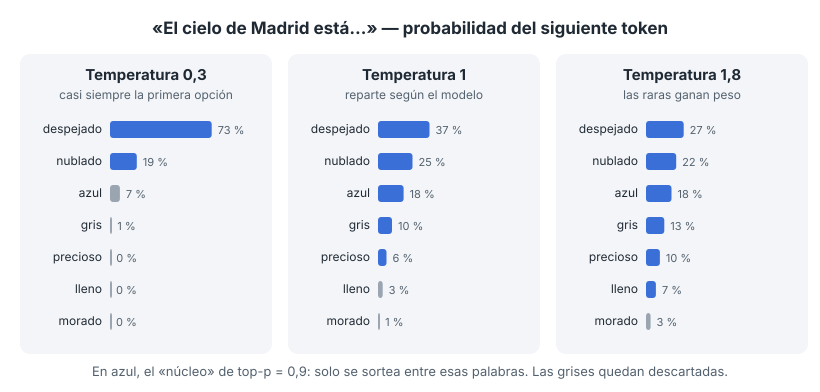
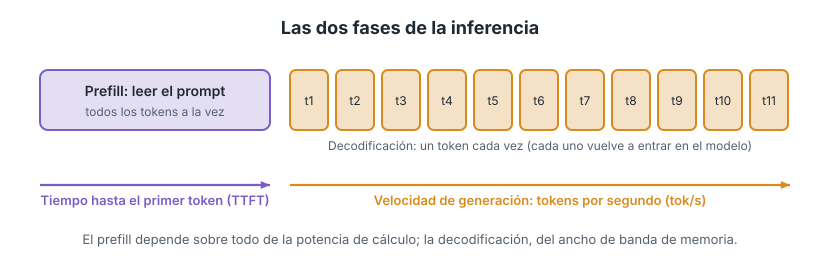
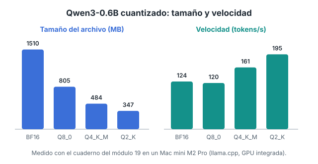

# 12. Inferencia: cómo responde un modelo

!!! abstract "En este módulo"
    - Qué es la inferencia y en qué se diferencia del entrenamiento.
    - Tokens, ventana de contexto y parámetros: las tres cifras que definen un modelo.
    - Cómo elige el modelo cada palabra: temperatura, top-k, top-p y compañía.
    - Las dos fases de una respuesta y cómo se mide la velocidad (*benchmarking*).

## 1. Entrenar frente a usar

La vida de un modelo tiene dos momentos muy distintos:

- **Entrenamiento:** el modelo lee enormes cantidades de datos y ajusta sus parámetros. Es lento, carísimo y ocurre una vez (o unas pocas). Lo verás en los módulos [18](18-fine-tuning.md) y [21](21-pre-entrenamiento.md).
- **Inferencia:** el modelo ya entrenado **se usa** para responder. Cada vez que escribes en ChatGPT, Gemini o Claude, el modelo hace inferencia. Durante la inferencia **no aprende nada**: sus parámetros no cambian, solo aplica lo que ya sabe.

En la IA generativa, la inferencia es el momento de **crear**: a partir de tu petición (el *prompt*), el modelo produce un texto, una imagen o un audio que no existía. No lo copia de ningún sitio: lo construye a partir de los patrones que aprendió.

!!! tip "¿Y la «memoria» de ChatGPT?"
    Si los parámetros no cambian, ¿cómo «recuerda» ChatGPT lo que le dijiste ayer? No es que el modelo aprenda: la aplicación guarda notas sobre ti y las **añade al principio de cada conversación**, como si te las recordara en voz baja. El modelo sigue siendo el mismo.

## 2. Tokens: las piezas con las que trabaja

Un modelo de lenguaje no lee letras ni palabras, sino **tokens**: trozos de texto de un vocabulario fijo (normalmente entre 30 000 y 250 000 piezas). Las palabras frecuentes son un solo token; las raras se parten en trozos. El proceso de cortar el texto se llama **tokenización** (lo construirás tú mismo en el [módulo 21](21-pre-entrenamiento.md)).

| Texto | Tokens posibles |
|---|---|
| `Los gatos comen pescado.` | `Los` · ` gatos` · ` comen` · ` pescado` · `.` |
| `aguacates` | ` agu` · `ac` · `ates` |
| `electroencefalograma` | ` elect` · `roen` · `ce` · `fal` · `ograma` |

Fíjate en que el espacio suele ir pegado al principio del token. Cada modelo tiene su propio tokenizador y los cortes varían de uno a otro. Puedes probarlo en el [tokenizador de OpenAI](https://platform.openai.com/tokenizer).

Los tokens importan porque:

1. **El modelo genera un token cada vez.** Predecir «la siguiente palabra» es, en realidad, predecir el siguiente token.
2. **Definen la memoria de trabajo.** La **ventana de contexto** es el número máximo de tokens que el modelo puede tener en cuenta a la vez: tu mensaje, las instrucciones de sistema, los documentos adjuntos, el historial de la conversación y su propia respuesta. Lo que no cabe, desaparece. Los primeros ChatGPT tenían 4 096 tokens; en 2026 lo habitual en los grandes modelos comerciales es entre 200 000 y más de un millón.
3. **Son la unidad de cobro.** Las API se pagan por **millón de tokens**, con precios distintos para los de entrada (lo que envías) y los de salida (lo que genera, que son más caros).
4. **Cada idioma «cuesta» distinto.** Los tokenizadores se entrenan con mucho texto en inglés, así que el inglés es el más eficiente: unas 75 palabras por cada 100 tokens. En español salen menos palabras por token, y en idiomas con otros alfabetos, menos aún. Por eso el mismo texto traducido puede costar más y llenar antes el contexto.

## 3. De tokens a significado: los *embeddings*

Dentro del modelo, cada token se convierte en un **vector**: una lista de miles de números que representa su significado ([módulo 6](06-multimodalidad.md)). Las palabras de significado parecido quedan cerca en ese espacio («rey» y «monarca»), y algunas relaciones se convierten en direcciones (de «hombre» a «mujer» se va en la misma dirección que de «rey» a «reina»).

A ese espacio interno de representaciones se le llama a veces **espacio latente**. La analogía:

- Los **tokens** son las palabras que dices: «Madrid», «capital», «Prado».
- Las **representaciones internas** son la idea completa que tienes en la cabeza: su historia, su geografía, sus conexiones.

El modelo traduce los tokens a vectores, los procesa capa a capa con el mecanismo de **atención** ([módulo 8](08-ia-generativa.md)), que mezcla la información de cada token con la de los demás, y al final traduce el resultado a una **probabilidad para cada token del vocabulario**.

!!! note "El término «espacio latente»"
    Se usa sobre todo en los modelos de imagen (difusión, autocodificadores), donde la imagen se comprime literalmente en un espacio más pequeño antes de generarse. En los modelos de lenguaje es más preciso hablar de *embeddings* o de **representaciones internas**.

## 4. Parámetros: el tamaño del cerebro

Los **parámetros** (también llamados **pesos**) son los números que el modelo ajustó durante el entrenamiento: la «fuerza» de cada conexión de la red neuronal ([módulo 5](05-deep-learning.md)). No son el conocimiento escrito en algún sitio, sino la configuración de miles de millones de interruptores que hace que, ante «el cielo está…», «despejado» tenga más probabilidad que «morado».

- Se cuentan en **miles de millones**: un modelo «8B» tiene unos 8 000 millones (*billion* en inglés); uno «70B», unos 70 000 millones. Los grandes modelos comerciales tienen cientos de miles de millones o incluso billones, aunque sus empresas no suelen publicar la cifra.
- **Más parámetros dan más capacidad**, pero no garantizan calidad: un modelo pequeño bien entrenado, con buenos datos, puede superar a uno grande mal entrenado. Gemma 4 E4B o Qwen3 4B, de 2025-2026, superan en muchas pruebas a GPT-3 (175B) de 2020.
- **Determinan la memoria necesaria.** Con 16 bits por parámetro, cada 1 000 millones ocupan unos 2 GB. Por eso un modelo de 8B pesa unos 16 GB sin comprimir, y la [cuantización](19-cuantizacion.md) es tan importante para usarlos en casa.
- **Modelos de mezcla de expertos (MoE).** Muchos modelos actuales (DeepSeek, Qwen3, gpt-oss…) tienen muchos parámetros en total, pero para cada token solo **activan** una parte. Un modelo «30B-A3B» tiene 30 000 millones de parámetros, pero cada token usa solo 3 000 millones: ocupa como uno grande y es tan rápido como uno pequeño.

!!! example "La analogía del chef"
    Los **datos de entrenamiento** son todos los platos que un chef ha probado y cocinado en 50 años. Los **parámetros** no son las recetas, sino su intuición: «a esta salsa le falta sal», «el jengibre va bien con el limón». La **inferencia** es pedirle un plato nuevo: no consulta un libro, usa su intuición para combinar ingredientes de forma coherente.

**Parámetros frente a hiperparámetros.** Los parámetros los aprende el modelo solo. Los **hiperparámetros** los eligen las personas que lo entrenan antes de empezar: cuántas capas tiene, la tasa de aprendizaje, cuántas pasadas se dan a los datos… Y los **parámetros de inferencia** (temperatura, top-p…) los eliges tú al usarlo, en el apartado siguiente.

## 5. Cómo elige cada palabra: el muestreo

Para cada posición, el modelo calcula una **probabilidad para cada token** del vocabulario. Si eligiera siempre el más probable (*decodificación voraz*), respondería siempre igual y caería con facilidad en bucles repetitivos. Por eso se usa el **muestreo** (*sampling*): se elige al azar, pero respetando las probabilidades. Varios ajustes controlan ese azar:

<figure markdown="span">
  { .diagrama width="760" }
  <figcaption>La temperatura aplana o afila las probabilidades. Top-p descarta las opciones de la cola.</figcaption>
</figure>

| Ajuste | Qué hace | Valores típicos |
|---|---|---|
| **Temperatura** | Afila (baja) o aplana (alta) las probabilidades. A 0, siempre la opción más probable; por encima de 1, ganan peso las raras. | 0–0,3 para datos y código; 0,7–1 para conversación y textos creativos. |
| **Top-k** | Solo sortea entre las *k* opciones más probables. | 20–50 |
| **Top-p** (*nucleus*) | Sortea entre el grupo más pequeño de opciones que suman una probabilidad *p*. Si el modelo está seguro, el grupo es pequeño; si duda, crece. | 0,8–0,95 |
| **Min-p** | Descarta las opciones con menos de un porcentaje de la probabilidad de la mejor. Muy usado en modelos locales. | 0,05 |
| **Penalización por repetición** | Resta probabilidad a los tokens ya usados para evitar bucles. 1,0 = sin penalización. | 1,0–1,1 |
| **Semilla** (*seed*) | Fija el azar: con la misma semilla y los mismos ajustes, la misma respuesta. | aleatoria |
| **Longitud máxima** | Límite de tokens de la respuesta. | según la tarea |

Un detalle práctico: los modelos de **razonamiento** (los que «piensan» antes de responder) suelen funcionar mejor con los valores que recomienda su fabricante, y algunos ni siquiera permiten cambiar la temperatura. En las aplicaciones de chat comerciales estos ajustes están ocultos; los verás en [LM Studio](14-ia-local.md) y en las [API](15-api.md).

## 6. Las dos fases de una respuesta

Cuando envías un mensaje, la inferencia pasa por dos fases muy distintas:

<figure markdown="span">
  { .diagrama width="760" }
</figure>

1. **Prefill (procesar el prompt).** El modelo lee todo tu mensaje (y el historial, y los documentos) **de una vez**, en paralelo. Depende de la **potencia de cálculo** de la GPU. Se mide con el **tiempo hasta el primer token** (*Time To First Token*, **TTFT**): lo que tardas en ver aparecer la primera palabra. Con un documento largo puede ser de varios segundos.
2. **Decodificación (generar la respuesta).** El modelo produce **un token cada vez**, y cada token nuevo vuelve a entrar para calcular el siguiente. Este paso no se puede paralelizar y depende sobre todo del **ancho de banda de memoria**: en cada token hay que leer todos los parámetros. Se mide en **tokens por segundo (tok/s)**. Para leer cómodamente bastan unos 10–20 tok/s; por debajo de 5 se hace lento.

Para no recalcular todo en cada token, el modelo guarda lo ya procesado en la **caché KV** (*key-value cache*). Esa caché crece con la longitud de la conversación y ocupa memoria, por eso un contexto muy largo necesita más RAM o VRAM (lo verás en los ajustes de [LM Studio](14-ia-local.md#5-ajustes-de-carga-el-rendimiento)).

Y un tercer factor, en los servicios en la nube: la **concurrencia**. Un servidor atiende a muchas personas a la vez agrupando sus peticiones (*batching*), lo que mejora el rendimiento total aunque cada usuario vaya algo más lento.

### Benchmarking: medir y comparar

Medir el TTFT y los tok/s permite comparar modelos, cuantizaciones y ordenadores. Una prueba sencilla:

1. Elige **dos o tres modelos** de tamaños distintos (por ejemplo, de 1B, 4B y 8B) y, si quieres, el mismo modelo en varias cuantizaciones.
2. Usa siempre **el mismo prompt**, con temperatura 0, en el mismo equipo y sin otros programas pesados abiertos.
3. Repite cada prueba **tres veces** y quédate con la media (la primera suele ser más lenta porque el modelo se está cargando).
4. Anota el **TTFT** y los **tok/s**. LM Studio muestra ambos debajo de cada respuesta.
5. Repite con un **prompt largo** (pega un texto de dos páginas y pide un resumen): verás cómo el TTFT se dispara y los tok/s apenas cambian.

<figure markdown="span">
  { .diagrama width="640" }
  <figcaption>Medición real con la práctica del módulo 19: Qwen3-0.6B en un Mac mini M2 Pro. Curiosamente, la versión más comprimida es la más rápida… y la que peor responde.</figcaption>
</figure>

!!! example "Actividad: tu propio benchmark"
    Con [LM Studio](14-ia-local.md) instalado, descarga un modelo pequeño en dos cuantizaciones (por ejemplo, Q4_K_M y Q8_0). Haz las mismas cinco preguntas a cada uno, anota TTFT y tok/s en una hoja de cálculo y pídele a una IA que te haga la gráfica a partir de la tabla. ¿Compensa la diferencia de calidad la diferencia de velocidad?

## 7. ¿Dónde se hace la inferencia?

| Opción | Ventajas | Inconvenientes |
|---|---|---|
| **Servicios comerciales** (ChatGPT, Gemini, Claude…) | Los modelos más potentes, sin instalar nada. | Tus datos salen de tu equipo; límites de uso; suscripción. Ver [módulo 13](13-apps-prompts.md). |
| **API en la nube** | Integras el modelo en tus programas y pagas solo lo que usas. | Hay que programar un poco y vigilar el gasto. Ver [módulo 15](15-api.md). |
| **En tu ordenador** (LM Studio, Ollama) | Privacidad total, sin conexión, gratis. | Modelos más pequeños; depende de tu RAM y GPU. Ver [módulo 14](14-ia-local.md). |
| **GPU alquilada** (Colab, RunPod, Vast.ai, Lambda…) | Potencia de un servidor por horas, para pruebas o entrenamiento. | Configuración técnica; se paga por hora aunque no la uses. |

Para practicar sin gastar, **[Google Colab](https://colab.research.google.com/?hl=es)** ofrece GPU gratuitas (con límites de tiempo) y es lo que usan las prácticas de este curso. [Kaggle](https://www.kaggle.com/docs/notebooks) da unas 30 horas semanales de GPU gratis. Para proyectos serios, los servicios de alquiler cobran por hora según la GPU: desde menos de 1 € la hora una GPU de consumo hasta varios euros una de centro de datos.

## Para ampliar

**Artículos**

- [¿Qué es la inferencia en IA?](https://www.ibm.com/es-es/think/topics/ai-inference) (IBM).
- [How LLM inference works](https://arpitbhayani.me/blogs/how-llm-inference-works) (Arpit Bhayani, en inglés): la explicación técnica de prefill, decodificación y caché KV.
- [¿Qué son los tokens y cómo contarlos?](https://help.openai.com/en/articles/4936856-what-are-tokens-and-how-to-count-them) (OpenAI, en inglés).
- [Parámetros de los LLM](https://www.ibm.com/es-es/think/topics/llm-parameters) (IBM).

**Vídeos**

- :material-youtube: [Pero, ¿qué es una red neuronal?](https://www.youtube.com/watch?v=aircAruvnKk) (3Blue1Brown, subtítulos en español): para ver qué son los pesos y los sesgos.
- :material-youtube: [Pero, ¿qué es un GPT? Introducción visual a los Transformers](https://www.youtube.com/watch?v=wjZofJX0v4M) (3Blue1Brown, subtítulos en español): incluye el muestreo y la temperatura.

**Para experimentar**

- :material-gesture-tap: [Tokenizador de OpenAI](https://platform.openai.com/tokenizer): escribe un texto y mira cómo se trocea.
- :material-gesture-tap: [Transformer Explainer](https://poloclub.github.io/transformer-explainer/): mueve el control de temperatura y observa cómo cambian las probabilidades.

