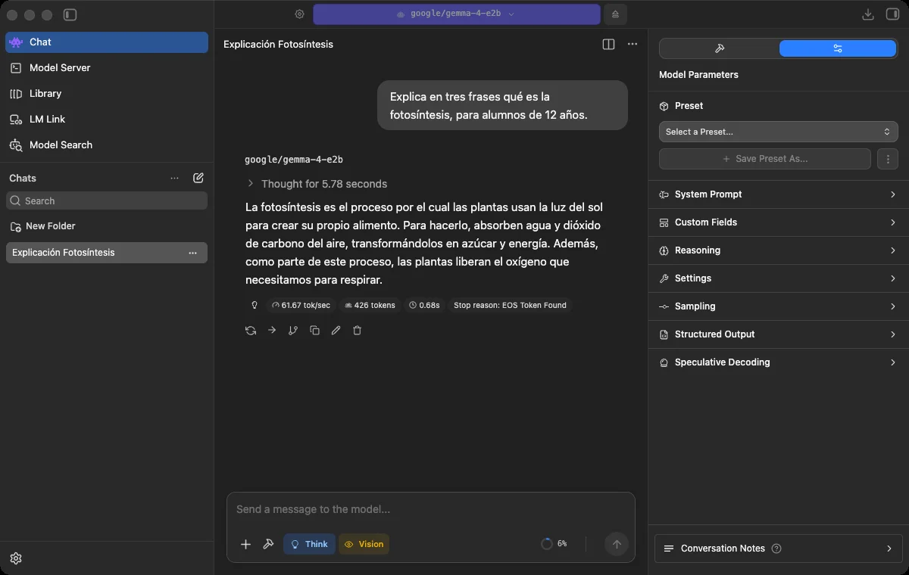
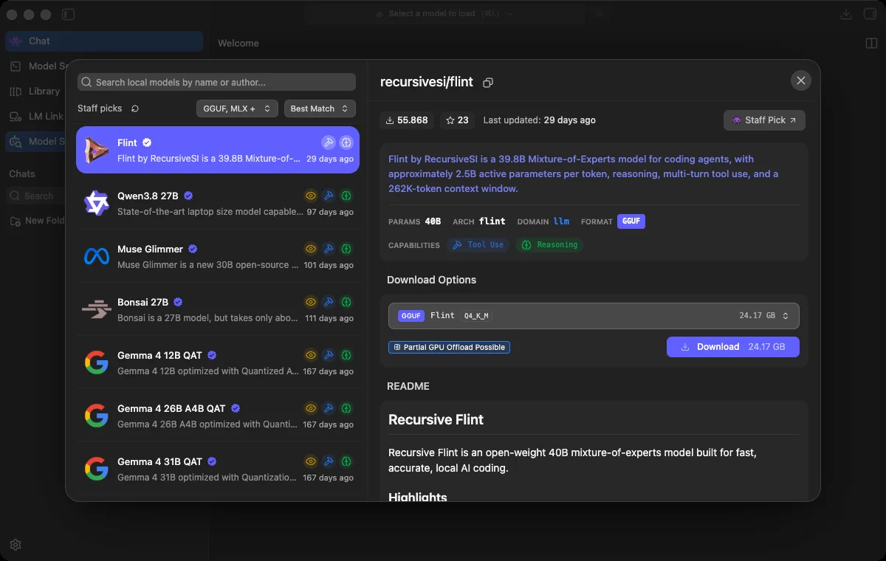
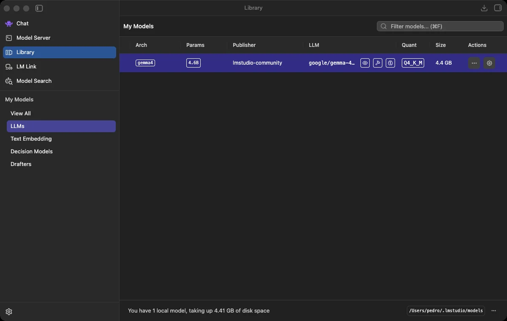
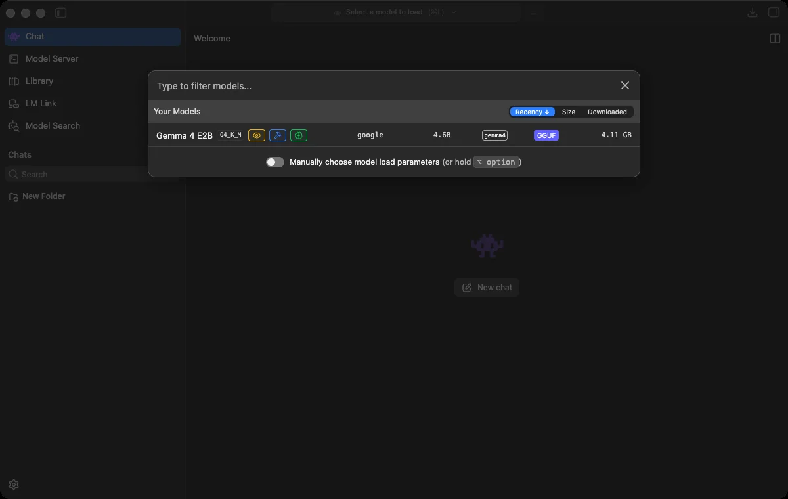
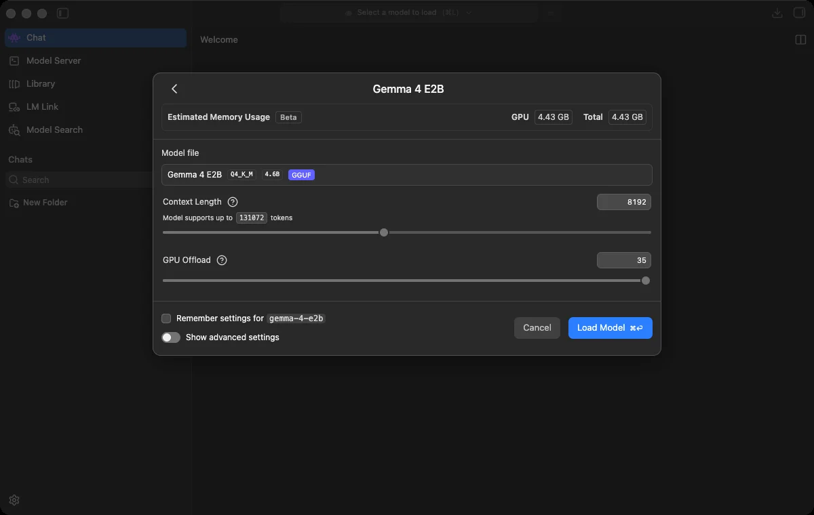
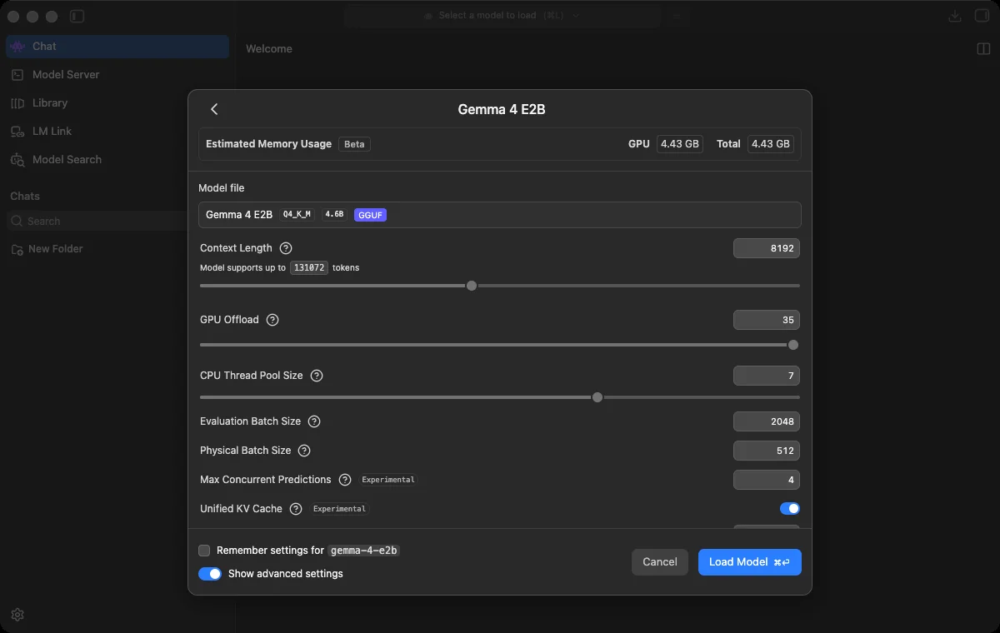
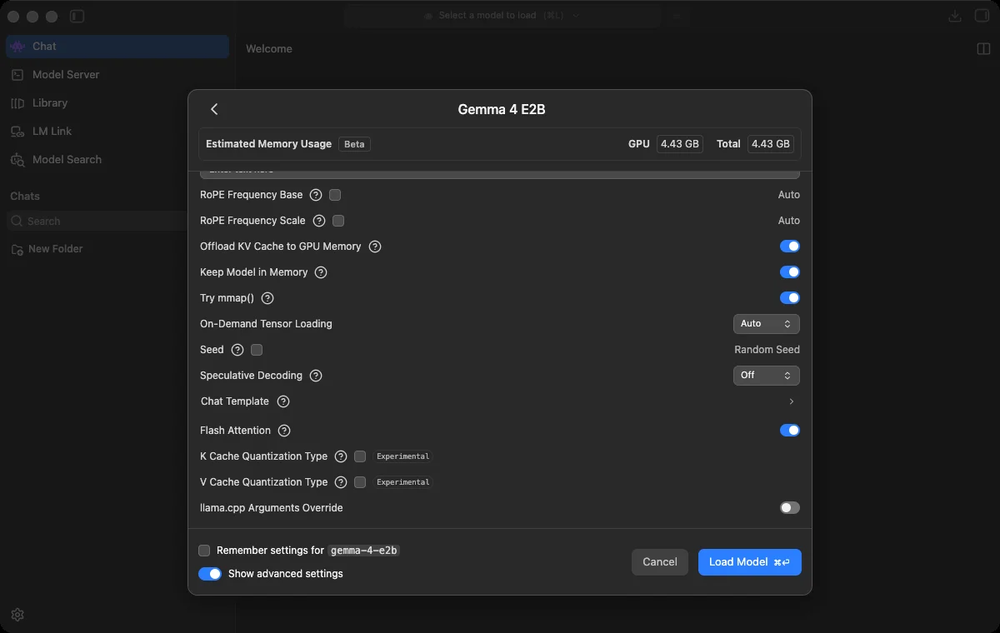
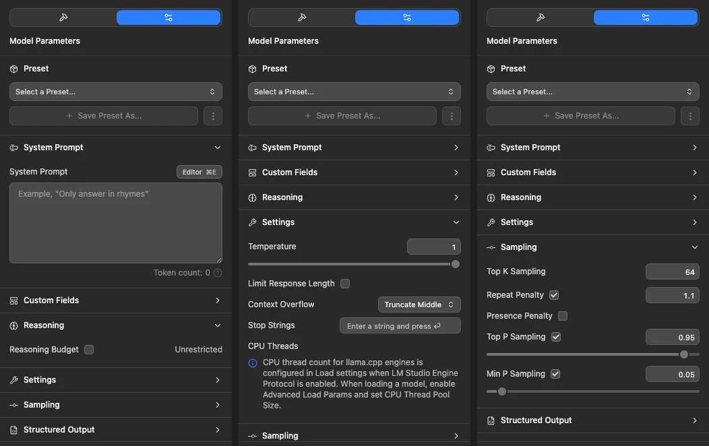
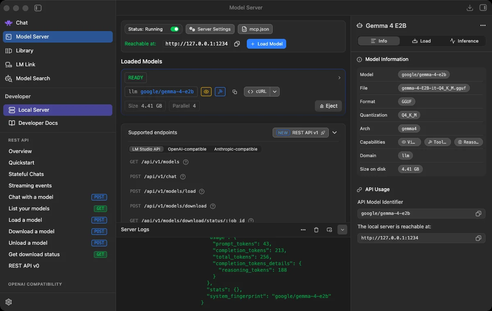
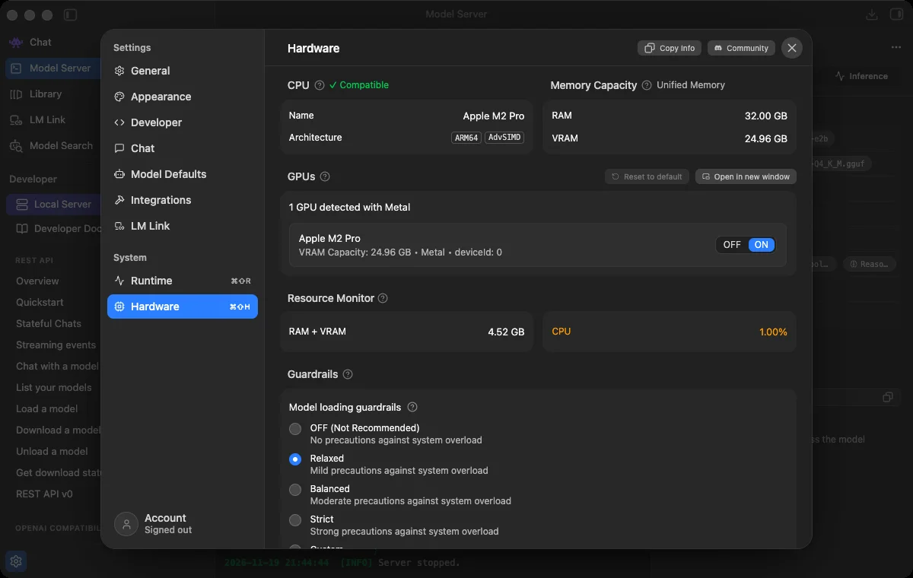

# 14. IA en tu ordenador: LM Studio y Ollama

!!! abstract "En este módulo"
    - Por qué ejecutar un modelo en tu propio equipo y qué necesitas.
    - Manual de **LM Studio 0.4**, con capturas reales: descargar, cargar, conversar, ajustar y servir modelos.
    - Los ajustes de carga y de conversación (*Model Parameters*), uno a uno.
    - **Ollama**, la alternativa ligera.

## 1. ¿Por qué en local?

Ejecutar un modelo de lenguaje en tu ordenador tiene ventajas claras:

- **Privacidad:** tus textos y documentos no salen de tu equipo. Es la opción adecuada para datos personales, de clientes o de alumnos.
- **Sin conexión:** funciona en un avión o en un aula sin internet.
- **Gratis y sin límites:** no hay suscripciones ni cupos de mensajes.
- **Control:** eliges el modelo, su versión y todos sus ajustes, y nadie lo cambia sin avisar.

El precio es que los modelos que caben en un ordenador doméstico son **más pequeños** que los de ChatGPT o Gemini: excelentes para resumir, redactar, traducir o programar cosas sencillas, menos fiables para preguntas de conocimiento muy específico.

### ¿Qué ordenador necesito?

Lo que manda es la **memoria**: el modelo tiene que caber entero en la VRAM de la tarjeta gráfica o, en los Mac con chip Apple, en la memoria unificada ([módulo 9](09-hardware.md)). Como regla rápida, un modelo cuantizado a 4 bits ocupa algo más de **0,6 GB por cada 1 000 millones de parámetros**, más la memoria del contexto.

| Memoria disponible | Modelos razonables (noviembre de 2026) |
|---|---|
| 8 GB | De 1 000 a 4 000 millones de parámetros: Gemma 4 E2B o E4B, Qwen3 4B, Phi-4-mini. |
| 16 GB | Hasta unos 14 000 millones: Qwen3 8B o 14B, o modelos MoE pequeños. |
| 32 GB | De 20 000 a 32 000 millones: gpt-oss-20b, Qwen3 30B-A3B, Gemma 4 26B (MoE) o 31B. |
| 64 GB o más | Modelos de 70 000 millones o MoE grandes. |

LM Studio funciona en **Mac con chip Apple** (M1 o posterior), **Windows** (x64 o ARM) y **Linux** (x64). En un PC con tarjeta NVIDIA, AMD o Intel aprovecha la GPU; sin ella funciona igual, pero más despacio.

## 2. Instalar LM Studio

1. Descárgalo de **[lmstudio.ai](https://lmstudio.ai/)** (unos 550 MB) e instálalo como cualquier programa.
2. Al abrirlo por primera vez te propone descargar un modelo recomendado para tu equipo. Puedes aceptarlo o saltarlo.
3. La versión 0.4, publicada en enero de 2026, rediseñó la interfaz. Desde entonces se actualiza casi cada semana; este manual corresponde a la **0.4.28** (noviembre de 2026).

!!! tip "Modo desarrollador"
    Algunas opciones avanzadas solo aparecen con el **modo desarrollador** activado: **ajustes (engranaje, abajo a la izquierda) → Developer → Developer mode: ON**. En la 0.4 sustituyó a los antiguos modos «User / Power User / Developer».

!!! info "Capturas reales"
    Las capturas de este módulo son de **LM Studio 0.4.28 en un Mac mini M2 Pro**, con el modelo Gemma 4 E2B, en noviembre de 2026. En Windows y Linux la ventana es igual.

## 3. La interfaz

<figure markdown="span">
  { width="900" loading=lazy }
  <figcaption>LM Studio con un modelo cargado. A la izquierda, las secciones; arriba, el selector de modelo; a la derecha, el panel <em>Model Parameters</em>.</figcaption>
</figure>

| Zona | Para qué sirve |
|---|---|
| **Chat** | Conversar con el modelo cargado. Las conversaciones se guardan a la izquierda y se pueden organizar en carpetas. El icono de dos columnas (arriba a la derecha del chat) abre la **vista dividida**, para comparar dos chats. |
| **Model Server** | El servidor local (la API) y el estado de los modelos cargados. Ver apartado 8. |
| **Library** | Los modelos descargados: arquitectura, parámetros, cuantización, tamaño y carpeta donde están. Desde aquí se borran. |
| **LM Link** | Usar los modelos de otro ordenador de tu red, o compartir los tuyos. |
| **Model Search** | Buscar y descargar modelos de Hugging Face (++cmd+shift+m++ en Mac, ++ctrl+shift+m++ en Windows). |
| **Selector de modelo** (barra superior, ++cmd+l++ o ++ctrl+l++) | Cargar, cambiar y expulsar modelos de la memoria. El engranaje que aparece a su izquierda abre los ajustes de carga del modelo activo. |
| **Panel derecho** (icono arriba a la derecha) | Dos pestañas: **Integrations** (llave inglesa: plugins y MCP) y **Model Parameters** (los ajustes de la conversación). |
| **Ajustes** (engranaje, abajo a la izquierda) | Idioma, apariencia, modo desarrollador, valores por defecto de los modelos, motores (*Runtime*, ++cmd+shift+r++) y hardware (++cmd+shift+h++). |

## 4. Descargar y cargar un modelo

<figure markdown="span">
  { width="800" loading=lazy }
  <figcaption>Model Search: a la izquierda, los modelos recomendados (<em>Staff picks</em>); a la derecha, su ficha con el tamaño de cada versión.</figcaption>
</figure>

1. Abre **Model Search** y escribe, por ejemplo, `gemma 4` o `qwen`. Los iconos de colores indican las capacidades del modelo: **visión** (ojo), **uso de herramientas** (martillo) y **razonamiento** (cerebro).
2. Elige una versión en **Download Options**. Cada una indica su **formato** (GGUF o MLX), su **cuantización** (`Q4_K_M`, `Q8_0`…, ver [módulo 19](19-cuantizacion.md)) y su tamaño. LM Studio avisa si cabe entero en la GPU (*Full GPU Offload Possible*) o solo en parte. Para empezar, **Q4_K_M** es la opción equilibrada; en un Mac, la versión **MLX** suele ser algo más rápida.
3. Pulsa **Download**. El progreso aparece en el icono de descargas, arriba a la derecha.
4. En **Library** verás el modelo descargado:

<figure markdown="span">
  { width="800" loading=lazy }
</figure>

5. Pulsa el **selector de modelo** de la barra superior. Si activas **Manually choose model load parameters** (o mantienes pulsada la tecla ++option++ / ++alt++ al elegir), se abre la ventana de ajustes de carga del apartado 5; si no, LM Studio usa los que considera mejores para tu equipo.

<figure markdown="span">
  { width="800" loading=lazy }
</figure>

6. Con el modelo cargado, escribe en el chat. Debajo de cada respuesta aparecen la **velocidad** (tok/s), los **tokens** generados y el **tiempo hasta el primer token**, los datos del [benchmarking del módulo 12](12-inferencia.md#benchmarking-medir-y-comparar). En la captura del apartado 3: 61,67 tok/s, 426 tokens y 0,68 s. Si el modelo razona, verás también «*Thought for… seconds*»: despliégalo para leer su razonamiento.
7. En la caja de texto, el **+** adjunta archivos o imágenes, el **martillo** activa las herramientas, y los botones **Think** y **Vision** aparecen si el modelo sabe razonar o ver imágenes. El círculo de la derecha indica qué porcentaje de la ventana de contexto llevas usado.

!!! example "Actividad"
    Descarga Gemma 4 E2B (o el modelo pequeño que te recomiende LM Studio) y hazle tres preguntas: una de cultura general, una de razonamiento («si tengo 3 manzanas y me como la mitad de las que tengo más una…») y una de redacción. Compara después las mismas preguntas en ChatGPT o Gemini. ¿Dónde se nota la diferencia de tamaño? Prueba también a desactivar **Think**: ¿responde más rápido? ¿Peor?

## 5. Ajustes de carga: el rendimiento

Estos ajustes se eligen al **cargar** el modelo, o después con el **engranaje** que hay junto al selector (el modelo se recarga). Deciden cuánta memoria usa y a qué velocidad responde. Arriba, **Estimated Memory Usage** calcula cuánta memoria ocupará, y cambia al mover los controles: es la forma más rápida de saber si un modelo cabe. Si marcas **Remember settings for…**, LM Studio los guarda para ese modelo.

<figure markdown="span">
  { width="800" loading=lazy }
  <figcaption>La ventana de carga básica: solo contexto y GPU offload. Gemma 4 E2B con 8 192 tokens de contexto ocupa 4,43 GB.</figcaption>
</figure>

Activando **Show advanced settings** aparecen todos los demás:

<figure markdown="span">
  { width="800" loading=lazy }
</figure>

<figure markdown="span">
  { width="800" loading=lazy }
</figure>

| Ajuste | Qué hace | Consejo |
|---|---|---|
| **Context Length** | Tokens máximos de la conversación (prompt, historial, documentos y respuesta). Debajo indica el máximo que admite el modelo (131 072 en Gemma 4 E2B). | Más contexto = más memoria. 8 000–16 000 bastan para conversar; súbelo si adjuntas documentos largos. |
| **GPU Offload** | Cuántas **capas** del modelo van a la GPU (35 de 35 en la captura). Las que no caben se calculan en la CPU. | Todas, si caben. Cada capa que se queda en la CPU frena mucho la generación. |
| **CPU Thread Pool Size** | Núcleos del procesador para las capas que no están en la GPU. | El valor automático va bien. |
| **Evaluation Batch Size** / **Physical Batch Size** | Cuántos tokens del prompt se procesan de golpe en el *prefill* ([módulo 12](12-inferencia.md#6-las-dos-fases-de-una-respuesta)). | Los valores por defecto (2048 y 512) van bien. |
| **Max Concurrent Predictions** | Cuántas peticiones atiende a la vez (novedad de la 0.4). | 4 por defecto; súbelo solo si varias aplicaciones usan el modelo a la vez. |
| **Unified KV Cache** | Una sola caché KV compartida por todas las peticiones simultáneas, en lugar de una reservada para cada una. | Déjalo activado. |
| **Context Checkpoints** | Puntos de guardado del contexto para no reprocesar todo al editar o regenerar mensajes. | Valor por defecto. |
| **Reasoning Budget Message** | Texto que se le da al modelo cuando agota su presupuesto de razonamiento. | Déjalo vacío. |
| **RoPE Frequency Base / Scale** | Ajustes de la codificación de posiciones, para estirar el contexto más allá del entrenado. | En automático: valores incorrectos producen texto sin sentido. |
| **Offload KV Cache to GPU Memory** | Pone la caché KV en la GPU. | Activado (por defecto) si te sobra VRAM: acelera las conversaciones largas. |
| **Keep Model in Memory** | Mantiene el modelo cargado aunque no lo uses. | Activado si vas a usarlo a menudo. |
| **Try mmap()** | Lee el archivo del modelo bajo demanda en lugar de entero al principio. | Activado: carga más rápido. |
| **On-Demand Tensor Loading** | Carga partes del modelo solo cuando se necesitan. | *Auto*. |
| **Seed** | Fija la semilla aleatoria para obtener respuestas reproducibles. | Aleatoria (*Random Seed*), salvo para experimentos. |
| **Speculative Decoding** | Un modelo pequeño (*draft model*) adivina varios tokens y el grande los verifica de golpe. Si acierta a menudo, la generación se acelera sin perder calidad. | Necesita un modelo «borrador» de la misma familia descargado (se ven en *Library → Drafters*). *Off* por defecto. |
| **Chat Template** | La plantilla con la que se formatea la conversación para el modelo. | No la toques: viene con el modelo. |
| **Flash Attention** | Una forma optimizada de calcular la atención que ahorra memoria y acelera los contextos largos. | Activado por defecto en la 0.4. |
| **K / V Cache Quantization Type** | Comprime la caché KV a 8 o 4 bits (experimental). | Útil para contextos muy largos con poca memoria; puede bajar algo la calidad. |
| **llama.cpp Arguments Override** | Pasar opciones directamente al motor llama.cpp. | Solo para expertos. |

En los modelos de **mezcla de expertos** (MoE) aparecen además ajustes para elegir cuántos expertos se activan y cuántos se dejan en la CPU, lo que permite cargar modelos MoE grandes en GPU pequeñas.

## 6. Model Parameters: los ajustes de la conversación

En el panel derecho del chat, pestaña **Model Parameters**, están los ajustes que no requieren recargar el modelo. Cada sección se despliega con un clic:

<figure markdown="span">
  { width="900" loading=lazy }
  <figcaption>El panel <em>Model Parameters</em> con tres secciones desplegadas: System Prompt, Settings y Sampling.</figcaption>
</figure>

**Preset.** Un *preset* guarda una combinación de instrucciones y parámetros («Tutor de matemáticas», «Traductor», «Respuestas precisas») para reutilizarla. **Save Preset As…** guarda la configuración actual; el desplegable carga una guardada. Si cambias algo, aparece «*Unsaved Preset*» con un punto azul y el botón **Discard unsaved** para volver atrás.

**System Prompt.** Las instrucciones de sistema: reglas que el modelo sigue en toda la conversación. Por ejemplo: «Eres un tutor de matemáticas de 3.º de ESO. Explica paso a paso y no des la solución hasta que el alumno lo intente». El botón **Editor** (++cmd+e++) abre un editor más grande y **Token count** cuenta cuántos tokens ocupan: se envían en cada mensaje y restan espacio a la conversación, así que conviene que sean breves.

**Custom Fields.** Opciones propias de cada modelo. En Gemma 4, **Enable Thinking** activa o desactiva el razonamiento (es lo mismo que el botón **Think** del chat).

**Reasoning.** **Reasoning Budget** limita cuántos tokens puede dedicar el modelo a «pensar» antes de responder. Sin marcar, es ilimitado (*Unrestricted*). Limitarlo da respuestas más rápidas, a veces peores.

**Settings.**

- **Temperature:** la creatividad de las respuestas ([módulo 12](12-inferencia.md#5-como-elige-cada-palabra-el-muestreo)). LM Studio carga la que recomienda el fabricante de cada modelo (1 en Gemma 4; 0,7 u 0,8 en otros).
- **Limit Response Length:** fija un máximo de tokens por respuesta.
- **Context Overflow:** qué hacer cuando la conversación no cabe en el contexto. **Truncate Middle** (por defecto) conserva el principio (las instrucciones) y lo más reciente y descarta lo del medio; **Rolling Window** olvida lo más antiguo; **Stop at Limit** detiene la respuesta.
- **Stop Strings:** textos que, si el modelo los escribe, cortan la respuesta. Útil para automatizar.
- **CPU Threads:** desde la 0.4, en los modelos GGUF se ajusta en la ventana de carga (*CPU Thread Pool Size*), como avisa el propio panel.

**Sampling.** Los controles finos del muestreo, con los valores que recomienda cada fabricante (en la captura, los de Gemma 4):

- **Top K Sampling** (64): solo sortea entre las 64 opciones más probables.
- **Repeat Penalty** (1,1): penaliza repetir tokens ya usados.
- **Presence Penalty**: penaliza volver a mencionar cualquier tema ya aparecido. Desactivada por defecto.
- **Top P Sampling** (0,95): sortea entre las opciones que suman el 95 % de la probabilidad.
- **Min P Sampling** (0,05): descarta las opciones con menos del 5 % de la probabilidad de la mejor.

**Structured Output.** Al activarlo, pegas un esquema JSON y el modelo queda **obligado** a responder con esa estructura exacta. Muy útil para automatizar tareas (extraer datos de facturas, clasificar correos).

**Speculative Decoding.** En la 0.4 esta opción se ha trasladado a los **ajustes de carga** (apartado 5), como indica el propio panel.

**Conversation Notes** (abajo del todo). Notas tuyas sobre la conversación. El modelo no las lee.

!!! example "Actividad: el efecto de los parámetros"
    Haz la misma pregunta creativa («Inventa el principio de un cuento sobre un faro») tres veces con **Temperature** 0,2, 1 y 1,6. Después vuelve a 1 y prueba **Top K** 1. ¿Qué pasa? Por último, guarda un *preset* «Cuentacuentos» con un *System Prompt* que fije el tono y el público.

## 7. Integrations: plugins, MCP y documentos

<figure markdown="span">
  { width="340" loading=lazy }
</figure>

La otra pestaña del panel derecho, **Integrations** (llave inglesa), da **herramientas** al modelo ([módulo 16](16-habilidades-mcp.md)). Trae dos plugins de serie, que se activan con su interruptor:

- **js-code-sandbox:** el modelo puede escribir y **ejecutar código JavaScript** en un entorno aislado, por ejemplo para hacer cálculos exactos en lugar de «inventarse» el resultado.
- **rag-v1:** permite **conversar con tus documentos**. Arrastra un PDF, un Word o un texto al chat: si es corto, se mete entero en el contexto; si es largo, el plugin hace **RAG** (*Retrieval-Augmented Generation*): trocea el documento, busca los fragmentos más relacionados con tu pregunta y solo pasa esos al modelo. Todo ocurre en tu equipo.

**Install → Edit mcp.json** abre el archivo donde se añaden **servidores MCP** (también accesible desde el botón **mcp.json** de *Model Server*). La práctica está en el [módulo 16](16-habilidades-mcp.md#practica).

!!! warning "RAG no es leer el documento entero"
    Con RAG el modelo solo ve los fragmentos recuperados. Pregunta cosas concretas («¿qué dice el apartado 3 sobre las faltas de asistencia?») mejor que generales («resume el documento»). Para resumir un texto largo, sube el **Context Length** y pégalo entero.

## 8. El servidor local

<figure markdown="span">
  { width="900" loading=lazy }
  <figcaption>Model Server en marcha. Abajo, en <em>Server Logs</em>, la respuesta a una petición de la práctica del módulo 15 (213 tokens generados, 188 de ellos de razonamiento).</figcaption>
</figure>

En **Model Server**, el interruptor **Status** arranca un servidor en `http://127.0.0.1:1234` (o `localhost:1234`), **compatible con las API de OpenAI y de Anthropic**: cualquier programa que sepa hablar con ChatGPT o Claude puede usar tu modelo local cambiando solo la dirección. También se arranca desde la terminal con `lms server start`. Lo usarás en la práctica del [módulo 15](15-api.md).

- **Loaded Models** muestra los modelos cargados y su identificador para la API (`google/gemma-4-e2b`). El botón **cURL** copia una petición de ejemplo.
- **Supported endpoints** lista las direcciones disponibles, en tres pestañas: la API propia de LM Studio, la compatible con OpenAI y la compatible con Anthropic.
- **Server Logs** registra cada petición en tiempo real.
- **Server Settings** permite, entre otras cosas, servir en la red local para que otros equipos usen el modelo, y exigir **claves de permiso** para controlar quién accede.
- A la izquierda, **Developer Docs** incluye la documentación completa de la API dentro de la propia aplicación.

!!! info "Más allá de la ventana"
    - **`lms`**: la herramienta de terminal de LM Studio. `lms get google/gemma-4-e2b` descarga un modelo, `lms ls` lista los descargados, `lms load` lo carga, `lms ps` muestra los que están en memoria y `lms chat` abre un chat en la propia terminal.
    - **Servicio sin ventana:** en *Ajustes → Developer → Enable Local LLM Service* el servidor funciona aunque cierres la aplicación.
    - **Hardware:** *Ajustes → Hardware* muestra tu CPU, GPU y memoria, y los **guardarraíles** que impiden cargar un modelo que bloquearía el equipo.
    - **LM Link** y **Locally** (la aplicación para iPhone y iPad) permiten usar desde otros dispositivos los modelos de tu ordenador.

<figure markdown="span">
  { width="800" loading=lazy }
  <figcaption>Ajustes → Hardware en un Mac con 32 GB de memoria unificada: macOS deja usar unos 25 GB como VRAM.</figcaption>
</figure>

## 9. Ollama, la alternativa ligera

**[Ollama](https://ollama.com/)** hace lo mismo con otra filosofía: menos ajustes, más sencillez. Se instala en Windows, Mac y Linux, tiene una aplicación con ventana de chat y, sobre todo, se usa desde la terminal:

```bash
ollama run gemma4:e4b        # descarga el modelo (la primera vez) y abre un chat
ollama list                  # modelos descargados
ollama rm gemma4:e4b         # borrar un modelo
```

Su **biblioteca** ([ollama.com/library](https://ollama.com/library)) ofrece los modelos ya preparados con un nombre corto. También levanta una API local (`http://localhost:11434`) que usan muchas aplicaciones: editores de código, extensiones del navegador, interfaces web como Open WebUI o agentes como OpenClaw ([módulo 17](17-agentes.md)).

| | LM Studio | Ollama |
|---|---|---|
| Interfaz | Ventana completa con todos los ajustes | Ventana sencilla y terminal |
| Ajustes | Todos visibles | Pocos, en un archivo de configuración (*Modelfile*) |
| Formatos | GGUF y MLX | GGUF y modelos propios de su biblioteca |
| Licencia | Gratuita, código cerrado | Código abierto (MIT) |
| Ideal para | Aprender y experimentar | Usar modelos desde otras aplicaciones |

Por debajo, ambos usan **[llama.cpp](https://github.com/ggml-org/llama.cpp)**, el motor de código abierto que hizo posible la IA local. Otras alternativas: **Jan** (código abierto, parecido a LM Studio), **GPT4All** o, en el móvil, **Google AI Edge Gallery**.

## Para ampliar

<div class="recursos" markdown>

**Documentación**

- [Documentación de LM Studio](https://lmstudio.ai/docs/app) (en inglés): instalación, RAG, MCP, servidor y la herramienta `lms`.
- [Novedades de LM Studio 0.4](https://lmstudio.ai/blog/0.4.0) (en inglés).
- [Documentación de Ollama](https://docs.ollama.com/) (en inglés).

**Para explorar**

- :material-gesture-tap: [Hugging Face: modelos GGUF](https://huggingface.co/models?library=gguf&sort=trending): los modelos más populares para usar en local.
- :material-gesture-tap: [Can I run this LLM?](https://apxml.com/tools/vram-calculator): calcula si un modelo cabe en tu tarjeta gráfica.

</div>
