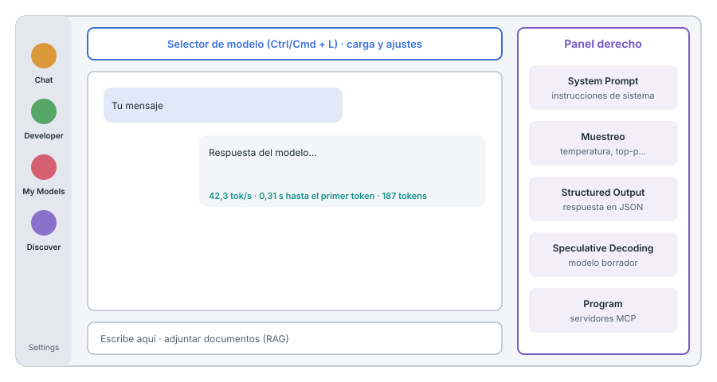

# 14. IA en tu ordenador: LM Studio y Ollama

!!! abstract "En este módulo"
    - Por qué ejecutar un modelo en tu propio equipo y qué necesitas.
    - Manual de **LM Studio 0.4**: descargar, cargar, conversar, ajustar y servir modelos.
    - Los ajustes de carga que más influyen en la velocidad y la memoria.
    - **Ollama**, la alternativa ligera.

## 1. ¿Por qué en local?

Ejecutar un modelo de lenguaje en tu ordenador tiene ventajas claras:

- **Privacidad:** tus textos y documentos no salen de tu equipo. Es la opción adecuada para datos personales, de clientes o de alumnos.
- **Sin conexión:** funciona en un avión o en un aula sin internet.
- **Gratis y sin límites:** no hay suscripciones ni cupos de mensajes.
- **Control:** eliges el modelo, su versión y todos sus ajustes, y nadie lo cambia sin avisar.

El precio es que los modelos que caben en un ordenador doméstico son **más pequeños** que los de ChatGPT o Gemini: excelentes para resumir, redactar, traducir o programar cosas sencillas, menos fiables para preguntas de conocimiento muy específico.

### ¿Qué ordenador necesito?

Lo que manda es la **memoria**: el modelo tiene que caber entero en la VRAM de la tarjeta gráfica o, en los Mac con chip Apple, en la memoria unificada ([módulo 9](09-hardware.md)). Como regla rápida, un modelo cuantizado a 4 bits ocupa algo más de **0,6 GB por cada 1 000 millones de parámetros**, más la memoria del contexto.

| Memoria disponible | Modelos razonables (noviembre de 2026) |
|---|---|
| 8 GB | De 1 000 a 4 000 millones de parámetros: Gemma 4 E2B o E4B, Qwen3 4B, Phi-4-mini. |
| 16 GB | Hasta unos 14 000 millones: Qwen3 8B o 14B, o modelos MoE pequeños. |
| 32 GB | De 20 000 a 32 000 millones: gpt-oss-20b, Qwen3 30B-A3B, Gemma 4 26B (MoE) o 31B. |
| 64 GB o más | Modelos de 70 000 millones o MoE grandes. |

LM Studio funciona en **Mac con chip Apple** (M1 o posterior), **Windows** (x64 o ARM) y **Linux** (x64). En un PC con tarjeta NVIDIA, AMD o Intel aprovecha la GPU; sin ella funciona igual, pero más despacio.

## 2. Instalar LM Studio

1. Descárgalo de **[lmstudio.ai](https://lmstudio.ai/)** (unos 550 MB) e instálalo como cualquier programa.
2. Al abrirlo por primera vez te propone descargar un modelo recomendado para tu equipo. Puedes aceptarlo o saltarlo.
3. La versión 0.4, publicada en enero de 2026, rediseñó la interfaz. Desde entonces se actualiza casi cada semana; este manual corresponde a la **0.4.28** (noviembre de 2026).

!!! tip "Modo desarrollador"
    Muchas opciones avanzadas solo aparecen con el **modo desarrollador** activado: **Settings → Developer → Developer Mode**. En la 0.4 sustituyó a los antiguos modos «User / Power User / Developer». Si en este manual se menciona un ajuste que no ves, actívalo.

## 3. La interfaz

<figure markdown="span">
  { .diagrama width="820" }
  <figcaption>Esquema de la ventana de LM Studio 0.4. La barra de navegación puede ir a la izquierda o arriba (Settings → Appearance).</figcaption>
</figure>

| Zona | Para qué sirve |
|---|---|
| **Chat** | Conversar con el modelo cargado. Puedes tener varias conversaciones en pestañas y verlas lado a lado (**Split View**, icono arriba a la derecha). Las conversaciones se exportan a PDF, Markdown o texto. |
| **Discover** (lupa, ++ctrl+shift+m++ o ++cmd+shift+m++ en Mac) | Buscar y descargar modelos de Hugging Face. |
| **My Models** | Los modelos descargados: dónde están, cuánto ocupan, y sus ajustes por defecto. Desde aquí se borran para liberar espacio. |
| **Developer** | El servidor local (API) y el estado en tiempo real de cada modelo cargado. |
| **Selector de modelo** (barra superior, ++ctrl+l++ o ++cmd+l++) | Cargar y descargar modelos de la memoria. |
| **Panel lateral derecho** | Ajustes de la conversación: instrucciones de sistema, parámetros de muestreo e integraciones (MCP). |
| **Settings** (engranaje, abajo) | Preferencias de la aplicación, modo desarrollador, servidor y *runtimes* (los motores llama.cpp y MLX). |

## 4. Descargar y cargar un modelo

1. Abre **Discover** y busca, por ejemplo, `gemma 4` o `qwen3`. LM Studio marca con una etiqueta los modelos recomendados (*Staff Pick*) y avisa de si caben en tu memoria.
2. Cada modelo aparece en varios **formatos** y **cuantizaciones**:
    - **GGUF** funciona en todos los sistemas (motor llama.cpp).
    - **MLX** solo en Mac con chip Apple, y suele ser algo más rápido en ellos.
    - La cuantización (`Q4_K_M`, `Q8_0`…) indica cuánto se ha comprimido; lo verás en el [módulo 19](19-cuantizacion.md). Para empezar, **Q4_K_M** es la opción equilibrada.
3. Pulsa **Download** y espera.
4. Abre el **selector de modelo** de la barra superior y elige el modelo. Si marcas **Manually choose model load parameters**, se abre una ventana con los ajustes de carga del apartado 5; si no, LM Studio usa los que considera mejores para tu equipo.
5. Cuando el modelo está cargado, ya puedes escribir en el chat. Debajo de cada respuesta verás la velocidad (**tok/s**), el **tiempo hasta el primer token** y los tokens usados: los datos del [benchmarking del módulo 12](12-inferencia.md#benchmarking-medir-y-comparar).

!!! example "Actividad"
    Descarga Gemma 4 E2B (o el modelo pequeño que te recomiende LM Studio) y hazle tres preguntas: una de cultura general, una de razonamiento («si tengo 3 manzanas y me como la mitad de las que tengo más una…») y una de redacción. Compara después las mismas preguntas en ChatGPT o Gemini. ¿Dónde se nota la diferencia de tamaño?

## 5. Ajustes de carga: el rendimiento

Estos ajustes se eligen al **cargar** el modelo (o con el engranaje del modelo ya cargado, que lo recarga). Deciden cuánta memoria usa y a qué velocidad responde. Se pueden guardar por modelo en **My Models**.

| Ajuste | Qué hace | Consejo |
|---|---|---|
| **Context Length** | Tokens máximos de la conversación (prompt, historial, documentos y respuesta). La ventana indica el máximo que admite el modelo. | Más contexto = más memoria. 8 000–16 000 bastan para conversar; súbelo si adjuntas documentos largos. |
| **GPU Offload** | Cuántas **capas** del modelo van a la GPU (por ejemplo, 36/36 = todas). Las que no caben se calculan en la CPU. | Todas, si caben. Cada capa que se queda en la CPU frena mucho la generación. |
| **CPU Thread Pool Size** | Núcleos del procesador para las capas que no están en la GPU. | Déjalo en automático. |
| **Evaluation Batch Size** | Tokens del prompt que se procesan de golpe en el *prefill*. | El valor por defecto (512) va bien. |
| **Offload KV Cache to GPU Memory** | Pone la caché KV ([módulo 12](12-inferencia.md#6-las-dos-fases-de-una-respuesta)) en la GPU. | Actívalo si te sobra VRAM: acelera mucho las conversaciones largas. |
| **Flash Attention** | Una forma optimizada de calcular la atención que ahorra memoria y acelera los contextos largos. | Actívalo si tu modelo y tu GPU lo admiten. |
| **K / V Cache Quantization** | Comprime la caché KV a 8 o 4 bits. | Útil para contextos muy largos con poca memoria; puede bajar algo la calidad. |
| **Keep Model in Memory** | Mantiene el modelo cargado aunque no lo uses. | Actívalo si vas a usarlo a menudo. |
| **Try mmap()** | Carga el archivo del modelo bajo demanda, en lugar de leerlo entero al principio. | Actívalo: reduce el tiempo de carga. |
| **Seed** | Fija la semilla aleatoria para obtener respuestas reproducibles. | Aleatoria, salvo para experimentos. |
| **Number of Experts** / **expertos en CPU** | En los modelos MoE, cuántos expertos se activan y cuántos se dejan en la CPU para ahorrar VRAM. | No cambies el número de expertos. Mover expertos a la CPU permite cargar MoE grandes en GPU pequeñas. |
| **Max Concurrent Predictions** | Cuántas peticiones atiende a la vez el servidor (novedad de la 0.4). | 4 por defecto; súbelo solo si varias aplicaciones usan el modelo a la vez. |
| **RoPE Frequency Base / Scale** | Ajustes de la codificación de posiciones, para estirar el contexto más allá del entrenado. | No los toques: valores incorrectos producen texto sin sentido. |

Con **Manually choose model load parameters**, LM Studio muestra una **estimación de la memoria** que ocupará el modelo y cómo cambia al mover el contexto. Es la forma más rápida de saber si un modelo cabe antes de cargarlo.

## 6. Ajustes de la conversación

En el panel lateral derecho del chat:

**Instrucciones de sistema (*System Prompt*).** Reglas que el modelo sigue en toda la conversación: «Eres un tutor de matemáticas de 3.º de ESO. Explica paso a paso y no des la solución hasta que el alumno lo intente». Cuentan como tokens en cada mensaje, así que conviene que sean breves.

**Muestreo.** Los parámetros del [módulo 12](12-inferencia.md#5-como-elige-cada-palabra-el-muestreo): **Temperature**, **Top K**, **Top P**, **Min P**, **Repeat Penalty** y **Limit Response Length**. LM Studio carga los valores que recomienda cada modelo.

**Presets.** Guardan una combinación de instrucciones y parámetros («Tutor», «Traductor», «Respuestas precisas») para reutilizarla.

**Structured Output.** Obliga al modelo a responder con un formato JSON concreto. Muy útil para automatizar tareas.

**Speculative Decoding.** Un modelo pequeño «adivina» varios tokens y el grande los verifica de golpe. Si acierta a menudo, la generación se acelera sin perder calidad. Necesita dos modelos de la misma familia (por ejemplo, Qwen3 0.6B como borrador de Qwen3 8B).

**Integraciones (*Program*).** Aquí se conectan **servidores MCP** y plugins para que el modelo use herramientas: buscar en la web, leer archivos, ejecutar código. Lo verás en el [módulo 16](16-habilidades-mcp.md).

## 7. Conversar con tus documentos

Arrastra un PDF, un Word o un archivo de texto al chat. Si el documento es corto, LM Studio lo **mete entero en el contexto**; si es largo, usa **RAG** (*Retrieval-Augmented Generation*): trocea el documento, busca los fragmentos más relacionados con tu pregunta y solo pasa esos al modelo. Todo ocurre en tu equipo.

!!! warning "RAG no es leer el documento entero"
    Con RAG el modelo solo ve los fragmentos recuperados. Pregunta cosas concretas («¿qué dice el apartado 3 sobre las faltas de asistencia?») mejor que generales («resume el documento»). Para resumir un texto largo, sube el **Context Length** y pégalo entero.

## 8. El servidor local

En **Developer** (o desde la terminal con `lms server start`) LM Studio arranca un **servidor compatible con la API de OpenAI** en `http://localhost:1234/v1`. Cualquier programa que sepa hablar con ChatGPT puede usar tu modelo local cambiando solo la dirección. Desde la versión 0.4.1 también imita la API de Anthropic. Lo usarás en la práctica del [módulo 15](15-api.md).

La pantalla **Developer** muestra en tiempo real cada petición: el porcentaje de prompt procesado y los tokens generados. Para que otros equipos de tu red usen el servidor, actívalo en **Settings → Server** y crea **claves de permiso** para controlar quién accede.

!!! info "Más allá de la ventana"
    - **`lms`**: la herramienta de terminal de LM Studio. `lms get qwen3-4b` descarga un modelo, `lms ls` lista los descargados, `lms load` lo carga y `lms chat` abre un chat en la propia terminal.
    - **llmster**: el motor de LM Studio sin interfaz gráfica, para servidores.
    - **LM Link**: usar desde tu portátil los modelos que corren en otro ordenador más potente de tu casa o tu oficina.
    - **Locally**: la aplicación de LM Studio para iPhone y iPad (desde junio de 2026).

## 9. Ollama, la alternativa ligera

**[Ollama](https://ollama.com/)** hace lo mismo con otra filosofía: menos ajustes, más sencillez. Se instala en Windows, Mac y Linux, tiene una aplicación con ventana de chat y, sobre todo, se usa desde la terminal:

```bash
ollama run gemma4:e4b        # descarga el modelo (la primera vez) y abre un chat
ollama list                  # modelos descargados
ollama rm gemma4:e4b         # borrar un modelo
```

Su **biblioteca** ([ollama.com/library](https://ollama.com/library)) ofrece los modelos ya preparados con un nombre corto. También levanta una API local (`http://localhost:11434`) que usan muchas aplicaciones: editores de código, extensiones del navegador, interfaces web como Open WebUI o agentes como OpenClaw ([módulo 17](17-agentes.md)).

| | LM Studio | Ollama |
|---|---|---|
| Interfaz | Ventana completa con todos los ajustes | Ventana sencilla y terminal |
| Ajustes | Todos visibles | Pocos, en un archivo de configuración (*Modelfile*) |
| Formatos | GGUF y MLX | GGUF y modelos propios de su biblioteca |
| Licencia | Gratuita, código cerrado | Código abierto (MIT) |
| Ideal para | Aprender y experimentar | Usar modelos desde otras aplicaciones |

Por debajo, ambos usan **[llama.cpp](https://github.com/ggml-org/llama.cpp)**, el motor de código abierto que hizo posible la IA local. Otras alternativas: **Jan** (código abierto, parecido a LM Studio), **GPT4All** o, en el móvil, **Google AI Edge Gallery**.

## Para ampliar

<div class="recursos" markdown>

**Documentación**

- [Documentación de LM Studio](https://lmstudio.ai/docs/app) (en inglés): instalación, RAG, MCP, servidor y la herramienta `lms`.
- [Novedades de LM Studio 0.4](https://lmstudio.ai/blog/0.4.0) (en inglés).
- [Documentación de Ollama](https://docs.ollama.com/) (en inglés).

**Para explorar**

- :material-gesture-tap: [Hugging Face: modelos GGUF](https://huggingface.co/models?library=gguf&sort=trending): los modelos más populares para usar en local.
- :material-gesture-tap: [Can I run this LLM?](https://apxml.com/tools/vram-calculator): calcula si un modelo cabe en tu tarjeta gráfica.

</div>
