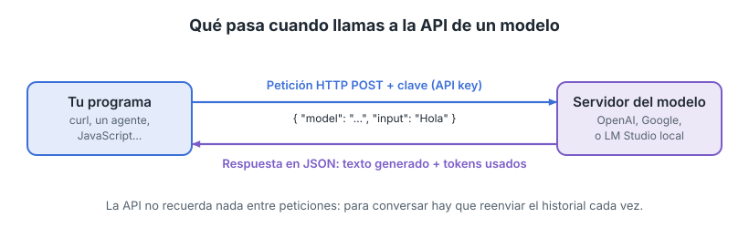

# 15. Usar modelos desde tus programas: la API

!!! abstract "En este módulo"
    - Qué es una API y cómo es una petición a un modelo de lenguaje.
    - Práctica con **curl**, desde la terminal, contra tu propio modelo en LM Studio, gratis y sin claves.
    - Las API de **OpenAI** y **Google Gemini**: claves, peticiones y precios.
    - Roles, historial y por qué la API «no tiene memoria».
    - De la API al agente: qué hace un agente con esta misma API.

## 1. ¿Qué es una API?

Una **API** (*Application Programming Interface*) es una puerta para que **un programa hable con otro**. En lugar de escribir en una ventana de chat, tu programa envía una **petición** a un servidor y recibe la **respuesta** en un formato que puede procesar, normalmente **JSON** (texto estructurado con llaves y comillas).

<figure markdown="span">
  { .diagrama width="760" }
</figure>

Con la API puedes:

- Meter un asistente en tu web o en tu aplicación.
- Procesar cientos de documentos de golpe (clasificar correos, resumir informes, traducir fichas).
- Automatizar tareas: «cada mañana, resume las noticias de estas tres webs y mándamelo».
- Construir tus propios agentes ([módulo 17](17-agentes.md)).

Una petición tiene cuatro partes:

| Parte | Qué es | Ejemplo |
|---|---|---|
| **Método** | El tipo de operación. `GET` pide información; `POST` envía datos. | `POST` |
| **URL** (*endpoint*) | La dirección del servicio. | `https://api.openai.com/v1/responses` |
| **Cabeceras** (*headers*) | Datos de control, entre ellos tu **clave** de acceso. | `Authorization: Bearer sk-...` |
| **Cuerpo** (*body*) | Lo que envías, en JSON: el modelo y tu mensaje. | `{"model": "...", "input": "Hola"}` |

Para probar una API sin programar basta **curl**, una herramienta de la terminal que ya traen Windows, Mac y Linux. Es la que usaremos en este módulo y en las prácticas. Si prefieres ventanas y botones, existen programas gratuitos como [Postman](https://www.postman.com/downloads/) o [Bruno](https://www.usebruno.com/), que hacen lo mismo.

## 2. Práctica: tu propia API en LM Studio

Este ejercicio es **guiado y no se evalúa**: sirve para practicar a tu ritmo, también en casa. Usaréis esta misma API con un agente en la [práctica 17](practicas/practica-17.md), que es la evaluable.

La forma más sencilla de empezar es con un modelo **en tu ordenador**: no hace falta cuenta, ni clave, ni tarjeta, y no cuesta nada.

1. En [LM Studio](14-ia-local.md), carga un modelo pequeño (por ejemplo, Gemma 4 E2B).
2. Ve a **Model Server** y activa el interruptor **Status** (pasa a *Running*). Verás la dirección `http://127.0.0.1:1234` (es lo mismo que `localhost:1234`).
3. Abre una terminal: en Mac, la aplicación **Terminal**; en Windows, **PowerShell**. Crea una carpeta para el ejercicio y entra en ella con `cd`.

**Paso 1. Pregunta qué modelos hay.** Es una petición `GET`, la que hace curl si no le dices otra cosa:

=== "Mac"

    ```bash
    curl http://localhost:1234/v1/models
    ```

=== "Windows (PowerShell)"

    ```powershell
    curl.exe http://localhost:1234/v1/models
    ```

    En PowerShell escribe siempre `curl.exe`: `curl` a secas es otra orden distinta.

La respuesta es una lista en JSON con los identificadores de tus modelos (el campo `id`). Copia el del modelo cargado.

**Paso 2. Envía un mensaje.** El cuerpo de la petición es un JSON. Para no pelearte con las comillas en la terminal, guárdalo en un archivo: con un editor de texto, crea en la carpeta un archivo llamado `peticion.json` con este contenido:

```json
{
  "model": "google/gemma-4-e2b",
  "messages": [
    {"role": "system", "content": "Eres Val, el asistente de un taller de bicicletas. Responde con humor y en pocas frases."},
    {"role": "user", "content": "Hola, ¿cómo te llamas?"}
  ],
  "temperature": 0.7
}
```

Cambia el valor de `"model"` por el `id` que copiaste. Después envíalo con una petición `POST` (la opción `-d` envía datos, y la `@` le dice que los lea del archivo):

=== "Mac"

    ```bash
    curl http://localhost:1234/v1/chat/completions -H "Content-Type: application/json" -d @peticion.json
    ```

=== "Windows (PowerShell)"

    ```powershell
    curl.exe http://localhost:1234/v1/chat/completions -H "Content-Type: application/json" -d "@peticion.json"
    ```

En la respuesta, busca `choices` → `message` → `content`: ahí está el texto. Fíjate también en `usage`, que cuenta los tokens de entrada (`prompt_tokens`) y de salida (`completion_tokens`).

En **Server Logs**, dentro de *Model Server*, verás llegar la petición en tiempo real. Comprobado con Gemma 4 E2B: Val respondió «Soy Val. El experto oficial en todo lo que gira sobre dos ruedas. ¡A darle caña!». Fíjate en `usage`: de 221 tokens de salida, 194 fueron de razonamiento (`reasoning_tokens`), que también se cuentan (y, en las API de pago, se cobran).

## 3. Los roles y el historial

Cada mensaje de la lista `messages` tiene un **rol**:

| Rol | Quién habla | Para qué |
|---|---|---|
| `system` (o `developer`) | Quien programa la aplicación | Instrucciones generales: personalidad, tono, reglas, datos fijos. |
| `user` | La persona usuaria | Las preguntas y peticiones. |
| `assistant` | El modelo | Sus respuestas anteriores. |

La idea clave: **la API no recuerda nada**. Cada petición empieza de cero. Para mantener una conversación, tu programa tiene que **reenviar todo el historial** en cada petición:

```json
{
  "model": "google/gemma-4-e2b",
  "messages": [
    {"role": "system", "content": "Eres Val, el asistente de un taller de bicicletas."},
    {"role": "user", "content": "¿Qué teléfonos tenéis?"},
    {"role": "assistant", "content": "Taller: 910 000 001. Tienda: 910 000 002."},
    {"role": "user", "content": "¿Y cuál es el de la tienda?"}
  ]
}
```

El modelo responde bien a la última pregunta porque ve el mensaje anterior de `assistant`. Así funcionan por dentro todas las aplicaciones de chat. Por eso las conversaciones largas son más lentas y más caras: cada mensaje nuevo reenvía todos los anteriores, y por eso los mensajes de sistema muy largos se pagan en cada petición.

## 4. De la API al agente

Un **agente** (lo verás a fondo en el [módulo 17](17-agentes.md)) es un programa que usa **esta misma API** para que el modelo haga tareas, no solo para que converse. Por ejemplo, OpenCode con un modelo de LM Studio:

- Envía al modelo, en el mensaje de sistema, sus propias instrucciones, las tuyas (un archivo `AGENTS.md`) y la descripción de sus **herramientas**: leer y escribir archivos, ejecutar órdenes en la terminal…
- Cuando el modelo responde «quiero leer `reservas.csv`», el agente lo hace (tras pedirte **permiso**), añade el resultado al historial y vuelve a llamar a la API. Así hasta terminar la tarea.
- Como la API no recuerda nada, reenvía todo en cada vuelta. Por eso pesa tanto: un simple «Hola» enviado por OpenCode ocupó **unos 5 700 tokens** de entrada; el mismo «Hola» con curl, 17.

Lo comprobaréis en la [práctica 17](practicas/practica-17.md), con un agente conectado a vuestro LM Studio y a una API externa.

## 5. La API de OpenAI

1. Entra en **[platform.openai.com](https://platform.openai.com/)** con tu cuenta (es distinta de la suscripción a ChatGPT: la API se paga aparte, por uso).
2. En **Billing**, añade un método de pago y carga crédito (se puede empezar con 5 dólares). Fija un **límite de gasto** mensual para evitar sustos.
3. En **API keys**, pulsa **Create new secret key** y **cópiala en ese momento**: no se vuelve a mostrar.
4. Guarda la clave en una **variable de entorno** de la terminal, no dentro de tus archivos: así no aparece en cada orden ni se comparte por accidente. Solo dura mientras la terminal esté abierta.

    === "Mac"

        ```bash
        export OPENAI_API_KEY="pega-aquí-tu-clave"
        ```

    === "Windows (PowerShell)"

        ```powershell
        $env:OPENAI_API_KEY = "pega-aquí-tu-clave"
        ```

5. Lista los modelos y elige uno. Los de nombre *mini* o *nano* son mucho más baratos y bastan para practicar. La clave va en la cabecera `Authorization`:

    === "Mac"

        ```bash
        curl https://api.openai.com/v1/models -H "Authorization: Bearer $OPENAI_API_KEY"
        ```

    === "Windows (PowerShell)"

        ```powershell
        curl.exe https://api.openai.com/v1/models -H "Authorization: Bearer $env:OPENAI_API_KEY"
        ```

6. OpenAI recomienda desde 2025 su **Responses API**. Una petición mínima (el cuerpo, en un archivo como en el apartado 2, y la orden, con `-d @archivo.json` y la misma cabecera de la clave):

```json
POST https://api.openai.com/v1/responses

{
  "model": "MODELO-ELEGIDO",
  "instructions": "Eres Val, el asistente de un taller de bicicletas.",
  "input": "Hola, ¿cómo te llamas?"
}
```

La respuesta trae el texto en `output` y el consumo en `usage`. La API anterior, **Chat Completions** (`/v1/chat/completions`, la misma que usaste con LM Studio), sigue funcionando y es la que imitan casi todos los demás proveedores.

## 6. La API de Google Gemini

1. Entra en **[Google AI Studio](https://aistudio.google.com/)** con tu cuenta de Google. Está disponible en España y en el resto de la UE.
2. Pulsa **Get API key → Create API key**. Los proyectos nuevos tienen un **nivel gratuito** con límites de peticiones por minuto y por día, suficiente para practicar sin tarjeta (Google puede usar esos datos para mejorar sus productos; para datos sensibles, activa la facturación).
3. Desde AI Studio puedes probar los modelos en una ventana de chat y pulsar **Get code** para obtener la petición equivalente en curl, JavaScript o Python.
4. Lo más cómodo es usar su **endpoint compatible con OpenAI**, que funciona igual que el de LM Studio. Guarda la clave en una variable de entorno, como con OpenAI (por ejemplo, `GEMINI_API_KEY`), y envíala en la cabecera `Authorization: Bearer …`:
    - Lista los modelos con `curl https://generativelanguage.googleapis.com/v1beta/openai/models -H "Authorization: Bearer $GEMINI_API_KEY"` (en PowerShell, `curl.exe` y `$env:GEMINI_API_KEY`).
    - Envía mensajes a `https://generativelanguage.googleapis.com/v1beta/openai/chat/completions` con el mismo `peticion.json` del apartado 2, cambiando `"model"` por uno de la lista (los *Flash* y *Flash-Lite* entran en el nivel gratuito).

    La API nativa de Google (con la cabecera `x-goog-api-key`) ofrece más funciones; su código lo genera **Get code**.

!!! tip "Una petición, muchos proveedores"
    Google, Mistral, DeepSeek, OpenRouter, Ollama y LM Studio ofrecen **endpoints compatibles con OpenAI**: la misma petición de Chat Completions funciona cambiando solo la URL, la clave y el nombre del modelo. Aprende una y sabrás usarlas todas.

## 7. Desde JavaScript

Si sabes algo de programación web, una página puede llamar a tu modelo local con unas pocas líneas:

```javascript
const respuesta = await fetch("http://localhost:1234/v1/chat/completions", {
  method: "POST",
  headers: { "Content-Type": "application/json" },
  body: JSON.stringify({
    model: "google/gemma-4-e2b",
    messages: [{ role: "user", content: "Dame tres ideas para una excursión en Madrid" }]
  })
});
const datos = await respuesta.json();
console.log(datos.choices[0].message.content);
```

Los proveedores también ofrecen **librerías oficiales** (SDK) para JavaScript, Python y otros lenguajes que simplifican todo esto.

## 8. Precios y buenas prácticas

- **Se paga por millón de tokens**, con precio distinto para la entrada y la salida (que suele costar entre 4 y 8 veces más). Un modelo pequeño puede costar unos céntimos por millón de tokens y uno de los más potentes, decenas de dólares. Consulta siempre la página de precios: cambian a menudo.
- **El historial y los documentos cuentan como entrada en cada petición.** Muchos proveedores aplican **caché de prompts**: si repites el mismo principio (instrucciones de sistema, documentos), lo cobran mucho más barato.
- **Nunca pongas tu clave en el código de una página web pública** ni la subas a GitHub: cualquiera podría usarla a tu costa. En una web, las peticiones deben pasar por tu propio servidor.
- **Fija límites de gasto** y revisa el consumo en el panel del proveedor.
- **Los datos enviados por la API** no se usan para entrenar en los planes de pago de OpenAI, Anthropic o Google (sí, en general, en los niveles gratuitos). Léelo en las condiciones de cada servicio.

!!! example "Actividad"
    Con curl, haz tres peticiones a tu LM Studio: listar modelos, una pregunta con instrucciones de sistema y una conversación de tres turnos con historial (guarda cada cuerpo en su propio archivo `.json`). Después cambia la temperatura a 0 y a 1,5 en la misma pregunta. Si tienes clave de Gemini, repite la segunda petición contra Google usando su endpoint compatible con OpenAI.

!!! tip "Práctica evaluable"
    Este módulo no tiene práctica evaluable propia: lo que has aprendido aquí lo usaréis con un agente en la **[práctica 17: Tu agente, tus APIs](practicas/practica-17.md)**, que cubre este módulo y el de agentes.

## Para ampliar

<div class="recursos" markdown>

**Documentación oficial**

- [API de OpenAI: guía rápida](https://platform.openai.com/docs/quickstart) y [referencia](https://platform.openai.com/docs/api-reference/introduction) (en inglés).
- [API de Gemini: guía rápida](https://aistudio.google.com/docs/get-started?hl=es-419) (en español) y [compatibilidad con OpenAI](https://aistudio.google.com/docs/openai?hl=es-419).
- [API de LM Studio compatible con OpenAI](https://lmstudio.ai/docs/developer/openai-compat) (en inglés).
- [Tutorial de curl](https://curl.se/docs/tutorial.html) (en inglés).

**Vídeos**

- :material-youtube: [Cómo utilizar el API de Google Gemini en tus proyectos de forma sencilla y rápida](https://www.youtube.com/watch?v=M0zabpjp-Ew) (Conciencia Artificial). Es de 2024: los nombres de los modelos y los precios han cambiado, y ya no hace falta VPN desde España.

</div>
