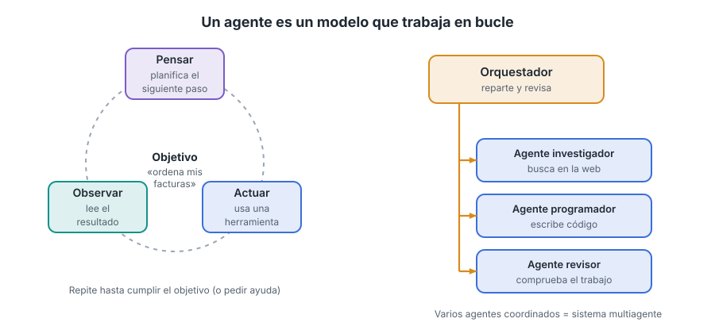

# 17. Agentes y orquestadores

!!! abstract "En este módulo"
    - Qué es un agente de IA y en qué se diferencia de un chat.
    - Agente frente a orquestador: trabajar solo o dirigir un equipo.
    - El panorama en 2026: agentes de programación, agentes personales, equipos de agentes en la nube y herramientas para construirlos.
    - Los riesgos de dar autonomía a una IA, y cómo limitarlos.

## 1. Del chat al agente

Un chat responde y espera. Un **agente** recibe un **objetivo** y trabaja **por su cuenta** hasta cumplirlo: planifica, usa herramientas ([módulo 16](16-habilidades-mcp.md)), mira el resultado, corrige y vuelve a intentarlo. Técnicamente, un agente es un **modelo de lenguaje en un bucle**, con acceso a herramientas y algún tipo de memoria.

<figure markdown="span">
  { .diagrama width="820" }
</figure>

Por ejemplo, ante «prepárame una comparativa de tres portátiles para el aula de menos de 600 €», un agente:

1. **Piensa:** «Necesito buscar modelos actuales y sus precios».
2. **Actúa:** busca en la web.
3. **Observa:** lee los resultados; uno de los modelos ya no se vende.
4. **Piensa de nuevo:** busca una alternativa, comprueba las especificaciones…
5. … y al final **entrega** una tabla en una hoja de cálculo.

Cuantos más pasos encadena sin equivocarse, más útil es. En 2024 los agentes aguantaban unos minutos de trabajo autónomo antes de perderse; a finales de 2026 los mejores trabajan durante horas en tareas de programación.

## 2. Agente y orquestador

- Un **agente** es un **ejecutor especializado**: hace una tarea con sus herramientas.
- Un **orquestador** es el **director**: divide un objetivo complejo en partes, las reparte entre varios agentes (un investigador, un programador, un revisor…), coordina su trabajo y junta los resultados.

A un conjunto de agentes coordinados se le llama **sistema multiagente**. En la práctica, la frontera es difusa: casi todos los agentes actuales pueden lanzar **subagentes** para tareas concretas, es decir, actuar también como orquestadores.

## 3. El panorama en 2026

### Agentes de programación

Son los agentes más maduros. Leen un proyecto entero, escriben y modifican código, ejecutan pruebas y corrigen errores. Se usan desde la terminal, desde el editor de código o desde una aplicación.

| Agente | De quién | Qué lo distingue |
|---|---|---|
| **[Claude Code](https://claude.com/product/claude-code)** | Anthropic | Pionero de los agentes de terminal (2025). Habilidades, MCP y subagentes. También en web, escritorio y móvil. |
| **[Codex](https://openai.com/codex/)** | OpenAI | Terminal, editor, aplicación y tareas en la nube que trabajan en paralelo. |
| **[OpenCode](https://opencode.ai/)** | Comunidad (código abierto) | Funciona con cualquier modelo: comerciales, abiertos o locales (LM Studio, Ollama). Tiene aplicación de escritorio. |
| **[Kilo Code](https://kilo.ai/)** | Comunidad (código abierto) | Extensión para VS Code y JetBrains con modos especializados (arquitecto, programador, depurador) y cientos de modelos. |
| **Gemini CLI**, **GitHub Copilot**, **Cursor** | Google, GitHub, Anysphere | Alternativas integradas en sus ecosistemas. |

### Agentes personales «siempre encendidos»

Viven en tu ordenador o en un servidor, **están disponibles las 24 horas** y te comunicas con ellos por WhatsApp, Telegram, Slack o Discord. Gestionan el correo, el calendario o los archivos, programan tareas («cada lunes resúmeme las facturas pendientes») y recuerdan lo que han hecho.

- **[OpenClaw](https://openclaw.ai/)**: el fenómeno de 2026. De código abierto (MIT), creado por Peter Steinberger, en marzo se convirtió en el repositorio con más estrellas de GitHub. Funciona con modelos comerciales o locales y se amplía con habilidades. Desde febrero lo gestiona una fundación sin ánimo de lucro.
- **[NanoClaw](https://github.com/nanocoai/nanoclaw)**: nació como respuesta a los problemas de seguridad de OpenClaw. Es mínimo, con unos pocos miles de líneas de código frente a cientos de miles, y **cada agente se ejecuta en su propio contenedor aislado**, que solo ve las carpetas que le permites. Usa Claude por defecto y admite otros modelos.
- **[Hermes Agent](https://hermes-agent.nousresearch.com/)** (Nous Research, febrero de 2026, MIT): su seña de identidad es que **aprende de la experiencia**. Crea sus propias habilidades a partir de las tareas que resuelve, las mejora con el uso y busca en sus conversaciones pasadas.

### Equipos de agentes en la nube

Las grandes empresas ofrecen ya agentes que trabajan con **su propio ordenador virtual y su navegador** en la nube, sin que tengas que instalar nada:

- **Grok Bot** (xAI, agosto de 2026): «compañeros» de trabajo virtuales que comparten un espacio de proyecto. Un bot orquestador reparte la tarea entre bots especialistas.
- **Dots** (OpenAI, septiembre de 2026): agentes siempre activos, cada uno con su ordenador y su navegador en la nube, coordinados por un agente principal que también puede lanzar tareas de Codex.

Los modos **agente** de ChatGPT, Claude o Gemini, y las funciones de **investigación profunda**, son versiones más sencillas de la misma idea dentro del chat.

### Para construir tus propios agentes

- **[CrewAI](https://www.crewai.com/)**: define un «equipo» (*crew*) de agentes con roles, objetivos y herramientas, y deja que colaboren. Es de Python, con una versión visual en la nube.
- **LangGraph**, **OpenAI Agents SDK**, **Claude Agent SDK** y **Google ADK**: librerías para programar agentes y orquestadores.
- **n8n**, **Make** o **Zapier**: automatizaciones visuales, sin código, que pueden incluir pasos con agentes de IA.

## 4. Riesgos y cómo limitarlos

Dar autonomía a una IA tiene riesgos reales, y en 2026 se han visto todos:

- **Acciones irreversibles.** Un agente puede borrar archivos, enviar correos o hacer compras. Las buenas herramientas piden **confirmación** antes de cada acción delicada. No las desactives a la ligera.
- **Inyección de instrucciones.** Una web, un documento o un correo pueden contener órdenes ocultas para el agente ([módulo 16](16-habilidades-mcp.md#permisos-y-seguridad)). Cuanto más puede hacer un agente, más peligrosa es.
- **Exceso de permisos.** Dale acceso solo a lo que necesita. Mejor una carpeta concreta que todo el disco, y una cuenta de prueba que tu correo personal.
- **Aislamiento.** Ejecuta los agentes que manejan código o archivos en un **contenedor** o una máquina virtual, como hace NanoClaw. Los agentes de programación comerciales suelen trabajar en un entorno aislado (*sandbox*).
- **Seguridad del propio agente.** OpenClaw acumuló en sus primeros meses más de un centenar de vulnerabilidades publicadas, y se encontraron muchas instalaciones expuestas en internet sin protección. Mantén el software actualizado y no expongas un agente a internet.
- **Coste.** Un agente en bucle puede consumir millones de tokens. Pon **límites de gasto** en las API.
- **Supervisión humana.** Revisa el trabajo antes de darlo por bueno. El agente puede ser muy convincente y, aun así, estar equivocado.

## Práctica

=== ":material-cursor-default-click: Sin código: el modo agente"

    1. En ChatGPT, Claude o Gemini, activa el **modo agente** o la **investigación profunda**.
    2. Pídele una tarea de varios pasos: «Busca 5 actividades gratuitas para familias en mi ciudad este fin de semana, comprueba en su web oficial el horario y el precio, y hazme una tabla».
    3. Observa el proceso: qué busca, qué páginas abre, cuándo cambia de plan, cuándo te pide permiso.
    4. **Comprueba dos de los resultados** tú mismo. ¿Eran correctos?

=== ":material-laptop: Un agente de programación con OpenCode"

    1. Descarga la **aplicación de escritorio** de [OpenCode](https://opencode.ai/download).
    2. Conecta un modelo: uno local de [LM Studio](14-ia-local.md) u Ollama (gratis, pero más lento y menos capaz) o un proveedor comercial con su clave ([módulo 15](15-api.md)).
    3. Crea una carpeta vacía, ábrela en OpenCode y pide: «Crea una página web con un temporizador Pomodoro de 25 minutos, con botones de inicio, pausa y reinicio, y un diseño limpio».
    4. Mira cómo planifica, crea los archivos y los revisa. Abre el `index.html` resultante en el navegador.
    5. Pide mejoras: «Añade un sonido al terminar» o «Que guarde cuántos pomodoros llevo hoy».

!!! example "Para debatir"
    ¿Qué tareas de tu trabajo dejarías a un agente sin supervisión? ¿Cuáles solo con supervisión? ¿Cuáles nunca? ¿Qué permisos le darías y cuáles no?

## Para ampliar

**Artículos y guías**

- [¿Qué son los agentes de IA?](https://www.ibm.com/es-es/think/topics/ai-agents) (IBM).
- [Building effective agents](https://www.anthropic.com/engineering/building-effective-agents) (Anthropic, en inglés): cuándo usar agentes y los patrones más habituales.
- [Agents towards production](https://github.com/NirDiamant/agents-towards-production) (en inglés): tutoriales prácticos para construir agentes reales, con memoria, herramientas, seguridad y despliegue.

**Herramientas**

- [Claude Code](https://claude.com/product/claude-code) · [Codex](https://openai.com/codex/) · [OpenCode](https://opencode.ai/) · [Kilo Code](https://kilo.ai/)
- [OpenClaw](https://openclaw.ai/) · [NanoClaw](https://github.com/nanocoai/nanoclaw) · [Hermes Agent](https://hermes-agent.nousresearch.com/)
- [CrewAI](https://www.crewai.com/) · [n8n](https://n8n.io/)

