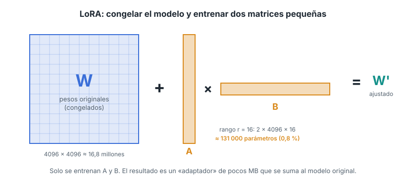

# 18. Fine-tuning: especializar un modelo

!!! abstract "En este módulo"
    - Qué es el *fine-tuning* (ajuste fino) y cuándo merece la pena frente a un buen prompt o a RAG.
    - Los ingredientes: modelo base, datos y GPU.
    - Ajuste completo, **LoRA** y **QLoRA**.
    - Riesgos: sobreajuste, olvido y datos de mala calidad.
    - Práctica: un asistente que siempre trata de usted, con **Unsloth Studio** y sin escribir código.

## 1. ¿Qué es el fine-tuning?

Un modelo pre-entrenado ([módulo 21](21-pre-entrenamiento.md)) es como un recién graduado con una cultura general enorme. El **fine-tuning** es darle una **formación especializada**: seguir entrenándolo, ahora con un **conjunto de datos pequeño y específico**, para que se convierta en experto en una tarea, un estilo o un dominio.

No se empieza de cero. Se parte del conocimiento del modelo base y solo se **ajusta**, lo que ahorra el 99,9 % del coste. De hecho, todos los asistentes que usas son modelos base ajustados: el *fine-tuning* es lo que convierte un modelo que solo sabe continuar textos en uno que sigue instrucciones y conversa.

Sirve para:

- **Fijar un estilo, un tono o una personalidad:** el registro formal de una institución, la voz de una marca, un personaje.
- **Fijar un formato:** que responda siempre con una estructura JSON concreta, o con las secciones de un informe.
- **Mejorar en tareas concretas:** clasificar incidencias, extraer datos de facturas, generar código de un lenguaje poco común.
- **Hacer pequeño a un modelo bueno en algo:** un modelo de 1 000 millones de parámetros ajustado para una sola tarea puede igualar en ella a uno de propósito general muchísimo mayor, y funcionar en un móvil.

### ¿Fine-tuning, prompt o RAG?

Antes de ajustar un modelo, conviene descartar las opciones más baratas:

| Si quieres… | Usa | Por qué |
|---|---|---|
| Que siga unas instrucciones o un formato | **Un buen prompt** o una [habilidad](16-habilidades-mcp.md) | Gratis, inmediato y fácil de cambiar. |
| Que responda con **información** de tus documentos | **RAG** ([módulo 14](14-ia-local.md#7-conversar-con-tus-documentos)) | El *fine-tuning* no es buena forma de enseñar datos nuevos: el modelo los mezcla y los inventa. Con RAG los consulta. |
| Que tenga un **comportamiento** fijo y fiable sin explicárselo cada vez | **Fine-tuning** | El estilo queda «grabado» en los pesos y ahorras tokens en cada petición. |
| Un modelo pequeño y barato que haga muy bien **una** tarea | **Fine-tuning** (o [destilación](20-destilacion.md)) | Especializar compensa la falta de tamaño. |

## 2. Los ingredientes

1. **Un modelo base.** Uno abierto que puedas descargar (Gemma, Qwen, Llama, Mistral…), de un tamaño adecuado a tu GPU y con una **licencia** que permita el uso que vas a darle. Se suele partir de la versión **instruct** (ya ajustada para conversar), no de la base pura.
2. **Un conjunto de datos de calidad.** Es el **ingrediente más importante**. No hace falta que sea enorme (de unos cientos a unos pocos miles de ejemplos bastan para un estilo), pero los ejemplos tienen que ser:
    - **Correctos y coherentes:** sin errores ni contradicciones entre ellos.
    - **Representativos:** variados, cubriendo los casos que el modelo encontrará.
    - **Bien estructurados**, normalmente como pares de instrucción y respuesta.
3. **Una GPU.** Mucho menos que para pre-entrenar, pero hace falta. Con las técnicas del apartado 3 basta una GPU de consumo con 8–16 GB, un Mac con chip Apple o la **GPU gratuita de Google Colab**.

### El formato de los datos

El más sencillo es **Alpaca**: un archivo **JSONL** (un objeto JSON por línea) con la instrucción, una entrada opcional y la respuesta esperada:

```json
{"instruction": "¿qué hora es?", "input": "", "output": "Lamento no poder consultar la hora actual. Puede verla en su dispositivo."}
{"instruction": "Resume este texto.", "input": "La reunión se aplaza al jueves por la baja del director.", "output": "La reunión se traslada al jueves por la ausencia del director."}
```

Para conversaciones de varios turnos se usa el formato **ChatML** o *messages*, con la lista de mensajes `system`, `user` y `assistant` de la [API](15-api.md#3-los-roles-y-el-historial).

Antes de entrenar, **limpia los datos**: quita duplicados, corrige errores, revisa que todas las respuestas sigan el mismo criterio y guarda un 5–10 % de ejemplos aparte para **validar**. En el [Hub de Hugging Face](https://huggingface.co/datasets) hay miles de conjuntos de datos listos para usar, y Unsloth Studio puede **generarlos a partir de tus documentos** (PDF, Word, CSV) con sus *Data Recipes*.

## 3. Tipos de fine-tuning

### Ajuste completo (*full fine-tuning*)

Se reentrenan **todos** los parámetros del modelo. Puede dar el mejor resultado, pero necesita mucha memoria (para un modelo de 8B, varias GPU de centro de datos) y el resultado es otro modelo completo del mismo tamaño.

### LoRA: el cuaderno de notas

**LoRA** (*Low-Rank Adaptation*, 2021) **congela** el modelo original y entrena, junto a algunas de sus matrices de pesos, dos matrices pequeñas cuyo producto se **suma** a ellas.

<figure markdown="span">
  { .diagrama width="760" }
</figure>

Es como darle al experto un **cuaderno de notas** con lo esencial de su nueva especialidad, sin tocar lo que ya sabe. Ventajas:

- Entrena menos del 1 % de los parámetros: es **mucho más rápido** y necesita **mucha menos memoria**.
- El resultado es un **adaptador** de unos pocos megas que se «enchufa» al modelo base. Puedes tener muchos adaptadores (uno por cliente, por asignatura, por estilo) para un solo modelo.
- Si quieres un archivo único, el adaptador se **fusiona** (*merge*) con el modelo.

Sus dos ajustes principales son el **rango** (*r*, el «grosor» de las matrices: 8, 16 o 32) y **alpha** (cuánto pesan los cambios, normalmente el doble del rango).

### QLoRA: LoRA sobre un modelo comprimido

**QLoRA** (2023) carga el modelo base **cuantizado a 4 bits** ([módulo 19](19-cuantizacion.md)) y entrena los adaptadores LoRA encima. Reduce la memoria otras tres o cuatro veces con una pérdida de calidad mínima. Es lo que hace posible ajustar modelos de 8B en una GPU de 8–12 GB o en el Colab gratuito.

| | Ajuste completo | LoRA | QLoRA |
|---|---|---|---|
| Parámetros que se entrenan | Todos | < 1 % | < 1 % |
| Memoria para un modelo de 8B (aprox.) | 80–120 GB | 18–24 GB | 6–10 GB |
| Velocidad | Lenta | Rápida | Algo más lenta que LoRA |
| Calidad | La máxima | Muy cercana | Muy cercana |
| Resultado | Modelo completo | Adaptador de MB | Adaptador de MB |

### Más allá de imitar ejemplos

Lo descrito hasta ahora es **ajuste supervisado** (*SFT*, *Supervised Fine-Tuning*): el modelo aprende a imitar respuestas. Las empresas añaden después fases de **alineamiento** con preferencias humanas: **RLHF** y **DPO** (dada una pregunta, «esta respuesta es mejor que esa») y aprendizaje por refuerzo con recompensas comprobables, como **GRPO** (premiar las respuestas matemáticas correctas o el código que pasa las pruebas). Así se entrenan los modelos de razonamiento. Unsloth y otras herramientas permiten hacerlo también en casa.

## 4. Riesgos

- **Sobreajuste** (*overfitting*, [módulo 4](04-machine-learning.md)): con pocos datos o demasiadas pasadas, el modelo **memoriza** los ejemplos en lugar de aprender el patrón. Responde perfecto a lo que vio y falla con cualquier variación. Se detecta vigilando la **pérdida de validación**: si sube mientras la de entrenamiento baja, para (*early stopping*). También ayuda bajar la tasa de aprendizaje o el número de épocas.
- **Olvido catastrófico:** al especializarse, el modelo puede perder capacidades generales. LoRA tiende a olvidar menos que el ajuste completo porque no toca los pesos originales, aunque no está libre del todo. Mezclar algunos ejemplos generales con los específicos lo reduce.
- **Basura entra, basura sale.** Un mal conjunto de datos da un mal modelo, entrenes lo que entrenes. Los errores, sesgos y faltas de ortografía de tus ejemplos acabarán en las respuestas.
- **Seguridad:** el ajuste puede **debilitar las protecciones** del modelo original, incluso sin pretenderlo. Si vas a publicar el modelo, pruébalo también con preguntas peligrosas.
- **Licencias y datos personales:** respeta la licencia del modelo base y no entrenes con datos personales sin base legal ([módulo 11](11-etica.md)): el modelo puede repetirlos.

## Práctica

**Objetivo:** ajustar un modelo pequeño para que responda **siempre de usted**, con un tono formal y cortés, aunque le hables de tú y de forma coloquial.

**Datos:** [asistente-formal.jsonl](descargas/asistente-formal.jsonl) (60 ejemplos en formato Alpaca, preparados para este curso). Ábrelo con un editor de texto para ver cómo son.

=== ":material-cursor-default-click: Unsloth Studio (sin código)"

    **[Unsloth Studio](https://unsloth.ai/docs/new/studio)** es una aplicación gratuita y de código abierto para entrenar, probar y exportar modelos desde el navegador. Funciona en un PC con GPU NVIDIA o en un Mac con chip Apple. Si no tienes ninguno, usa la pestaña de Colab.

    1. **Instala Unsloth Studio.** Descarga la aplicación de escritorio desde [unsloth.ai](https://unsloth.ai/docs/new/studio) o, en la terminal: `curl -fsSL https://unsloth.ai/install.sh | sh` (Mac y Linux) o `irm https://unsloth.ai/install.ps1 | iex` (PowerShell en Windows). Ábrelo con `unsloth studio` y entra en `http://127.0.0.1:8888`. La primera vez te pide crear una contraseña.
    2. **Elige el modelo.** *Model Type*: **Text**. *Training Method*: **QLoRA** (el que menos memoria usa). Busca `gemma-4-E2B-it` o `Qwen3-4B-Instruct`.
    3. **Sube los datos.** En la pestaña **Local**, sube `asistente-formal.jsonl`. En *Format* elige **alpaca** (o deja **auto**). En *Eval split* reserva un **10 %**: así verás la pérdida de validación.
    4. **Revisa los ajustes.** Los valores por defecto son buenos: *Epochs* 3, *Learning Rate* 2e-4, *LoRA Rank* 16, *Alpha* 32. Pulsa **Save** si quieres guardar la configuración.
    5. **Entrena.** Pulsa **Start Training** y observa las gráficas: la **pérdida** (*loss*) debe bajar. Con 60 ejemplos tarda pocos minutos.
    6. **Prueba el resultado.** En la página de chat, en **Select model**, elige tu modelo en la pestaña **Fine-tuned**. Escríbele de tú y de forma coloquial («oye, ¿me echas una mano con un correo?»). Después carga el modelo original y repite la pregunta.
    7. **Exporta.** En **Export**, elige el último *checkpoint*, el método **GGUF / llama.cpp** y **Export / Save Locally**. Importa el archivo en [LM Studio](14-ia-local.md) (arrástralo a *My Models* o usa `lms import`).

=== ":material-google: Con Google Colab (sin GPU propia)"

    Unsloth ofrece un cuaderno de Colab que **arranca Unsloth Studio dentro de Colab**, con la GPU gratuita de Google.

    1. Abre el [cuaderno de Unsloth Studio para Colab](https://colab.research.google.com/github/unslothai/unsloth/blob/main/studio/Unsloth_Studio_Colab.ipynb) e inicia sesión con tu cuenta de Google.
    2. Comprueba que el entorno usa GPU: *Entorno de ejecución → Cambiar tipo de entorno de ejecución → GPU T4*.
    3. Menú *Entorno de ejecución → Ejecutar todas*. La instalación tarda unos minutos. Al terminar, la última celda muestra un **enlace** (de Cloudflare) y el **usuario y la contraseña** para entrar en Studio. Abre el enlace en otra pestaña: la vista dentro del propio cuaderno suele quedarse en blanco.
    4. Sigue los pasos 2 a 7 de la otra pestaña. En el paso 3 subes el archivo desde tu ordenador.
    5. Descarga el GGUF antes de cerrar: los archivos de Colab se borran al terminar la sesión.

    Si prefieres ver el código, Unsloth también tiene un [cuaderno clásico para ajustar Gemma 4 E2B](https://colab.research.google.com/github/unslothai/notebooks/blob/main/nb/Gemma4_(E2B)-Text.ipynb). Cambia en él el conjunto de datos de ejemplo por el tuyo.

!!! question "Para analizar"
    - ¿Trata de usted en preguntas que **no** estaban en los datos? Eso es generalizar.
    - ¿Ha perdido algo? Pregúntale cosas generales y compara con el modelo original: ¿ha empeorado (olvido)?
    - Entrena de nuevo con **10 épocas**. ¿Qué pasa con la pérdida de validación? ¿Repite frases literales de los ejemplos? Eso es sobreajuste.

!!! info "Para quien programa"
    El *fine-tuning* también se hace con código: [Unsloth](https://github.com/unslothai/unsloth) (la librería sobre la que se construye Studio), [Axolotl](https://github.com/axolotl-ai-cloud/axolotl) (configuración en archivos YAML) o TRL de Hugging Face. Son las herramientas que se usan en empresas y en investigación.

## Para ampliar

<div class="recursos" markdown>

**Documentación**

- [Guía de fine-tuning de Unsloth](https://unsloth.ai/docs/get-started/fine-tuning-llms-guide) y [guía de hiperparámetros de LoRA](https://unsloth.ai/docs/get-started/fine-tuning-llms-guide/lora-hyperparameters-guide) (en inglés).
- [Cuadernos de Unsloth para Colab](https://unsloth.ai/docs/get-started/unsloth-notebooks): decenas de ejemplos para Gemma, Qwen, Llama, visión, voz y GRPO.
- [¿Qué es el fine-tuning?](https://www.ibm.com/es-es/think/topics/fine-tuning) y [¿Qué es LoRA?](https://www.ibm.com/es-es/think/topics/lora) (IBM).
- [LoRA: Low-Rank Adaptation of Large Language Models](https://arxiv.org/abs/2106.09685) (2021) y [QLoRA](https://arxiv.org/abs/2305.14314) (2023): los artículos originales (en inglés).

**Vídeos**

- :material-youtube: [How To Fine-Tune A Large Language Model (Step-By-Step)](https://www.youtube.com/watch?v=pddeyCqevnw) (Matt Wolfe, en inglés): *fine-tuning* fácil en la nube con Nebius (de pago).
- :material-youtube: [Gemma 3 270M Explained + Fine-Tuning on RunPod](https://www.youtube.com/watch?v=3udsYrPheOw) (Prompt Engineer, en inglés): ajuste de un modelo diminuto en una GPU alquilada.

</div>
