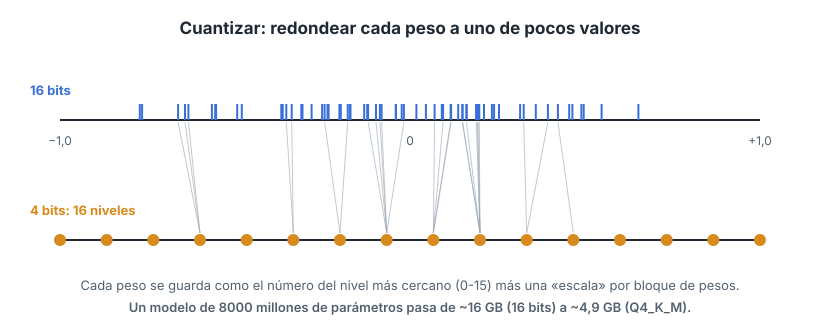
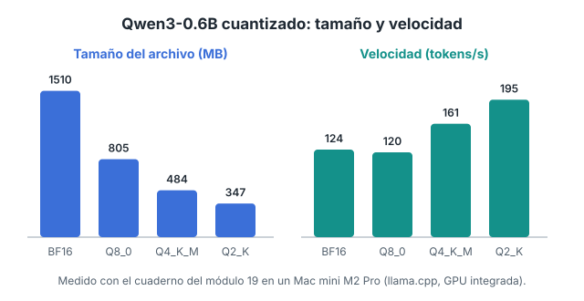

# 19. Cuantización: modelos más ligeros

!!! abstract "En este módulo"
    - Qué es cuantizar un modelo y por qué es la clave de la IA en local.
    - Cómo funciona: de 16 bits a 4 bits por parámetro.
    - Qué significan `Q4_K_M`, `Q8_0`, `GGUF` o `MLX` cuando descargas un modelo.
    - El precio a pagar: cuánta calidad se pierde.
    - Práctica: cuantizar un modelo a 8, 4 y 2 bits, y comparar.

## 1. ¿Qué es la cuantización?

Los parámetros de un modelo son números con decimales. Durante el entrenamiento se guardan con mucha precisión: **32 o 16 bits** por número. **Cuantizar** es **guardarlos con menos bits**, redondeándolos: como pasar de 7,123456 a 7,12, o incluso a 7. El número es menos preciso, pero casi igual de útil, y ocupa mucho menos.

| Formato | Bits por parámetro | Un modelo de 8B ocupa | Uso típico |
|---|---|---|---|
| FP32 | 32 | 32 GB | Entrenamiento (antes) |
| BF16 / FP16 | 16 | 16 GB | Entrenamiento y servidores |
| FP8 / INT8 | 8 | 8 GB | Servidores, casi sin pérdida |
| 4 bits (Q4, INT4, NF4) | ~4,5–5 | ~4,9 GB | **Uso en local**, QLoRA |
| 2-3 bits | ~2,5–3,5 | ~3 GB | Equipos con muy poca memoria |

La cuantización **no cambia lo que sabe el modelo**, solo la precisión con la que guarda cada dato. Es una **compresión con pérdida**, como pasar una foto de RAW a JPEG.

## 2. ¿Para qué sirve?

- **Que quepa en tu equipo.** Un modelo que necesitaba una GPU de 24 GB cabe cuantizado en una de 8 GB o en un portátil. Es la técnica que ha hecho posible la [IA en local](14-ia-local.md).
- **Más velocidad.** Generar cada token exige leer todos los parámetros de la memoria ([módulo 12](12-inferencia.md#6-las-dos-fases-de-una-respuesta)). Con la mitad de bits se lee la mitad de datos, y la respuesta llega antes.
- **Menos coste.** Las empresas sirven sus modelos cuantizados a 8 bits (o incluso a 4) para atender a más usuarios con el mismo hardware.
- **Entrenar con menos memoria.** QLoRA entrena sobre un modelo cuantizado a 4 bits ([módulo 18](18-fine-tuning.md#qlora-lora-sobre-un-modelo-comprimido)).

## 3. ¿Cómo funciona?

<figure markdown="span">
  { .diagrama width="760" }
</figure>

1. **Se agrupan los pesos en bloques** (por ejemplo, de 32 en 32).
2. **Se mira el rango de cada bloque:** sus valores mínimo y máximo.
3. **Se reparte ese rango en niveles.** Con 4 bits hay 2⁴ = **16 niveles**; con 8 bits, 256; con 2 bits, solo 4.
4. **Cada peso se sustituye por el número de su nivel más cercano** (de 0 a 15), y se guarda una **escala** por bloque para poder recuperar el valor aproximado al calcular.

Trabajar por bloques es lo que hace que funcione tan bien: cada grupo de pesos tiene su propia escala, así que el redondeo se ajusta a sus valores.

## 4. La sopa de letras: GGUF, MLX y los tipos K

Cuando buscas un modelo en LM Studio o en Hugging Face verás nombres como `Qwen3-8B-Q4_K_M.gguf`:

- **GGUF** es el **formato de archivo** de llama.cpp, LM Studio y Ollama: un solo archivo con los pesos cuantizados, el tokenizador y la descripción del modelo. Funciona en cualquier sistema.
- **MLX** es el formato de Apple para sus chips M. En un Mac suele ser algo más rápido que GGUF.
- Otros formatos (**GPTQ**, **AWQ**, **FP8**, **NVFP4**) se usan sobre todo en servidores con GPU de NVIDIA.

Y dentro de GGUF:

- **Q** = cuantizado. **El número** = bits por peso: `Q2`, `Q3`, `Q4`, `Q5`, `Q6`, `Q8`.
- **`_0`** (como en `Q8_0`): el método clásico, un redondeo lineal simple. A 8 bits hay tanta precisión que no hace falta nada más.
- **`_K`** (*K-quants*): un método más elaborado, con bloques dentro de bloques y escalas cuantizadas, que aprovecha mejor cada bit. Es el que se usa por debajo de 8 bits.
- **`_S`, `_M`, `_L`** (*small*, *medium*, *large*): la misma familia con más o menos bits extra en las partes más delicadas del modelo. `Q4_K_M` es la combinación más popular.
- **`IQ`** (como `IQ3_XS`): cuantizaciones aún más avanzadas, mejores en tamaños muy pequeños.
- **`imatrix`**: indica que se usó una **matriz de importancia**, calculada con textos de ejemplo, para proteger los pesos que más influyen. Mejora la calidad a igual tamaño.
- **`UD`** (*Unsloth Dynamic*): cuantizaciones de Unsloth que eligen la precisión capa por capa.

!!! tip "¿Cuál descargo?"
    - **Q4_K_M**: el punto de partida para casi todo.
    - **Q5_K_M o Q6_K**: si te sobra memoria y quieres algo más de calidad.
    - **Q8_0**: prácticamente idéntico al original. Útil en modelos pequeños, donde cada bit cuenta.
    - **Q3 o Q2**: solo si no cabe de otra forma. Mejor un modelo más pequeño en Q4 que uno grande en Q2.

## 5. El precio: la pérdida de calidad

Al redondear se pierde información, y el modelo se vuelve algo «menos listo»: menos matices, más pequeños errores. Se mide con la **perplejidad** (cuánto le «sorprende» un texto de prueba: cuanto más baja, mejor) o repitiendo los mismos exámenes que al modelo original.

La regla práctica:

- A **8 bits**, la diferencia es casi imposible de notar.
- A **4-5 bits**, la pérdida es pequeña en los modelos grandes (de más de 30B) y algo más visible en los pequeños.
- Por **debajo de 4 bits**, la calidad cae deprisa, sobre todo en los modelos pequeños.

Existen incluso modelos **entrenados directamente con muy pocos bits**, como BitNet de Microsoft (unos 1,58 bits por peso: cada uno vale −1, 0 o 1). Como se diseñan así desde el principio, pierden mucho menos que un modelo normal comprimido después.

## Práctica

**Objetivo:** cuantizar un modelo pequeño ([Qwen3-0.6B](https://huggingface.co/Qwen/Qwen3-0.6B), de Alibaba, con licencia Apache 2.0) a 8, 4 y 2 bits, y comparar tamaño, velocidad y respuestas.

=== ":material-google: Con Google Colab"

    

    El cuaderno descarga llama.cpp ya compilado, baja el modelo original, lo convierte a GGUF, lo cuantiza a tres niveles y hace la misma pregunta a cada versión. **No necesita GPU** y tarda unos 10 minutos. Al final puedes descargar el archivo `Q4_K_M` y abrirlo en LM Studio.

=== ":material-cursor-default-click: Sin código: GGUF-my-repo"

    **[GGUF-my-repo](https://huggingface.co/spaces/ggml-org/gguf-my-repo)** es una página de Hugging Face, mantenida por el equipo de llama.cpp, que cuantiza cualquier modelo del Hub sin instalar nada.

    1. Crea una cuenta gratuita en [Hugging Face](https://huggingface.co/join) y pulsa **Sign in with Hugging Face** en la página.
    2. En **Hub Model ID** escribe `Qwen/Qwen3-0.6B`.
    3. En **Quantization Method** elige `Q4_K_M`. Si quieres, marca **Use Imatrix Quantization**.
    4. Pulsa **Submit**. En unos minutos tendrás un repositorio nuevo en tu cuenta con el archivo GGUF.
    5. En LM Studio, busca ese repositorio en **Model Search** (con tu nombre de usuario) y descárgalo.
    6. Repite con `Q8_0` y compara las dos versiones en LM Studio con las mismas preguntas.

### Resultados de la prueba

Así salió el cuaderno ejecutado en un Mac mini M2 Pro, con la pregunta «Explica en dos frases qué es la fotosíntesis» y temperatura 0:

| Versión | Tamaño | Velocidad | Respuesta (resumida) |
|---|---|---|---|
| BF16 (original) | 1 510 MB | 124 tok/s | «…las plantas convierten la luz solar en energía química, generando alimentos y liberando **dióxido de carbono**.» |
| Q8_0 | 805 MB | 120 tok/s | «…convierten la luz solar en energía química, generando alimentos.» |
| Q4_K_M | 484 MB | 161 tok/s | «…generando **oxígeno** y metabolitos orgánicos. Esto permite a las plantas crecer… sin dependir de fuentes externas de carbono.» |
| Q2_K | 347 MB | 195 tok/s | «como una respuesta, en español, en el contexto internacional, en la evolución, en la evolución, en la evolución…» |

<figure markdown="span">
  { .diagrama width="600" }
</figure>

Tres lecciones:

1. **Q4_K_M ocupa un tercio** y es **más rápido**; Q2_K, menos de una cuarta parte.
2. **Q8_0 responde prácticamente igual** que el original. Q4_K_M cambia la redacción y comete una falta de ortografía (*dependir*). **Q2_K se ha roto**: con 600 millones de parámetros, 2 bits son demasiado pocos.
3. Y una sorpresa: el **original** se equivoca («liberando dióxido de carbono») y la versión Q4 acierta («oxígeno»). Un modelo tan pequeño es poco fiable en cualquier versión, y la cuantización solo **altera al azar** qué errores comete. Para comparar calidad de verdad hacen falta muchas preguntas, no una.

## Para ampliar

**Artículos**

- [¿Qué es la cuantización?](https://www.ibm.com/es-es/think/topics/quantization) (IBM).
- [A visual guide to quantization](https://newsletter.maartengrootendorst.com/p/a-visual-guide-to-quantization) (Maarten Grootendorst, en inglés): la mejor explicación visual.
- [Cuantización en llama.cpp](https://github.com/ggml-org/llama.cpp/blob/master/tools/quantize/README.md) (en inglés): todos los tipos y su calidad medida.
- [The Era of 1-bit LLMs](https://arxiv.org/abs/2402.17764) (Microsoft, 2024, en inglés): el artículo de BitNet b1.58.

**Para experimentar**

- :material-gesture-tap: [GGUF-my-repo](https://huggingface.co/spaces/ggml-org/gguf-my-repo): cuantiza cualquier modelo del Hub desde el navegador.

