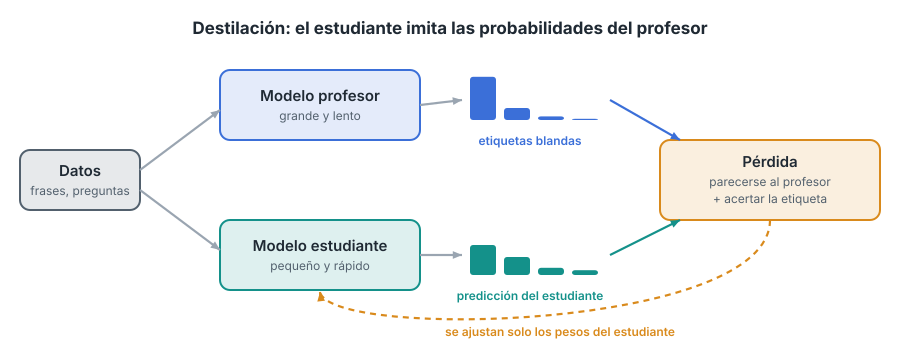

# 20. Destilación: un profesor grande para un estudiante pequeño

!!! abstract "En este módulo"
    - Qué es la destilación de conocimiento y el «conocimiento oscuro».
    - Cómo se entrena un modelo estudiante a partir de un profesor.
    - Tipos de destilación y su uso en los LLM actuales (versiones *mini*, *flash*, modelos de razonamiento).
    - Práctica: destilar un clasificador de opiniones 15 veces más pequeño que su profesor.

## 1. ¿Qué es la destilación?

La **destilación de conocimiento** (*knowledge distillation*) es una técnica en la que un modelo grande y potente, el **profesor**, enseña a un modelo mucho más pequeño y rápido, el **estudiante**, a imitar su comportamiento.

Imagina a una chef de prestigio enseñando a un aprendiz. No le da solo las recetas (las respuestas correctas): le explica por qué hace cada cosa, qué otras opciones había y cuánto le convence cada una. El aprendiz aprende mucho más deprisa que si solo tuviera el recetario.

- **Profesor:** un modelo grande, caro y lento, como un LLM de cientos de miles de millones de parámetros.
- **Estudiante:** un modelo con una arquitectura parecida pero mucho más pequeño, por ejemplo de 1 000 a 8 000 millones.

### El conocimiento oscuro

La clave es **con qué** se entrena al estudiante. En un entrenamiento normal, cada ejemplo tiene una **etiqueta dura**: «esta foto es un gato». Pero el profesor da algo más rico, una **etiqueta blanda**: «90 % gato, 8 % perro, 2 % zorro». Que un gato se parezca algo a un perro y nada a un coche es información valiosa que la etiqueta dura no contiene. Geoffrey Hinton, que propuso la técnica en 2015, la llamó **conocimiento oscuro** (*dark knowledge*).

## 2. ¿Para qué sirve?

- **Modelos pequeños y buenos.** El estudiante hereda buena parte de la capacidad del profesor con una fracción de su tamaño.
- **Menos coste.** Para un servicio con millones de usuarios, pasar de un modelo grande a uno destilado reduce la factura de forma drástica.
- **Dispositivos modestos.** Es la forma de llevar modelos de calidad a móviles, portátiles y sistemas sin conexión.
- **Datos sin etiquetar.** El profesor puede etiquetar cualquier texto, así que no hace falta pagar a personas para que lo hagan (lo comprobarás en la práctica).

A diferencia de la [cuantización](19-cuantizacion.md), que comprime **el mismo modelo**, la destilación crea **otro modelo**, más pequeño, que ha aprendido del grande. Las dos técnicas se combinan: primero se destila y después se cuantiza el estudiante.

## 3. ¿Cómo funciona?

<figure markdown="span">
  { .diagrama width="820" }
</figure>

1. **Se prepara un conjunto de datos** relacionado con la tarea. Puede no estar etiquetado.
2. **El profesor procesa todos los ejemplos** y se guardan sus **probabilidades** completas, no solo su respuesta final.
3. **Se entrena al estudiante** con una función de pérdida que mide cuánto se parecen sus probabilidades a las del profesor (con la **divergencia de Kullback-Leibler**). Si hay etiquetas humanas, se puede añadir también la pérdida normal.
4. **Temperatura.** Para que se vean mejor los matices, las probabilidades de ambos se «suavizan» con una temperatura mayor que 1, la misma idea que en el [muestreo](12-inferencia.md#5-como-elige-cada-palabra-el-muestreo). Con temperatura 1, «99 % gato, 0,9 % perro» apenas enseña nada; con temperatura 3, la diferencia entre perro y coche se hace visible.
5. **Se evalúa al estudiante** por separado: debe acercarse al profesor en la tarea, siendo mucho más rápido.

## 4. Tipos de destilación

- **Basada en respuestas:** el estudiante imita las salidas finales del profesor. Es la más común, y la de la práctica.
- **Basada en características:** el estudiante imita también las **representaciones internas** de las capas intermedias del profesor. El aprendiz no solo copia el plato, también cómo corta las verduras.
- **Basada en relaciones:** el estudiante imita cómo relaciona el profesor unos ejemplos con otros.

### Destilación en los LLM

Con los modelos de lenguaje se usan dos variantes:

- **Destilación de probabilidades:** el estudiante aprende de las probabilidades del profesor **token a token**. Es la versión clásica y la más eficaz, pero requiere acceso al modelo profesor completo. Así se crearon, según sus autores, los modelos pequeños de familias como Gemma o Llama 3.2 a partir de sus hermanos mayores.
- **Destilación por datos sintéticos:** se le piden al profesor miles de respuestas (o de razonamientos paso a paso) y se hace [fine-tuning](18-fine-tuning.md) del estudiante con ellas. El ejemplo más conocido es el de **DeepSeek**, que en enero de 2025 publicó, junto a su modelo de razonamiento R1, seis modelos Qwen y Llama más pequeños ajustados con 800 000 razonamientos generados por R1. El de 32B superaba en pruebas de matemáticas a o1-mini, el modelo de razonamiento pequeño de OpenAI.

!!! warning "Destilar modelos ajenos"
    Las condiciones de uso de OpenAI, Anthropic o Google **prohíben** usar las respuestas de sus modelos para entrenar modelos que compitan con ellos. Destilar un modelo abierto con licencia permisiva sí está permitido; revisa siempre la licencia.

### El precio

El estudiante **rara vez iguala al profesor en todo**. Suele acercarse mucho en la tarea concreta para la que se destiló y perder más en razonamientos complejos o en conocimiento general: no hay espacio para todo en un modelo pequeño.

## Práctica

**Objetivo:** un profesor (DistilBERT, 67 millones de parámetros) ya entrenado para clasificar reseñas de cine en inglés como positivas o negativas enseña a un estudiante (BERT-tiny, 4,4 millones de parámetros) que todavía no sabe nada. ¿Puede el profesor sustituir el trabajo de las personas que etiquetan datos?

El cuaderno entrena tres copias del mismo estudiante:

1. Con **1 000 frases etiquetadas por personas**.
2. Con **30 000 frases etiquetadas por personas**.
3. Con **las mismas 30 000 frases sin etiquetas humanas**, aprendiendo solo de las probabilidades del profesor.

Activa la GPU en Colab (*Entorno de ejecución → Cambiar tipo → GPU T4*). Tarda unos 10 minutos.

### Resultados de la prueba

Primero, el cuaderno muestra cómo «piensa» el profesor:

| Frase | Positiva | Negativa |
|---|---|---|
| *A masterpiece, moving and beautifully acted.* | 100,0 % | 0,0 % |
| *It was fine, I guess, but I wouldn't watch it again.* | 3,6 % | 96,4 % |
| *Two hours of my life I will never get back.* | **74,5 %** | 25,5 % |

El profesor **también se equivoca**: no capta la ironía de la tercera frase. El estudiante heredará sus aciertos y también sus errores.

Y el resultado final, sobre las 872 frases de validación:

| Modelo | Parámetros | Acierto | Frases por segundo |
|---|---|---|---|
| Profesor | 67 M | 91,1 % | 782 |
| Estudiante · 1 000 etiquetas humanas | 4,4 M | 72,2 % | |
| Estudiante · 30 000 etiquetas humanas | 4,4 M | 80,8 % | |
| **Estudiante · 30 000 frases, solo profesor** | 4,4 M | **80,4 %** | **29 806** |

Medido en un Mac mini M2 Pro. En Colab las cifras serán parecidas, aunque varían un punto arriba o abajo en cada ejecución.

- El estudiante es **15 veces más pequeño** y unas **38 veces más rápido**, pero acierta 11 puntos menos: un modelo tan diminuto no da para más.
- El estudiante destilado, **sin ver una sola etiqueta humana**, empata prácticamente con el que tuvo 30 000, y supera de largo al que tuvo 1 000. El profesor ha hecho el trabajo de las personas.

!!! question "Para experimentar"
    Cambia la `TEMPERATURA` del cuaderno a 1, 4 y 8 y vuelve a ejecutar los pasos 3 a 5. ¿Con cuál aprende mejor el estudiante? ¿Por qué crees que una temperatura demasiado alta puede empeorar el resultado?

## Para ampliar

**Artículos**

- [¿Qué es la destilación de conocimiento?](https://www.ibm.com/es-es/think/topics/knowledge-distillation) (IBM).
- [Distilling the Knowledge in a Neural Network](https://arxiv.org/abs/1503.02531) (Hinton, Vinyals y Dean, 2015, en inglés): el artículo original.
- [DeepSeek-R1](https://arxiv.org/abs/2501.12948) (2025, en inglés): incluye la destilación de su razonamiento en modelos Qwen y Llama.
- [DistilBERT](https://arxiv.org/abs/1910.01108) (Hugging Face, 2019, en inglés): el profesor de la práctica es, a su vez, una versión destilada de BERT.

