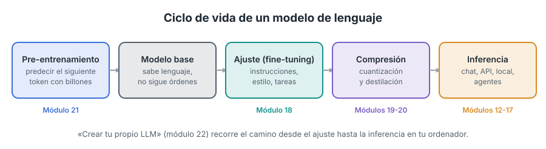

# 21. Pre-entrenamiento: el nacimiento de un modelo

!!! abstract "En este módulo"
    - Qué es el pre-entrenamiento y por qué es la fase más cara de la vida de un LLM.
    - Los datos, el cómputo y las leyes de escala.
    - Los tokenizadores: cómo se construye el vocabulario de un modelo.
    - La arquitectura Transformer, en una página.
    - El camino completo, del texto en bruto a ChatGPT.
    - Práctica: pre-entrenar desde cero un nano-modelo con el Quijote.

## 1. Leer todo internet

El **pre-entrenamiento** es la primera fase, la más larga y la más cara de la vida de un modelo de lenguaje. Es donde adquiere su conocimiento general del mundo y del idioma.

Imagina que quieres formar a la persona más culta del mundo y la obligas a leer una biblioteca inmensa, con buena parte de internet incluida. No le pides que resuma ni que responda nada: solo que, frase a frase, **intente adivinar la palabra siguiente**, y que compruebe si ha acertado. Tras billones de intentos, para acertar ha tenido que aprender gramática, hechos, estilos y hasta cierta capacidad de razonar.

- **La tarea:** predecir el siguiente token ([módulo 12](12-inferencia.md)). Es **aprendizaje autosupervisado** ([módulo 4](04-machine-learning.md)): las respuestas correctas salen del propio texto, así que no hace falta que nadie etiquete nada.
- **El resultado:** un **modelo base** (o fundacional). Sabe muchísimo, pero no sigue instrucciones: si le escribes «¿Cuál es la capital de Francia?», puede que continúe con «¿Y la de Italia? ¿Y la de Alemania?», como si fuera una lista de preguntas de examen. Para que converse hace falta el **post-entrenamiento** (apartado 5).

### Los ingredientes

**Datos masivos.** Los modelos de 2026 se pre-entrenan con **decenas de billones de tokens**: GPT-3 (2020) usó unos 300 000 millones; Llama 3 (2024), más de 15 billones. Proceden de copias de la web como **Common Crawl**, Wikipedia, libros, artículos científicos, código de GitHub y, cada vez más, **datos sintéticos** generados por otros modelos. La mayor parte del trabajo no es reunir texto, sino **filtrarlo**: quitar duplicados, spam, texto de mala calidad y datos personales. Conjuntos abiertos como [FineWeb](https://huggingface.co/datasets/HuggingFaceFW/fineweb) muestran cómo se hace.

**Cómputo extremo.** Decenas de miles de GPU funcionando sin parar durante **semanas o meses** ([módulo 9](09-hardware.md)), con un coste de **cientos de millones de dólares** para los modelos punteros. Por eso solo unas pocas empresas y laboratorios pre-entrenan grandes modelos desde cero.

**Las leyes de escala.** En 2020 y 2022 se descubrió que la calidad mejora de forma muy predecible al aumentar a la vez los parámetros, los datos y el cómputo. El estudio *Chinchilla* (DeepMind, 2022) concluyó que, para un presupuesto dado, conviene usar unos **20 tokens de entrenamiento por parámetro**. Hoy se entrena con muchos más (Llama 3 8B vio unos 1 900 tokens por parámetro), porque un modelo pequeño muy entrenado sale más barato de **usar** después.

## 2. Los tokenizadores

Un modelo solo entiende números. El **tokenizador** es el traductor entre el texto y esos números:

1. Tiene un **vocabulario**: una lista fija de piezas de texto (palabras, trozos de palabra, caracteres sueltos), cada una con un número de identificación.
2. Al recibir un texto, lo **trocea** en piezas de su vocabulario.
3. Devuelve la lista de **números** (los ID de los tokens), que es lo que entra en el modelo.

```text
Texto:   Hola, ¿qué tal?
Tokens:  "Hola"  ","  " ¿"  "qué"  " tal"  "?"
IDs:     [8341,  11,  1834, 7561, 10302,  30]      ← los números son ilustrativos
```

¿De dónde sale el vocabulario? Se **aprende** antes del pre-entrenamiento, a partir de una muestra de los datos, con algoritmos como **BPE** (*Byte-Pair Encoding*): se empieza con caracteres sueltos y se van **fusionando los pares más frecuentes** («q»+«u» → «qu», «qu»+«e» → «que»…) hasta llegar al tamaño deseado. Así, las palabras comunes acaban siendo un solo token y las raras, como «neurocientífico», se forman con piezas conocidas («neuro» + «cient» + «ífico»). Nunca hay palabras desconocidas: en el peor caso, se escriben letra a letra.

Cada modelo y su tokenizador son **inseparables**: un modelo solo entiende los números de su propio vocabulario. Por eso el tokenizador se distribuye siempre junto al modelo (en los archivos GGUF, por ejemplo, va dentro).

## 3. La arquitectura Transformer

La arquitectura que usan casi todos los LLM es el **Transformer**, presentado por Google en 2017 en el artículo *[Attention Is All You Need](https://arxiv.org/abs/1706.03762)* ([módulo 8](08-ia-generativa.md)). Sus dos claves:

- **Atención** (*self-attention*). Cada token «mira» a todos los anteriores y decide cuáles son relevantes para él. En «La gata persiguió al ratón hasta su madriguera porque era muy **rápida**», la atención permite asociar «rápida» con «gata» (y no con «madriguera» ni con «ratón», que además es masculino). Las arquitecturas anteriores, que leían palabra por palabra, olvidaban el sujeto en las frases largas.
- **Paralelismo.** Durante el entrenamiento, todos los tokens de un texto se procesan **a la vez**. Eso permite aprovechar miles de GPU y es la razón por la que se pudo escalar a modelos gigantes.

Un LLM apila decenas de **bloques** iguales, cada uno con su capa de atención y una red neuronal. Los modelos de 2026 añaden mejoras sobre el diseño original: la **mezcla de expertos** (MoE), atenciones más eficientes para contextos de un millón de tokens o capas que combinan atención con otros mecanismos, pero la idea de fondo es la misma.

## 4. El bucle de entrenamiento

El pre-entrenamiento es, en esencia, este bucle repetido cientos de miles de veces:

1. Tomar un lote de fragmentos de texto.
2. Pedir al modelo que prediga el siguiente token en cada posición.
3. Medir el error con la **pérdida** (*loss*, entropía cruzada): cuánta probabilidad dio el modelo a la respuesta correcta.
4. Usar la **retropropagación** ([módulo 5](05-deep-learning.md)) para ajustar un poco todos los parámetros en la dirección que reduce el error.

Se vigila la pérdida con textos que el modelo nunca ve durante el entrenamiento (**validación**) para comprobar que **generaliza** en lugar de memorizar. Es exactamente lo que harás en la práctica, a escala de juguete.

## 5. El camino completo

<figure markdown="span">
  { .diagrama width="820" }
</figure>

1. **Diseño:** se elige la arquitectura (un Transformer con cierto número de capas y parámetros) y se entrena el **tokenizador**.
2. **Pre-entrenamiento:** meses de cómputo con billones de tokens. Resultado: el **modelo base**.
3. **Post-entrenamiento:**
    - ***Fine-tuning* supervisado** con ejemplos de instrucciones y respuestas de calidad: el modelo aprende a conversar ([módulo 18](18-fine-tuning.md)).
    - **Alineamiento** con preferencias humanas (RLHF, DPO) y **aprendizaje por refuerzo** con problemas verificables: el modelo aprende a ser útil, a rechazar peticiones peligrosas y, en los modelos de razonamiento, a «pensar» paso a paso.
    - Resultado: el **modelo *instruct*** o de chat, el que usas en ChatGPT o descargas en LM Studio.
4. **Compresión** (opcional): [cuantización](19-cuantizacion.md) y [destilación](20-destilacion.md) para que funcione en equipos más modestos o salga más barato.
5. **Especialización** (opcional): otras empresas o personas toman el modelo abierto y lo ajustan para su caso ([módulo 22](22-crear-llm.md)).
6. **Inferencia:** el tokenizador convierte tu mensaje en números, el modelo predice el siguiente token, el tokenizador lo convierte en texto… y vuelta a empezar, token a token.

!!! tip "Pre-entrenamiento continuado"
    Entre el pre-entrenamiento completo y el *fine-tuning* hay una opción intermedia: seguir pre-entrenando un modelo ya hecho con mucho texto de un ámbito o un idioma concreto (por ejemplo, textos jurídicos, o euskera), para que **absorba vocabulario y conocimiento** nuevos. Es más caro que el *fine-tuning*, pero muchísimo más barato que empezar de cero. Unsloth Studio lo ofrece como método de entrenamiento.

## Práctica

**Objetivo:** pre-entrenar **desde cero** un nano-modelo de lenguaje de unos 3 millones de parámetros con el texto completo de *Don Quijote de la Mancha*. Su único universo será el castellano de Cervantes. Construirás el tokenizador, la arquitectura y el bucle de entrenamiento: los mismos pasos que un LLM gigante.

[](https://colab.research.google.com/github/mosqueteroweb/IAconceptos/blob/main/notebooks/nanomodelo-quijote.ipynb)

Activa la GPU (*Entorno de ejecución → Cambiar tipo → GPU T4*). Con ella tarda unos 3 minutos. El cuaderno está basado en [nanoGPT](https://github.com/karpathy/nanoGPT), de Andrej Karpathy.

### Resultados de la prueba

El tokenizador es el más simple posible, **un token por carácter**: el Quijote tiene 92 caracteres distintos (letras, tildes, signos), y ese es todo el vocabulario.

**Antes de entrenar**, con los parámetros al azar, el modelo escribe esto:

```text
DON QUIJOTE)OT4AIüáZpFWjNHrZáicá]s-Á5Oñ"C"15rX7dpgqS3É,íSe)Ó2g!üÁGF.ebIS"Ñ7
6G»PUv"oÍGDW5:ùcÓdóÁ«ÍZÍuüñÍtïsSD7SN«0(bàOGá:'GxPGb"U3ùBíù'ïÉünUùEÑsÚx4B(D
```

**Durante el entrenamiento**, la pérdida baja de 4,65 (peor que adivinar al azar entre 92 caracteres, que daría 4,52) a 1,32 en 5 000 pasos. Las pérdidas de entrenamiento y de validación bajan casi juntas: el modelo **generaliza**, no memoriza.

| Paso | 0 | 500 | 1 000 | 2 000 | 3 000 | 4 000 | 5 000 |
|---|---|---|---|---|---|---|---|
| Pérdida de validación | 4,66 | 2,00 | 1,72 | 1,50 | 1,39 | 1,35 | 1,32 |

**Después de entrenar** (3,6 minutos en un Mac mini M2 Pro), empezando con «—Mire vuestra merced»:

```text
—Mire vuestra merced y saber su valiente y de aquellos, y con la
deseo de su mesmo de la mano que sea; y con mucha señora del padre que se
hacen su padre, y la duquesa de los deseos de la famosa de los venir con
ellas partes sobre su bueno, y que hay de ver que le había de hacer el más
de la cabeza por adelante la fama
```

No tiene sentido, pero ha aprendido **sola**, sin que nadie se lo explique, la ortografía, la puntuación, los diálogos con raya y palabras de la época como «vuestra merced», «mesmo» o «duquesa». Con 3 millones de parámetros y un libro (2 MB de texto) no se puede pedir más. Ahora imagina lo que aprende un modelo 100 000 veces mayor con millones de veces más texto.

!!! question "Para experimentar"
    - Cambia la **temperatura** de la última celda (0,3 y 1,3). ¿Qué ocurre?
    - Aumenta `CAPAS` a 6 o `PASOS` a 10 000. ¿Baja más la pérdida? ¿Cuánto más tarda?
    - Sustituye el Quijote por otro libro de [Gutenberg](https://www.gutenberg.org/browse/languages/es) en español, por ejemplo poesía. ¿Imita su estilo?

!!! info "¿Y en LM Studio?"
    Este nano-modelo usa una arquitectura casera, así que no se puede abrir en LM Studio: esas aplicaciones solo cargan arquitecturas conocidas (Llama, Qwen, Gemma…). Para llegar hasta ahí habría que construirlo con una arquitectura estándar de Hugging Face, como hacen los recursos del [módulo 22](22-crear-llm.md#para-ampliar).

## Para ampliar

<div class="recursos" markdown>

**Artículos**

- [¿Qué es el preentrenamiento?](https://www.ibm.com/es-es/think/topics/pretraining) (IBM).
- [Attention Is All You Need](https://arxiv.org/abs/1706.03762) (2017, en inglés): el artículo original del Transformer.
- [Training Compute-Optimal Large Language Models (Chinchilla)](https://arxiv.org/abs/2203.15556) (DeepMind, 2022, en inglés).
- [The FineWeb datasets](https://huggingface.co/spaces/HuggingFaceFW/blogpost-fineweb-v1) (Hugging Face, en inglés): cómo se limpian 15 billones de tokens de la web.

**Vídeos**

- :material-youtube: [Neural Networks: Zero to Hero](https://www.youtube.com/playlist?list=PLAqhIrjkxbuWI23v9cThsA9GvCAUhRvKZ) (Andrej Karpathy, en inglés con subtítulos): el curso en vídeo del que sale la práctica, desde cero hasta un GPT completo.

**Para experimentar**

- :material-gesture-tap: [Tiktokenizer](https://tiktokenizer.vercel.app/): mira cómo trocean el texto los tokenizadores de distintos modelos.
- :material-gesture-tap: [LLM Visualization](https://bbycroft.net/llm): un GPT en 3D que puedes recorrer capa a capa.

</div>
