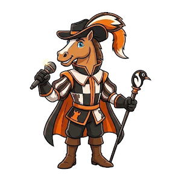

# Sobre este material

Este sitio recoge los apuntes del **Curso de IA (Introducción)**.

## Autoría

<figure markdown="span">
  { width="160" }
  <figcaption>Curso creado por <strong>MosqueteroWeb</strong> · <a href="https://github.com/mosqueteroweb">github.com/mosqueteroweb</a></figcaption>
</figure>

## Licencia

El texto y los diagramas propios se publican con licencia [Creative Commons BY-SA 4.0](https://creativecommons.org/licenses/by-sa/4.0/deed.es). Puedes copiar, adaptar y compartir el material, también con fines comerciales, siempre que **cites la autoría (MosqueteroWeb)** con un enlace a este sitio y publiques tus versiones con la misma licencia. Los recursos enlazados pertenecen a sus respectivos autores.

## Cómo contribuir

El código fuente está en [GitHub](https://github.com/mosqueteroweb/IAconceptos). Si encuentras un error o un enlace roto, puedes:

- **Abrir una *issue*** describiendo el problema.
- **Proponer un cambio** con el botón de edición (el lápiz) de cada página. Necesitas una cuenta de GitHub, pero no permisos sobre el repositorio: GitHub crea una copia en tu cuenta y envía la propuesta como *pull request*. El cambio solo se publica si el autor lo aprueba.
