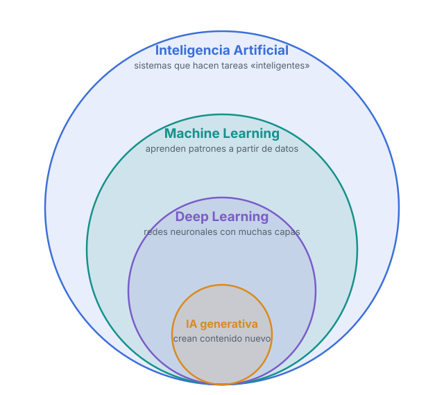

---
hide:
  - navigation
---

# IAconceptos

**Un curso introductorio de Inteligencia Artificial para entender qué hay detrás de ChatGPT, Gemini o Claude, sin necesidad de saber programar.**

El curso tiene **dos partes**. La primera explica qué es la IA y cómo aprende: verás cómo funciona una red neuronal, por qué hacen falta GPUs o qué regula la ley europea de IA. La segunda es práctica: cómo **usar** un modelo de lenguaje en la web, en tu ordenador y desde tus programas, cómo **ampliarlo** con habilidades, conectores y agentes, y cómo se **adapta y se crea** uno.

Las explicaciones son divulgativas, con la base técnica justa y sin bloques de código que lo hagan cuesta arriba. Las prácticas de la segunda parte se hacen con herramientas gráficas o con cuadernos de Google Colab que se ejecutan con un clic. Cada módulo termina con una selección de **enlaces de ampliación revisados**: artículos, vídeos en español y herramientas interactivas.

<figure markdown="span">
  { .diagrama width="440" }
  <figcaption>El mapa del curso: cada círculo está contenido en el anterior.</figcaption>
</figure>

## Primera parte: entender la IA

-   :material-lightbulb-on-outline: **Fundamentos**

    ---

    1. [¿Qué es la IA?](01-que-es-la-ia.md)
    2. [Historia](02-historia.md)
    3. [Tipos de IA](03-tipos-de-ia.md)

-   :material-school-outline: **Cómo aprenden las máquinas**

    ---

    4. [Machine Learning](04-machine-learning.md)
    5. [Deep Learning y redes neuronales](05-deep-learning.md)
    6. [Multimodalidad: la IA que ve y habla](06-multimodalidad.md)

-   :material-hammer-wrench: **Crear con IA**

    ---

    7. [Herramientas para crear IA](07-herramientas.md)
    8. [IA generativa](08-ia-generativa.md)
    9. [Hardware necesario](09-hardware.md) · [Práctica de montaje](practicas/montaje.md)
    10. [Software necesario](10-software.md)

-   :material-scale-balance: **Sociedad**

    ---

    11. [Ética y responsabilidad](11-etica.md)

    También: [Glosario](glosario.md)

## Segunda parte: usar y crear modelos

-   :material-play-circle-outline: **Usar modelos**

    ---

    12. [Inferencia: cómo responde un modelo](12-inferencia.md)
    13. [Aplicaciones e ingeniería de prompts](13-apps-prompts.md)
    14. [IA en tu ordenador: LM Studio y Ollama](14-ia-local.md)
    15. [La API: modelos desde tus programas](15-api.md)

-   :material-puzzle-outline: **Ampliar modelos**

    ---

    16. [Habilidades y conectores (MCP)](16-habilidades-mcp.md)
    17. [Agentes y orquestadores](17-agentes.md)

-   :material-tune-variant: **Adaptar modelos**

    ---

    18. [Fine-tuning](18-fine-tuning.md)
    19. [Cuantización](19-cuantizacion.md)
    20. [Destilación](20-destilacion.md)

-   :material-factory: **Crear modelos**

    ---

    21. [Pre-entrenamiento](21-pre-entrenamiento.md)
    22. [Crea tu propio modelo](22-crear-llm.md)

Empieza por la [presentación de la segunda parte](parte-2.md): explica cómo están hechas las prácticas.

## Cómo usar este material

!!! tip "Recorrido recomendado"
    Los módulos 1 a 6 se leen en orden: cada uno se apoya en el anterior. Los módulos 7 a 10 son más técnicos y pueden consultarse según el interés del grupo. El módulo 11 (ética) puede trabajarse en cualquier momento como debate.

    En la segunda parte, los módulos 12 a 17 son independientes y muy prácticos; el 12 (inferencia) conviene leerlo primero. Los módulos 18 a 22 forman una secuencia: si vas a hacer el proyecto final (módulo 22), haz antes la práctica del 18.

- :material-play-circle-outline: Los **vídeos** recomendados están en español siempre que ha sido posible.
- :material-google: Los **cuadernos de Colab** de la segunda parte se han ejecutado completos antes de publicarlos.
- :material-gesture-tap: Las **herramientas interactivas** (Teachable Machine, TensorFlow Playground, Transformer Explainer…) funcionan en el navegador, sin instalar nada.
- :material-alert-circle-outline: La IA cambia muy rápido. Las cifras de modelos, hardware y leyes están revisadas a **noviembre de 2026**; conviene comprobarlas si lees esto mucho después.
