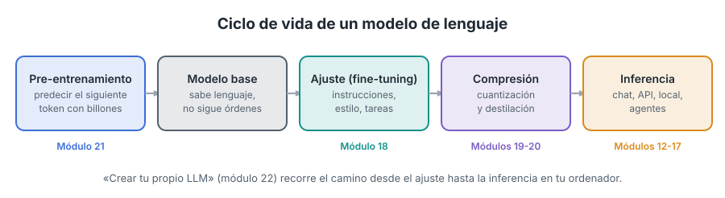

# Segunda parte: usar, ampliar y crear modelos

En la primera parte viste qué es la IA, cómo aprenden las máquinas y qué hace falta para construir un modelo. La segunda parte es más práctica: **cómo se usa un modelo de lenguaje** (en la web, en tu ordenador y desde tus propios programas), **cómo se amplían sus capacidades** con habilidades, conectores y agentes y, por último, **cómo se fabrica y se adapta** uno: pre-entrenamiento, *fine-tuning*, cuantización y destilación.

<figure markdown="span">
  { .diagrama width="820" }
  <figcaption>El ciclo de vida de un LLM y el módulo donde se trata cada fase.</figcaption>
</figure>

-   :material-play-circle-outline: **Usar modelos**

    ---

    12. [Inferencia: cómo responde un modelo](12-inferencia.md)
    13. [Aplicaciones e ingeniería de prompts](13-apps-prompts.md)
    14. [IA en tu ordenador: LM Studio y Ollama](14-ia-local.md)
    15. [Usar modelos desde tus programas: la API](15-api.md)

-   :material-puzzle-outline: **Ampliar modelos**

    ---

    16. [Habilidades y conectores (MCP)](16-habilidades-mcp.md)
    17. [Agentes y orquestadores](17-agentes.md)

-   :material-tune-variant: **Adaptar modelos**

    ---

    18. [Fine-tuning](18-fine-tuning.md)
    19. [Cuantización](19-cuantizacion.md)
    20. [Destilación](20-destilacion.md)

-   :material-factory: **Crear modelos**

    ---

    21. [Pre-entrenamiento](21-pre-entrenamiento.md)
    22. [Crea tu propio modelo](22-crear-llm.md)

## Cómo están hechas las prácticas

Hay dos tipos de prácticas:

- **Las prácticas evaluables**, en la sección [Prácticas](practicas/segunda-parte.md) del menú. Se hacen en grupo, en los equipos del aula (Mac mini M4 o PC con NVIDIA RTX 5060 Ti), con LM Studio, la terminal y Unsloth Studio, y el profesor las valida en clase.
- **Las prácticas de cada módulo**, más cortas, para entender el tema o repasarlo en casa. Siempre que existen, se ofrecen en dos versiones:

=== ":material-cursor-default-click: Sin código"

    Con herramientas gráficas: **LM Studio**, **Unsloth Studio** o páginas web como **GGUF-my-repo**. Solo hay que hacer clic y rellenar campos.

=== ":material-google: Con Google Colab"

    Un **cuaderno de Google Colab** preparado para este curso: se abre en el navegador, usa una GPU gratuita de Google y se ejecuta celda a celda con el botón ▶. Cada paso está explicado en lenguaje llano. No hay que escribir código, solo leerlo si te apetece. Es la opción para practicar **sin un ordenador potente**, por ejemplo en casa.

!!! info "Cuadernos comprobados"
    Los cuadernos de [cuantización](19-cuantizacion.md#practica), [destilación](20-destilacion.md#practica) y [pre-entrenamiento](21-pre-entrenamiento.md#practica) se han ejecutado completos antes de publicarlos, y los resultados que aparecen en cada módulo son los obtenidos. Las prácticas de *fine-tuning* usan Unsloth Studio, que necesita una GPU de NVIDIA o un Mac con chip Apple; si no tienes ninguna, Unsloth ofrece una versión de Studio que funciona dentro de Colab.

!!! warning "Un campo que cambia cada mes"
    Las herramientas de esta parte (LM Studio, Unsloth, los agentes…) se actualizan constantemente. Los nombres de menús y modelos están revisados a **noviembre de 2026**. Si algo no coincide, busca la opción equivalente: las ideas de fondo no cambian.
