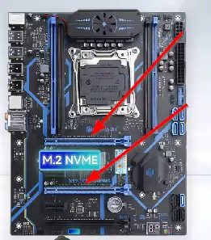

# Práctica: montaje de un equipo para IA

!!! abstract "Objetivo"
    Diseñar el presupuesto **más barato posible** de un equipo capaz de ejecutar y ajustar (*fine-tuning*) modelos de lenguaje abiertos con **dos tarjetas gráficas**, aplicando lo aprendido en el [módulo de hardware](../09-hardware.md).

## Enunciado

Cada persona debe hacer **un presupuesto**, lo más **barato** posible, con estos componentes:

1. **Placa base X99** con **más de una ranura PCIe x16** (2 o 3).
2. **Procesador** compatible con la placa con una puntuación **PassMark multinúcleo mínima de 12 000 puntos** (consulta [cpubenchmark.net](https://www.cpubenchmark.net/)).
3. **Memoria RAM** compatible, **mínimo 32 GB**.
4. **Disipador y ventilador** compatibles con el zócalo de la placa.
5. **Fuente de alimentación modular** compatible y capaz de alimentar **dos tarjetas gráficas modernas** (2 × RTX 5060 Ti de 16 GB), con sus conectores de alimentación PCIe (de 8 pines o 16 pines, 12V-2×6, según el modelo de tarjeta elegido).
6. **Disco NVMe** compatible (mejor **M.2 2280 PCIe Gen3**).
7. Se valorará que la placa tenga **chip TPM 2.0** (o conector para módulo TPM).

<figure markdown="span">
  { width="360" loading=lazy }
  <figcaption>Ejemplo de placa X99 con ranura M.2 para disco NVMe.</figcaption>
</figure>

!!! note "Compra"
    El equipo se intentará comprar tal cual lo pidáis, así que hay que poner **enlaces a la tienda de cada componente**. La placa, el procesador y la memoria seguramente serán de AliExpress.

## Pistas técnicas

??? tip "Plataforma X99 y procesador"
    X99 es una plataforma de Intel de 2014 (zócalo **LGA 2011-3**) muy popular de segunda mano porque admite procesadores **Xeon E5 v3/v4** con muchos núcleos a precios bajos y tiene **muchas líneas PCIe**, ideales para varias GPUs. Busca Xeon E5-26xx v3 o v4 y compara su PassMark multinúcleo. Comprueba en la ficha de la placa qué versiones de procesador admite su BIOS.

??? tip "Memoria RAM"
    Las placas X99 usan **DDR4**. Muchas placas chinas de AliExpress aceptan memoria **ECC REG** (de servidor), mucho más barata de segunda mano. Comprueba en la ficha si la placa admite ECC REG, normal o ambas, y aprovecha el **cuádruple canal** (4 módulos iguales rinden más que 2).

??? tip "Ranuras PCIe y separación entre tarjetas"
    Fíjate en que las dos ranuras x16 estén **suficientemente separadas**: cada tarjeta suele ocupar 2 o 3 ranuras de ancho. Comprueba también cuántas líneas tiene realmente cada ranura (x16/x16 o x16/x8). Para inferencia de LLM, x8 apenas penaliza.

??? tip "Fuente de alimentación"
    Suma el consumo: cada RTX 5060 Ti ronda los **180 W**, un Xeon E5 de gama alta unos **120-145 W**, más placa, disco y ventiladores. Una fuente de **750-850 W** con certificación 80 PLUS Bronze o superior deja margen. Comprueba que tenga **dos conectores PCIe** del tipo que piden tus tarjetas.

??? tip "Disco NVMe y arranque"
    Algunas placas X99 antiguas no pueden **arrancar** desde NVMe sin una BIOS actualizada. Las placas chinas modernas suelen venir preparadas; compruébalo en la descripción.

## ¿Qué podremos hacer con este equipo?

Con **2 × 16 GB = 32 GB de VRAM** (repartidos entre dos tarjetas, sin NVLink):

- Ejecutar con soltura modelos de **8 a 14 mil millones de parámetros** y, cuantizados a 4 bits, modelos de **hasta unos 32 mil millones** repartiendo capas entre las dos GPUs (consulta la tabla de memoria del [módulo 9](../09-hardware.md#5-cuanta-memoria-necesita-un-modelo)).
- Hacer **fine-tuning con QLoRA** de modelos de unos 8 mil millones de parámetros.
- Generar imágenes con modelos de difusión abiertos.

## Entrega

Una tabla con: componente, modelo concreto, características clave (zócalo, tipo de memoria, consumo…), precio con envío y **enlace de compra**, más el **total**. Añade una breve justificación de la compatibilidad entre piezas.
