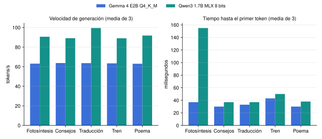

# Práctica 14. Tu laboratorio de IA local

**Módulo:** [14. IA en tu ordenador: LM Studio y Ollama](../14-ia-local.md) · [Normas comunes de las prácticas](segunda-parte.md)

!!! danger "Validación obligatoria en clase"
    El profesor tiene que ver en clase vuestro trabajo funcionando **antes** de que lo subas. Un trabajo subido sin haberlo validado antes en clase no se evalúa. Lo que tendréis que enseñar está en el apartado [Validación en clase](#validacion-en-clase).

**Objetivo:** medir el rendimiento real de vuestro equipo con LM Studio y comprobar cómo influyen los ajustes de carga, los de muestreo y el uso de documentos.

## Ejemplo resuelto

**Pareja del ejemplo:** **Gemma 4 E2B** en Q4_K_M (formato GGUF) frente a **Qwen3 1.7B** en 8 bits (formato MLX, solo para Mac). Equipo: Mac con chip M2 Pro.

**1. Hardware.** En el engranaje de abajo a la izquierda → **Hardware** se ven el chip, la memoria total y la que puede usar la GPU. Captúralo.

**2. Memoria estimada al cargar.** Con **Manually choose model load parameters** activado, cambiamos *Context Length* y anotamos *Estimated Memory Usage*:

| Modelo | Contexto 4 096 | Contexto 32 768 |
|---|---|---|
| Gemma 4 E2B Q4_K_M | 4,32 GB | 4,86 GB |
| Qwen3 1.7B MLX 8 bits | 2,40 GB | 2,40 GB |

Con más contexto hace falta más memoria para la **caché KV** (módulo 12). En Gemma 4 crece poco porque buena parte de sus capas solo miran una ventana de texto cercano. En el modelo MLX la estimación **no cambia**: LM Studio no incluye ahí el contexto, así que la cifra no es la memoria real. Es un buen ejemplo de que hay que entender lo que se mide. (En LM Studio 0.4.28, la ventana de carga de un modelo MLX ya no muestra ninguna estimación.)

**3. Benchmark.** Temperatura 0, **Think** desactivado (es el botón **Think** de la barra donde se escribe el mensaje, junto a las herramientas; si no aparece, el modelo no razona), las cinco preguntas del [material](#material-las-cinco-preguntas-del-benchmark), tres veces cada una. Medias:

| Pregunta | Gemma 4 E2B: 1.er token | Gemma 4 E2B: tok/s | Qwen3 1.7B: 1.er token | Qwen3 1.7B: tok/s |
|---|---|---|---|---|
| 1. Fotosíntesis | 0,037 s | 63,1 | 0,155 s | 90,6 |
| 2. Cinco consejos | 0,030 s | 63,7 | 0,037 s | 89,1 |
| 3. Traducción | 0,033 s | 63,6 | 0,037 s | 99,5 |
| 4. Tren | 0,043 s | 63,4 | 0,050 s | 89,0 |
| 5. Poema | 0,030 s | 63,0 | 0,038 s | 91,8 |
| **Media** | **0,035 s** | **63,4** | **0,064 s** | **92,0** |

<figure markdown="span">
  { loading=lazy }
  <figcaption>La gráfica del apartado 3 en el ejemplo: velocidad y tiempo hasta el primer token de cada pregunta (media de tres ejecuciones). Así debe ser la vuestra, con vuestros dos modelos.</figcaption>
</figure>


- La **primera** pregunta de Qwen tardó 0,42 s en dar el primer token y las siguientes, 0,02 s: la primera ejecución «calienta» el modelo. Por eso se repite tres veces.
- Qwen es un 45 % más rápido, porque tiene menos parámetros. Pero en la traducción respondió «Tomorrow we have a History exam **at early morning**» (incorrecto: es *first thing in the morning*). Gemma dio la traducción correcta y dos alternativas. Los dos acertaron la hora del tren (12:15).

**4. Muestreo** (Gemma 4 E2B, «Escribe el principio de un cuento sobre una brújula»):

| Ajuste | Cómo empezó |
|---|---|
| Temperatura 0,2 | «El viejo reloj de bolsillo, con su mecanismo de latón…» |
| Temperatura 1 | «El viejo Latón, con sus agujas temblorosas y su carcasa desgastada…» |
| Temperatura 1,6 | «El viejo cazador, con manos curtidas por el sol…» |
| Temperatura 1 + Top K 1 | «El viejo Casimiro no era solo un objeto de latón y vidrio…» |

Con **Top K 1** el modelo solo puede elegir la palabra más probable: repetimos la petición y salió **exactamente el mismo texto**, igual que con temperatura 0. Con temperatura 1,6, cada vez sale un cuento distinto.

**5. Documento.** Usamos unas normas inventadas de una piscina municipal, más cortas que el reglamento de la práctica. Como es un texto breve, LM Studio lo incluye entero en la conversación.

??? example "Las normas de la piscina del ejemplo"

    ```text
    NORMAS DE LA PISCINA MUNICIPAL CUBIERTA DE VALDEMORA DEL RÍO

    1. Horario. De lunes a viernes, de 7.00 a 22.00 h. Sábados, de 9.00 a 20.00 h. Domingos y festivos, de 9.00 a 14.00 h. Cerrada del 1 al 15 de agosto por mantenimiento.
    2. Precios. Baño libre: 4,20 €. Menores de 16 y mayores de 65: 2,60 €. Bono de 10 baños: 35 €. Los martes por la tarde, de 16.00 a 18.00 h, el baño libre es gratuito para menores de 12 años acompañados.
    3. Calles. Hay 6 calles: la 1 y la 2 son de nado rápido, la 3 y la 4 de nado medio y la 5 y la 6 de nado lento y aquagym.
    4. Normas. Es obligatorio el gorro de baño y ducharse antes de entrar al agua. No se permite comer en la zona de vasos. Los menores de 10 años deben estar acompañados por un adulto dentro del recinto.
    5. Cursos. Natación infantil (de 4 a 12 años): 48 € al trimestre, dos días por semana. Inscripciones del 1 al 10 de septiembre en la recepción.
    ```

Resultados:

| Pregunta | Respuesta del modelo | ¿Correcta? |
|---|---|---|
| ¿Cuánto cuesta el bono de 10 baños y cuánto se ahorra frente a 10 baños libres? | «El bono de 10 baños cuesta 35 €.» | **A medias:** no calculó el ahorro (42 − 35 = 7 €). |
| ¿Puede ir un niño de 9 años solo? | «Los menores de 10 años deben estar acompañados por un adulto.» | Sí. |
| ¿Qué calle debo usar para hacer aquagym? | «La calle 6 es para aquagym.» | **A medias:** son la 5 y la 6. |
| ¿Tiene taquillas con candado? (no está en el documento) | «El documento no menciona si la piscina tiene servicio de taquillas.» | Sí: no se lo inventó. |

**6. Preset.** *Model Parameters → System Prompt*: «Eres un tutor de Física y Química de 4.º de ESO. Explica con ejemplos de la vida diaria y termina siempre con una pregunta para comprobar que lo he entendido». Después, **Save Preset As…** → «Tutor FyQ».

**Conclusión del ejemplo:** para tareas rápidas y cortas, Qwen3 1.7B (92 tok/s); para traducir o redactar, Gemma 4 E2B, más lenta (63 tok/s) pero más fiable.

## Vuestra práctica

Haced lo mismo con **la pareja de modelos de vuestro grupo**:

1. **Hardware.** Captura de **Ajustes → Hardware** de vuestro equipo.
2. **Carga.** La memoria estimada de vuestros dos modelos con 4 096 y 32 768 tokens de contexto, y la explicación. Si un modelo es MLX y LM Studio no muestra la estimación, decidlo y anotad la memoria que ocupa una vez cargado (en la terminal, `lms ps`).
3. **Benchmark.** Las cinco preguntas del [material](#material-las-cinco-preguntas-del-benchmark), tres veces cada una, con temperatura 0 y **Think** desactivado. Hoja de cálculo con todas las mediciones, las medias y una gráfica.
4. **Muestreo.** El principio de un cuento sobre **el objeto de vuestro grupo**, con temperatura 0,2, 1 y 1,6, y con temperatura 1 y Top K 1.
5. **Documento.** Guardad el [reglamento del planetario](#material-el-reglamento-del-planetario) en un archivo de texto, adjuntadlo al chat y haced **las tres preguntas de vuestro grupo** y **una pregunta que no esté en el documento**. Comprobad cada respuesta en el reglamento.
6. **Preset.** Un *preset* con un *System Prompt* para un uso vuestro real.
7. **El experimento de vuestro grupo.** El que indica vuestra tarjeta.

## Lo específico de cada grupo

??? abstract "Grupo 1"
    - **Modelos:** Gemma 4 E2B en Q4_K_M y en Q8_0.
    - **Objeto del cuento:** un paraguas roto.
    - **Preguntas sobre el reglamento:** (a) ¿Cuánto pagan dos adultos y dos niños de 10 años un sábado? (b) ¿A qué hora empieza la última sesión de un jueves? (c) ¿Cuántos turnos de telescopio solar caben en un sábado?
    - **Experimento:** al cargar, pon *GPU Offload* a la mitad de las capas. ¿Cuántos tok/s pierdes?

??? abstract "Grupo 2"
    - **Modelos:** Qwen3 4B en Q4_K_M y en Q8_0.
    - **Objeto del cuento:** una llave oxidada.
    - **Preguntas sobre el reglamento:** (a) ¿Cuánto paga un grupo de 30 alumnos con 3 profesores? (b) ¿Abre el planetario el 24 de junio? (c) Si veo las dos sesiones de la mañana seguidas, ¿a qué hora salgo de la segunda?
    - **Experimento:** pega el reglamento entero en el chat y pregunta algo. ¿Cuánto tarda el primer token, comparado con una pregunta corta?

??? abstract "Grupo 3"
    - **Modelos:** Gemma 4 E2B y Gemma 4 E4B, los dos en Q4_K_M.
    - **Objeto del cuento:** un reloj que va hacia atrás.
    - **Preguntas sobre el reglamento:** (a) ¿Puede entrar un niño de 7 años solo a la cúpula? (b) ¿Puedo entrar si llego 5 minutos tarde a la sesión? (c) ¿Cuántas personas, como máximo, pueden ver las sesiones de un viernes?
    - **Experimento:** la pregunta 4 del benchmark con **Think** activado y desactivado. Compara el tiempo total y los tokens generados.

??? abstract "Grupo 4"
    - **Modelos:** Qwen3 1.7B y Qwen3 4B, los dos en Q4_K_M.
    - **Objeto del cuento:** una farola que habla.
    - **Preguntas sobre el reglamento:** (a) ¿Cuánto paga una familia de cinco el primer miércoles de mes? (b) ¿Qué horario tiene un martes de julio? (c) ¿Qué pasa con un objeto perdido al cabo de un mes?
    - **Experimento:** el cuento con **Top P** 0,5 y 1, a temperatura 1. ¿Qué cambia?

??? abstract "Grupo 5"
    - **Modelos:** Gemma 4 E4B y Qwen3 4B, los dos en Q4_K_M.
    - **Objeto del cuento:** un mapa en blanco.
    - **Preguntas sobre el reglamento:** (a) ¿Tiene tarifa de grupo una clase de 14 alumnos? (b) ¿Qué ocurre si un grupo llega 12 minutos tarde? (c) ¿Cuántas plazas hay para sillas de ruedas?
    - **Experimento:** la pregunta 2 del benchmark con *Repeat Penalty* 1 y 1,5. ¿Cambia la lista?

??? abstract "Grupo 6"
    - **Modelos:** Qwen3 4B y Qwen3 8B, los dos en Q4_K_M.
    - **Objeto del cuento:** una maleta sin dueño.
    - **Preguntas sobre el reglamento:** (a) ¿Cuánto se ahorran seis personas con tarifa reducida frente a la general? (b) ¿Qué día de la semana está siempre cerrado? (c) ¿Cuál es la última sesión de un domingo?
    - **Experimento:** limita la respuesta a 50 tokens (*Limit Response Length*) y repite las preguntas 1 y 5. ¿Qué pasa con las respuestas?

??? abstract "Grupo 7"
    - **Modelos:** Qwen3 0.6B y Qwen3 1.7B, los dos en Q8_0.
    - **Objeto del cuento:** una semilla dorada.
    - **Preguntas sobre el reglamento:** (a) ¿Cuánto paga un grupo de 25 alumnos con 2 profesores? (b) ¿Qué filtro tiene el telescopio solar? (c) ¿Cómo se reserva una visita de grupo?
    - **Experimento:** pon como *System Prompt* «Responde siempre en inglés» y haz las preguntas 1 y 3. ¿Lo cumple siempre?

??? abstract "Grupo 8"
    - **Modelos:** Qwen3 8B en Q3_K_M y en Q4_K_M.
    - **Objeto del cuento:** un espejo empañado.
    - **Preguntas sobre el reglamento:** (a) ¿Puede ir un grupo escolar el 1 de enero? (b) ¿Cuánto pagan una persona de 70 años y su nieto de 12? (c) ¿A qué hora termina la sesión «El cielo de los íberos»?
    - **Experimento:** activa *Structured Output* con un esquema JSON que tenga los campos `respuesta` (texto) y `seguro` (verdadero o falso), y haz las tres preguntas del reglamento. ¿Cumple el esquema?

??? abstract "Grupo 9"
    - **Modelos:** Qwen3 0.6B en Q4_K_M y en Q8_0.
    - **Objeto del cuento:** una bicicleta sin frenos.
    - **Preguntas sobre el reglamento:** (a) ¿Cuánto paga un grupo de 48 alumnos con 5 profesores? (b) ¿Qué hay que hacer con el móvil en la cúpula? (c) ¿Qué sesión tiene lengua de signos?
    - **Experimento:** a temperatura 1, pide dos veces el cuento con una semilla (*Seed*) fija de 42 y otras dos sin semilla. ¿Qué observas?

## Material: las cinco preguntas del benchmark

1. Explica en tres frases qué es la fotosíntesis.
2. Escribe una lista de cinco consejos para estudiar mejor.
3. Traduce al inglés: «Mañana tenemos examen de Historia a primera hora».
4. Si un tren sale a las 9:40 y tarda 2 horas y 35 minutos, ¿a qué hora llega? Explica el cálculo.
5. Escribe un poema de cuatro versos sobre la lluvia.

## Material: el reglamento del planetario

Crea un archivo llamado `reglamento-planetario.txt` (en Mac, con **TextEdit** → *Formato → Convertir a texto normal*; en Windows, con el **Bloc de notas**), copia dentro este texto y guárdalo. Es un documento inventado: el modelo no puede conocer las respuestas si no lo lee.

```text
REGLAMENTO DE USO DEL PLANETARIO MUNICIPAL DE VALDEMORA DEL RÍO

Artículo 1. Horario. El Planetario abre de martes a domingo. De octubre a mayo, de 10.15 a 19.45 h;
de junio a septiembre, de 11.00 a 21.30 h. Permanece cerrado los lunes, el 1 de enero, el 24 de junio
(fiesta local de San Juan de la Vega) y el 25 de diciembre.

Artículo 2. Sesiones de cúpula. Hay cuatro sesiones diarias: «Viaje a Proxima» (11.30 h), «El cielo de
los íberos» (13.00 h), «Tormentas solares» (17.15 h) y «Noche de Valdemora» (18.45 h, solo viernes y
sábados). Cada sesión dura 42 minutos y el aforo máximo de la cúpula es de 86 personas.

Artículo 3. Tarifas. Entrada general: 6,40 €. Reducida (menores de 14 años, mayores de 65, carné
joven): 3,90 €. Grupos escolares a partir de 15 alumnos: 2,75 € por alumno, con un docente gratis por
cada 12 alumnos. La entrada es gratuita para todo el público el primer miércoles de cada mes.

Artículo 4. Grupos. Los grupos deben reservar con al menos 9 días de antelación en el teléfono
912 555 041 o en el correo reservas@planetario-valdemora.example. Un grupo que llegue más de 10 minutos
tarde pierde la sesión y no se devuelve el importe.

Artículo 5. Normas en la cúpula. No se permite comer, beber ni usar flashes. Los teléfonos deben ir en
«modo avión». Los menores de 8 años deben ir acompañados de un adulto. No se permite la entrada una vez
empezada la sesión.

Artículo 6. Telescopio solar. Los sábados de 12.00 a 14.00 h, si el cielo está despejado, se instala en
la terraza un telescopio solar con filtro H-alfa. Es gratuito con la entrada y hay turnos de 3 minutos
por persona.

Artículo 7. Accesibilidad. La cúpula tiene 6 plazas para sillas de ruedas y bucle magnético para
audífonos. Las sesiones de los domingos a las 11.30 h incluyen interpretación en lengua de signos.

Artículo 8. Objetos perdidos. Se guardan en la taquilla durante 30 días. Pasado ese plazo, se entregan
al Ayuntamiento.
```

## Validación en clase

Tendréis que enseñar al profesor, en vuestro equipo:

- Uno de vuestros modelos cargado con el contexto que os diga, y la memoria estimada.
- Una pregunta del benchmark en directo, con la velocidad que marca LM Studio.
- El reglamento adjunto en el chat y una de vuestras preguntas respondida.
- El resultado de vuestro experimento.

## Entregables

Se entregan como se explica en [Cómo se entrega](segunda-parte.md#como-se-entrega): un ZIP con el PDF de portada y los archivos, y la documentación en tu web.

**En el ZIP**, además del PDF:

- La hoja de cálculo con las mediciones.

**En tu web:**

- Capturas completas de los apartados 1, 2, 5, 6 y 7.
- Las medias y la gráfica de la hoja de cálculo.
- Los cuatro cuentos del apartado 4 y vuestra explicación.
- Las respuestas del apartado 5 con vuestra comprobación de cada una.
- Un análisis (máximo 250 palabras): ¿qué modelo elegiríais para vuestro equipo y para qué tarea, **con vuestras cifras**?
