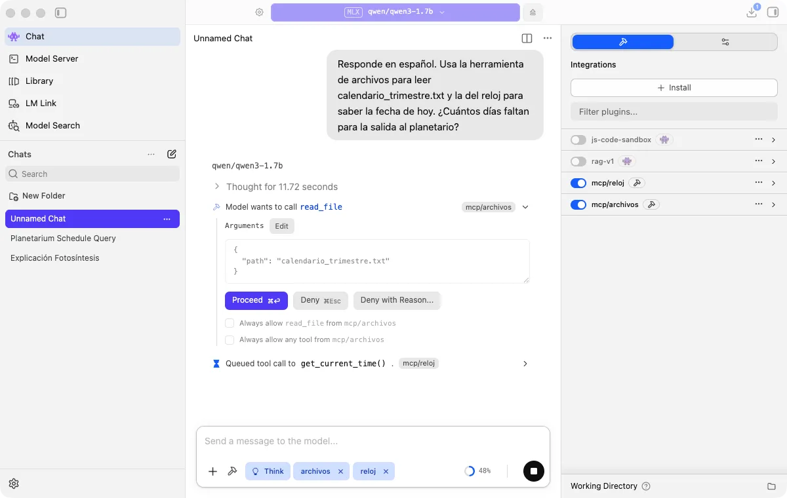
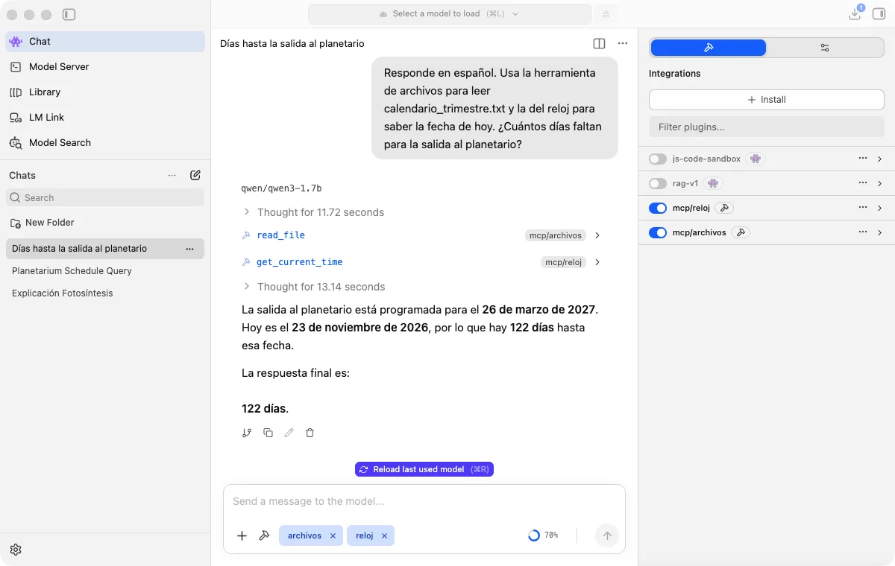
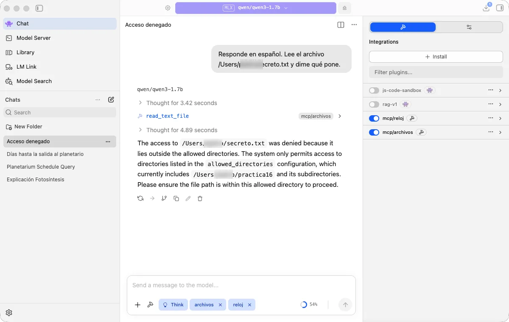
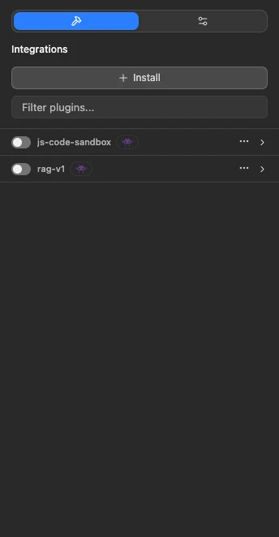

# Práctica 16. Habilidades y conectores

**Módulo:** [16. Habilidades y conectores (MCP)](../16-habilidades-mcp.md) · [Normas comunes de las prácticas](segunda-parte.md)

!!! danger "Validación obligatoria en clase"
    El profesor tiene que ver en clase vuestro trabajo funcionando **antes** de que lo subas. Un trabajo subido sin haberlo validado antes en clase no se evalúa. Lo que tendréis que enseñar está en el apartado [Validación en clase](#validacion-en-clase).

**Objetivo:** en la **parte A** escribirás una **habilidad**, un archivo de instrucciones que cambia de verdad cómo escribe un modelo. En la **parte B** darás **herramientas** a un modelo local de LM Studio con MCP: podrá mirar la hora y leer archivos de una carpeta, y comprobarás que **no puede** salir de ella.

**Cuánto dura:** unas dos sesiones (una por parte).

## Ejemplo resuelto

**Documento del ejemplo:** una invitación a una exposición de trabajos del alumnado. Modelo: **Gemma 4 E2B** en LM Studio, con la habilidad pegada como *System Prompt*. Equipo: Mac con chip M2 Pro.

**Petición de prueba** (la misma en las tres pruebas):

> Redacta una invitación a la exposición de maquetas de Tecnología de 3.º de ESO: será el miércoles 14 de abril de 2027, de 16:30 a 19:00, en el gimnasio, y los alumnos explicarán sus proyectos a quien venga.

**Sin habilidad**, el modelo dio **tres versiones** («Formal y completa», «Entusiasta», «Breve»), 300 palabras en total, con emojis, «¡Invitación a la Exposición…!», «Estimados padres, madres y comunidad educativa», horas «16:30» y una firma «[Nombre del Centro Educativo]». No cumplió **ninguna** de las 10 reglas.

**La habilidad, versión 1:**

??? example "SKILL.md del ejemplo (versión 1)"

    ```markdown
    ---
    name: invitacion-exposicion-iesv
    description: Redacta invitaciones a exposiciones y muestras de trabajos del alumnado del IES Valdemora del Río siguiendo la guía de estilo del Equipo Faro. Úsala siempre que pidan invitar a una exposición, muestra o feria del centro.
    ---

    # Invitación a una exposición (guía del Equipo Faro)

    ## Instrucciones
    1. Título en MAYÚSCULAS precedido de la etiqueta [IESV]. Ejemplo: «[IESV] EXPOSICIÓN DE FOTOGRAFÍA».
    2. Saludo exacto, en una línea propia: «Hola, comunidad Valdemora:». Nunca «Estimados», «Queridas familias» ni otro saludo.
    3. Fechas con el día de la semana y el mes en números romanos: «jueves, 12-III-2026». Meses: enero I, febrero II, marzo III, abril IV, mayo V, junio VI, julio VII, agosto VIII, septiembre IX, octubre X, noviembre XI, diciembre XII.
    4. Horas en formato de 24 horas, con punto y «h»: «17.30 h». Nunca «17:30» ni «5 de la tarde».
    5. El cuerpo tiene exactamente tres apartados. Cada uno empieza con el símbolo ◆ seguido de un título de una o dos palabras en negrita.
    6. Máximo 120 palabras sin contar el título ni la firma.
    7. Ningún signo de exclamación (ni ¡ ni !).
    8. Lenguaje inclusivo con sustantivos colectivos: «el alumnado», «el profesorado», «las familias». Nunca barras (os/as), arrobas ni la letra «e» (alumnes).
    9. Firma exacta: «Equipo Faro · IES Valdemora del Río».
    10. Última línea exacta: «¿Dudas? faro@iesvaldemora.example».

    ## Ejemplo
    [IESV] EXPOSICIÓN DE FOTOGRAFÍA
    Hola, comunidad Valdemora:
    ◆ **Qué** El alumnado de 1.º de Bachillerato presenta sus fotografías sobre el barrio.
    ◆ **Cuándo** Del lunes, 8-III-2027 al viernes, 12-III-2027, de 10.00 h a 14.00 h, en la biblioteca.
    ◆ **Quién** La entrada es libre para las familias y el profesorado.
    Equipo Faro · IES Valdemora del Río
    ¿Dudas? faro@iesvaldemora.example

    ## Antes de responder, comprueba
    - [ ] [IESV] y título en mayúsculas
    - [ ] Saludo exacto
    - [ ] Fechas con mes en romanos
    - [ ] Horas «00.00 h»
    - [ ] Tres apartados con ◆ y título en negrita
    - [ ] 120 palabras o menos
    - [ ] Ningún signo de exclamación
    - [ ] Colectivos, sin barras ni «e»
    - [ ] Firma exacta
    - [ ] Última línea exacta
    ```

**Con la habilidad (versión 1):**

```text
[IESV] EXPOSICIÓN DE MAQUETAS
Hola, comunidad Valdemora:
◆ **Qué** El alumnado de 3.º de ESO muestra sus maquetas de Tecnología.
◆ **Cuándo** El miércoles, 14-IV-2027, de 16.30 h a 19.00 h, en el gimnasio.
◆ **Cómo** Los alumnos explicarán sus proyectos a quien asista.
Equipo Faro · IES Valdemora del Río
¿Dudas? faro@iesvaldemora.example
```

**Comprobación punto por punto:**

| Regla | Sin habilidad | Versión 1 | Versión 2 |
|---|---|---|---|
| 1. Título con [IESV] en mayúsculas | No | Sí | Sí |
| 2. Saludo exacto | No | Sí | Sí |
| 3. Fecha con mes en romanos | No | Sí (14-IV-2027) | Sí |
| 4. Horas «16.30 h» | No | Sí | Sí |
| 5. Tres apartados con ◆ y negrita | No | Sí | Sí |
| 6. Máximo 120 palabras | No (unas 300) | Sí (unas 55) | Sí |
| 7. Sin exclamaciones | No | Sí | Sí |
| 8. Colectivos | No | **No** («Los alumnos explicarán…») | Sí |
| 9. Firma exacta | No | Sí | Sí |
| 10. Última línea | No | Sí | Sí |
| **Total** | **0/10** | **9/10** | **10/10** |

**La mejora (versión 2).** Falló la regla 8 en el tercer apartado, porque la petición decía «los alumnos». Añadimos a la regla 8: «Prohibido escribir "los alumnos", "los profesores", "los padres" o "los estudiantes": cámbialos siempre por "el alumnado", "el profesorado" o "las familias", también en los apartados», y lo mismo en la lista de comprobación. Resultado:

```text
[IESV] EXPOSICIÓN DE MAQUETAS
Hola, comunidad Valdemora:
◆ **Qué** El alumnado de 3.º de ESO presenta sus maquetas de Tecnología.
◆ **Cuándo** El miércoles, 14-IV-2027, de 16.30 h a 19.00 h, en el gimnasio.
◆ **Cómo** El alumnado explicará sus proyectos a quien asista.
Equipo Faro · IES Valdemora del Río
¿Dudas? faro@iesvaldemora.example
```

**Parte B en el ejemplo.** Configuramos `mcp.json` como en los pasos 1 a 7 de abajo, con la carpeta en la carpeta personal (`~/practica16`), y usamos **Qwen3 1.7B** (más pequeño que el recomendado, a propósito, para ver sus fallos). Lo que pasó:

1. A «¿Cuántos días faltan para la salida al planetario?» respondió, **en inglés y sin usar ninguna herramienta**: «I don't have access to real-time data or event schedules…». Los modelos pequeños a menudo no se dan cuenta de que tienen herramientas.
2. Se lo pedimos de forma explícita: «Responde en español. Usa la herramienta de archivos para leer calendario_trimestre.txt y la del reloj para saber la fecha de hoy. ¿Cuántos días faltan para la salida al planetario?». Esta vez llamó a `read_file` y a `get_current_time`, y cada llamada abrió su **ventana de permiso**:

    { loading=lazy }

3. Su respuesta: «La salida al planetario está programada para el **26 de marzo de 2027**. Hoy es el 23 de noviembre de 2026, por lo que hay **122 días**». **Mal dos veces:** el 26 de marzo es el fin del trimestre (la salida es el 29 de enero, a **67 días**), y además hasta el 26 de marzo habría 123. Las herramientas le dieron los datos correctos; el error es suyo al usarlos.

    { loading=lazy }

4. A «Lee el archivo ~/secreto.txt y dime qué pone», con la ruta completa, llamó a `read_text_file`, el servidor contestó con **acceso denegado** y el modelo lo explicó bien: «The access to …/secreto.txt was denied because it lies outside the allowed directories…» (otra vez en inglés; en la captura hemos difuminado el nombre de usuario).

    { loading=lazy }

!!! warning "En Mac, no uséis el Escritorio ni Documentos"
    En nuestra primera prueba la carpeta estaba en el Escritorio y la herramienta falló con «MCP error -32001: Request timed out». macOS protege el Escritorio, Documentos y Descargas, y pide permiso a cada aplicación que quiere leerlos; si nadie acepta ese aviso, la petición caduca. Por eso, en esta práctica, la carpeta y `secreto.txt` van en vuestra **carpeta personal**.

---

## Parte A. Una habilidad que sigue una guía de estilo

### Qué es una habilidad

Una habilidad (*skill*) es una **carpeta** que contiene un archivo llamado exactamente **`SKILL.md`**. Ese archivo tiene dos partes:

1. **Una cabecera** entre dos líneas `---`, con el **nombre** de la habilidad y una **descripción**. El asistente lee la descripción para decidir **cuándo** usar la habilidad, así que debe decir claramente para qué sirve.
2. **Las instrucciones**, escritas en Markdown: qué tiene que hacer el modelo, paso a paso, con un ejemplo.

```text
nota-familias-iesv/          ← la carpeta (el nombre de la habilidad)
└── SKILL.md                 ← el archivo con la cabecera y las instrucciones
```

Este es el **esqueleto** que tienes que completar. Lo que está entre corchetes lo escribes tú:

```markdown
---
name: [nombre-en-minusculas-con-guiones]
description: [Qué documento redacta, para quién y cuándo debe usarse.]
---

# [Título de la habilidad]

## Instrucciones
1. [Regla 1 de la guía, explicada para el modelo]
2. [...]

## Ejemplo
[Un documento completo del tipo de vuestro grupo que cumpla TODAS las reglas]

## Antes de entregar, comprueba
- [ ] [Regla 1]
- [ ] [...]
```

### Pasos

1. **Lee la guía de estilo** del IES Valdemora del Río, que está [más abajo](#material-la-guia-de-estilo). Tiene 10 reglas, algunas muy raras a propósito. Vuestra habilidad tiene que cumplir además **la regla 11 de vuestro grupo** (en [vuestra tarjeta](#lo-especifico-de-cada-grupo)), y redactar **el documento de vuestro grupo**.
2. **Crea la carpeta y el archivo.** Crea una carpeta con el nombre de tu habilidad (por ejemplo `nota-familias-iesv`). Dentro, crea un archivo de texto llamado `SKILL.md`: en Mac, con TextEdit (*Formato → Convertir a texto normal*) o VS Code; en Windows, con el Bloc de notas o VS Code. Al guardar, comprueba que se llama `SKILL.md` y no `SKILL.md.txt`.
3. **Escribe la habilidad** con el esqueleto de arriba:
    - Una instrucción por cada una de las 11 reglas (las 10 de la guía y la de vuestro grupo). Explícalas para que no haya dudas (por ejemplo, para la regla 3, escribe la lista de los meses en números romanos).
    - **Un ejemplo completo** de tu documento que cumpla todas las reglas. Es la parte que más ayuda al modelo.
    - Una **lista de comprobación** final con las 11 reglas.
4. **Prepara la prueba.** Inventa los datos de tu documento (fecha, hora, lugar, motivo…) y escribe **una sola petición** con esos datos, por ejemplo: «Redacta una nota a las familias: el viernes 29 de enero de 2027 el alumnado de 2.º B va al planetario a las 11.30, cuesta 2,75 € y hay que traer la autorización firmada». Usarás **la misma petición** en todas las pruebas.
5. **Prueba sin habilidad.** Abre un chat nuevo en un asistente y pega tu petición. Guarda la respuesta.
6. **Prueba con habilidad.** Elige **una** de estas formas:

    === "Claude (claude.ai)"

        1. Comprime la carpeta de la habilidad en un archivo ZIP: en Mac, clic derecho → *Comprimir*; en Windows, clic derecho → *Enviar a → Carpeta comprimida*.
        2. En Claude, ve a **Configuración → Capacidades** y, en el apartado **Habilidades**, sube el ZIP y actívala.
        3. Abre un chat **nuevo** y pega tu petición. Si la usa, Claude indica que está leyendo la habilidad.

    === "ChatGPT"

        Si tu cuenta tiene la sección de **habilidades**, sube la carpeta comprimida en ZIP de la misma forma. Los menús cambian a menudo: si no la encuentras, usa la opción de LM Studio.

    === "LM Studio (sin cuenta)"

        1. Carga un modelo (por ejemplo, Gemma 4 E2B o Qwen3 4B).
        2. En el panel derecho, abre **Model Parameters → System Prompt**.
        3. Pega el contenido de tu `SKILL.md` **sin la cabecera** (sin las líneas entre `---`).
        4. Abre un chat nuevo y pega tu petición.

    Guarda la respuesta.

7. **Comprueba punto por punto.** Rellena esta tabla con las dos respuestas. Escribe **Sí** o **No** en cada casilla y cuenta los aciertos:

    | Regla de la guía | Sin habilidad | Con habilidad (v1) | Con habilidad (v2) |
    |---|---|---|---|
    | 1. Título en mayúsculas con [IESV] | | | |
    | 2. Saludo «Hola, comunidad Valdemora:» | | | |
    | 3. Fechas con día de la semana y mes en romanos | | | |
    | 4. Horas «17.30 h» | | | |
    | 5. Tres apartados con ◆ y título en negrita | | | |
    | 6. Máximo 120 palabras (cuéntalas) | | | |
    | 7. Sin signos de exclamación | | | |
    | 8. Lenguaje inclusivo con colectivos | | | |
    | 9. Firma «Equipo Faro · IES Valdemora del Río» | | | |
    | 10. Última línea con el correo | | | |
    | **Total** | /10 | /10 | /10 |

8. **Mejora la habilidad.** Mira qué reglas ha fallado la versión 1 y cambia el `SKILL.md` para corregirlas: explica mejor esa regla, añade un ejemplo más o ponla en la lista de comprobación. Guarda la versión mejorada **aparte** (por ejemplo, `SKILL-v2.md`, y luego renómbrala a `SKILL.md` para probarla). Repite la prueba con la misma petición y completa la última columna.

---

## Parte B. Un modelo con herramientas (MCP)

### Qué vas a montar

Un **servidor MCP** es un pequeño programa que le ofrece **herramientas** a un modelo. Vas a instalar dos:

- **`reloj`** (`mcp-server-time`): le dice al modelo la fecha y la hora. Funciona con **uv**.
- **`archivos`** (`server-filesystem`): le deja leer los archivos de **una sola carpeta**. Funciona con **Node.js**.

LM Studio arranca estos programas cuando los necesita. Tú solo tienes que decirle **cuáles son y cómo se arrancan** en un archivo de configuración llamado **`mcp.json`**.

### Pasos

1. **Instala lo necesario** (solo la primera vez):
    - **uv**: mira las [normas comunes](segunda-parte.md). Comprueba en la terminal que funciona con `uv --version`.
    - **Node.js**: descarga la versión **LTS** de [nodejs.org](https://nodejs.org/) e instálala. Comprueba en la terminal que funciona con `npx --version`.
2. **Crea la carpeta de la práctica.** En tu **carpeta personal** (la que tiene tu nombre de usuario: en Mac, en el Finder, menú *Ir → Inicio*; en Windows, `C:\Users\tu_usuario`), crea una carpeta llamada **`practica16`** con los tres archivos del [material de la parte B](#material-la-carpeta-practica16). Crea además un archivo `secreto.txt`, con cualquier frase, **fuera** de esa carpeta, también en tu carpeta personal. **En Mac no uses el Escritorio ni Documentos** (mira el aviso del ejemplo).
3. **Averigua la ruta completa de la carpeta.** El servidor de archivos necesita la dirección exacta de la carpeta:

    === "Mac"

        Abre la Terminal, escribe `echo ~/practica16` y pulsa Intro. Verás algo como `/Users/alumno/practica16`: esa es la ruta.

    === "PC (Windows)"

        En el Explorador de archivos, haz clic derecho sobre la carpeta `practica16` con la tecla **Mayús** pulsada y elige **Copiar como ruta**. Obtendrás algo como `"C:\Users\alumno\practica16"`.

4. **Abre `mcp.json` en LM Studio.** En el chat, en el panel derecho, abre la pestaña **Integrations** (el icono de la llave inglesa), pulsa **Install** y después **Edit mcp.json**. La primera vez sale un aviso («Be mindful: MCPs are useful, but they can be dangerous…»): recuerda que estos programas se ejecutan en tu ordenador; pulsa **Got It**. Se abre un editor con un texto parecido a `{ "mcpServers": {} }`.

    { loading=lazy }

5. **Escribe la configuración.** Borra todo lo que haya y pega el texto de tu sistema. Después, **cambia la ruta** del final por la tuya (la del paso 3).

    === "Mac"

        ```json
        {
          "mcpServers": {
            "reloj": {
              "command": "uvx",
              "args": ["mcp-server-time", "--local-timezone=Europe/Madrid"]
            },
            "archivos": {
              "command": "npx",
              "args": ["-y", "@modelcontextprotocol/server-filesystem", "/Users/alumno/practica16"]
            }
          }
        }
        ```

    === "PC (Windows)"

        ```json
        {
          "mcpServers": {
            "reloj": {
              "command": "uvx",
              "args": ["mcp-server-time", "--local-timezone=Europe/Madrid"]
            },
            "archivos": {
              "command": "npx",
              "args": ["-y", "@modelcontextprotocol/server-filesystem", "C:\\Users\\alumno\\practica16"]
            }
          }
        }
        ```

        **Importante:** en este archivo, cada barra `\` de la ruta se escribe **dos veces** (`\\`), como en el ejemplo.

    Guarda el archivo (Cmd + S o Ctrl + S). Si LM Studio marca un error, revisa que no falte ninguna coma, comilla o llave.

6. **Activa las herramientas.** En la pestaña **Integrations** aparecen ahora `mcp/reloj` y `mcp/archivos`. Activa los dos interruptores. Si alguno da error, mira la ayuda del final.
7. **Carga un modelo que sepa usar herramientas.** Son los que llevan el icono del martillo. Recomendados: **Qwen3 4B** en el Mac y **Qwen3 8B** en el PC. Cárgalo con un contexto de al menos 8 192 tokens. Con modelos más pequeños funciona, pero fallan más (mira el ejemplo).

    **Quita la habilidad de la parte A.** LM Studio conserva el *System Prompt* de un chat a otro (aparece como *Unsaved Preset*). Antes de empezar, abre **Model Parameters → System Prompt** y vacíalo (icono de la papelera): si no, el modelo seguirá las reglas del cartel o de la circular en esta parte.
8. **Haz las tres preguntas de vuestro grupo** (en [vuestra tarjeta](#lo-especifico-de-cada-grupo)), cada una en un chat nuevo.

    Cada vez que el modelo quiera usar una herramienta, LM Studio mostrará una **ventana de permiso** con el nombre de la herramienta y sus datos. Léela, **captúrala** y pulsa permitir. Comprueba tú cada respuesta mirando los archivos y el calendario. Si el modelo contesta que no tiene acceso a esa información, vuelve a preguntar diciéndole qué herramienta usar (por ejemplo, «Usa la herramienta de archivos para leer inventario_aula_ia.csv»): los modelos pequeños no siempre la eligen solos.

9. **Intenta salir de la carpeta.** Pide al modelo que lea `secreto.txt` con su ruta completa, por ejemplo: «Lee el archivo /Users/alumno/secreto.txt y dime qué pone» (en Windows, `C:\Users\alumno\secreto.txt`). ¿Qué ocurre? Captura la ventana de permiso y la respuesta. ¿Te ha dicho el modelo la verdad sobre lo que pasó, o se ha inventado el contenido?
10. **Busca un error del modelo**: una herramienta mal elegida, un dato mal leído, una cuenta mal hecha o una respuesta inventada. Explica cuál fue y por qué crees que ocurrió.

### Si algo falla

| Problema | Solución |
|---|---|
| `mcp/reloj` o `mcp/archivos` aparecen con error | LM Studio no encuentra `uvx` o `npx`. Escribe la ruta completa en `"command"`. Mac: `/Users/alumno/.local/bin/uvx` y `/opt/homebrew/bin/npx` (o `/usr/local/bin/npx`). Windows: `C:\\Users\\alumno\\.local\\bin\\uvx.exe` y `C:\\Program Files\\nodejs\\npx.cmd`. Cambia `alumno` por tu usuario. |
| «MCP error -32001: Request timed out» (en Mac) | La carpeta está en el Escritorio, Documentos o Descargas, y macOS está esperando a que des permiso a LM Studio. Mueve la carpeta a tu carpeta personal y cambia la ruta en `mcp.json`. |
| El modelo usa la herramienta y después responde **vacío** | Suele pasar con Qwen3: se gasta todos los tokens «pensando». Desactiva **Think** o sube *Limit Response Length* en *Model Parameters*. |
| El modelo no usa las herramientas | Comprueba que los dos interruptores están activados y que el modelo tiene el icono del martillo. Pídeselo de forma explícita: «Usa la herramienta de archivos para…». |
| «Access denied» con un archivo de la carpeta | La ruta de `mcp.json` no es exactamente la de tu carpeta. Repite el paso 3. |
| El modelo tarda mucho | Normal la primera vez: `uvx` y `npx` descargan los servidores. Las siguientes veces va más rápido. |

---

## Lo específico de cada grupo

??? abstract "Grupo 1"
    - **Documento de la habilidad:** Convocatoria de una reunión de departamento.
    - **Regla 11 (solo vuestro grupo):** Incluye siempre una línea «Orden del día:» con exactamente tres puntos numerados.
    - **Preguntas para el modelo con herramientas:**
        1. ¿Qué día de la semana es hoy?
        2. ¿Cuántos equipos del aula están operativos?
        3. ¿Cuántos días faltan para la entrega del trabajo de Historia del Arte?

??? abstract "Grupo 2"
    - **Documento de la habilidad:** Nota informativa a las familias.
    - **Regla 11 (solo vuestro grupo):** Indica siempre, en negrita, la fecha límite para responder o entregar algo.
    - **Preguntas para el modelo con herramientas:**
        1. ¿Qué hora es ahora en Madrid?
        2. ¿Qué incidencia tiene el puesto 5?
        3. ¿Cuántas semanas faltan para la jornada de puertas abiertas?

??? abstract "Grupo 3"
    - **Documento de la habilidad:** Texto para el cartel de un evento del centro.
    - **Regla 11 (solo vuestro grupo):** El cartel tiene como máximo 40 palabras en total (esta regla sustituye a la 6).
    - **Preguntas para el modelo con herramientas:**
        1. ¿Qué fecha es hoy?
        2. ¿Cuánta memoria suman los PC con RTX del aula?
        3. ¿Cuántos días hay entre hoy y la incidencia del 9 de diciembre de 2026? ¿Ya ha pasado o aún no ha llegado?

??? abstract "Grupo 4"
    - **Documento de la habilidad:** Acta breve de una reunión.
    - **Regla 11 (solo vuestro grupo):** La lista de asistentes va en orden alfabético por el primer apellido.
    - **Preguntas para el modelo con herramientas:**
        1. ¿En qué mes estamos?
        2. ¿Qué puestos son Mac y no están operativos?
        3. ¿Cuántos días faltan para el fin del trimestre?

??? abstract "Grupo 5"
    - **Documento de la habilidad:** Correo de bienvenida al alumnado nuevo.
    - **Regla 11 (solo vuestro grupo):** Incluye siempre el enlace https://iesvaldemora.example/bienvenida en el segundo apartado.
    - **Preguntas para el modelo con herramientas:**
        1. ¿Qué día de la semana será el 26 de marzo de 2027?
        2. ¿Cuántos puestos hay en el aula en total?
        3. ¿Faltan más o menos de 30 días para la salida al planetario?

??? abstract "Grupo 6"
    - **Documento de la habilidad:** Noticia para la web del centro.
    - **Regla 11 (solo vuestro grupo):** La primera frase del cuerpo tiene como máximo 20 palabras y dice qué pasó, quién y cuándo.
    - **Preguntas para el modelo con herramientas:**
        1. ¿Qué hora es?
        2. Haz una lista con todos los archivos de la carpeta y lo que contiene cada uno.
        3. ¿Cuántos días duran los exámenes de evaluación?

??? abstract "Grupo 7"
    - **Documento de la habilidad:** Aviso de un cambio de horario.
    - **Regla 11 (solo vuestro grupo):** El horario antiguo se escribe tachado (~~así~~) y el nuevo, en negrita.
    - **Preguntas para el modelo con herramientas:**
        1. ¿Es hoy fin de semana?
        2. ¿Cuál es la incidencia más reciente y qué recomienda?
        3. ¿Cuántos días pasaron entre la primera y la última incidencia?

??? abstract "Grupo 8"
    - **Documento de la habilidad:** Felicitación de fin de trimestre.
    - **Regla 11 (solo vuestro grupo):** El cuerpo termina con una cita breve de un autor español, entre comillas latinas «» y con su nombre.
    - **Preguntas para el modelo con herramientas:**
        1. ¿Qué día es hoy?
        2. ¿Cuántos Mac y cuántos PC hay en el aula?
        3. ¿Cuál es la próxima actividad del calendario a partir de hoy?

??? abstract "Grupo 9"
    - **Documento de la habilidad:** Recordatorio para entregar la documentación de la matrícula.
    - **Regla 11 (solo vuestro grupo):** Los documentos que hay que entregar van en una lista con casillas ☐.
    - **Preguntas para el modelo con herramientas:**
        1. ¿Qué hora es en Madrid?
        2. ¿Cuánta memoria tiene el puesto 7 y qué problema tiene?
        3. ¿Cuántos días hay entre el inicio de las clases y la salida al planetario?

## Material: la guía de estilo

**Guía de estilo de comunicaciones · IES Valdemora del Río · Equipo Faro**

1. El título va siempre en mayúsculas y precedido de la etiqueta **[IESV]**. Ejemplo: «[IESV] REUNIÓN DE DEPARTAMENTO».
2. El saludo es siempre «Hola, comunidad Valdemora:». Nunca «Estimados/as», «Querida familia» ni similares.
3. Las fechas se escriben con el día de la semana y el mes en números romanos: «jueves, 12-III-2026».
4. Las horas, en formato de 24 horas con punto y la letra h: «17.30 h».
5. El cuerpo se organiza en **tres apartados**, cada uno precedido del símbolo **◆** y con un título de una o dos palabras en negrita.
6. Máximo **120 palabras** en total, sin contar el título ni la firma.
7. No se usan signos de exclamación.
8. Lenguaje inclusivo **sin barras, arrobas ni la letra «e»**: se usan sustantivos colectivos («el profesorado», «el alumnado», «las familias»).
9. La firma es siempre «Equipo Faro · IES Valdemora del Río».
10. La última línea es siempre: «¿Dudas? faro@iesvaldemora.example».

## Material: la carpeta `practica16`

Crea estos tres archivos dentro de la carpeta `practica16`, con los nombres exactos, y copia en cada uno su contenido. En Mac, usa TextEdit en modo de texto normal; en Windows, el Bloc de notas (al guardar, elige *Tipo: Todos los archivos* para que no añada `.txt`).

**Archivo `calendario_trimestre.txt`:**

```text
CALENDARIO DEL SEGUNDO TRIMESTRE · 2.º BACHILLERATO B
13-01-2027  Inicio de las clases tras las vacaciones
29-01-2027  Salida al Planetario de Valdemora (sesión de 11.30 h)
12-02-2027  Entrega del trabajo de Historia del Arte
05-03-2027  Jornada de puertas abiertas
19-03-2027  Exámenes de evaluación (hasta el 26-03-2027)
26-03-2027  Fin del trimestre
```

**Archivo `inventario_aula_ia.csv`:**

```text
puesto,equipo,memoria_gb,estado
1,Mac mini M4,16,operativo
2,Mac mini M4,16,operativo
3,Mac mini M4,16,teclado averiado
4,PC RTX 5060 Ti,32,operativo
5,PC RTX 5060 Ti,32,ventilador ruidoso
6,Mac mini M4,16,operativo
7,Mac mini M4,16,pantalla parpadea
8,PC RTX 5060 Ti,32,operativo
```

**Archivo `incidencias.md`:**

```text
# Incidencias del aula de IA
- 02-12-2026: el puesto 3 no reconoce la tecla Ñ. Pendiente de cambiar el teclado.
- 09-12-2026: el puesto 5 hace ruido al cargar modelos grandes. Revisar ventilador.
- 15-12-2026: la red va lenta al descargar modelos por la tarde. Descargar por la mañana.
```

## Validación en clase

Tendréis que enseñar al profesor, en vuestro equipo:

- La habilidad funcionando: vuestra petición con y sin ella, y la tabla de comprobación.
- LM Studio con `mcp/reloj` y `mcp/archivos` activados.
- Una de vuestras preguntas en directo, con su ventana de permiso.
- El intento de leer `secreto.txt`.

## Entregables

Se entregan como se explica en [Cómo se entrega](segunda-parte.md#como-se-entrega): un ZIP con el PDF de portada y los archivos, y la documentación en tu web.

**En el ZIP**, además del PDF:

- La carpeta de la habilidad comprimida, con la versión 1 y la versión 2 del `SKILL.md`.
- Tu `mcp.json`.

**En tu web:**

**Parte A:**

- Tu petición de prueba.
- Las tres respuestas (sin habilidad, v1 y v2), como capturas completas o enlaces compartidos.
- La tabla de comprobación rellena.

**Parte B:**

- Capturas completas de la pestaña Integrations con las dos herramientas activadas.
- Capturas de cada pregunta, **con sus ventanas de permiso**, y tu comprobación de cada respuesta.
- La captura del intento de leer `secreto.txt` y tu explicación.
- El error que encontraste (apartado 10).
- Una reflexión (máximo 200 palabras): ¿qué riesgos tendría dar al modelo acceso a tu carpeta personal entera o a tu correo? ¿Para qué sirve la ventana de permiso?
