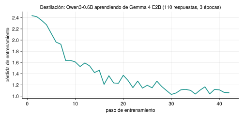

# Práctica 20. Destila tu propio modelo

**Módulo:** [20. Destilación](../20-destilacion.md) · [Normas comunes de las prácticas](segunda-parte.md)

!!! danger "Validación obligatoria en clase"
    El profesor tiene que ver en clase vuestro trabajo funcionando **antes** de que lo subas. Un trabajo subido sin haberlo validado antes en clase no se evalúa. Lo que tendréis que enseñar está en el apartado [Validación en clase](#validacion-en-clase).

**Objetivo:** destilar de verdad un modelo de lenguaje, como hizo DeepSeek con R1: un modelo **profesor** grande, en LM Studio, responde a cientos de preguntas, y con esas respuestas se ajusta un modelo **estudiante** mucho más pequeño. Después compararás a los tres (profesor, estudiante antes y estudiante después) en LM Studio.

**Material:** el script [destilar_profesor.py](../descargas/destilar_profesor.py), que se ejecuta con una sola orden (necesitas **uv**, mira las [normas comunes](segunda-parte.md)).

## Qué modelos usar

| Equipo | Profesor (en LM Studio) | Estudiante (en Unsloth Studio) |
|---|---|---|
| Mac mini M4 16 GB | Qwen3 8B en Q4_K_M | Qwen3-0.6B |
| PC RTX 5060 Ti 16 GB | gpt-oss-20b o Qwen3 14B en Q4_K_M | Qwen3-0.6B o Qwen3-1.7B |

En el Mac, **expulsa el profesor** de LM Studio (*Eject*) antes de entrenar al estudiante, para liberar memoria.

## Ejemplo resuelto

**Tema del ejemplo:** los volcanes. Para que el ejemplo fuera rápido usamos como profesor **Gemma 4 E2B** y 120 preguntas (en vuestra práctica, el profesor es más grande: mirad la tabla de arriba). Equipo: Mac con chip M2 Pro.

**1. Preguntas.** Con Gemma 4 E2B cargado y el servidor en marcha:

```bash
uv run destilar_profesor.py preguntas --modelo google/gemma-4-e2b --tema "los volcanes" --n 120
```

Tardó **2 min 47 s** en generar 120 preguntas, en tandas de 15. Algunas:

- «¿Cuál es la diferencia entre lava y magma?»
- «¿Qué es un cono volcánico y cómo se diferencia de una caldera?»
- «¿De qué manera la presión del vapor puede influir en la forma de las erupciones?»

**Revisión.** Al leer `preguntas.txt` encontramos dos problemas:

- **Muchas casi repetidas.** El script solo quita las que son idénticas, y el profesor repite ideas con otras palabras. Por ejemplo, hay cuatro versiones de «¿Qué tipo de rocas se forman a partir del enfriamiento lento de la lava?» y más de diez sobre las placas tectónicas y los volcanes. En vuestra práctica, borradlas: aquí las dejamos para que el ejemplo fuera rápido, y se verá el efecto más abajo.
- **A 13 preguntas les faltaba el signo de apertura** («Qué tipo de rocas…?»). Los corregimos.

**2. Prueba aparte.** Sacamos 10 preguntas, distintas entre sí, a otro archivo, `prueba.txt`. Quedan 110 para entrenar.

**3. Respuestas del profesor.**

```bash
uv run destilar_profesor.py respuestas --modelo google/gemma-4-e2b
```

El script muestra el avance y la velocidad: `[1/110] ¿Qué es un volcán?… (61 tok/s de media)`. Cada respuesta se guarda en `datos_profesor.jsonl`, en formato de chat, por ejemplo:

```json
{"messages": [{"role": "user", "content": "¿Qué es un volcán?"}, {"role": "assistant", "content": "Un volcán es una abertura en la corteza terrestre por donde el magma, las rocas fundidas, los gases y los cenizas ascienden desde el interior de la Tierra…"}]}
```

Las 110 respuestas tardaron **3 min 37 s** (62 tok/s de media), todas en un párrafo y sin listas, de unas 90 palabras. Al revisarlas encontramos errores que hay que corregir a mano en `datos_profesor.jsonl` antes de entrenar:

- «**los** cenizas», en cinco respuestas (es «las cenizas»).
- A «¿Qué estructuras geológicas se forman cuando el magma se solidifica bajo la superficie?» responde con rocas como «granito, basalto o andesita». El granito sí, pero el basalto y la andesita son rocas **volcánicas**: se forman al enfriarse la lava en la superficie.

!!! info "Por qué el script pide al profesor que no razone"
    Gemma 4 y Qwen3 «piensan» antes de responder, y ese razonamiento cuenta para el límite de tokens. En una versión anterior del script, Gemma gastaba el límite pensando y muchas respuestas salían **cortadas o vacías**; además tardaba unos 12 minutos en lugar de 3 y medio. Ahora el script le pide que no razone y **no guarda** las respuestas vacías o cortadas: avisa al final y, si repetís la orden, las vuelve a pedir.

!!! warning "Si el script se para con «LM Studio ha rechazado la petición»"
    Suele ser porque se ha cargado otro modelo en LM Studio y el profesor se ha descargado. Volved a cargar el profesor y repetid la misma orden: el script continúa donde lo dejó.

**4-6. Destilación.** Entrenamos el estudiante, **Qwen3-0.6B**, con la orden `unsloth train` (el mismo motor que la interfaz de Unsloth Studio), 3 épocas y *Gradient Accumulation* 2. No hace falta indicar el formato: Unsloth reconoce el formato de chat y aplica la plantilla de Qwen3 («Applying Unsloth chat template: qwen3»).

```bash
unsloth train --model unsloth/Qwen3-0.6B --local-dataset datos_profesor.jsonl --num-epochs 3 --learning-rate 2e-4 --batch-size 4 --gradient-accumulation-steps 2 --lora-r 16 --lora-alpha 32 --max-seq-length 1024 --output-dir estudiante
```

**42 pasos en 69 s.** La pérdida bajó de 2,26 (paso 1) a 1,44 (paso 10), 1,14 (paso 20), 0,90 (paso 30) y 0,78 al final. Lo exportamos a GGUF en **Q8_0** (639 MB) con `unsloth export estudiante exportado -f gguf -q q8_0` y lo importamos en LM Studio.

<figure markdown="span">
  { loading=lazy }
  <figcaption>Pérdida de entrenamiento del estudiante paso a paso.</figcaption>
</figure>


**7. Comparación** con las 10 preguntas de prueba, en LM Studio, temperatura 0 y sin *Think*. Los dos estudiantes, en GGUF Q8_0, para que la velocidad sea comparable:

| Modelo | Archivo | Velocidad | Respuestas en un párrafo, sin listas | Longitud media |
|---|---|---|---|---|
| Profesor (Gemma 4 E2B) | 4,41 GB | 63 tok/s | **0 de 10** | 910 tokens |
| Estudiante sin entrenar (Qwen3-0.6B) | 805 MB | 144 tok/s | **0 de 10** | 372 tokens |
| Estudiante destilado | 639 MB | 144 tok/s | **10 de 10** | 144 tokens |

- El **formato** se ha destilado: el estudiante responde siempre en un párrafo, como el profesor cuando generaba los datos. El profesor, en el chat normal, usa listas y encabezados, porque allí no recibe las instrucciones de estilo del script. El estudiante las ha aprendido sin necesitarlas.
- El **contenido**, no. El estudiante destilado dice que en un volcán activo hay «formación de nuevas placas tectónicas», que un volcán inactivo es el que «no se mueve», que la caldera se forma «al derretirse el manto terrestre» (se forma al hundirse el techo de la cámara magmática) y que los volcanes se vigilan con «telescopios». Un modelo de 600 millones de parámetros no puede guardar lo que sabe uno de 4 600 millones.
- Las casi repetidas no ayudaron: en los datos estaba «¿Cuál es la diferencia entre una caldera y un cono volcánico?», con una respuesta correcta del profesor, y aun así el estudiante falló la pregunta de prueba casi igual. Repetir lo mismo con otras palabras no enseña más; preguntas variadas, sí.

## Vuestra práctica

Haced lo mismo que en el ejemplo con **el tema y el estilo de vuestro grupo** (en [vuestra tarjeta](#lo-especifico-de-cada-grupo)) y el profesor de vuestro tipo de equipo. En las órdenes, cambiad `qwen/qwen3-8b` por el identificador de vuestro profesor.

1. **Preguntas.** Con LM Studio abierto, el profesor cargado y el servidor en marcha (**Model Server → Status: Running**), generad **150 preguntas** sobre vuestro tema. En la terminal, dentro de la carpeta donde está el script (cambia el modelo y el tema por los tuyos):

    ```bash
    uv run destilar_profesor.py preguntas --modelo qwen/qwen3-8b --tema "la Edad Media en la península ibérica" --n 150
    ```

    **Revisa** el archivo `preguntas.txt`: elimina las repetidas, las ambiguas o las que no sean del tema, y añade **al menos 20 escritas por ti**.

2. **Prueba aparte.** Aparta **10 preguntas** que no usarás para entrenar: sácalas de `preguntas.txt` y guárdalas en otro archivo.
3. **Respuestas del profesor.** Generad las respuestas con **el estilo de vuestra tarjeta** (la opción `--estilo` cambia las instrucciones que recibe el profesor):

    ```bash
    uv run destilar_profesor.py respuestas --modelo qwen/qwen3-8b --estilo "EL ESTILO DE VUESTRA TARJETA"
    ```

    Anota cuánto tarda y a cuántos tokens por segundo trabaja el profesor. Revisa al menos **20 respuestas** de `datos_profesor.jsonl` y corrige las que tengan errores. Si se corta, vuelve a ejecutar la orden: continúa donde lo dejó. El script **no guarda** las respuestas vacías o cortadas y avisa al final de cuántas son: repite la orden para que las vuelva a pedir. No hagas otra cosa con la GPU mientras tanto (otro modelo, otra práctica): el profesor irá mucho más lento.

4. **Antes.** Haz las 10 preguntas de prueba al **profesor** y al **estudiante** sin entrenar, en LM Studio, con **Think** desactivado. Guarda las respuestas y su velocidad. En el Mac, el Qwen3-0.6B que descarga LM Studio puede ser **MLX de 4 bits**: ocupa la mitad que vuestro destilado en Q8_0 y va más rápido por eso, no por la destilación. Indicad el formato de cada modelo en la tabla.
5. **Destilación.** Ajusta el estudiante con **Unsloth Studio** usando tu archivo `datos_profesor.jsonl` (*Format* **auto**, porque el script lo guarda en formato de chat; 10 % de validación; **Gradient Accumulation 2**). Captura las gráficas de pérdida y guarda la configuración.
6. **Después.** Exporta el estudiante a GGUF en **Q8_0** (en Studio, *Export*; desde la terminal, `unsloth export estudiante exportado -f gguf -q q8_0`, que indica al final dónde ha guardado el archivo), impórtalo en LM Studio (`lms import -c -y --user-repo alumno/practica20 archivo.gguf`) y hazle las 10 preguntas de prueba.
7. **Comparación.** Haz una tabla con los tres modelos: tamaño del archivo, memoria al cargarlo, tokens por segundo y una puntuación de 0 a 2 de cada respuesta (corrección y estilo). ¿Cuánto se acerca el estudiante al profesor? ¿En qué falla?

## Lo específico de cada grupo

??? abstract "Grupo 1"
    - **Tema:** El sistema solar y la exploración espacial.
    - **Estilo del profesor** (para `--estilo`):

        ```text
        Eres un profesor experto y paciente. Responde en español, en un párrafo de 3 a 6 frases que incluye siempre un dato numérico. No uses listas ni encabezados.
        ```

    - **Para la comparación (tarea 7):** puntuad también de 0 a 2 si cada respuesta cumple vuestro estilo.

??? abstract "Grupo 2"
    - **Tema:** La Edad Media en la península ibérica.
    - **Estilo del profesor** (para `--estilo`):

        ```text
        Eres un profesor experto y paciente. Responde en español, en un párrafo de 3 a 6 frases que incluye siempre una fecha. No uses listas ni encabezados.
        ```

    - **Para la comparación (tarea 7):** puntuad también de 0 a 2 si cada respuesta cumple vuestro estilo.

??? abstract "Grupo 3"
    - **Tema:** El cuerpo humano: aparatos y sistemas.
    - **Estilo del profesor** (para `--estilo`):

        ```text
        Eres un profesor experto y paciente. Responde en español, en un párrafo de 3 a 6 frases que incluye siempre una comparación con algo de la vida diaria. No uses listas ni encabezados.
        ```

    - **Para la comparación (tarea 7):** puntuad también de 0 a 2 si cada respuesta cumple vuestro estilo.

??? abstract "Grupo 4"
    - **Tema:** Economía doméstica: ahorro, nómina e impuestos.
    - **Estilo del profesor** (para `--estilo`):

        ```text
        Eres un profesor experto y paciente. Responde en español, en un párrafo de 3 a 6 frases que incluye siempre un ejemplo con euros. No uses listas ni encabezados.
        ```

    - **Para la comparación (tarea 7):** puntuad también de 0 a 2 si cada respuesta cumple vuestro estilo.

??? abstract "Grupo 5"
    - **Tema:** La Segunda Guerra Mundial.
    - **Estilo del profesor** (para `--estilo`):

        ```text
        Eres un profesor experto y paciente. Responde en español, en un párrafo de exactamente tres frases, sin adjetivos valorativos. No uses listas ni encabezados.
        ```

    - **Para la comparación (tarea 7):** puntuad también de 0 a 2 si cada respuesta cumple vuestro estilo.

??? abstract "Grupo 6"
    - **Tema:** Química de la cocina.
    - **Estilo del profesor** (para `--estilo`):

        ```text
        Eres un profesor experto y paciente. Responde en español, en un párrafo de 3 a 6 frases que termina siempre con un consejo práctico. No uses listas ni encabezados.
        ```

    - **Para la comparación (tarea 7):** puntuad también de 0 a 2 si cada respuesta cumple vuestro estilo.

??? abstract "Grupo 7"
    - **Tema:** Ciberseguridad para usuarios.
    - **Estilo del profesor** (para `--estilo`):

        ```text
        Eres un profesor experto y paciente. Responde en español, en un párrafo de 3 a 6 frases que termina siempre con una pregunta de repaso. No uses listas ni encabezados.
        ```

    - **Para la comparación (tarea 7):** puntuad también de 0 a 2 si cada respuesta cumple vuestro estilo.

??? abstract "Grupo 8"
    - **Tema:** Arte del Renacimiento.
    - **Estilo del profesor** (para `--estilo`):

        ```text
        Eres un profesor experto y paciente. Responde en español, en un párrafo de 3 a 6 frases que cita siempre una obra y su autor. No uses listas ni encabezados.
        ```

    - **Para la comparación (tarea 7):** puntuad también de 0 a 2 si cada respuesta cumple vuestro estilo.

??? abstract "Grupo 9"
    - **Tema:** Historia del cine.
    - **Estilo del profesor** (para `--estilo`):

        ```text
        Eres un profesor experto y paciente. Responde en español, en un párrafo de 3 a 6 frases que menciona siempre una película y su año. No uses listas ni encabezados.
        ```

    - **Para la comparación (tarea 7):** puntuad también de 0 a 2 si cada respuesta cumple vuestro estilo.

## Validación en clase

Tendréis que enseñar al profesor, en vuestro equipo:

- `preguntas.txt` y `datos_profesor.jsonl`, con alguna de las correcciones que hicisteis.
- El estudiante destilado cargado en LM Studio.
- Una pregunta nueva de vuestro tema, hecha en directo al profesor y al estudiante.

## Entregables

- `preguntas.txt` y `datos_profesor.jsonl`, con la lista de tus preguntas propias y de las respuestas que corregiste.
- Las respuestas de los tres modelos a las 10 preguntas de prueba.
- Capturas completas de LM Studio (profesor y estudiante cargados) y de las gráficas de Unsloth.
- La configuración guardada.
- La tabla del apartado 7 y tus conclusiones (máximo 250 palabras).

