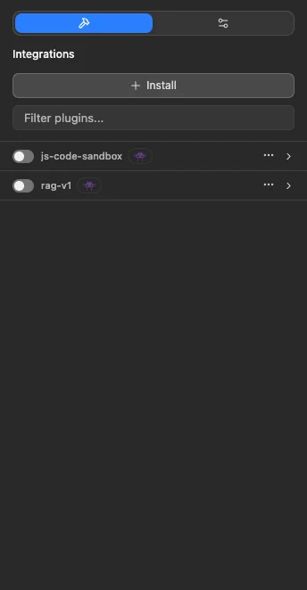

---
search:
  exclude: true
hide:
  - navigation
---

# Práctica 16. Habilidades y conectores

**Módulo:** [16. Habilidades y conectores (MCP)](../16-habilidades-mcp.md) · [Normas comunes de las prácticas](index.md)

**Objetivo:** en la **parte A** escribirás una **habilidad**, un archivo de instrucciones que cambia de verdad cómo escribe un modelo. En la **parte B** darás **herramientas** a un modelo local de LM Studio con MCP: podrá mirar la hora y leer archivos de una carpeta, y comprobarás que **no puede** salir de ella.

**Cuánto dura:** unas dos sesiones (una por parte).

## Tu variante (el documento que la habilidad debe redactar)

| N.º | Documento |
|---|---|
| 1 | Convocatoria de una reunión de departamento. |
| 2 | Nota informativa a las familias. |
| 3 | Texto para el cartel de un evento del centro. |
| 4 | Acta breve de una reunión. |
| 5 | Correo de bienvenida a alumnado nuevo. |
| 6 | Noticia para la web del centro. |

---

## Parte A. Una habilidad que sigue una guía de estilo

### Qué es una habilidad

Una habilidad (*skill*) es una **carpeta** que contiene un archivo llamado exactamente **`SKILL.md`**. Ese archivo tiene dos partes:

1. **Una cabecera** entre dos líneas `---`, con el **nombre** de la habilidad y una **descripción**. El asistente lee la descripción para decidir **cuándo** usar la habilidad, así que debe decir claramente para qué sirve.
2. **Las instrucciones**, escritas en Markdown: qué tiene que hacer el modelo, paso a paso, con un ejemplo.

```text
nota-familias-iesv/          ← la carpeta (el nombre de la habilidad)
└── SKILL.md                 ← el archivo con la cabecera y las instrucciones
```

Este es el **esqueleto** que tienes que completar. Lo que está entre corchetes lo escribes tú:

```markdown
---
name: [nombre-en-minusculas-con-guiones]
description: [Qué documento redacta, para quién y cuándo debe usarse.]
---

# [Título de la habilidad]

## Instrucciones
1. [Regla 1 de la guía, explicada para el modelo]
2. [...]

## Ejemplo
[Un documento completo de tu variante que cumpla TODAS las reglas]

## Antes de entregar, comprueba
- [ ] [Regla 1]
- [ ] [...]
```

### Pasos

1. **Lee la guía de estilo** del IES Valdemora del Río, que está [más abajo](#material-la-guia-de-estilo). Tiene 10 reglas, algunas muy raras a propósito: ningún modelo las sigue por casualidad.
2. **Crea la carpeta y el archivo.** Crea una carpeta con el nombre de tu habilidad (por ejemplo `nota-familias-iesv`). Dentro, crea un archivo de texto llamado `SKILL.md`: en Mac, con TextEdit (*Formato → Convertir a texto normal*) o VS Code; en Windows, con el Bloc de notas o VS Code. Al guardar, comprueba que se llama `SKILL.md` y no `SKILL.md.txt`.
3. **Escribe la habilidad** con el esqueleto de arriba:
    - Una instrucción por cada una de las 10 reglas. Explícalas para que no haya dudas (por ejemplo, para la regla 3, escribe la lista de los meses en números romanos).
    - **Un ejemplo completo** de tu documento que cumpla todas las reglas. Es la parte que más ayuda al modelo.
    - Una **lista de comprobación** final con las 10 reglas.
4. **Prepara la prueba.** Inventa los datos de tu documento (fecha, hora, lugar, motivo…) y escribe **una sola petición** con esos datos, por ejemplo: «Redacta una nota a las familias: el viernes 29 de enero de 2027 el alumnado de 2.º B va al planetario a las 11.30, cuesta 2,75 € y hay que traer la autorización firmada». Usarás **la misma petición** en todas las pruebas.
5. **Prueba sin habilidad.** Abre un chat nuevo en un asistente y pega tu petición. Guarda la respuesta.
6. **Prueba con habilidad.** Elige **una** de estas formas:

    === "Claude (claude.ai)"

        1. Comprime la carpeta de la habilidad en un archivo ZIP: en Mac, clic derecho → *Comprimir*; en Windows, clic derecho → *Enviar a → Carpeta comprimida*.
        2. En Claude, ve a **Configuración → Capacidades** y, en el apartado **Habilidades**, sube el ZIP y actívala.
        3. Abre un chat **nuevo** y pega tu petición. Si la usa, Claude indica que está leyendo la habilidad.

    === "ChatGPT"

        Si tu cuenta tiene la sección de **habilidades**, sube la carpeta comprimida en ZIP de la misma forma. Los menús cambian a menudo: si no la encuentras, usa la opción de LM Studio.

    === "LM Studio (sin cuenta)"

        1. Carga un modelo (por ejemplo, Gemma 4 E2B o Qwen3 4B).
        2. En el panel derecho, abre **Model Parameters → System Prompt**.
        3. Pega el contenido de tu `SKILL.md` **sin la cabecera** (sin las líneas entre `---`).
        4. Abre un chat nuevo y pega tu petición.

    Guarda la respuesta.

7. **Comprueba punto por punto.** Rellena esta tabla con las dos respuestas. Escribe **Sí** o **No** en cada casilla y cuenta los aciertos:

    | Regla de la guía | Sin habilidad | Con habilidad (v1) | Con habilidad (v2) |
    |---|---|---|---|
    | 1. Título en mayúsculas con [IESV] | | | |
    | 2. Saludo «Hola, comunidad Valdemora:» | | | |
    | 3. Fechas con día de la semana y mes en romanos | | | |
    | 4. Horas «17.30 h» | | | |
    | 5. Tres apartados con ◆ y título en negrita | | | |
    | 6. Máximo 120 palabras (cuéntalas) | | | |
    | 7. Sin signos de exclamación | | | |
    | 8. Lenguaje inclusivo con colectivos | | | |
    | 9. Firma «Equipo Faro · IES Valdemora del Río» | | | |
    | 10. Última línea con el correo | | | |
    | **Total** | /10 | /10 | /10 |

8. **Mejora la habilidad.** Mira qué reglas ha fallado la versión 1 y cambia el `SKILL.md` para corregirlas: explica mejor esa regla, añade un ejemplo más o ponla en la lista de comprobación. Guarda la versión mejorada **aparte** (por ejemplo, `SKILL-v2.md`, y luego renómbrala a `SKILL.md` para probarla). Repite la prueba con la misma petición y completa la última columna.

---

## Parte B. Un modelo con herramientas (MCP)

### Qué vas a montar

Un **servidor MCP** es un pequeño programa que le ofrece **herramientas** a un modelo. Vas a instalar dos:

- **`reloj`** (`mcp-server-time`): le dice al modelo la fecha y la hora. Funciona con **uv**.
- **`archivos`** (`server-filesystem`): le deja leer los archivos de **una sola carpeta**. Funciona con **Node.js**.

LM Studio arranca estos programas cuando los necesita. Tú solo tienes que decirle **cuáles son y cómo se arrancan** en un archivo de configuración llamado **`mcp.json`**.

### Pasos

1. **Instala lo necesario** (solo la primera vez):
    - **uv**: mira las [normas comunes](index.md). Comprueba en la terminal que funciona con `uv --version`.
    - **Node.js**: descarga la versión **LTS** de [nodejs.org](https://nodejs.org/) e instálala. Comprueba en la terminal que funciona con `npx --version`.
2. **Crea la carpeta de la práctica.** En el **Escritorio**, crea una carpeta llamada **`practica16`** con los tres archivos del [material de la parte B](#material-la-carpeta-practica16). Crea además un archivo `secreto.txt`, con cualquier frase, **fuera** de esa carpeta, en **Documentos**.
3. **Averigua la ruta completa de la carpeta.** El servidor de archivos necesita la dirección exacta de la carpeta:

    === "Mac"

        Abre la Terminal, escribe `cd ` (con un espacio), **arrastra** la carpeta `practica16` a la ventana de la Terminal y pulsa Intro. Después escribe `pwd` y pulsa Intro. Verás algo como `/Users/alumno/Desktop/practica16`: esa es la ruta.

    === "PC (Windows)"

        En el Explorador de archivos, haz clic derecho sobre la carpeta `practica16` con la tecla **Mayús** pulsada y elige **Copiar como ruta**. Obtendrás algo como `"C:\Users\alumno\Desktop\practica16"`.

4. **Abre `mcp.json` en LM Studio.** En el chat, en el panel derecho, abre la pestaña **Integrations** (el icono de la llave inglesa), pulsa **Install** y después **Edit mcp.json**. Se abre un editor con un texto parecido a `{ "mcpServers": {} }`.

    { loading=lazy }

5. **Escribe la configuración.** Borra todo lo que haya y pega el texto de tu sistema. Después, **cambia la ruta** del final por la tuya (la del paso 3).

    === "Mac"

        ```json
        {
          "mcpServers": {
            "reloj": {
              "command": "uvx",
              "args": ["mcp-server-time", "--local-timezone=Europe/Madrid"]
            },
            "archivos": {
              "command": "npx",
              "args": ["-y", "@modelcontextprotocol/server-filesystem", "/Users/alumno/Desktop/practica16"]
            }
          }
        }
        ```

    === "PC (Windows)"

        ```json
        {
          "mcpServers": {
            "reloj": {
              "command": "uvx",
              "args": ["mcp-server-time", "--local-timezone=Europe/Madrid"]
            },
            "archivos": {
              "command": "npx",
              "args": ["-y", "@modelcontextprotocol/server-filesystem", "C:\\Users\\alumno\\Desktop\\practica16"]
            }
          }
        }
        ```

        **Importante:** en este archivo, cada barra `\` de la ruta se escribe **dos veces** (`\\`), como en el ejemplo.

    Guarda el archivo (Cmd + S o Ctrl + S). Si LM Studio marca un error, revisa que no falte ninguna coma, comilla o llave.

6. **Activa las herramientas.** En la pestaña **Integrations** aparecen ahora `mcp/reloj` y `mcp/archivos`. Activa los dos interruptores. Si alguno da error, mira la ayuda del final.
7. **Carga un modelo que sepa usar herramientas.** Son los que llevan el icono del martillo. Recomendados: **Qwen3 4B** en el Mac y **Qwen3 8B** en el PC. Cárgalo con un contexto de al menos 8 192 tokens.
8. **Haz tres preguntas que necesiten las herramientas**, cada una en un chat nuevo:
    1. Una que solo necesite el reloj (por ejemplo, «¿Qué día de la semana es hoy?»).
    2. Una que solo necesite los archivos (por ejemplo, «¿Qué puestos del aula tienen problemas y cuáles son?»).
    3. Una que **combine las dos** (por ejemplo, «¿Cuántos días faltan para la salida al planetario?»).

    Cada vez que el modelo quiera usar una herramienta, LM Studio mostrará una **ventana de permiso** con el nombre de la herramienta y sus datos. Léela, **captúrala** y pulsa permitir. Comprueba tú cada respuesta mirando los archivos y el calendario.

9. **Intenta salir de la carpeta.** Pide al modelo: «Lee el archivo secreto.txt de mi carpeta Documentos». ¿Qué ocurre? Captura la ventana de permiso y la respuesta. ¿Te ha dicho el modelo la verdad sobre lo que pasó, o se ha inventado el contenido?
10. **Busca un error del modelo**: una herramienta mal elegida, un dato mal leído, una cuenta mal hecha o una respuesta inventada. Explica cuál fue y por qué crees que ocurrió.

### Si algo falla

| Problema | Solución |
|---|---|
| `mcp/reloj` o `mcp/archivos` aparecen con error | LM Studio no encuentra `uvx` o `npx`. Escribe la ruta completa en `"command"`. Mac: `/Users/alumno/.local/bin/uvx` y `/opt/homebrew/bin/npx` (o `/usr/local/bin/npx`). Windows: `C:\\Users\\alumno\\.local\\bin\\uvx.exe` y `C:\\Program Files\\nodejs\\npx.cmd`. Cambia `alumno` por tu usuario. |
| El modelo no usa las herramientas | Comprueba que los dos interruptores están activados y que el modelo tiene el icono del martillo. Pídeselo de forma explícita: «Usa la herramienta de archivos para…». |
| «Access denied» con un archivo de la carpeta | La ruta de `mcp.json` no es exactamente la de tu carpeta. Repite el paso 3. |
| El modelo tarda mucho | Normal la primera vez: `uvx` y `npx` descargan los servidores. Las siguientes veces va más rápido. |

---

## Material: la guía de estilo

**Guía de estilo de comunicaciones · IES Valdemora del Río · Equipo Faro**

1. El título va siempre en mayúsculas y precedido de la etiqueta **[IESV]**. Ejemplo: «[IESV] REUNIÓN DE DEPARTAMENTO».
2. El saludo es siempre «Hola, comunidad Valdemora:». Nunca «Estimados/as», «Querida familia» ni similares.
3. Las fechas se escriben con el día de la semana y el mes en números romanos: «jueves, 12-III-2026».
4. Las horas, en formato de 24 horas con punto y la letra h: «17.30 h».
5. El cuerpo se organiza en **tres apartados**, cada uno precedido del símbolo **◆** y con un título de una o dos palabras en negrita.
6. Máximo **120 palabras** en total, sin contar el título ni la firma.
7. No se usan signos de exclamación.
8. Lenguaje inclusivo **sin barras, arrobas ni la letra «e»**: se usan sustantivos colectivos («el profesorado», «el alumnado», «las familias»).
9. La firma es siempre «Equipo Faro · IES Valdemora del Río».
10. La última línea es siempre: «¿Dudas? faro@iesvaldemora.example».

## Material: la carpeta `practica16`

Crea estos tres archivos dentro de la carpeta `practica16`, con los nombres exactos, y copia en cada uno su contenido. En Mac, usa TextEdit en modo de texto normal; en Windows, el Bloc de notas (al guardar, elige *Tipo: Todos los archivos* para que no añada `.txt`).

**Archivo `calendario_trimestre.txt`:**

```text
CALENDARIO DEL SEGUNDO TRIMESTRE · 2.º BACHILLERATO B
13-01-2027  Inicio de las clases tras las vacaciones
29-01-2027  Salida al Planetario de Valdemora (sesión de 11.30 h)
12-02-2027  Entrega del trabajo de Historia del Arte
05-03-2027  Jornada de puertas abiertas
19-03-2027  Exámenes de evaluación (hasta el 26-03-2027)
26-03-2027  Fin del trimestre
```

**Archivo `inventario_aula_ia.csv`:**

```text
puesto,equipo,memoria_gb,estado
1,Mac mini M4,16,operativo
2,Mac mini M4,16,operativo
3,Mac mini M4,16,teclado averiado
4,PC RTX 5060 Ti,32,operativo
5,PC RTX 5060 Ti,32,ventilador ruidoso
6,Mac mini M4,16,operativo
7,Mac mini M4,16,pantalla parpadea
8,PC RTX 5060 Ti,32,operativo
```

**Archivo `incidencias.md`:**

```text
# Incidencias del aula de IA
- 02-12-2026: el puesto 3 no reconoce la tecla Ñ. Pendiente de cambiar el teclado.
- 09-12-2026: el puesto 5 hace ruido al cargar modelos grandes. Revisar ventilador.
- 15-12-2026: la red va lenta al descargar modelos por la tarde. Descargar por la mañana.
```

## Entregables

**Parte A:**

- La carpeta de la habilidad comprimida, con la versión 1 y la versión 2 del `SKILL.md`.
- Tu petición de prueba.
- Las tres respuestas (sin habilidad, v1 y v2), como capturas completas o enlaces compartidos.
- La tabla de comprobación rellena.

**Parte B:**

- Tu `mcp.json`.
- Capturas completas de la pestaña Integrations con las dos herramientas activadas.
- Capturas de cada pregunta, **con sus ventanas de permiso**, y tu comprobación de cada respuesta.
- La captura del intento de leer `secreto.txt` y tu explicación.
- El error que encontraste (apartado 10).
- Una reflexión (máximo 200 palabras): ¿qué riesgos tendría dar al modelo acceso a tu carpeta personal entera o a tu correo? ¿Para qué sirve la ventana de permiso?

**Defensa posible:** el profesor añadirá una regla nueva a la guía de estilo y tendrás que incorporarla a tu habilidad y probarla en directo, o te pedirá que limites el servidor de archivos a otra carpeta.
