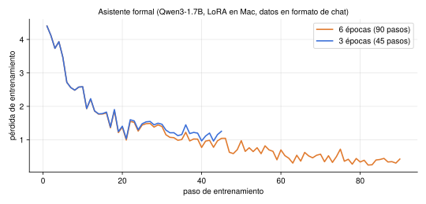

---
search:
  exclude: true
hide:
  - navigation
---

# Práctica 18. Un modelo con estilo propio

**Módulo:** [18. Fine-tuning](../18-fine-tuning.md) · [Normas comunes de las prácticas](index.md)

!!! danger "Validación obligatoria en clase"
    El profesor tiene que ver en clase vuestro trabajo funcionando **antes** de que lo subas. Un trabajo subido sin haberlo validado antes en clase no se evalúa. Lo que tendréis que enseñar está en el apartado [Validación en clase](#validacion-en-clase).

**Objetivo:** crear vuestro propio conjunto de datos, ajustar un modelo con LoRA o QLoRA y comprobar con pruebas si de verdad ha aprendido el estilo, sin memorizar.

## Qué modelo usar

| Equipo | Modelo base | Método en Unsloth Studio |
|---|---|---|
| Mac mini M4 16 GB | Qwen3-1.7B | LoRA (o QLoRA si está disponible) |
| PC RTX 5060 Ti 16 GB | Gemma 4 E2B o Qwen3-4B | QLoRA |
| Google Colab | Gemma 4 E2B | QLoRA, con el [cuaderno de Unsloth Studio](https://colab.research.google.com/github/unslothai/unsloth/blob/main/studio/Unsloth_Studio_Colab.ipynb) |

## Ejemplo resuelto

**Estilo del ejemplo:** un asistente **formal**, que siempre trata de usted. Es el ejemplo del módulo 18.

**1. Datos.** El archivo [asistente-formal.jsonl](../descargas/asistente-formal.jsonl) tiene 60 ejemplos en formato Alpaca, uno por línea:

```json
{"instruction": "Hola, ¿quién eres?", "input": "", "output": "Buenos días. Soy un asistente virtual a su servicio. ¿En qué puedo ayudarle?"}
{"instruction": "Cuéntame un chiste.", "input": "", "output": "Con mucho gusto: ¿por qué el libro de matemáticas estaba triste? Porque tenía demasiados problemas. Espero haberle sacado una sonrisa."}
```

Fíjate en tres cosas: la pregunta se escribe de tú (como la escribiría cualquiera), la respuesta **siempre** de usted, y los temas son muy variados. Si todos los ejemplos fueran de cocina, el modelo aprendería «cocina», no «de usted».

**2. Preguntas de prueba.** Diez preguntas que **no** están en los datos, por ejemplo: «Oye, ¿me recomiendas una peli para esta noche?», «¿Qué tiempo hace hoy en Sevilla?», «Explícame qué es un agujero negro».

**3. Antes.** Respuestas reales de **Qwen3-1.7B sin ajustar** en LM Studio (temperatura 0,3, sin *Think*):

| Pregunta | Respuesta (principio) | Estilo (0-2) | Correcta (0-2) |
|---|---|---|---|
| ¿Me recomiendas una peli? | «¡Claro que sí! ¿Te gustan las películas de ciencia ficción…? *Die Hard: With a Vengeance* (2002)…» | 0 (tutea) | 1 (la película es de 1995) |
| ¿Qué tiempo hace hoy en Sevilla? | «Hoy, el 21 de octubre de 2024, en Sevilla, la temperatura promedio es de 13 °C a 18 °C…» | 0 | 0 (se lo inventa: no puede saberlo) |
| Explícame qué es un agujero negro | «Un **agujero negro** es un objeto en el espacio-tiempo que tiene una curvatura extremadamente grande…» | 1 (neutro) | 2 |

**4. Entrenamiento.** En Unsloth Studio: *Model Type* Text → QLoRA (o LoRA en Mac) → `Qwen3-1.7B` → pestaña **Local** → subir el JSONL → *Format* **alpaca** → *Eval split* 10 % → *Epochs* 3, *Learning Rate* 2e-4, *LoRA Rank* 16, *Alpha* 32, *Batch Size* 4 y, en **Optimization**, **Gradient Accumulation 1** (con el valor por defecto, 8, solo habría unos 6 pasos y el modelo apenas cambiaría). **Save** para guardar la configuración en YAML y **Start Training**.

Nosotros lo entrenamos con la orden `unsloth train`, que usa el mismo motor que la interfaz de Unsloth Studio, con esos mismos ajustes:

```bash
unsloth train --model unsloth/Qwen3-1.7B --local-dataset asistente-formal.jsonl --format-type alpaca --num-epochs 3 --learning-rate 2e-4 --batch-size 4 --gradient-accumulation-steps 1 --lora-r 16 --lora-alpha 32 --max-seq-length 1024 --output-dir asistente-formal
```

En el Mac, Unsloth usa **MLX** y entrena **17,4 millones de parámetros** de LoRA (el 3,2 % del modelo). Fueron **45 pasos en 70 s**, con 3 GB de memoria como máximo. La pérdida de entrenamiento:

| Paso | 1 | 5 | 10 | 15 | 20 | 30 | 40 | 45 |
|---|---|---|---|---|---|---|---|---|
| Pérdida | 3,31 | 2,28 | 1,89 | 1,37 | 1,06 | 1,05 | 0,66 | 0,98 |

Baja rápido al principio y después oscila en torno a 1: es normal con lotes tan pequeños.

<figure markdown="span">
  { loading=lazy }
  <figcaption>Pérdida de entrenamiento paso a paso con 3 épocas (el ejemplo) y con 6 (el experimento). Con 6, la pérdida sigue bajando hasta 0,36: el modelo empieza a memorizar los ejemplos.</figcaption>
</figure>


**5. Después.** Las mismas preguntas al modelo ajustado:

| Pregunta | Respuesta (principio) | Estilo (0-2) | Correcta (0-2) |
|---|---|---|---|
| ¿Me recomiendas una peli? | «Claro, pero necesito que me diga qué tipo de película **le** gustaría: acción, drama, comedia…» | 2 | 2 |
| ¿Qué tiempo hace hoy en Sevilla? | «Lo siento, no tengo acceso a la información actual del clima… Puedo recomendarte que **consulte** un sitio web especializado…» | 1 (mezcla tú y usted) | 2 (ya no se lo inventa) |
| Explícame qué es un agujero negro | «¡Por supuesto! Un **agujero negro** es una región del espacio-tiempo en la que la gravedad es tan intensa que ni siquiera la luz puede escapar…» | 1 | 2 |

Ha aprendido el «de usted» y a reconocer lo que no sabe, aunque no siempre lo mantiene. Los conocimientos son los mismos que antes: el ajuste enseña la **forma**, no datos nuevos.

**6. Experimento: 6 épocas.** Con el doble de épocas (90 pasos, 118 s), la pérdida de entrenamiento baja hasta **0,36**: el modelo ya casi se sabe los 60 ejemplos de memoria. Se nota en las respuestas:

- A «¿Me das una receta de tortilla de patatas?» respondió con «500 g de patatas (mezcladas con agua, sal y **pimentón dulce**)». El pimentón no lleva tortilla: viene del ejemplo de la **paella** de los datos.
- A «¿Qué tiempo hace hoy en Sevilla?» recomendó consultar la «Dirección General de Meteorología de España (**DGOME**)», que no existe (es la AEMET).

Más épocas no es mejor: con pocos datos, el modelo empieza a mezclar y copiar los ejemplos. Con un 10 % de validación en Studio, lo veríais porque la pérdida de validación deja de bajar.

**7. Exportación.** *Export* → último *checkpoint* → **GGUF** → en la terminal, `lms import -c -y --user-repo alumno/practica18 archivo.gguf` → aparece en **Library** de LM Studio.

!!! warning "Exportad en Q8_0, no en Q4_K_M"
    Exportamos el mismo modelo en las dos cuantizaciones y lo probamos en LM Studio con temperatura 0. En **Q4_K_M** había **perdido el estilo**: «¡Claro! ¿Qué tipo de película **te** gustaría ver?» y volvía a inventarse el tiempo de Sevilla («Hoy es viernes, 28 de julio de 2025…»). En **Q8_0** conservaba lo aprendido. Un ajuste ligero sobre un modelo pequeño cambia poco los pesos, y una cuantización fuerte borra ese cambio. Con modelos de 4 000 millones de parámetros o menos, exportad en **Q8_0**.

## Vuestra práctica

1. **Datos.** Un JSONL en formato Alpaca con **al menos 60 ejemplos** del **estilo de vuestro grupo**, sobre temas variados. Podéis usar una IA para generar borradores, pero **revisad y corregid cada ejemplo** y escribid **al menos 20** desde cero (marcadlos en una lista).
2. **Prueba aparte.** **10 preguntas de prueba** que no estén en los datos: las **tres de vuestra tarjeta** y siete vuestras.
3. **Antes.** Las 10 preguntas al modelo base, con la tabla de puntuaciones (estilo y corrección, de 0 a 2).
4. **Entrenamiento** con Unsloth Studio y el modelo de vuestro tipo de equipo, con un 10 % de validación. Guardad la configuración y capturad las gráficas.
5. **Después.** Las mismas 10 preguntas al modelo ajustado y la misma tabla.
6. **Experimento de vuestro grupo** (en la tarjeta): una segunda ejecución con ese cambio. ¿Qué pasa con la pérdida de validación y con las respuestas? ¿Hay sobreajuste? ¿Cómo lo sabéis?
7. **Exportación** del mejor modelo a GGUF en **Q8_0**, importado en LM Studio.

## Lo específico de cada grupo

??? abstract "Grupo 1"
    - **Estilo de vuestro modelo:** Locutor de radio deportiva que lo narra todo como un partido.
    - **Tres preguntas de prueba obligatorias** (las otras siete las escribís vosotros): «¿Cómo se hace una tortilla de patatas?», «¿Qué es la fotosíntesis?», «Recomiéndame un libro.»
    - **Experimento (tarea 6):** 1 época (en lugar de 3).

??? abstract "Grupo 2"
    - **Estilo de vuestro modelo:** Abuela que responde con un refrán y un consejo.
    - **Tres preguntas de prueba obligatorias** (las otras siete las escribís vosotros): «¿Qué hago si suspendo un examen?», «¿Cómo funciona un móvil?», «¿Me compro una moto?»
    - **Experimento (tarea 6):** 6 épocas.

??? abstract "Grupo 3"
    - **Estilo de vuestro modelo:** Presentador de documentales de naturaleza.
    - **Tres preguntas de prueba obligatorias** (las otras siete las escribís vosotros): «Describe un atasco de tráfico.», «¿Qué pasa en un recreo?», «¿Cómo se prepara un café?»
    - **Experimento (tarea 6):** LoRA Rank 4 (y Alpha 8).

??? abstract "Grupo 4"
    - **Estilo de vuestro modelo:** Asistente que responde siempre en tres viñetas y una pregunta final.
    - **Tres preguntas de prueba obligatorias** (las otras siete las escribís vosotros): «¿Qué es la inflación?», «Dame ideas para un cumpleaños.», «¿Cómo se cuida un cactus?»
    - **Experimento (tarea 6):** LoRA Rank 64 (y Alpha 128).

??? abstract "Grupo 5"
    - **Estilo de vuestro modelo:** Caballero medieval que habla en castellano antiguo.
    - **Tres preguntas de prueba obligatorias** (las otras siete las escribís vosotros): «¿Qué es internet?», «¿Cómo se usa un microondas?», «Háblame del fútbol.»
    - **Experimento (tarea 6):** Learning Rate 2e-5 (diez veces menor).

??? abstract "Grupo 6"
    - **Estilo de vuestro modelo:** Profesor que nunca da la respuesta y guía con preguntas.
    - **Tres preguntas de prueba obligatorias** (las otras siete las escribís vosotros): «¿Cuánto es 15 % de 80?», «¿Por qué el cielo es azul?», «¿Quién escribió el Quijote?»
    - **Experimento (tarea 6):** Learning Rate 1e-3 (cinco veces mayor).

??? abstract "Grupo 7"
    - **Estilo de vuestro modelo:** Periodista de sucesos que convierte cualquier tema en titular.
    - **Tres preguntas de prueba obligatorias** (las otras siete las escribís vosotros): «Mi gato no quiere comer.», «¿Cómo se riega una planta?», «Hoy he aprobado Matemáticas.»
    - **Experimento (tarea 6):** Solo la mitad de los datos (30 ejemplos).

??? abstract "Grupo 8"
    - **Estilo de vuestro modelo:** Asistente que explica todo con analogías de cocina.
    - **Tres preguntas de prueba obligatorias** (las otras siete las escribís vosotros): «¿Qué es la memoria RAM?», «¿Cómo funciona una vacuna?», «¿Qué es un impuesto?»
    - **Experimento (tarea 6):** Gradient Accumulation 8 (el valor por defecto). Cuenta los pasos.

??? abstract "Grupo 9"
    - **Estilo de vuestro modelo:** Poeta que responde siempre en versos que riman.
    - **Tres preguntas de prueba obligatorias** (las otras siete las escribís vosotros): «¿Qué hora es en Tokio cuando en Madrid son las 12?», «¿Cómo se cambia una rueda?», «¿Para qué sirve el reciclaje?»
    - **Experimento (tarea 6):** Context Length 128 (en lugar de 1024).

## Validación en clase

Tendréis que enseñar al profesor, en vuestro equipo:

- Vuestro modelo cargado en LM Studio.
- Tres preguntas nuevas que os harán vuestros compañeros, respondidas en directo con vuestro estilo.
- Las gráficas de pérdida de los dos entrenamientos en Unsloth Studio (o sus capturas) y la explicación de vuestro experimento.

## Entregables

- El archivo JSONL y la lista de los ejemplos escritos por vosotros.
- La configuración guardada (YAML) de los dos entrenamientos.
- Capturas completas de las gráficas de pérdida.
- La tabla de puntuaciones antes y después.
- La captura de LM Studio con vuestro modelo cargado.
- Las conclusiones del experimento.
