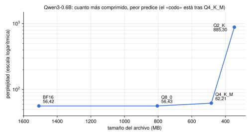

---
search:
  exclude: true
hide:
  - navigation
---

# Práctica 19. Cuantizar y medir

**Módulo:** [19. Cuantización](../19-cuantizacion.md) · [Normas comunes de las prácticas](index.md)

!!! danger "Validación obligatoria en clase"
    El profesor tiene que ver en clase vuestro trabajo funcionando **antes** de que lo subas. Un trabajo subido sin haberlo validado antes en clase no se evalúa. Lo que tendréis que enseñar está en el apartado [Validación en clase](#validacion-en-clase).

**Objetivo:** cuantizar un modelo tú mismo, en tu ordenador y con la terminal, con las mismas herramientas que usan por dentro LM Studio y Ollama, y medir con datos (tamaño, velocidad y perplejidad) qué se gana y qué se pierde.

**Qué vas a usar:** [llama.cpp](https://github.com/ggml-org/llama.cpp) (los programas `llama-quantize`, `llama-bench` y `llama-perplexity`), **uv** (mira las [normas comunes](index.md)) y LM Studio. Unos 5 GB libres de disco.

## Ejemplo resuelto

**Modelo del ejemplo:** [Qwen3-0.6B](https://huggingface.co/Qwen/Qwen3-0.6B). Equipo: Mac con chip M2 Pro, llama.cpp instalado con Homebrew. Hicimos exactamente los pasos de [vuestra práctica](#vuestra-practica), con `Qwen/Qwen3-0.6B` en la orden de descarga. Resultados:

| Versión | Tamaño | % del original | Escritura `tg128` | Lectura `pp512` | Perplejidad |
|---|---|---|---|---|---|
| BF16 | 1 509 MB | 100 % | 124 tok/s | 3 512 tok/s | 56,42 |
| Q8_0 | 805 MB | 53 % | 163 tok/s | 3 969 tok/s | 56,43 |
| Q4_K_M | 484 MB | 32 % | 227 tok/s | 3 602 tok/s | 62,21 |
| Q2_K | 347 MB | 23 % | 207 tok/s | 3 603 tok/s | 885,30 |

<figure markdown="span">
  { loading=lazy }
  <figcaption>La gráfica del apartado 7 en el ejemplo. La perplejidad está en escala logarítmica para que se vean a la vez 56 y 885.</figcaption>
</figure>


Tiempos: la descarga del modelo, 24 s; la conversión a GGUF, 20 s (más unos minutos la primera vez, mientras uv descarga lo necesario); cada cuantización, unos segundos; cada perplejidad, menos de un minuto.

**Lo que se aprende de la tabla:**

- **Q8_0 ocupa la mitad y su perplejidad es prácticamente igual** (56,43 frente a 56,42): 8 bits bastan para guardar casi toda la información.
- **Q4_K_M** ocupa un tercio y pierde un poco (62,21). Es el equilibrio habitual.
- **Q2_K se derrumba**: perplejidad 885. El «codo» está entre Q4_K_M y Q2_K: comprimir más ya no compensa.
- **Escribir** es más rápido cuanto más pequeño es el archivo, porque hay que leer menos memoria por cada token… hasta Q4_K_M. **Q2_K es más lento** que Q4_K_M (207 frente a 227 tok/s): descomprimir los pesos de 2 bits cuesta más cálculo, y este modelo es tan pequeño que la memoria ya no es el límite.
- **Leer** (`pp512`) depende del cálculo, no de la memoria: todas las versiones van parecidas, y la más rápida es Q8_0.

**En LM Studio** (paso 8), las versiones aparecen como un solo modelo, `practica19`, con varias variantes. A «Explica en dos frases qué es la fotosíntesis», con temperatura 0:

- **Q4_K_M** (179 tok/s): «La fotosíntesis es el proceso mediante el cual las plantas convierten la luz solar en energía química, generando oxígeno…». Correcto, con algún error («dependir»).
- **Q2_K** (181 tok/s): una letra árabe y después «no», «and», «so», «in», «a», «1» y una columna de ceros. El modelo está roto, como anunciaba su perplejidad de 885.

!!! warning "No comparéis perplejidades entre modelos distintos"
    La perplejidad se mide **por token**, y cada familia de modelos trocea el texto de forma diferente. Por ejemplo, el pequeño SmolLM2-135M da una perplejidad de 43 con el mismo texto, menor que la de Qwen3-0.6B, y no es mejor modelo: sus tokens son distintos. Comparad solo las versiones de **vuestro** modelo.

## Vuestra práctica

Haced los mismos pasos que el ejemplo, con **el modelo de vuestro grupo** y **un nivel de cuantización más**, el de [vuestra tarjeta](#lo-especifico-de-cada-grupo). En las órdenes aparece `Qwen/Qwen3-0.6B`: cambiadlo por vuestro modelo.

### 1. Prepara las herramientas

Crea una carpeta `practica19` y abre la terminal **dentro de ella**: en Mac, escribe `cd ` y arrastra la carpeta a la Terminal; en Windows, abre la carpeta en el Explorador, haz clic en la barra de direcciones, escribe `powershell` y pulsa Intro.

=== "Mac"

    1. Instala llama.cpp con [Homebrew](https://brew.sh/):

        ```bash
        brew install llama.cpp
        ```

    2. Comprueba que funciona:

        ```bash
        llama-quantize --help
        ```

=== "PC (Windows)"

    1. Entra en la página de [versiones de llama.cpp](https://github.com/ggml-org/llama.cpp/releases/latest) y, en *Assets*, descarga estos dos archivos:
        - `llama-…-bin-win-cuda-13.5-x64.zip` (los programas, preparados para tarjetas NVIDIA).
        - `cudart-llama-bin-win-cuda-13.5-x64.zip` (las librerías de CUDA que necesitan).
    2. Crea la carpeta `C:\llama` y descomprime **los dos** archivos dentro (que los `.exe` y los `.dll` queden juntos en `C:\llama`).
    3. En la terminal, añade esa carpeta a las órdenes disponibles (hay que repetirlo cada vez que abras una terminal nueva):

        ```powershell
        $env:Path += ";C:\llama"
        ```

    4. Comprueba que funciona:

        ```powershell
        llama-quantize --help
        ```

    Si da error con la tarjeta gráfica, actualiza el controlador de NVIDIA o usa la versión `…-bin-win-vulkan-x64.zip`, que funciona con cualquier tarjeta.

Después, descarga el código de llama.cpp, que incluye el *script* de conversión (es el mismo para Mac y PC; en Windows escribe `curl.exe` en lugar de `curl`):

```bash
curl -L -o llama-src.zip https://github.com/ggml-org/llama.cpp/archive/refs/heads/master.zip
tar -xf llama-src.zip
```

Se crea la carpeta `llama.cpp-master`.

### 2. Descarga el modelo original

Bajamos el modelo tal y como lo publica su autor en Hugging Face, a 16 bits:

```bash
uvx hf download Qwen/Qwen3-0.6B --local-dir modelo-original
```

Anota el tamaño de los archivos `.safetensors` de la carpeta `modelo-original`.

### 3. Convierte a GGUF (sin cuantizar)

GGUF es el formato que entienden LM Studio, Ollama y llama.cpp: un solo archivo con los pesos, el tokenizador y la arquitectura. Primero lo convertimos manteniendo los 16 bits (BF16). La primera vez tarda unos minutos porque uv descarga lo que necesita el *script*:

=== "Mac"

    ```bash
    uv run --python 3.12 --with-requirements llama.cpp-master/requirements/requirements-convert_hf_to_gguf.txt python llama.cpp-master/convert_hf_to_gguf.py modelo-original --outtype bf16 --outfile modelo-bf16.gguf
    ```

=== "PC (Windows)"

    ```powershell
    uv run --python 3.12 --with-requirements llama.cpp-master\requirements\requirements-convert_hf_to_gguf.txt python llama.cpp-master\convert_hf_to_gguf.py modelo-original --outtype bf16 --outfile modelo-bf16.gguf
    ```

### 4. Cuantiza a tres niveles

`llama-quantize` redondea cada peso a menos bits. Ejecuta una orden por cada nivel:

```bash
llama-quantize modelo-bf16.gguf modelo-Q8_0.gguf Q8_0
llama-quantize modelo-bf16.gguf modelo-Q4_K_M.gguf Q4_K_M
llama-quantize modelo-bf16.gguf modelo-Q2_K.gguf Q2_K
```

| Tipo | Bits aproximados | Qué es |
|---|---|---|
| `Q8_0` | 8,5 | Casi sin pérdida. |
| `Q4_K_M` | 4,8 | El equilibrio habitual: el que más verás en LM Studio. |
| `Q2_K` | 2,6 | Compresión extrema. |

Añadid una cuarta orden con **el nivel extra de vuestro grupo**, por ejemplo:

```bash
llama-quantize modelo-bf16.gguf modelo-Q5_K_M.gguf Q5_K_M
```

Anotad el tamaño de los cinco archivos `.gguf` y el porcentaje respecto al BF16. En los pasos 5, 6 y 8, incluid también vuestro archivo extra.

### 5. Mide la velocidad

`llama-bench` mide cuántos tokens por segundo procesa tu equipo al **leer** un texto (`pp512`) y al **escribir** (`tg128`). Medid todos los archivos de una vez (añadid `-m modelo-…gguf` con vuestro nivel extra) y guardad el resultado en un archivo:

```bash
llama-bench -m modelo-bf16.gguf -m modelo-Q8_0.gguf -m modelo-Q4_K_M.gguf -m modelo-Q2_K.gguf | tee velocidad.txt
```

### 6. Mide la calidad: la perplejidad

La **perplejidad** mide cuánto le «sorprende» al modelo un texto que no ha visto: cuanto **más baja**, mejor predice. Usamos las primeras páginas del *Lazarillo de Tormes*. Descárgalas (en Windows, `curl.exe`):

```bash
curl -L -o lazarillo.txt https://mosqueteroweb.github.io/IAconceptos/descargas/lazarillo-perplejidad.txt
```

Y mide cada versión (tarda uno o dos minutos por archivo). La cifra que buscas aparece al final, en la línea **`Final estimate: PPL =`**:

```bash
llama-perplexity -m modelo-bf16.gguf -f lazarillo.txt -c 512
llama-perplexity -m modelo-Q8_0.gguf -f lazarillo.txt -c 512
llama-perplexity -m modelo-Q4_K_M.gguf -f lazarillo.txt -c 512
llama-perplexity -m modelo-Q2_K.gguf -f lazarillo.txt -c 512
```

### 7. Tabla y gráfica

Haced una tabla con todas las versiones (tamaño, velocidad al escribir y perplejidad) y una gráfica del **tamaño frente a la perplejidad**. ¿Dónde está el «codo», el punto a partir del cual comprimir más ya no compensa?

### 8. Tus GGUF en LM Studio

1. Importad vuestros archivos en LM Studio (también el del nivel extra) (si `lms` no se encuentra, en Mac está en `~/.lmstudio/bin/lms` y en Windows en `C:\Users\tu_usuario\.lmstudio\bin\lms.exe`):

    ```bash
    lms import -c -y --user-repo alumno/practica19 modelo-bf16.gguf
    lms import -c -y --user-repo alumno/practica19 modelo-Q8_0.gguf
    lms import -c -y --user-repo alumno/practica19 modelo-Q4_K_M.gguf
    lms import -c -y --user-repo alumno/practica19 modelo-Q2_K.gguf
    ```

    Aparecerán en **Library** como un solo modelo, `practica19`, con cuatro variantes.

2. Escribe **una pregunta tuya** sobre una asignatura que estudies. Hacedla a todas las versiones con **temperatura 0** y **Think** desactivado. Comparad las respuestas y la velocidad que indica LM Studio con la de `llama-bench`.

### 9. Los modelos de LM Studio de vuestro grupo

En LM Studio, descargad el modelo de vuestra tarjeta en las dos cuantizaciones indicadas. Mide la velocidad (tres preguntas, tres veces cada una) y anota la memoria estimada al cargarlo.

### 10. Cálculo

Con la regla del módulo, calcula cuánto ocuparía un modelo de **14 000 millones de parámetros** en BF16, Q8_0 y Q4_K_M. ¿Cuál cabría en tu equipo? ¿Y en el otro tipo de equipo del aula? Justifícalo con los datos de la pantalla **Hardware** de LM Studio.

## Lo específico de cada grupo

??? abstract "Grupo 1"
    - **Modelo que cuantizáis:** [`Qwen/Qwen3-1.7B`](https://huggingface.co/Qwen/Qwen3-1.7B)
    - **Nivel de cuantización extra:** `Q5_K_M`
    - **Modelo para LM Studio (paso 9):** Gemma 4 E2B (Q4_K_M y Q8_0)

??? abstract "Grupo 2"
    - **Modelo que cuantizáis:** [`HuggingFaceTB/SmolLM2-360M-Instruct`](https://huggingface.co/HuggingFaceTB/SmolLM2-360M-Instruct)
    - **Nivel de cuantización extra:** `Q3_K_M`
    - **Modelo para LM Studio (paso 9):** Qwen3 4B (Q4_K_M y Q8_0)

??? abstract "Grupo 3"
    - **Modelo que cuantizáis:** [`Qwen/Qwen2.5-0.5B-Instruct`](https://huggingface.co/Qwen/Qwen2.5-0.5B-Instruct)
    - **Nivel de cuantización extra:** `Q6_K`
    - **Modelo para LM Studio (paso 9):** Qwen3 8B (Q3_K_L y Q4_K_M)

??? abstract "Grupo 4"
    - **Modelo que cuantizáis:** [`Qwen/Qwen2.5-1.5B-Instruct`](https://huggingface.co/Qwen/Qwen2.5-1.5B-Instruct)
    - **Nivel de cuantización extra:** `Q4_0`
    - **Modelo para LM Studio (paso 9):** Gemma 4 E4B (Q4_K_M y Q8_0)

??? abstract "Grupo 5"
    - **Modelo que cuantizáis:** [`HuggingFaceTB/SmolLM2-1.7B-Instruct`](https://huggingface.co/HuggingFaceTB/SmolLM2-1.7B-Instruct)
    - **Nivel de cuantización extra:** `Q5_K_M`
    - **Modelo para LM Studio (paso 9):** Qwen3 1.7B (Q4_K_M y Q8_0)

??? abstract "Grupo 6"
    - **Modelo que cuantizáis:** [`Qwen/Qwen3-4B`](https://huggingface.co/Qwen/Qwen3-4B)
    - **Nivel de cuantización extra:** `Q3_K_M`
    - **Modelo para LM Studio (paso 9):** Qwen3 0.6B (Q4_K_M y Q8_0)

??? abstract "Grupo 7"
    - **Modelo que cuantizáis:** [`Qwen/Qwen2.5-3B-Instruct`](https://huggingface.co/Qwen/Qwen2.5-3B-Instruct)
    - **Nivel de cuantización extra:** `Q6_K`
    - **Modelo para LM Studio (paso 9):** Qwen3 4B (Q3_K_L y Q6_K)

??? abstract "Grupo 8"
    - **Modelo que cuantizáis:** [`HuggingFaceTB/SmolLM2-135M-Instruct`](https://huggingface.co/HuggingFaceTB/SmolLM2-135M-Instruct)
    - **Nivel de cuantización extra:** `Q4_0`
    - **Modelo para LM Studio (paso 9):** Qwen3 1.7B (Q3_K_L y Q6_K)

??? abstract "Grupo 9"
    - **Modelo que cuantizáis:** [`Qwen/Qwen2.5-Coder-1.5B-Instruct`](https://huggingface.co/Qwen/Qwen2.5-Coder-1.5B-Instruct)
    - **Nivel de cuantización extra:** `Q3_K_M`
    - **Modelo para LM Studio (paso 9):** Gemma 4 E2B (Q6_K y Q8_0)

## Validación en clase

Tendréis que enseñar al profesor, en vuestro equipo:

- La carpeta con vuestros archivos `.gguf` y sus tamaños.
- `llama-perplexity` en directo con una de vuestras versiones (el profesor elige cuál).
- Vuestros modelos en **Library** de LM Studio y la versión más comprimida respondiendo a una pregunta.

## Entregables

- `velocidad.txt` y la salida de las órdenes de perplejidad (cópiala en un archivo `perplejidad.txt`).
- La tabla y la gráfica del apartado 7.
- Las respuestas del apartado 8 y la captura de **Library** con vuestros modelos.
- Las mediciones del apartado 9 con capturas completas.
- Los cálculos del apartado 10.

